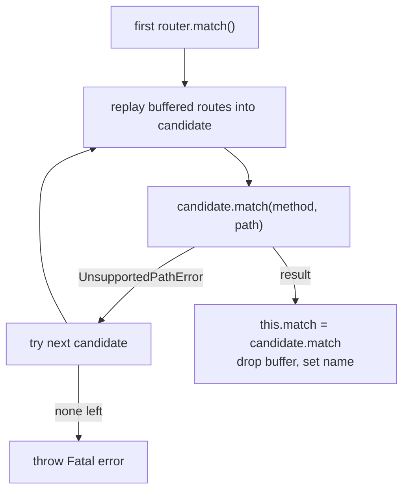

## Overview

Hono ships the same application class under three import paths: `hono`, `hono/quick` and `hono/tiny`. All three subclass `HonoBase`, so routing methods, `Context`, middleware and error handling behave the same. The only difference is the router each constructor assigns to `this.router`. A preset is a choice of trade-off between start-up cost, per-request matching speed and bundle size, fixed at import time.

Sources: [src/hono.ts:16-34](repo://src/hono.ts#L16-L34), [src/preset/quick.ts:1-24](repo://src/preset/quick.ts#L1-L24), [src/preset/tiny.ts:1-20](repo://src/preset/tiny.ts#L1-L20)

`HonoBase` has no router of its own and leaves `router` declared but unset. A preset must provide one. The three entry points are published as separate package exports, so a bundler only includes the routers the chosen preset imports.

Sources: [src/hono-base.ts:114-118](repo://src/hono-base.ts#L114-L118), [package.json:39-68](repo://package.json#L39-L68)

## Comparison

| Import | Router | Reported name | `router` option | Routes after first request |
| --- | --- | --- | --- | --- |
| `hono` | `SmartRouter` over `RegExpRouter` then `TrieRouter` | `SmartRouter + RegExpRouter` (or `+ TrieRouter`) | honoured | throws |
| `hono/quick` | `SmartRouter` over `LinearRouter` then `TrieRouter` | `SmartRouter + LinearRouter` (or `+ TrieRouter`) | ignored | throws |
| `hono/tiny` | `PatternRouter` | `PatternRouter` | ignored | allowed |

Sources: [src/hono.ts:26-33](repo://src/hono.ts#L26-L33), [src/preset/quick.ts:18-23](repo://src/preset/quick.ts#L18-L23), [src/preset/tiny.ts:16-19](repo://src/preset/tiny.ts#L16-L19), [src/router/smart-router/router.ts:13-61](repo://src/router/smart-router/router.ts#L13-L61)

```ts
import { Hono } from 'hono'        // default: fast matching, larger bundle
// import { Hono } from 'hono/quick' // fast registration for per-request start-up
// import { Hono } from 'hono/tiny'  // smallest bundle

const app = new Hono()
app.get('/posts/:id', (c) => c.text(c.req.param('id')))
```

Sources: [src/hono.ts:16-34](repo://src/hono.ts#L16-L34), [src/preset/quick.ts:13-24](repo://src/preset/quick.ts#L13-L24), [src/preset/tiny.ts:11-20](repo://src/preset/tiny.ts#L11-L20)

## How SmartRouter picks a router

### Selection on first match

Both `hono` and `hono/quick` wrap their routers in `SmartRouter`. Its `add()` only buffers `[method, path, handler]` tuples. On the first `match()`, it tries each candidate router in order:

Sources: [src/router/smart-router/router.ts:4-61](repo://src/router/smart-router/router.ts#L4-L61), [src/router.ts:100-103](repo://src/router.ts#L100-L103)

1. Replay every buffered route into the candidate with `router.add(...)`.
2. Call `router.match(method, path)`.
3. If the candidate throws `UnsupportedPathError`, move on to the next one. Any other error is re-thrown.
4. On success, replace `this.match` with the candidate's bound `match` and keep only that router. The buffer is dropped (`#routes = undefined`) and `name` becomes `SmartRouter + <name>`.

Sources: [src/router/smart-router/router.ts:4-61](repo://src/router/smart-router/router.ts#L4-L61), [src/router.ts:100-103](repo://src/router.ts#L100-L103)



Sources: [src/router/smart-router/router.ts:21-61](repo://src/router/smart-router/router.ts#L21-L61)

### Consequences

Because the buffer is gone after the first match, a later `app.get()` reaches `SmartRouter.add` with `#routes` undefined. It throws `Can not add a route since the matcher is already built.` Register every route before serving the first request, including routes added through `app.route()` and `app.mount()`. `activeRouter` exposes the chosen router and throws before the first match.

Sources: [src/router/smart-router/router.ts:13-19](repo://src/router/smart-router/router.ts#L13-L19), [src/router/smart-router/router.ts:63-69](repo://src/router/smart-router/router.ts#L63-L69), [src/router.ts:18-22](repo://src/router.ts#L18-L22)

## The default preset: hono

`Hono` from `hono` uses `options.router` when given, and otherwise `new SmartRouter({ routers: [new RegExpRouter(), new TrieRouter()] })`. `RegExpRouter` collects routes per method during `add()`. On the first `match()`, `buildAllMatchers()` compiles each method's routes into a single regular expression plus a static-path map. It then replaces `match` with a closure that does one map lookup or one regex execution per request.

Sources: [src/hono.ts:26-33](repo://src/hono.ts#L26-L33), [src/router/reg-exp-router/router.ts:122-222](repo://src/router/reg-exp-router/router.ts#L122-L222), [src/router/reg-exp-router/matcher.ts:10-33](repo://src/router/reg-exp-router/matcher.ts#L10-L33)

Some route sets cannot be expressed as one unambiguous expression. Examples are `/:user/entries` together with `/entry/:name`, or `/posts/:id` with `/:id/:action`. When it meets one, `RegExpRouter` throws `UnsupportedPathError` while compiling on the first match, and `SmartRouter` silently falls back to `TrieRouter`, which handles every pattern. The internals are covered in [[RegExpRouter Internals]] and [[Router Implementations]].

Sources: [src/router/reg-exp-router/router.ts:43-66](repo://src/router/reg-exp-router/router.ts#L43-L66), [src/router/trie-router/router.ts:5-28](repo://src/router/trie-router/router.ts#L5-L28)

This preset suits long-running servers and runtimes that reuse an isolate across requests. The one-off compile cost is paid on the first request, and every later request gets the fastest matching.

Sources: [src/router/reg-exp-router/matcher.ts:10-33](repo://src/router/reg-exp-router/matcher.ts#L10-L33)

## hono/quick

`hono/quick` swaps `RegExpRouter` for `LinearRouter`. `LinearRouter.add` only pushes the route onto an array, after `checkOptionalParameter` has expanded optional parameters such as `/:type?`. Nothing is compiled. `match` walks the whole array on every request and compares static paths, wildcard parts and labels directly. Registration is close to free, and matching cost grows with the number of routes.

Sources: [src/preset/quick.ts:13-24](repo://src/preset/quick.ts#L13-L24), [src/router/linear-router/router.ts:11-60](repo://src/router/linear-router/router.ts#L11-L60)

`LinearRouter` throws `UnsupportedPathError` when a route for the requested method combines a label and a wildcard, such as `/:id/*`. On the first request that falls back to `TrieRouter`. Choose this preset when the app is built for each request or each short-lived isolate, so that start-up time matters more than per-request matching.

Sources: [src/router/linear-router/router.ts:125-144](repo://src/router/linear-router/router.ts#L125-L144)

> [!WARNING]
> The `hono/quick` and `hono/tiny` constructors assign `this.router` unconditionally after `super(options)`. A `router` passed in the options is overwritten without warning. To pick a router yourself, import `Hono` from `hono`.

Sources: [src/hono-base.ts:170-173](repo://src/hono-base.ts#L170-L173), [src/preset/quick.ts:18-23](repo://src/preset/quick.ts#L18-L23), [src/preset/tiny.ts:16-19](repo://src/preset/tiny.ts#L16-L19)

## hono/tiny

`hono/tiny` uses `PatternRouter` alone, without `SmartRouter`. `add()` turns each route into one `RegExp` straight away. Labels become named groups such as `(?<id>[^/]+)`, or the custom pattern in `:id{...}`. A trailing `/*` drops the end anchor, and a trailing `?` also registers the path without its last segment. `match()` runs every route's regex for the method, in order, and returns the named groups as parameters.

Sources: [src/preset/tiny.ts:11-20](repo://src/preset/tiny.ts#L11-L20), [src/router/pattern-router/router.ts:8-60](repo://src/router/pattern-router/router.ts#L8-L60)

There is no fallback. If the generated expression is invalid, `PatternRouter` throws `UnsupportedPathError` from `add()`, so the error surfaces at the `app.get()` call. Because nothing is frozen after the first match, routes can still be added while the app is serving. Choose this preset when bundle size matters most and the route table is small.

Sources: [src/router/pattern-router/router.ts:33-41](repo://src/router/pattern-router/router.ts#L33-L41)

## Choosing and checking a router

With the default preset, pass any `Router<[H, RouterRoute]>` as `router`. That can be a single router, for example to skip the selection step, or your own `SmartRouter` list. `getRouterName(app)` from `hono/dev` runs a dummy `match('GET', '/')` to force selection and returns `router.name`. Note that this freezes a `SmartRouter`.

Sources: [src/hono-base.ts:55-65](repo://src/hono-base.ts#L55-L65), [src/helper/dev/index.ts:76-79](repo://src/helper/dev/index.ts#L76-L79)

```ts
import { Hono } from 'hono'
import { RegExpRouter } from 'hono/router/reg-exp-router'
import { getRouterName } from 'hono/dev'

const app = new Hono({ router: new RegExpRouter() })
app.get('/', (c) => c.text('Hi'))
console.log(getRouterName(app)) // 'RegExpRouter'
```

Sources: [src/hono-base.ts:55-65](repo://src/hono-base.ts#L55-L65), [src/helper/dev/index.ts:76-79](repo://src/helper/dev/index.ts#L76-L79)
