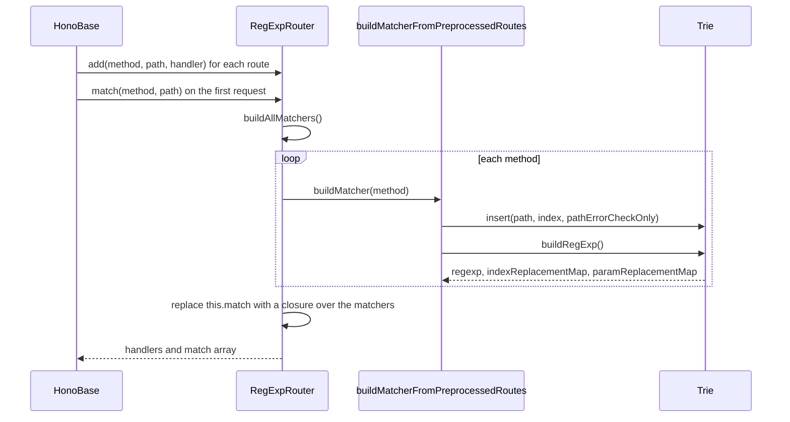

## Overview

`RegExpRouter` is the first router the default `Hono` app tries. Instead of walking a tree per request, it compiles all routes of one HTTP method into a single regular expression the first time a request arrives. Matching a request is then one map lookup for static paths, or one `String.prototype.match` call plus an array lookup for dynamic ones, whatever the number of routes.

Sources: [src/hono.ts:26-33](repo://src/hono.ts#L26-L33), [src/router/reg-exp-router/matcher.ts:10-33](repo://src/router/reg-exp-router/matcher.ts#L10-L33)

The price is expressiveness: one regular expression can report only one winning alternative, so route sets where a path could end in two different places are refused with `UnsupportedPathError`, and the `SmartRouter` falls back to `TrieRouter` (see [[Router Implementations]]). `PreparedRegExpRouter` goes one step further and moves the compilation to build time.

Sources: [src/router/reg-exp-router/router.ts:60-65](repo://src/router/reg-exp-router/router.ts#L60-L65), [src/router/smart-router/router.ts:34-44](repo://src/router/smart-router/router.ts#L34-L44), [src/router/reg-exp-router/index.ts:6-7](repo://src/router/reg-exp-router/index.ts#L6-L7)

## Lifecycle

### From add to first match

The router has two phases. While routes are being registered, `add` only fills two per-method dictionaries, `#middleware` (paths ending in `*`) and `#routes` (everything else). The first `match` call runs `buildAllMatchers`, which compiles one `Matcher` per method, frees both dictionaries and the wildcard cache, and replaces `this.match` with a closure over the compiled matchers.

Sources: [src/router/reg-exp-router/router.ts:122-130](repo://src/router/reg-exp-router/router.ts#L122-L130), [src/router/reg-exp-router/router.ts:206-222](repo://src/router/reg-exp-router/router.ts#L206-L222), [src/router/reg-exp-router/matcher.ts:10-33](repo://src/router/reg-exp-router/matcher.ts#L10-L33)



Sources: [src/router/reg-exp-router/router.ts:34-103](repo://src/router/reg-exp-router/router.ts#L34-L103), [src/router/reg-exp-router/router.ts:208-251](repo://src/router/reg-exp-router/router.ts#L208-L251), [src/router/reg-exp-router/trie.ts:10-73](repo://src/router/reg-exp-router/trie.ts#L10-L73)

Calling `add` after the first match throws `MESSAGE_MATCHER_IS_ALREADY_BUILT`, because the dictionaries no longer exist.

Sources: [src/router/reg-exp-router/router.ts:132-138](repo://src/router/reg-exp-router/router.ts#L132-L138)

## Registering routes

### Method tables

The first time a method is seen, `add` creates its entry in both dictionaries and copies every path already registered under `ALL`, so a `GET` table starts with all `app.all()` routes and middleware. `/*` is normalized to `*`.

Sources: [src/router/reg-exp-router/router.ts:140-151](repo://src/router/reg-exp-router/router.ts#L140-L151)

Each handler is stored as `[handler, paramCount]`, where `paramCount` is the number of `/:` in its own path. The count matters later: a middleware on `/users/:id/*` that ends up in the list for `/users/:id/posts/:postId` must only receive the `id` parameter.

Sources: [src/router/reg-exp-router/router.ts:14-17](repo://src/router/reg-exp-router/router.ts#L14-L17), [src/router/reg-exp-router/router.ts:153-155](repo://src/router/reg-exp-router/router.ts#L153-L155), [src/router/reg-exp-router/router.ts:71-79](repo://src/router/reg-exp-router/router.ts#L71-L79)

### Middleware paths

For a path ending in `*`, `add` builds a regular expression for it with `buildWildcardRegExp` (`*` alone becomes an empty, match-all regexp; a trailing `/*` becomes `(?:|/.*)`; metacharacters are escaped) and caches it in `wildcardRegExpCache`. It then:

Sources: [src/router/reg-exp-router/router.ts:19-27](repo://src/router/reg-exp-router/router.ts#L19-L27), [src/router/reg-exp-router/router.ts:155-156](repo://src/router/reg-exp-router/router.ts#L155-L156)

1. Creates the middleware list for that path, pre-filled with the handlers of the most specific existing middleware path that covers it (`findMiddleware` tries keys longest first).
2. Appends the handler to every middleware list whose path the wildcard matches.
3. Appends the handler to every route list whose path the wildcard matches.

Sources: [src/router/reg-exp-router/router.ts:19-32](repo://src/router/reg-exp-router/router.ts#L19-L32), [src/router/reg-exp-router/router.ts:105-120](repo://src/router/reg-exp-router/router.ts#L105-L120), [src/router/reg-exp-router/router.ts:155-187](repo://src/router/reg-exp-router/router.ts#L155-L187)

### Normal paths

Other paths are first expanded by `checkOptionalParameter`. For each resulting path, the route list is created from the matching middleware list (or empty), then the handler is appended. Middleware registered before a route is therefore copied in front of it, and middleware registered after it is appended by step 3 above, so every list is already in execution order. For expanded optional paths the stored `paramCount` is reduced (`paramCount - len + i + 1`) so the shorter variant does not expect the missing parameter.

Sources: [src/router/reg-exp-router/router.ts:189-204](repo://src/router/reg-exp-router/router.ts#L189-L204)

## Building the matcher

### Collecting routes per method

`#buildMatcher(method)` concatenates the method's middleware and route entries. If the method has no entries of its own in one dictionary, it uses the `ALL` entries instead. A method without any own route returns `null`, and `match` later falls back to the `ALL` matcher for it.

Sources: [src/router/reg-exp-router/router.ts:224-251](repo://src/router/reg-exp-router/router.ts#L224-L251)

### Static and dynamic paths

`buildMatcherFromPreprocessedRoutes` flags each path as static when it contains neither `*` nor `/:`, then sorts dynamic paths first, shortest first, and static paths last. Static paths go straight into `staticMap` with empty params, and are only inserted into the trie with `pathErrorCheckOnly = true` so that conflicts with dynamic routes are detected. Dynamic paths receive a sequential index `j` and are inserted for real; the `ParamAssocArray` the trie returns is turned into a `ParamIndexMap` per handler, keeping only the first `paramCount` entries.

Sources: [src/router/reg-exp-router/router.ts:34-80](repo://src/router/reg-exp-router/router.ts#L34-L80)

### The trie

`Trie.insert` tokenizes a path character by character, except that each `:label` (with its `{regexp}`) and a trailing `/*` are single tokens. Brace groups are replaced by `@\N` marks before tokenizing so that a `/` inside a custom regexp does not split the token, then restored.

Sources: [src/router/reg-exp-router/trie.ts:10-47](repo://src/router/reg-exp-router/trie.ts#L10-L47)

`Node.insert` maps each token to a child. A pattern token's child is keyed by its regexp source: `[^/]+` for `:label`, the custom regexp for `:label{...}`, `.*` for a final `*`, `(?:|/.*)` for a trailing `/*`. A named parameter node receives a `#varIndex` from the shared context counter, and the `[name, varIndex]` pair is pushed to the path's `paramMap`. The leaf stores the route index in `#index`.

Sources: [src/router/reg-exp-router/node.ts:1-9](repo://src/router/reg-exp-router/node.ts#L1-L9), [src/router/reg-exp-router/node.ts:45-133](repo://src/router/reg-exp-router/node.ts#L45-L133)

`buildRegExpStr` serializes the tree recursively. Children are sorted by `compareKey`: literal characters, then custom patterns (longer first), then `[^/]+`, then wildcards. A parameter child becomes `(regexp)@varIndex`, a metacharacter is escaped, a leaf adds `#index`, and several alternatives are wrapped in `(?:a|b)`.

Sources: [src/router/reg-exp-router/node.ts:13-43](repo://src/router/reg-exp-router/node.ts#L13-L43), [src/router/reg-exp-router/node.ts:135-161](repo://src/router/reg-exp-router/node.ts#L135-L161)

### Capture-group bookkeeping

`Trie.buildRegExp` rewrites the markers while counting capture groups from left to right. Each `#index` becomes `$()`, an end anchor followed by an empty capture group; its group number is recorded in `indexReplacementMap`. Each `@varIndex` is removed and the group number of the preceding parameter group is recorded in `paramReplacementMap`. The result is anchored with `^`.

Sources: [src/router/reg-exp-router/trie.ts:49-73](repo://src/router/reg-exp-router/trie.ts#L49-L73)

The builder then rewrites every `ParamIndexMap` value from a `varIndex` to the capture-group number, and builds `handlerMap` so that `handlerMap[groupNumber]` is the handler list of the route whose `$()` group has that number. The `Matcher` is the tuple `[regexp, handlerMap, staticMap]`.

Sources: [src/router/reg-exp-router/router.ts:82-103](repo://src/router/reg-exp-router/router.ts#L82-L103), [src/router/reg-exp-router/matcher.ts:4-7](repo://src/router/reg-exp-router/matcher.ts#L4-L7)

### Worked example

For an `ALL` middleware on `*` plus `GET /users/:id`, `GET /users/:id/posts/:postId` and `GET /static`, the `GET` matcher compiles to the following parts.

Sources: [src/router/reg-exp-router/router.ts:34-103](repo://src/router/reg-exp-router/router.ts#L34-L103), [src/router/reg-exp-router/trie.ts:49-73](repo://src/router/reg-exp-router/trie.ts#L49-L73)

```text
regexp:     /^(?:\/users\/([^/]+)(?:$()|\/posts\/([^/]+)$())|.*$())/
handlerMap: [ , , [[mw,{}],[getUser,{id:1}]], , [[mw,{}],[getPost,{postId:3,id:1}]], [[mw,{}]] ]
staticMap:  { "/static": [[[mw,{}],[static,{}]], []] }
```

Sources: [src/router/reg-exp-router/node.ts:135-161](repo://src/router/reg-exp-router/node.ts#L135-L161), [src/router/reg-exp-router/trie.ts:59-72](repo://src/router/reg-exp-router/trie.ts#L59-L72)

## Matching

The `match` function in `matcher.ts` is shared by both routers. On a request it picks `matchers[method]`, or `matchers.ALL` when the method has no matcher, then:

Sources: [src/router/reg-exp-router/matcher.ts:10-15](repo://src/router/reg-exp-router/matcher.ts#L10-L15), [src/router/reg-exp-router/prepared-router.ts:88-93](repo://src/router/reg-exp-router/prepared-router.ts#L88-L93)

1. Returns `staticMap[path]` when present, a precomputed `Result`.
2. Otherwise runs `path.match(regexp)`; no match returns `[[], emptyParam]`.
3. Finds the first empty string after the full match with `match.indexOf('', 1)`. Only the `$()` group of the alternative that matched captured `''` (groups of other alternatives are `undefined`, and a default `[^/]+` parameter group is never empty), so this index is the winning route's group number.
4. Returns `[handlerMap[index], match]`: the match array is the `ParamStash`, and each handler's `ParamIndexMap` points into it.

Sources: [src/router/reg-exp-router/matcher.ts:9-33](repo://src/router/reg-exp-router/matcher.ts#L9-L33)

With the example above, `/users/1/posts/2` yields the match array `['/users/1/posts/2', '1', undefined, '2', '']`; index 4 selects `getPost`, whose map `{ postId: 3, id: 1 }` resolves to `'2'` and `'1'` through `HonoRequest`.

Sources: [src/router/reg-exp-router/matcher.ts:22-28](repo://src/router/reg-exp-router/matcher.ts#L22-L28), [src/request.ts:106-128](repo://src/request.ts#L106-L128)

## UnsupportedPathError

### When paths are refused

`Node.insert` throws the private `PATH_ERROR` symbol, which `buildMatcherFromPreprocessedRoutes` converts to `new UnsupportedPathError(path)`. Because it is thrown while building on the first `match`, `SmartRouter` catches it and retries the whole route set with the next router.

Sources: [src/router/reg-exp-router/node.ts:1-4](repo://src/router/reg-exp-router/node.ts#L1-L4), [src/router/reg-exp-router/router.ts:60-65](repo://src/router/reg-exp-router/router.ts#L60-L65), [src/router/smart-router/router.ts:34-44](repo://src/router/smart-router/router.ts#L34-L44)

| Condition | Example that triggers it |
| --- | --- |
| Two routes end at the same trie node | `/users/:id` and `/users/:name` |
| A pattern child is added where a non-wildcard child exists | `/users/:id` and `/users/:id{[0-9]+}`; `/:a{[a-z]+}` and `/:b{[0-9]+}` |
| A literal child is added where a pattern child exists | `/users/me` and `/users/:id` (static check); `/u/:id` and `/u/me/x` |
| A named parameter uses `.*` | `/u/:p{.*}` |
| A custom regexp contains a capturing group | `/u/:id{x(a)}` |

Sources: [src/router/reg-exp-router/node.ts:57-67](repo://src/router/reg-exp-router/node.ts#L57-L67), [src/router/reg-exp-router/node.ts:80-130](repo://src/router/reg-exp-router/node.ts#L80-L130)

The capturing-group rule has one exception: a custom regexp that is a single group from start to end, such as `:type{(jpg|png)}`, is rewritten to the non-capturing `(?:jpg|png)` before the check, while a group after a prefix, such as `:id{x(a|b)}`, is refused.

Sources: [src/router/reg-exp-router/node.ts:83-91](repo://src/router/reg-exp-router/node.ts#L83-L91)

All of these are cases where one request could legitimately end in two routes, or where an extra capturing group would shift the group numbering the matcher relies on. Routes that merely share a parameter prefix, such as `/users/:id/a` and `/users/:name/b`, are accepted because the trie reuses the same `[^/]+` node.

Sources: [src/router/reg-exp-router/node.ts:94-113](repo://src/router/reg-exp-router/node.ts#L94-L113), [src/router/reg-exp-router/trie.ts:59-70](repo://src/router/reg-exp-router/trie.ts#L59-L70)

> [!TIP]
> If an application's hot path must stay on `RegExpRouter`, check `app.router.name` after the first request: `SmartRouter + TrieRouter` means one of the conditions above was hit.

Sources: [src/router/smart-router/router.ts:57-58](repo://src/router/smart-router/router.ts#L57-L58)

## PreparedRegExpRouter

### Why it exists

Compiling the matchers costs time on the first request, which is noticeable on platforms that start a fresh isolate often. `PreparedRegExpRouter` takes the compiled matchers as constructor input, so the runtime only has to place handlers into precomputed slots. Its `buildAllMatchers` returns those matchers unchanged and it reuses the same `match` function.

Sources: [src/router/reg-exp-router/prepared-router.ts:9-17](repo://src/router/reg-exp-router/prepared-router.ts#L9-L17), [src/router/reg-exp-router/prepared-router.ts:88-93](repo://src/router/reg-exp-router/prepared-router.ts#L88-L93)

### Build step

`buildInitParams({ paths })` registers every path under `ALL` in a `RegExpRouter` subclass, using the path string itself as the handler, and exports the matchers. It then scans the `ALL` matcher to build a `RelocateMap`: for each path, the `handlerMap` indexes (numbers) and `staticMap` keys (strings, `''` meaning the path itself) where its handler appears, together with its `ParamIndexMap`. Finally it empties all handler lists. `serializeInitParams` turns the result into JavaScript source, embedding each `RegExp` as a literal via a `##...##` placeholder in `JSON.stringify`.

Sources: [src/router/reg-exp-router/prepared-router.ts:95-165](repo://src/router/reg-exp-router/prepared-router.ts#L95-L165)

### Runtime

`add(method, path, handler)` first clones the `ALL` matcher for a method it has not seen. `*` and `/*` are added to every handler list via `#addWildcard`. Any other path is looked up in the relocate map and pushed into each recorded slot by `#addPath`; a path that was not in the build-time list throws `Path ${path} is not registered`.

Sources: [src/router/reg-exp-router/prepared-router.ts:19-86](repo://src/router/reg-exp-router/prepared-router.ts#L19-L86)

```ts
import {
  PreparedRegExpRouter,
  buildInitParams,
  serializeInitParams,
} from 'hono/router/reg-exp-router'

// build time: compute the constructor arguments and emit them as source code
const source = serializeInitParams(buildInitParams({ paths: ['*', '/hello', '/users/:id'] }))

// runtime: `params` is the value of the generated source, e.g. `eval(source)` in the tests
const params = eval(source) as ConstructorParameters<typeof PreparedRegExpRouter>
const router = new PreparedRegExpRouter(...params)
router.add('GET', '/hello', handler)
```

Sources: [src/router/reg-exp-router/prepared-router.ts:95-97](repo://src/router/reg-exp-router/prepared-router.ts#L95-L97), [src/router/reg-exp-router/prepared-router.ts:156-165](repo://src/router/reg-exp-router/prepared-router.ts#L156-L165), [src/router/reg-exp-router/prepared-router.test.ts:25-50](repo://src/router/reg-exp-router/prepared-router.test.ts#L25-L50)

> [!NOTE]
> The prepared matchers are built from the path list alone, so the same restrictions as `RegExpRouter` apply, and the path strings passed to `add` must be exactly those passed to `buildInitParams`.

Sources: [src/router/reg-exp-router/prepared-router.ts:73-76](repo://src/router/reg-exp-router/prepared-router.ts#L73-L76), [src/router/reg-exp-router/prepared-router.ts:103-108](repo://src/router/reg-exp-router/prepared-router.ts#L103-L108)
