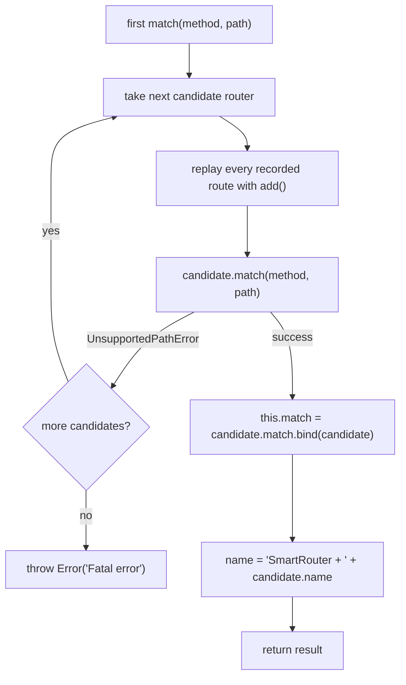

## Overview

Hono separates "which handlers run for this request" from everything else. The application never walks routes itself: every `app.get()`, `app.use()` or `app.on()` call ends in `router.add(method, path, [handler, route])`, and every request ends in one `router.match(method, path)` call whose result is handed to the composer. Because the contract is that small, Hono ships five interchangeable routers with different trade-offs between registration cost, matching speed, bundle size and supported path syntax.

Sources: [src/hono-base.ts:385-397](repo://src/hono-base.ts#L385-L397), [src/hono-base.ts:406-425](repo://src/hono-base.ts#L406-L425)

The default `Hono` class wraps `RegExpRouter` and `TrieRouter` in a `SmartRouter`; a custom router can be passed through the `router` option. The `hono/quick` and `hono/tiny` presets swap in `LinearRouter` and `PatternRouter` (see [[Presets]]). How the request reaches the router is covered in [[The Hono Application]]; the internals of the default fast path are in [[RegExpRouter Internals]].

Sources: [src/hono.ts:26-33](repo://src/hono.ts#L26-L33), [src/hono-base.ts:55-65](repo://src/hono-base.ts#L55-L65), [src/preset/quick.ts:13-24](repo://src/preset/quick.ts#L13-L24), [src/preset/tiny.ts:11-20](repo://src/preset/tiny.ts#L11-L20)

## The Router interface

### Contract

A router is any object with a `name` and two methods. `add` receives the upper-cased method (or `ALL` for `app.all()` and middleware) and the full path after the base path has been merged in. `match` receives the request method and the path returned by `getPath`.

Sources: [src/router.ts:29-52](repo://src/router.ts#L29-L52), [src/hono-base.ts:385-395](repo://src/hono-base.ts#L385-L395)

```ts
export interface Router<T> {
  name: string
  add(method: string, path: string, handler: T): void
  match(method: string, path: string): Result<T>
}
```

Sources: [src/router.ts:29-52](repo://src/router.ts#L29-L52)

The module also exports the constants every router relies on.

Sources: [src/router.ts:1-22](repo://src/router.ts#L1-L22)

| Export | Value | Purpose |
| --- | --- | --- |
| `METHOD_NAME_ALL` | `'ALL'` | Method key for routes registered with `all()`/`use()`; every router treats it as matching any method. |
| `METHOD_NAME_ALL_LOWERCASE` | `'all'` | Lower-case form used for the `$all` key in route schemas. |
| `METHODS` | `['get', 'post', 'put', 'delete', 'options', 'patch']` | Methods that get a dedicated `app.<method>()` function. |
| `MESSAGE_MATCHER_IS_ALREADY_BUILT` | `'Can not add a route since the matcher is already built.'` | Error thrown by routers that compile on first match when `add` is called afterwards. |
| `UnsupportedPathError` | `class extends Error` | Thrown when a router cannot represent a path; `SmartRouter` uses it to fall back. |

Sources: [src/router.ts:9-22](repo://src/router.ts#L9-L22), [src/router.ts:100-103](repo://src/router.ts#L100-L103)

### The Result shape

`Result<T>` has two forms so that each router can return parameters in the cheapest way it knows. The first form, used by `RegExpRouter`, pairs every handler with a `ParamIndexMap` (parameter name to an index) and appends one shared `ParamStash` array (the regular-expression match). The second form, used by `TrieRouter`, `LinearRouter` and `PatternRouter`, pairs every handler with a ready `Params` object. Handlers appear in the order they must run: middleware and handlers interleaved by registration order.

Sources: [src/router.ts:54-98](repo://src/router.ts#L54-L98)

```ts
export type Result<T> = [[T, ParamIndexMap][], ParamStash] | [[T, Params][]]
```

Sources: [src/router.ts:97-98](repo://src/router.ts#L97-L98)

`HonoRequest` resolves a parameter by reading the current handler's map and, when a stash is present, using the stored value as an index into it. This is why `c.req.param()` works the same whatever router produced the result (see [[HonoRequest]]).

Sources: [src/request.ts:106-128](repo://src/request.ts#L106-L128)

## Path syntax

### Supported patterns

All five routers accept the same path language. Wildcards and parameters may be combined, but some routers reject some combinations (see the trade-offs table below).

Sources: [src/utils/url.ts:51-78](repo://src/utils/url.ts#L51-L78)

| Pattern | Example | Matches | Notes |
| --- | --- | --- | --- |
| Static | `/about` | `/about` | Exact comparison of the segments. |
| Named parameter | `/post/:id` | `/post/123` with `id = '123'` | Matches one segment, `[^/]+`. |
| Custom-regexp parameter | `/post/:id{[0-9]+}` | `/post/123` only | Text inside `{}` is a regular expression for the value. |
| Optional parameter | `/api/animals/:type?` | `/api/animals` and `/api/animals/dog` | Expanded into two routes before insertion. |
| Tail wildcard | `/files/*` | `/files`, `/files/a/b` | The trailing `/*` also matches the bare prefix. |
| Middle wildcard | `/a/*/c` | `/a/b/c` | Matches exactly one segment. |
| Match everything | `*` or `/*` | every path | Used by `app.use()` without a path. |

Sources: [src/utils/url.ts:51-78](repo://src/utils/url.ts#L51-L78), [src/utils/url.ts:171-206](repo://src/utils/url.ts#L171-L206), [src/router/trie-router/node.ts:136-163](repo://src/router/trie-router/node.ts#L136-L163)

### How patterns are parsed

`getPattern` turns one path segment into a `Pattern`: `'*'` for a wildcard, `[key, name, true]` for a plain `:name`, or `[key, name, RegExp]` for `:name{regexp}`. When a custom regexp is followed by a static segment, the regexp gets a look-ahead for that segment (`(?=/next)`) and the cache key includes it, so `/:file{.+}/edit` can let the value contain slashes and still stop before `/edit`. Results are cached in `patternCache` by `label#next`.

Sources: [src/utils/url.ts:50-78](repo://src/utils/url.ts#L50-L78)

`splitRoutingPath` must not split inside a `{...}` group because a custom regexp may contain `/`. `extractGroupsFromPath` replaces every brace group with a placeholder `@index`, the path is split on `/`, and `replaceGroupMarks` puts the original groups back into the segments that hold them.

Sources: [src/utils/url.ts:16-48](repo://src/utils/url.ts#L16-L48)

`checkOptionalParameter` handles a path ending in `?` that contains a parameter. It walks the segments, emits the path built so far each time it reaches an optional parameter, then emits the path including it, and deduplicates the list. `/api/animals/:type?` therefore becomes `['/api/animals', '/api/animals/:type']`, and a leading optional parameter yields `'/'` as the first path. `TrieRouter`, `LinearRouter` and `RegExpRouter` call it in `add`; `PatternRouter` strips the `?` and calls `add` recursively for the parent path.

Sources: [src/utils/url.ts:171-206](repo://src/utils/url.ts#L171-L206), [src/router/pattern-router/router.ts:12-20](repo://src/router/pattern-router/router.ts#L12-L20)

## SmartRouter

### Deferred selection

`SmartRouter` does not match anything itself. Its constructor takes an ordered list of candidate routers, and `add` only records `[method, path, handler]` tuples. Selection happens on the first `match` call: it replays all recorded routes into the first candidate and tries the match. If that router throws `UnsupportedPathError` (during `add` or `match`), it moves to the next candidate; any other error is re-thrown.

Sources: [src/router/smart-router/router.ts:4-44](repo://src/router/smart-router/router.ts#L4-L44)

Once a candidate succeeds, `SmartRouter` replaces its own `match` with the winner's bound `match`, keeps only that router, drops the recorded routes (`#routes = undefined`) and renames itself, for example `SmartRouter + RegExpRouter`. Every later request therefore calls the chosen router directly with no extra indirection. If no candidate accepts the routes, it throws `Fatal error`.

Sources: [src/router/smart-router/router.ts:46-61](repo://src/router/smart-router/router.ts#L46-L61)



Sources: [src/router/smart-router/router.ts:21-61](repo://src/router/smart-router/router.ts#L21-L61)

### Consequences

Adding a route after the first request fails: `add` throws `MESSAGE_MATCHER_IS_ALREADY_BUILT` once `#routes` is cleared. The `activeRouter` getter returns the winning router, and throws `No active router has been determined yet.` before the first match.

Sources: [src/router/smart-router/router.ts:13-19](repo://src/router/smart-router/router.ts#L13-L19), [src/router/smart-router/router.ts:63-69](repo://src/router/smart-router/router.ts#L63-L69)

> [!NOTE]
> With the default `Hono`, an application whose routes contain an ambiguity `RegExpRouter` cannot express (for example both `/post/:id` and `/post/:id{[0-9]+}`) silently ends up on `TrieRouter`; `app.router.name` reports `SmartRouter + TrieRouter` after the first request.

Sources: [src/hono.ts:28-32](repo://src/hono.ts#L28-L32), [src/router/reg-exp-router/node.ts:94-102](repo://src/router/reg-exp-router/node.ts#L94-L102)

## TrieRouter

### Insertion

`TrieRouter` stores routes in a tree of `Node` objects, one level per path segment. `add` expands optional parameters and calls `Node.insert` for each resulting path. `insert` splits the path with `splitRoutingPath`, and for each segment uses `getPattern` to derive the child key: the segment itself for static parts, or the pattern key for parameters and wildcards. A new pattern child is also pushed onto the parent's `#patterns` list. At the leaf, it appends a `{ [method]: { handler, possibleKeys, score } }` entry, where `score` is a counter incremented on every insertion and `possibleKeys` lists the parameter names along the path.

Sources: [src/router/trie-router/router.ts:5-28](repo://src/router/trie-router/router.ts#L5-L28), [src/router/trie-router/node.ts:44-85](repo://src/router/trie-router/node.ts#L44-L85)

### Search

`search` walks the request segments breadth-first, keeping a list of current nodes (`curNodes`) because several branches can match at once. For each node and segment it:

Sources: [src/router/trie-router/node.ts:114-135](repo://src/router/trie-router/node.ts#L114-L135)

1. Follows the static child with the same name; on the last segment it collects that child's handlers and those of its `*` child, so `/hello/*` also matches `/hello`.
2. Checks each pattern: a `*` pattern collects the wildcard child and keeps it in the next level, so a middle wildcard consumes one segment.
3. For a custom regexp, executes it against the rest of the path from the current segment (offsets are computed lazily into `partOffsets`). A match may span several segments, so the child is queued in `curNodesQueue` at the depth equal to the number of `/` consumed.
4. For a plain parameter (`matcher === true`) or a regexp that tests the single segment, records `params[name] = part` and either collects handlers (last segment) or descends.

Sources: [src/router/trie-router/node.ts:114-233](repo://src/router/trie-router/node.ts#L114-L233)

`#pushHandlerSets` copies the node's handler sets for the request method or `ALL`, filling each handler's `params` from its own `possibleKeys` so that routes see only their own parameter names. Finally the collected sets are sorted by `score`, restoring registration order across branches.

Sources: [src/router/trie-router/node.ts:87-112](repo://src/router/trie-router/node.ts#L87-L112), [src/router/trie-router/node.ts:237-244](repo://src/router/trie-router/node.ts#L237-L244)

TrieRouter never throws `UnsupportedPathError`, which is why it is the last candidate of the default `SmartRouter`: it supports every pattern, including duplicate or ambiguous parameter definitions at the same level.

Sources: [src/router/trie-router/node.ts:44-85](repo://src/router/trie-router/node.ts#L44-L85), [src/hono.ts:30-32](repo://src/hono.ts#L30-L32)

## LinearRouter

`LinearRouter` keeps a flat array of `[method, path, handler]` and does no preprocessing besides optional-parameter expansion, so registration is nearly free. That suits environments where the application is rebuilt per request (some serverless setups), which is what the `hono/quick` preset targets.

Sources: [src/router/linear-router/router.ts:11-23](repo://src/router/linear-router/router.ts#L11-L23), [src/preset/quick.ts:1-24](repo://src/preset/quick.ts#L1-L24)

`match` scans every route in order and, for those whose method equals the request method or `ALL`, picks one of four strategies from the route string:

Sources: [src/router/linear-router/router.ts:25-30](repo://src/router/linear-router/router.ts#L25-L30)

| Route shape | Strategy |
| --- | --- |
| `*` or `/*` | Always matches with empty params. |
| No `*`, no `:` | Equality with the path, or with the path minus a trailing slash. |
| `*` but no `:` | Split on `*` and check each piece with `indexOf` at the current position; a middle `*` skips to the next `/`. |
| `:` but no `*` | Tokenize with `splitPathRe`, read each `:name` up to the next `/`, or run its `{regexp}` (with a look-ahead for the next static part) using the `d` flag to get indices. |
| `:` and `*` | Throws `UnsupportedPathError`. |

Sources: [src/router/linear-router/router.ts:25-143](repo://src/router/linear-router/router.ts#L25-L143)

Because the mixed case only throws inside `match`, `SmartRouter` catches it on the first request and falls back to `TrieRouter`, which is how `hono/quick` still supports such paths. Duplicate names keep the first captured value (`params[name] ||= value`).

Sources: [src/router/linear-router/router.ts:115-116](repo://src/router/linear-router/router.ts#L115-L116), [src/router/linear-router/router.ts:136-138](repo://src/router/linear-router/router.ts#L136-L138), [src/preset/quick.ts:20-22](repo://src/preset/quick.ts#L20-L22)

## PatternRouter

`PatternRouter` is the smallest implementation. `add` compiles each route into its own anchored `RegExp`: parameters become named groups `(?<name>...)` defaulting to `[^/]+`, a middle `/*` becomes `/[^/]+`, other characters are escaped, and the expression ends with `/?$` unless the route ends with a wildcard. A pattern the `RegExp` constructor rejects raises `UnsupportedPathError`.

Sources: [src/router/pattern-router/router.ts:8-42](repo://src/router/pattern-router/router.ts#L8-L42)

`match` loops over every compiled route, executes the regexp when the method matches, and uses `match.groups` as the params object. The `hono/tiny` preset uses it directly, without a `SmartRouter`, so a rejected pattern surfaces as an error at registration time.

Sources: [src/router/pattern-router/router.ts:44-59](repo://src/router/pattern-router/router.ts#L44-L59), [src/preset/tiny.ts:11-20](repo://src/preset/tiny.ts#L11-L20)

> [!WARNING]
> `LinearRouter` and `PatternRouter` treat a tail wildcard as a plain prefix: `/files/*` also matches `/filesabc`, whereas `RegExpRouter` and `TrieRouter` require a `/` after the prefix.

Sources: [src/router/linear-router/router.ts:41-69](repo://src/router/linear-router/router.ts#L41-L69), [src/router/pattern-router/router.ts:13-16](repo://src/router/pattern-router/router.ts#L13-L16), [src/router/pattern-router/router.ts:33-38](repo://src/router/pattern-router/router.ts#L33-L38)

## Choosing a router

### Trade-offs

| Router | Build cost | Match cost | Path support | Typical use |
| --- | --- | --- | --- | --- |
| `RegExpRouter` | Compiles one regexp per method on first match | One regexp execution, or a map lookup for static paths | Rejects ambiguous or duplicate parameters at the same position | Fastest matching for long-lived apps. |
| `TrieRouter` | Tree insertion per route | Tree walk, proportional to segments and branches | Everything | Fallback when `RegExpRouter` refuses. |
| `SmartRouter` | Defers to candidates on first match | Same as the chosen router | Union of candidates | Default `Hono` (`RegExpRouter`, `TrieRouter`). |
| `LinearRouter` | Push to an array | Linear scan of all routes | Throws for routes with both `:` and `*` | `hono/quick`, apps built per request. |
| `PatternRouter` | One regexp per route | Linear scan executing regexps | Anything `RegExp` accepts | `hono/tiny`, smallest bundle. |

Sources: [src/router/reg-exp-router/router.ts:122-222](repo://src/router/reg-exp-router/router.ts#L122-L222), [src/router/trie-router/node.ts:44-85](repo://src/router/trie-router/node.ts#L44-L85), [src/router/trie-router/node.ts:114-233](repo://src/router/trie-router/node.ts#L114-L233), [src/router/smart-router/router.ts:4-70](repo://src/router/smart-router/router.ts#L4-L70), [src/router/linear-router/router.ts:25-143](repo://src/router/linear-router/router.ts#L25-L143), [src/router/pattern-router/router.ts:8-60](repo://src/router/pattern-router/router.ts#L8-L60)

### Passing a router

Each router has its own export path (`hono/router/reg-exp-router`, `hono/router/trie-router`, `hono/router/smart-router`, `hono/router/linear-router`, `hono/router/pattern-router`) so that an app bundles only the one it uses.

Sources: [package.json:284-313](repo://package.json#L284-L313)

```ts
import { Hono } from 'hono'
import { SmartRouter } from 'hono/router/smart-router'
import { LinearRouter } from 'hono/router/linear-router'
import { TrieRouter } from 'hono/router/trie-router'

const app = new Hono({
  router: new SmartRouter({ routers: [new LinearRouter(), new TrieRouter()] }),
})
```

Sources: [src/hono-base.ts:55-65](repo://src/hono-base.ts#L55-L65), [src/router/smart-router/router.ts:9-11](repo://src/router/smart-router/router.ts#L9-L11)

A custom router only has to implement `add` and `match` and return one of the two `Result` forms. Throwing `UnsupportedPathError` lets it sit in front of a more general router inside `SmartRouter`.

Sources: [src/router.ts:29-103](repo://src/router.ts#L29-L103), [src/router/smart-router/router.ts:39-44](repo://src/router/smart-router/router.ts#L39-L44)
