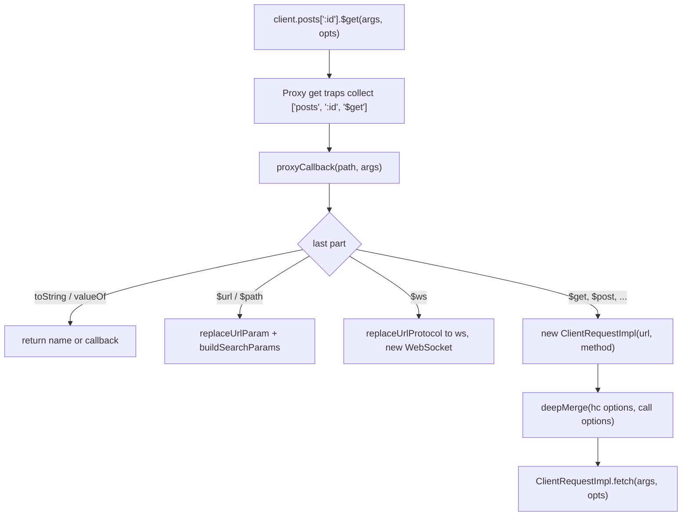

## Overview

The RPC client `hc` turns the type of a Hono application into a typed HTTP client. The server and the client share no runtime code: the server exports only a TypeScript type, and `hc` is a small `Proxy` that converts property access such as `client.posts[':id'].$get(...)` into a `fetch` call. All the safety comes from types computed from the app's route schema.

Sources: [src/client/client.ts:15-31](repo://src/client/client.ts#L15-L31), [src/client/client.ts:133-232](repo://src/client/client.ts#L133-L232), [src/client/types.ts:294-318](repo://src/client/types.ts#L294-L318)

The module `hono/client` exports `hc`, `parseResponse`, `DetailedError` and the helper types.

Sources: [src/client/index.ts:6-17](repo://src/client/index.ts#L6-L17)

## Exporting route types

### How the schema is built

Every route method on a Hono app returns the app with a wider type parameter `S`. `ToSchema` adds an entry keyed by the full path and by the method prefixed with `$`, holding an `Endpoint`: the `input` (from validators and path parameters), the `output`, the `outputFormat` (`json`, `text`, `redirect`...) and the `status`. Output, format and status come from the `TypedResponse` that `c.json()`, `c.text()` and similar helpers return.

Sources: [src/types.ts:2500-2535](repo://src/types.ts#L2500-L2535), [src/types.ts:2546-2551](repo://src/types.ts#L2546-L2551), [src/types.ts:2632-2647](repo://src/types.ts#L2632-L2647)

Because the schema lives in the return type, routes must be chained (or assigned from chained calls) for the type to be kept. Validators contribute the `input` type and any error responses they can return (see [[Validator]]).

Sources: [src/types.ts:150-165](repo://src/types.ts#L150-L165)

```ts
// server.ts
const route = app
  .get('/posts/:id', (c) => c.json({ id: c.req.param('id') }))
  .post('/posts', validator('json', (v) => v as { title: string }), (c) =>
    c.json({ ok: true }, 201)
  )

export type AppType = typeof route

// client.ts
import { hc } from 'hono/client'
import type { AppType } from './server'

const client = hc<AppType>('http://localhost:8787/')
const res = await client.posts[':id'].$get({ param: { id: '1' } })
```

Sources: [src/client/client.ts:133-136](repo://src/client/client.ts#L133-L136), [src/types.ts:2500-2530](repo://src/types.ts#L2500-L2530)

### From schema to client type

`Client<T, Prefix>` extracts the schema `S` from the app type and maps each path key through `PathToChain`, which splits the path on `/` into nested properties. An empty last segment, as produced by `/`, becomes the property `index`. The leaf is a `ClientRequest` whose keys are the schema's `$method` names.

Sources: [src/client/types.ts:294-318](repo://src/client/types.ts#L294-L318)

`ClientRequest` builds each method signature from the endpoint's `input`: when the input has required keys the `args` parameter is mandatory, otherwise optional. A `$all` entry is expanded by `ExpandAllMethod` into all six standard methods. `$url` and `$path` are always present, and `$ws` is added when the `$get` endpoint's `outputFormat` is `ws`.

Sources: [src/client/types.ts:8-26](repo://src/client/types.ts#L8-L26), [src/client/types.ts:67-118](repo://src/client/types.ts#L67-L118)

## The proxy

### Resolving a call

`createProxy` wraps an empty function in a `Proxy`. Its `get` trap returns a new proxy with the property name appended to `path`, and its `apply` trap calls the callback with the collected path and the call arguments. The key `then` and non-string keys return `undefined`, so a client object is never mistaken for a promise by `await`.

Sources: [src/client/client.ts:15-31](repo://src/client/client.ts#L15-L31)

When a call happens, `proxyCallback` in `hc` inspects the last path parts:

Sources: [src/client/client.ts:137-141](repo://src/client/client.ts#L137-L141)

1. `toString` and `valueOf` are answered directly; `client.somePath.name.toString()` returns `'somePath'`.
2. A last part starting with `$` is removed from the path and becomes the method (`$get` becomes `get`).
3. The remaining parts are joined with `/` and merged onto `baseUrl` with `mergePath`, which normalizes the slashes between them.
4. `url` and `path` return a URL; `ws` opens a WebSocket; any other method creates a `ClientRequestImpl` and sends the request.

Sources: [src/client/client.ts:137-232](repo://src/client/client.ts#L137-L232), [src/client/utils.ts:11-16](repo://src/client/utils.ts#L11-L16)



Sources: [src/client/client.ts:137-232](repo://src/client/client.ts#L137-L232)

### Building the request

`ClientRequestImpl.fetch` translates the typed `args` object into a `fetch` call:

Sources: [src/client/client.ts:53-58](repo://src/client/client.ts#L53-L58)

| Argument | Effect |
| --- | --- |
| `query` | Serialized with `buildSearchParams` (or the `buildSearchParams` option) and appended after `?`. |
| `form` | Appended to a new `FormData`; arrays append one entry per item; `undefined` values are skipped. |
| `json` | `JSON.stringify` as the body, with `Content-Type: application/json`. |
| `param` | Substituted into the URL by `replaceUrlParam`. |
| `header` | Copied into the request headers. |
| `cookie` | Each pair serialized with `serialize(key, value, { path: '/' })`, joined with `,` into the `Cookie` header. |

Sources: [src/client/client.ts:53-110](repo://src/client/client.ts#L53-L110)

Then the URL is finalized: `removeIndexString` drops a trailing `/index` (keeping `/` when it is the only path), parameters are replaced, the query is appended, and the body is dropped for `GET` and `HEAD`. Finally `opt.fetch` (or the global `fetch`) is called with the URL as a string, the method, the headers and `opt.init` spread last.

Sources: [src/client/client.ts:111-129](repo://src/client/client.ts#L111-L129), [src/client/utils.ts:55-60](repo://src/client/utils.ts#L55-L60)

`replaceUrlParam` matches `/:name`, an optional `{regexp}` and an optional `?`, so `/posts/:id{[0-9]+}` is filled the same way as `/posts/:id`. A missing or empty value removes the segment, which is how optional parameters are omitted.

Sources: [src/client/utils.ts:18-24](repo://src/client/utils.ts#L18-L24)

## Options

### ClientRequestOptions

Options can be passed to `hc(baseUrl, options)` and per call as the second argument. Per-call options are combined with `deepMerge`, so nested objects such as `init` merge key by key.

Sources: [src/client/client.ts:214-231](repo://src/client/client.ts#L214-L231), [src/client/utils.ts:66-82](repo://src/client/utils.ts#L66-L82)

| Option | Type | Default | Description |
| --- | --- | --- | --- |
| `headers` | `Record<string, string>` or a function returning one (sync or async) | none | Added to every request; a function is called on each request, useful for fresh tokens. |
| `fetch` | `typeof fetch` or `app.request` | global `fetch` | Custom fetch implementation. |
| `init` | `RequestInit` | none | Spread last into the `fetch` options, so it overrides `body`, `method` and `headers` set by the client. |
| `buildSearchParams` | `(query) => URLSearchParams` | repeated keys (`key=a&key=b`) | Custom query serialization, such as bracket notation. |
| `webSocket` | `(...args) => WebSocket` | `new WebSocket(...)` | Factory used by `$ws`. |

Sources: [src/client/types.ts:30-65](repo://src/client/types.ts#L30-L65), [src/client/client.ts:91-129](repo://src/client/client.ts#L91-L129), [src/client/client.ts:204-211](repo://src/client/client.ts#L204-L211)

Headers are combined in this order, later winning: `args.header`, then the resolved `headers` option, then `Cookie` and `Content-Type` set by the client. When both `hc` and the call give `headers`, the call wraps them in one async function that resolves and merges both, call headers last.

Sources: [src/client/client.ts:93-108](repo://src/client/client.ts#L93-L108), [src/client/client.ts:217-227](repo://src/client/client.ts#L217-L227)

> [!WARNING]
> `init` takes the highest priority. Setting `init.headers` replaces the whole `Headers` object the client built, including `Content-Type` for JSON bodies; use `headers` to add headers.

Sources: [src/client/types.ts:35-41](repo://src/client/types.ts#L35-L41), [src/client/client.ts:123-128](repo://src/client/client.ts#L123-L128)

### Testing with app.request

Passing `fetch: app.request` sends client calls straight into the app without a network, which is the usual way to test an RPC API. `ClientRequestImpl` always passes a URL string as the first argument for this reason.

Sources: [src/client/types.ts:28-34](repo://src/client/types.ts#L28-L34), [src/client/client.ts:122-123](repo://src/client/client.ts#L122-L123), [src/client/client.test.ts:880-900](repo://src/client/client.test.ts#L880-L900)

## URLs and WebSockets

### $url and $path

`$url(arg?)` returns a `URL` built from the base URL, substituted `param` values and serialized `query`. `$path(arg?)` returns the same path without the origin and without the base URL's path prefix, always starting with `/`. Both accept only `param` and `query`.

Sources: [src/client/client.ts:171-186](repo://src/client/client.ts#L171-L186)

With a literal base URL, `$url` is typed as `TypedURL`, whose `protocol`, `hostname`, `port`, `pathname`, `search` and `href` are template literal types; literal param values appear in the pathname. A non-literal base URL types the result as plain `URL`.

Sources: [src/client/types.ts:156-230](repo://src/client/types.ts#L156-L230)

```ts
const client = hc<AppType>('http://localhost:8787/api')

client.posts[':id'].$url({ param: { id: '1' }, query: { q: ['a', 'b'] } }).href
// 'http://localhost:8787/api/posts/1?q=a&q=b'
client.posts[':id'].$path({ param: { id: '1' } })
// '/posts/1'
```

Sources: [src/client/client.ts:171-186](repo://src/client/client.ts#L171-L186), [src/client/utils.ts:26-44](repo://src/client/utils.ts#L26-L44)

### $ws

`$ws(args?)` replaces the `http` scheme with `ws` via `replaceUrlProtocol`, substitutes path parameters, appends query values (arrays as repeated keys) and returns a `WebSocket` from the `webSocket` option or the global constructor. See [[WebSockets]] for the server side.

Sources: [src/client/client.ts:187-212](repo://src/client/client.ts#L187-L212), [src/client/utils.ts:46-53](repo://src/client/utils.ts#L46-L53)

## Response types

### ClientResponse

Calls return `Promise<ClientResponse<Output, Status, Format>>`, a typed view of the standard `Response`. `status` is the literal status code, `ok` is `true` for success codes and `false` for others, and `json()` resolves to the output type only when the format is `json`; a `text` endpoint's `json()` is `Promise<never>`. When a route can return several responses, the result is a union that narrows by checking `res.ok` or `res.status`.

Sources: [src/client/types.ts:120-154](repo://src/client/types.ts#L120-L154)

### Inference helpers

| Type | Purpose |
| --- | --- |
| `InferRequestType<typeof client.x.$get>` | The `args` type the method accepts. |
| `InferResponseType<typeof client.x.$get, Status?>` | The output type, optionally limited to one status code. |
| `InferRequestOptionsType<T>` | The options type of the second argument. |
| `Fetch<T>` | A function type with the same arguments and response as an endpoint, for wrappers. |
| `FilterClientResponseByStatusCode<T, U>` | Keeps only the `ClientResponse` members with status `U`. |
| `ApplyGlobalResponse<App, Def>` | Adds responses (for example from `onError`) to every endpoint of an app type. |
| `PickResponseByStatusCode<App, U>` | Keeps only responses with the given status on every endpoint. |

Sources: [src/client/types.ts:234-292](repo://src/client/types.ts#L234-L292), [src/client/types.ts:332-393](repo://src/client/types.ts#L332-L393)

```ts
import type { InferRequestType, InferResponseType } from 'hono/client'

const $get = client.posts[':id'].$get
type Req = InferRequestType<typeof $get> // { param: { id: string } }
type Ok = InferResponseType<typeof $get, 200>
```

Sources: [src/client/types.ts:251-271](repo://src/client/types.ts#L251-L271)

## parseResponse

### Behavior

`parseResponse(fetchRes)` awaits a client call and returns its parsed body, throwing on errors, so callers do not have to branch on `ok` and pick a body reader. It delegates to `fetchRP`, adapted from the `fetch-result-please` package:

Sources: [src/client/utils.ts:84-93](repo://src/client/utils.ts#L84-L93), [src/client/fetch-result-please.ts:9-14](repo://src/client/fetch-result-please.ts#L9-L14)

1. A body is read only if the response has one (`body` or the polyfill's `_bodyInit`) and the status is not 101, 204, 205 or 304.
2. `detectResponseType` reads `Content-Type` up to the first `;` and chooses `json()` for `application/json` and `+json` types, `text()` otherwise or when the header is missing.
3. A response that is not `ok` throws `DetailedError` with message `"<status> <statusText>"`, `statusCode`, and `detail: { data, statusText }` holding the parsed body.
4. Otherwise it returns the parsed data, or `undefined` when there was no body.

Sources: [src/client/utils.ts:84-114](repo://src/client/utils.ts#L84-L114), [src/client/fetch-result-please.ts:7-44](repo://src/client/fetch-result-please.ts#L7-L44), [src/client/fetch-result-please.ts:77-95](repo://src/client/fetch-result-please.ts#L77-L95)

### Return type

The return type filters out 4xx and 5xx responses and non-contentful statuses. If the remaining responses are `json`, it is their output type; if they are text, it is their string literal type or `string`; if nothing contentful remains, it is `undefined`.

Sources: [src/client/utils.ts:92-112](repo://src/client/utils.ts#L92-L112)

```ts
import { parseResponse, DetailedError } from 'hono/client'

try {
  const post = await parseResponse(client.posts[':id'].$get({ param: { id: '1' } }))
} catch (e) {
  if (e instanceof DetailedError) {
    console.log(e.statusCode, e.detail.data)
  }
}
```

Sources: [src/client/utils.ts:84-114](repo://src/client/utils.ts#L84-L114), [src/client/fetch-result-please.ts:46-75](repo://src/client/fetch-result-please.ts#L46-L75)
