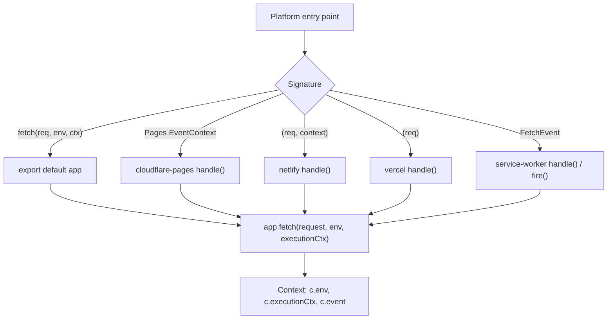
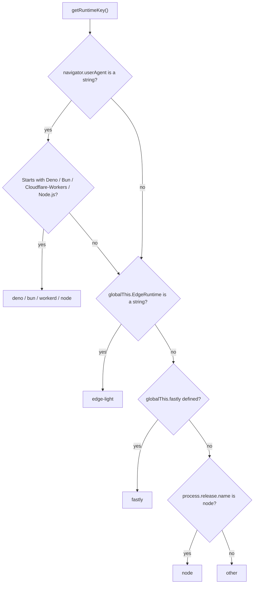

## Overview

A Hono app is a single `fetch(request, env, executionCtx)` function built on Web Standard `Request` and `Response`, so runtimes that already speak `fetch` (Cloudflare Workers, Deno, Bun) can run it with no glue at all. The adapters under `src/adapter` exist for two reasons: to translate a platform's own entry-point signature into that `fetch` call (Cloudflare Pages, Vercel, Netlify, Service Worker), and to supply runtime-specific implementations of features the core cannot provide portably, namely static file serving, WebSocket upgrades, static site generation and connection info.

Sources: [src/hono-base.ts:468-485](repo://src/hono-base.ts#L468-L485)

Each adapter is published as its own subpath export (`hono/cloudflare-workers`, `hono/cloudflare-pages`, `hono/deno`, `hono/bun`, `hono/vercel`, `hono/netlify`, `hono/service-worker`), so an app only bundles the code for the runtime it targets. The `hono/aws-lambda` and `hono/lambda-edge` adapters convert non-`fetch` events and are covered in [[AWS Lambda and Lambda@Edge]].

Sources: [package.json:329-388](repo://package.json#L329-L388)

## How an adapter reaches the app

### The fetch contract

`app.fetch` takes the request, an optional bindings object and an optional `ExecutionContext`, and forwards them to the internal dispatcher. Whatever an adapter passes as the second argument becomes `c.env`, and the third becomes `c.executionCtx` (or `c.event` when it has a `respondWith` method, as a Service Worker `FetchEvent` does). Both getters throw when the adapter supplied nothing.

Sources: [src/hono-base.ts:468-485](repo://src/hono-base.ts#L468-L485), [src/context.ts:371-397](repo://src/context.ts#L371-L397)



Sources: [src/adapter/cloudflare-pages/handler.ts:32-46](repo://src/adapter/cloudflare-pages/handler.ts#L32-L46), [src/adapter/netlify/handler.ts:4-10](repo://src/adapter/netlify/handler.ts#L4-L10), [src/adapter/vercel/handler.ts:4-8](repo://src/adapter/vercel/handler.ts#L4-L8), [src/adapter/service-worker/handler.ts:18-37](repo://src/adapter/service-worker/handler.ts#L18-L37), [src/context.ts:371-397](repo://src/context.ts#L371-L397)

### What each adapter exports

| Import path | `handle` | `serveStatic` | `upgradeWebSocket` | `toSSG` | `getConnInfo` | Other |
| --- | --- | --- | --- | --- | --- | --- |
| `hono/cloudflare-workers` | no | yes (deprecated, KV) | yes | no | yes | none |
| `hono/cloudflare-pages` | yes | yes (`ASSETS`) | no | no | yes | `handleMiddleware`, `EventContext` type |
| `hono/deno` | no | yes | yes | yes | yes | `denoFileSystemModule` |
| `hono/bun` | no | yes | yes | yes | yes | `websocket`, `getBunServer`, `bunFileSystemModule`, `createBunWebSocket` (deprecated) |
| `hono/vercel` | yes | no | no | no | yes | none |
| `hono/netlify` | yes | no | no | no | yes | none |
| `hono/service-worker` | yes | no | no | no | no | `fire` |

Sources: [src/adapter/cloudflare-workers/index.ts:1-8](repo://src/adapter/cloudflare-workers/index.ts#L1-L8), [src/adapter/cloudflare-pages/index.ts:1-8](repo://src/adapter/cloudflare-pages/index.ts#L1-L8), [src/adapter/deno/index.ts:1-9](repo://src/adapter/deno/index.ts#L1-L9), [src/adapter/bun/index.ts:1-11](repo://src/adapter/bun/index.ts#L1-L11), [src/adapter/vercel/index.ts:1-7](repo://src/adapter/vercel/index.ts#L1-L7), [src/adapter/netlify/mod.ts:1-2](repo://src/adapter/netlify/mod.ts#L1-L2), [src/adapter/service-worker/index.ts:28-36](repo://src/adapter/service-worker/index.ts#L28-L36)

## Cloudflare Workers

### Entry point and bindings

Workers call a module's default export with `fetch(request, env, ctx)`, which is exactly the signature of `app.fetch`, so `export default app` works without an adapter. Bindings (KV, D1, secrets) arrive as `c.env`, and `ctx.waitUntil` is reachable through `c.executionCtx`. The `hono/cloudflare-workers` module therefore only exports the runtime-specific helpers.

Sources: [src/hono-base.ts:468-485](repo://src/hono-base.ts#L468-L485), [src/adapter/cloudflare-workers/index.ts:1-8](repo://src/adapter/cloudflare-workers/index.ts#L1-L8)

### Static files from Workers Sites KV

`serveStatic` wraps the shared serve-static middleware with a `getContent` that reads from the Workers Sites KV store. The ES-module export omits the `namespace` option from its type and takes the namespace from `c.env.__STATIC_CONTENT` unless one is passed. `getContentFromKVAsset` resolves the request path through the asset manifest (the `manifest` option as an object or JSON string, otherwise the global `__STATIC_CONTENT_MANIFEST`), returns `null` when the path has no key, and otherwise fetches the value as a stream.

Sources: [src/adapter/cloudflare-workers/serve-static-module.ts:1-12](repo://src/adapter/cloudflare-workers/serve-static-module.ts#L1-L12), [src/adapter/cloudflare-workers/serve-static.ts:21-42](repo://src/adapter/cloudflare-workers/serve-static.ts#L21-L42), [src/adapter/cloudflare-workers/utils.ts:11-50](repo://src/adapter/cloudflare-workers/utils.ts#L11-L50)

| Option | Type | Default | Description |
| --- | --- | --- | --- |
| `root`, `path`, `rewriteRequestPath`, ... | from base `ServeStaticOptions` | see [[Serving Static Files]] | Path resolution options shared by every runtime |
| `manifest` | `object \| string` | `__STATIC_CONTENT_MANIFEST` | Maps file paths to KV keys; a string is parsed as JSON |
| `namespace` | KV namespace | `c.env.__STATIC_CONTENT` | Not accepted by the module-mode export |

Sources: [src/adapter/cloudflare-workers/serve-static.ts:6-10](repo://src/adapter/cloudflare-workers/serve-static.ts#L6-L10), [src/adapter/cloudflare-workers/serve-static-module.ts:6-10](repo://src/adapter/cloudflare-workers/serve-static-module.ts#L6-L10), [src/adapter/cloudflare-workers/utils.ts:17-37](repo://src/adapter/cloudflare-workers/utils.ts#L17-L37)

> [!WARNING]
> The Workers `serveStatic` is marked `@deprecated`: Cloudflare Static Assets (or Cloudflare Pages) serves files directly without going through the Worker.

Sources: [src/adapter/cloudflare-workers/serve-static.ts:12-20](repo://src/adapter/cloudflare-workers/serve-static.ts#L12-L20)

### WebSockets on Workers

`upgradeWebSocket` returns `undefined` (so the request falls through) unless the `Upgrade` header equals `websocket`. It creates a `WebSocketPair`, wraps the server end in a `WSContext`, attaches `close`, `message` and `error` listeners for whichever handlers were given, calls `server.accept()` and answers `101` with the client end in the `webSocket` response field. Workers emit no `open` event, so the type removes `onOpen` from the accepted events. The shared helper is described in [[WebSockets]].

Sources: [src/adapter/cloudflare-workers/websocket.ts:5-53](repo://src/adapter/cloudflare-workers/websocket.ts#L5-L53)

## Cloudflare Pages

### handle for Pages Functions

Pages Functions call `onRequest(context)` with an `EventContext` rather than `fetch` arguments. `handle(app)` unpacks it: the request goes first, the bindings are spread into the env together with the original `eventContext` (so `c.env.eventContext` exposes `params`, `data`, `next` and `functionPath`), and `waitUntil` and `passThroughOnException` form the execution context.

Sources: [src/adapter/cloudflare-pages/handler.ts:12-46](repo://src/adapter/cloudflare-pages/handler.ts#L12-L46)

```ts
export const handle =
  <E extends Env = Env, S extends Schema = BlankSchema, BasePath extends string = '/'>(
    app: Hono<E, S, BasePath>
  ): PagesFunction<E['Bindings']> =>
  (eventContext) => {
    return app.fetch(
      eventContext.request,
      { ...eventContext.env, eventContext },
      {
        waitUntil: eventContext.waitUntil,
        passThroughOnException: eventContext.passThroughOnException,
        props: {},
      }
    )
  }
```

Sources: [src/adapter/cloudflare-pages/handler.ts:32-46](repo://src/adapter/cloudflare-pages/handler.ts#L32-L46)

### handleMiddleware for _middleware files

`handleMiddleware` runs one Hono middleware as a Pages `_middleware` function, without an app or router. It builds a bare `Context` from the event, and the `next` it passes to the middleware calls `executionCtx.next()` to continue to the next Pages function, storing the result in `c.res`. Errors thrown either downstream or by the middleware itself are captured on `context.error` rather than propagated straight away, and the outcome is then resolved in the order listed below.

Sources: [src/adapter/cloudflare-pages/handler.ts:49-86](repo://src/adapter/cloudflare-pages/handler.ts#L49-L86)

1. A `Response` returned by the middleware is used as is.
2. An `HTTPException` caught on `context.error` is turned into its response with `getResponse()`.
3. Any other `Error` is rethrown; a thrown non-`Error` value is rethrown immediately.
4. Otherwise `context.res` (the downstream response, possibly modified) is returned.

Sources: [src/adapter/cloudflare-pages/handler.ts:49-102](repo://src/adapter/cloudflare-pages/handler.ts#L49-L102)

### serveStatic in advanced mode

In Pages advanced mode a single `_worker.js` handles every request, so `serveStatic()` takes no options and forwards the raw request to the `ASSETS` binding. A `404` from `ASSETS` becomes `c.notFound()`, which lets the app's own not-found handler answer.

Sources: [src/adapter/cloudflare-pages/handler.ts:104-123](repo://src/adapter/cloudflare-pages/handler.ts#L104-L123)

## Deno

### Serving with Deno.serve

`Deno.serve` calls its handler with `(request, info)`, which maps onto `app.fetch(request, env)`: the serve info becomes `c.env`, which is how `getConnInfo` later reads `remoteAddr`. The adapter module exports only helpers.

Sources: [src/adapter/deno/index.ts:1-9](repo://src/adapter/deno/index.ts#L1-L9), [src/adapter/deno/conninfo.ts:8-17](repo://src/adapter/deno/conninfo.ts#L8-L17)

### Deno static files and SSG

Deno's `serveStatic` supplies `getContent` (open the file and return its `readable` stream), `join` from `node:path`, and an `isDir` built on `Deno.lstatSync`. A directory returns `null` from `getContent` so the base middleware can append the default document. A missing file returns `null` quietly; any other error is logged with `console.warn` and also returns `null`. `toSSG` passes `denoFileSystemModule` to the core SSG helper; it encodes strings to `Uint8Array` before `Deno.writeFile` and honours `recursive` in `mkdir` (see [[Static Site Generation]]).

Sources: [src/adapter/deno/serve-static.ts:8-42](repo://src/adapter/deno/serve-static.ts#L8-L42), [src/adapter/deno/ssg.ts:9-27](repo://src/adapter/deno/ssg.ts#L9-L27), [src/middleware/serve-static/index.ts:33-52](repo://src/middleware/serve-static/index.ts#L33-L52)

### WebSockets on Deno

The Deno `upgradeWebSocket` checks the `upgrade` header, then calls `Deno.upgradeWebSocket` with the first requested subprotocol echoed back (browsers such as Chrome reject a handshake that drops it), merged with caller options of type `Deno.UpgradeWebSocketOptions`. It wires `onopen`, `onmessage`, `onclose` and `onerror` to the user's events and returns Deno's upgrade response.

Sources: [src/adapter/deno/websocket.ts:4-38](repo://src/adapter/deno/websocket.ts#L4-L38)

## Bun

### Bun.serve and the server object

`Bun.serve({ fetch: app.fetch })` calls `fetch(request, server)`, so the Bun server object lands in `c.env`. `getBunServer(c)` returns `c.env.server` when the env has a `server` key (for setups that wrap it in an object) and otherwise `c.env` itself. Both `getConnInfo` and `upgradeWebSocket` depend on it and throw `TypeError('env has to include the 2nd argument of fetch.')` when it is missing.

Sources: [src/adapter/bun/server.ts:13-14](repo://src/adapter/bun/server.ts#L13-L14), [src/adapter/bun/conninfo.ts:10-24](repo://src/adapter/bun/conninfo.ts#L10-L24), [src/adapter/bun/websocket.ts:48-60](repo://src/adapter/bun/websocket.ts#L48-L60)

### WebSockets on Bun

Bun upgrades a socket inside `fetch` but delivers socket events to a separate `websocket` handler given to `Bun.serve`, so the adapter splits the work. `upgradeWebSocket` calls `server.upgrade(c.req.raw, { data })`, storing the user's events, the request URL and the first `sec-websocket-protocol` value on the socket's `data`; on success it returns an empty `Response`. The exported `websocket` object then reads `ws.data.events` in `open`, `close` and `message`, builds a fresh `WSContext` per event, and normalizes binary messages to their `buffer`.

Sources: [src/adapter/bun/websocket.ts:24-104](repo://src/adapter/bun/websocket.ts#L24-L104)

```ts
import { Hono } from 'hono'
import { upgradeWebSocket, websocket } from 'hono/bun'

const app = new Hono()

app.get(
  '/ws',
  upgradeWebSocket(() => ({
    onMessage(event, ws) {
      ws.send(`echo: ${event.data}`)
    },
  }))
)

export default { fetch: app.fetch, websocket }
```

Sources: [src/adapter/bun/websocket.ts:48-104](repo://src/adapter/bun/websocket.ts#L48-L104), [src/adapter/bun/index.ts:8-8](repo://src/adapter/bun/index.ts#L8-L8)

`createBunWebSocket()` is kept for older code and simply returns the same `upgradeWebSocket` and `websocket` pair.

Sources: [src/adapter/bun/websocket.ts:106-113](repo://src/adapter/bun/websocket.ts#L106-L113)

### Bun static files and SSG

Bun's `serveStatic` returns a `Bun.file(path)` when it exists, uses `node:fs/promises` `stat` for `isDir` and `node:path` `join`. `toSSG` writes through `Bun.write`; its `mkdir` is a no-op because `Bun.write` creates parent directories.

Sources: [src/adapter/bun/serve-static.ts:8-32](repo://src/adapter/bun/serve-static.ts#L8-L32), [src/adapter/bun/ssg.ts:13-27](repo://src/adapter/bun/ssg.ts#L13-L27)

## Vercel, Netlify and Service Worker

### Vercel

`handle(app)` from `hono/vercel` returns `(req) => app.fetch(req)`, a plain Web handler suited to Vercel functions that receive a `Request`. No env or execution context is passed.

Sources: [src/adapter/vercel/handler.ts:4-8](repo://src/adapter/vercel/handler.ts#L4-L8)

### Netlify

Netlify Functions call `(req, context)`. `handle(app)` from `hono/netlify` forwards the request and places Netlify's context object under `c.env.context`, where `getConnInfo` and user code can read `ip`, `geo` and `requestId`.

Sources: [src/adapter/netlify/handler.ts:4-10](repo://src/adapter/netlify/handler.ts#L4-L10), [src/adapter/netlify/conninfo.ts:8-32](repo://src/adapter/netlify/conninfo.ts#L8-L32)

### Service Worker

In a browser Service Worker, requests arrive as `FetchEvent`s. `handle(app, opts)` calls `evt.respondWith` with the result of `app.fetch(evt.request, {}, evt)`, so `c.event` gives access to the event. When the app answers `404` and `opts.fetch` is set, the request is passed on to the network instead. `fire(app, options)` registers that handler with `addEventListener('fetch', ...)`.

Sources: [src/adapter/service-worker/handler.ts:10-37](repo://src/adapter/service-worker/handler.ts#L10-L37), [src/adapter/service-worker/index.ts:28-36](repo://src/adapter/service-worker/index.ts#L28-L36)

| Option | Type | Default in `handle` | Default in `fire` | Description |
| --- | --- | --- | --- | --- |
| `fetch` | `typeof fetch` | `globalThis.fetch.bind(globalThis)` | `undefined` | Called with the original request when the app returns 404 |

Sources: [src/adapter/service-worker/handler.ts:11-24](repo://src/adapter/service-worker/handler.ts#L11-L24), [src/adapter/service-worker/index.ts:10-34](repo://src/adapter/service-worker/index.ts#L10-L34)

> [!NOTE]
> The default `fetch` is bound to `globalThis` because calling an unbound `fetch` in a Service Worker throws. Passing an `options` object without `fetch` (or calling `fire(app)` with no options) disables the fallback, so the app's 404 is returned.

Sources: [src/adapter/service-worker/handler.ts:18-34](repo://src/adapter/service-worker/handler.ts#L18-L34)

## Connection info

### The ConnInfo shape

Every adapter that knows the client address exports a `getConnInfo(c)` with the `GetConnInfo` type from `hono/conninfo`. It returns `{ remote }`, a `NetAddrInfo` with optional `address`, `addressType` (`'IPv4'`, `'IPv6'` or `undefined`), `port` and `transport` (`'tcp'` or `'udp'`). Middleware such as IP restriction accepts any of these functions as its `getIP` argument, which keeps it runtime-neutral.

Sources: [src/helper/conninfo/types.ts:1-45](repo://src/helper/conninfo/types.ts#L1-L45), [src/middleware/ip-restriction/index.ts:23-23](repo://src/middleware/ip-restriction/index.ts#L23-L23)

### Where each adapter gets the address

| Adapter | Source of data | Fields filled |
| --- | --- | --- |
| Cloudflare Workers | `cf-connecting-ip` request header | `address` |
| Cloudflare Pages | `cf-connecting-ip` request header | `address` |
| Deno | `c.env.remoteAddr` (serve handler info) | `address` (hostname), `port`, `transport` |
| Bun | `server.requestIP(c.req.raw)` | `address`, `addressType`, `port` |
| Vercel | `x-real-ip` request header | `address` |
| Netlify | `c.env.context.ip` | `address` |

Sources: [src/adapter/cloudflare-workers/conninfo.ts:3-7](repo://src/adapter/cloudflare-workers/conninfo.ts#L3-L7), [src/adapter/cloudflare-pages/conninfo.ts:22-26](repo://src/adapter/cloudflare-pages/conninfo.ts#L22-L26), [src/adapter/deno/conninfo.ts:8-17](repo://src/adapter/deno/conninfo.ts#L8-L17), [src/adapter/bun/conninfo.ts:10-43](repo://src/adapter/bun/conninfo.ts#L10-L43), [src/adapter/vercel/conninfo.ts:3-8](repo://src/adapter/vercel/conninfo.ts#L3-L8), [src/adapter/netlify/conninfo.ts:53-57](repo://src/adapter/netlify/conninfo.ts#L53-L57)

Bun returns `{ remote: {} }` when `requestIP` yields `null` (a closed request or a Unix domain socket), throws if the server object has no `requestIP` function, and reports `addressType` only for the families `IPv4` and `IPv6`. Header-based adapters trust the platform's proxy to set the header; outside that platform the header can be spoofed or absent, giving `address: undefined`.

Sources: [src/adapter/bun/conninfo.ts:19-43](repo://src/adapter/bun/conninfo.ts#L19-L43), [src/adapter/cloudflare-workers/conninfo.ts:3-7](repo://src/adapter/cloudflare-workers/conninfo.ts#L3-L7)

## Runtime detection and environment variables

### getRuntimeKey

`hono/adapter` lets portable code ask where it runs. `getRuntimeKey()` first compares `navigator.userAgent` prefixes against `knownUserAgents` (`Deno`, `Bun`, `Cloudflare-Workers`, `Node.js`), then checks for a global `EdgeRuntime` string (`edge-light`, as on Vercel Edge), then a global `fastly` object, then `process.release.name === 'node'` for Node versions before 21.1 that lack `navigator.userAgent`, and finally returns `other`.

Sources: [src/helper/adapter/index.ts:8-8](repo://src/helper/adapter/index.ts#L8-L8), [src/helper/adapter/index.ts:43-90](repo://src/helper/adapter/index.ts#L43-L90)



Sources: [src/helper/adapter/index.ts:50-90](repo://src/helper/adapter/index.ts#L50-L90)

### env

`env(c, runtime?)` returns environment variables in a runtime-neutral way, using `getRuntimeKey()` when no runtime is given. Bun, Node and `edge-light` read `process.env`; Deno returns `Deno.env.toObject()`; `workerd` returns the bindings in `c.env`; Fastly and unknown runtimes return an empty object.

Sources: [src/helper/adapter/index.ts:10-41](repo://src/helper/adapter/index.ts#L10-L41)

```ts
import { env, getRuntimeKey } from 'hono/adapter'

app.get('/env', (c) => {
  const { API_KEY } = env<{ API_KEY: string }>(c)
  return c.json({ runtime: getRuntimeKey(), hasKey: Boolean(API_KEY) })
})
```

Sources: [src/helper/adapter/index.ts:10-50](repo://src/helper/adapter/index.ts#L10-L50), [package.json:329-333](repo://package.json#L329-L333)
