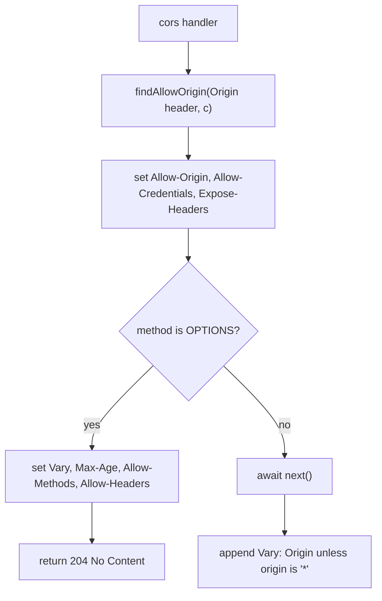
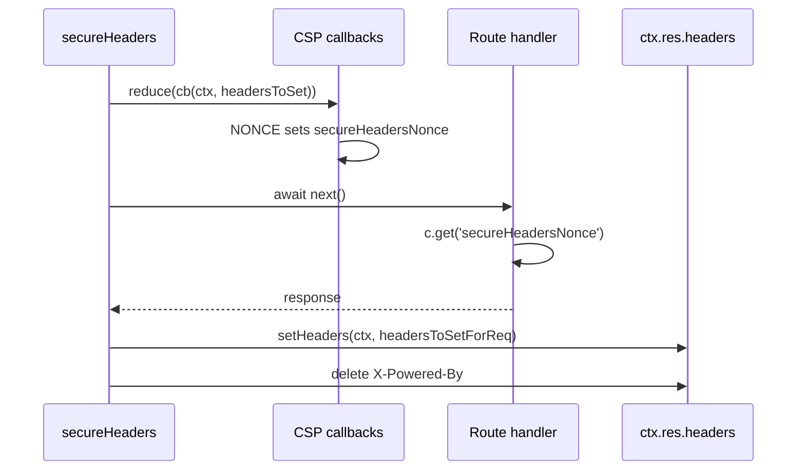
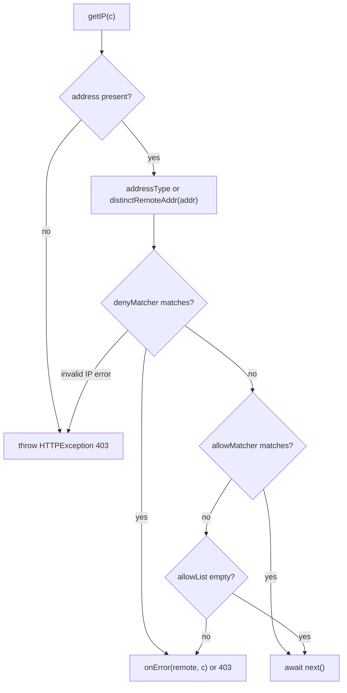
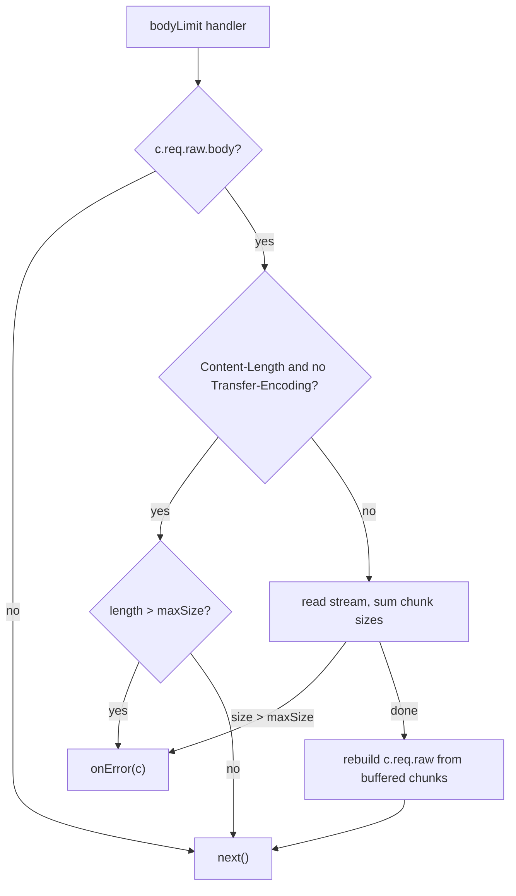

## Overview

Hono ships five middleware that guard an application at the HTTP boundary: `cors` answers cross-origin preflights and adds the `Access-Control-*` headers, `csrf` rejects form-style writes that come from another site, `secureHeaders` adds a hardened set of response headers (including a Content-Security-Policy with per-request nonces), `ipRestriction` allows or denies clients by IP address or CIDR range, and `bodyLimit` refuses request bodies over a byte limit. Each is a factory that takes options once, precomputes what it can, and returns a `MiddlewareHandler` that is registered with `app.use()` like any other middleware (see [[Middleware and Composition]]).

Sources: [src/middleware/cors/index.ts:63-96](repo://src/middleware/cors/index.ts#L63-L96), [src/middleware/csrf/index.ts:94-138](repo://src/middleware/csrf/index.ts#L94-L138), [src/middleware/secure-headers/secure-headers.ts:179-215](repo://src/middleware/secure-headers/secure-headers.ts#L179-L215), [src/middleware/ip-restriction/index.ts:218-238](repo://src/middleware/ip-restriction/index.ts#L218-L238), [src/middleware/body-limit/index.ts:50-61](repo://src/middleware/body-limit/index.ts#L50-L61)

The blocking middleware (`csrf`, `ipRestriction` and `bodyLimit` without a custom handler) reject a request by throwing an `HTTPException` that carries a ready-made `Response`, so the app's error handler sees the rejection and `getResponse()` returns that response unchanged (see [[Error Handling]]).

Sources: [src/middleware/csrf/index.ts:144-147](repo://src/middleware/csrf/index.ts#L144-L147), [src/middleware/ip-restriction/index.ts:231-236](repo://src/middleware/ip-restriction/index.ts#L231-L236), [src/middleware/body-limit/index.ts:51-58](repo://src/middleware/body-limit/index.ts#L51-L58), [src/http-exception.ts:66-77](repo://src/http-exception.ts#L66-L77)

| Middleware | Import | Acts | Rejection |
| --- | --- | --- | --- |
| `cors` | `hono/cors` | before and after `next()` | never rejects; answers `OPTIONS` with 204 |
| `csrf` | `hono/csrf` | before `next()` | `HTTPException(403)` with body `Forbidden` |
| `secureHeaders` | `hono/secure-headers` | callbacks before, headers after `next()` | never rejects |
| `ipRestriction` | `hono/ip-restriction` | before `next()` | `HTTPException(403)` or `onError` |
| `bodyLimit` | `hono/body-limit` | before `next()` | `HTTPException(413)` or `onError` |

Sources: [src/middleware/cors/index.ts:96-156](repo://src/middleware/cors/index.ts#L96-L156), [src/middleware/csrf/index.ts:138-150](repo://src/middleware/csrf/index.ts#L138-L150), [src/middleware/secure-headers/secure-headers.ts:215-228](repo://src/middleware/secure-headers/secure-headers.ts#L215-L228), [src/middleware/ip-restriction/index.ts:238-278](repo://src/middleware/ip-restriction/index.ts#L238-L278), [src/middleware/body-limit/index.ts:61-110](repo://src/middleware/body-limit/index.ts#L61-L110)

## CORS

### CORS options

`cors(options?)` merges the options over its defaults: any origin (`*`), the six common methods, and empty header lists.

Sources: [src/middleware/cors/index.ts:9-22](repo://src/middleware/cors/index.ts#L9-L22), [src/middleware/cors/index.ts:63-70](repo://src/middleware/cors/index.ts#L63-L70)

| Option | Type | Default | Description |
| --- | --- | --- | --- |
| `origin` | `string`, `string[]` or `(origin, c) => string \| undefined \| null` (may be async) | `'*'` | Value of `Access-Control-Allow-Origin`. A string other than `*` echoes the request origin only on an exact match; an array echoes it when included; a function returns the value to send, or a falsy value to send none. |
| `allowMethods` | `string[]` or `(origin, c) => string[]` (may be async) | `['GET', 'HEAD', 'PUT', 'POST', 'DELETE', 'PATCH']` | Value of `Access-Control-Allow-Methods` on preflight responses. |
| `allowHeaders` | `string[]` | `[]` | Value of `Access-Control-Allow-Headers` on preflight. When empty, the request's `Access-Control-Request-Headers` are reflected. |
| `maxAge` | `number` | none | Value of `Access-Control-Max-Age` on preflight, in seconds. |
| `credentials` | `boolean` | none | Sends `Access-Control-Allow-Credentials: true` when set. |
| `exposeHeaders` | `string[]` | `[]` | Value of `Access-Control-Expose-Headers` when non-empty. |

Sources: [src/middleware/cors/index.ts:9-35](repo://src/middleware/cors/index.ts#L9-L35), [src/middleware/cors/index.ts:72-94](repo://src/middleware/cors/index.ts#L72-L94)

The `origin` and `allowMethods` options are normalised once, at factory time, into lookup functions: `findAllowOrigin` and `findAllowMethods`. A fixed `'*'` becomes a function that always returns `*`; a fixed origin string or array becomes an equality or `includes` check against the incoming `Origin` header; a function is used as-is.

Sources: [src/middleware/cors/index.ts:72-94](repo://src/middleware/cors/index.ts#L72-L94)

```ts
const findAllowOrigin = ((optsOrigin) => {
  if (typeof optsOrigin === 'string') {
    if (optsOrigin === '*') {
      return () => optsOrigin
    } else {
      return (origin: string) => (optsOrigin === origin ? origin : null)
    }
  } else if (typeof optsOrigin === 'function') {
    return optsOrigin
  } else {
    return (origin: string) => (optsOrigin.includes(origin) ? origin : null)
  }
})(opts.origin)
```

Sources: [src/middleware/cors/index.ts:72-84](repo://src/middleware/cors/index.ts#L72-L84)

### Preflight and actual requests

For every request the handler first writes `Access-Control-Allow-Origin` (when the lookup returns a value), `Access-Control-Allow-Credentials` and `Access-Control-Expose-Headers` directly onto `c.res.headers`. These headers are set before `next()`, so they survive into the handler's response because the `c.res` setter copies every header of the earlier response (except `Content-Type`) onto the one the handler returns.

Sources: [src/middleware/cors/index.ts:96-112](repo://src/middleware/cors/index.ts#L96-L112), [src/context.ts:402-435](repo://src/context.ts#L402-L435)

An `OPTIONS` request is treated as a preflight and never reaches the route handler. The middleware adds `Vary: Origin` when the origin is not `*`, `Access-Control-Max-Age` when `maxAge` is set, `Access-Control-Allow-Methods` from `findAllowMethods`, and `Access-Control-Allow-Headers` from `allowHeaders` or, if that list is empty, from the request's `Access-Control-Request-Headers` split on commas. When allow-headers are sent it also appends `Vary: Access-Control-Request-Headers`. It strips `Content-Length` and `Content-Type` and returns a `204 No Content` response built from the accumulated headers.

Sources: [src/middleware/cors/index.ts:114-148](repo://src/middleware/cors/index.ts#L114-L148)

Any other method calls `next()`, then appends `Vary: Origin` to the final response when `origin` is not `*`, so shared caches keep per-origin variants apart.

Sources: [src/middleware/cors/index.ts:149-156](repo://src/middleware/cors/index.ts#L149-L156)



Sources: [src/middleware/cors/index.ts:96-156](repo://src/middleware/cors/index.ts#L96-L156)

```ts
import { Hono } from 'hono'
import { cors } from 'hono/cors'

const app = new Hono()

app.use('/api/*', cors())
app.use(
  '/api2/*',
  cors({
    origin: 'http://example.com',
    allowHeaders: ['X-Custom-Header', 'Upgrade-Insecure-Requests'],
    allowMethods: ['POST', 'GET', 'OPTIONS'],
    exposeHeaders: ['Content-Length', 'X-Kuma-Revision'],
    maxAge: 600,
    credentials: true,
  })
)
```

Sources: [src/middleware/cors/index.ts:38-61](repo://src/middleware/cors/index.ts#L38-L61)

> [!WARNING]
> `credentials: true` combined with the default `origin: '*'` sends `Access-Control-Allow-Origin: *`, which browsers reject for credentialed requests. Pass an explicit origin, list or function when credentials are needed.

Sources: [src/middleware/cors/index.ts:63-70](repo://src/middleware/cors/index.ts#L63-L70), [src/middleware/cors/index.ts:101-108](repo://src/middleware/cors/index.ts#L101-L108)

## CSRF protection

### When a request is checked

`csrf()` only inspects requests a browser could send cross-site without a preflight: any method other than `GET` or `HEAD` whose `Content-Type` is `application/x-www-form-urlencoded`, `multipart/form-data` or `text/plain`. A missing `Content-Type` is treated as `text/plain`, so a bodiless `POST` is checked too. A JSON `POST` passes through, because a cross-site JSON request already needs a CORS preflight.

Sources: [src/middleware/csrf/index.ts:28-30](repo://src/middleware/csrf/index.ts#L28-L30), [src/middleware/csrf/index.ts:138-141](repo://src/middleware/csrf/index.ts#L138-L141)

A checked request is allowed when either the `Sec-Fetch-Site` check or the `Origin` check passes. The `Sec-Fetch-Site` check runs first; only when it fails is the `Origin` check evaluated. When both fail the middleware throws `HTTPException(403)` whose response body is `Forbidden`.

Sources: [src/middleware/csrf/index.ts:138-150](repo://src/middleware/csrf/index.ts#L138-L150)

```ts
return async function csrf(c, next) {
  if (
    !isSafeMethodRe.test(c.req.method) &&
    isRequestedByFormElementRe.test(c.req.header('content-type') || 'text/plain') &&
    !(await isAllowedSecFetchSite(c.req.header('sec-fetch-site'), c)) &&
    !(await isAllowedOrigin(c.req.header('origin'), c))
  ) {
    const res = new Response('Forbidden', { status: 403 })
    throw new HTTPException(403, { res })
  }

  await next()
}
```

Sources: [src/middleware/csrf/index.ts:138-150](repo://src/middleware/csrf/index.ts#L138-L150)

### CSRF options

| Option | Type | Default | Description |
| --- | --- | --- | --- |
| `origin` | `string`, `string[]` or `(origin, c) => boolean` (may be async) | same origin as `c.req.url` | Allowed values of the `Origin` header. A missing `Origin` header always fails this check. |
| `secFetchSite` | `'same-origin' \| 'same-site' \| 'none' \| 'cross-site'`, an array of these, or `(secFetchSite, c) => boolean` (may be async) | `'same-origin'` only | Allowed values of `Sec-Fetch-Site`. A missing header, or a value outside the four standard ones, always fails this check. |

Sources: [src/middleware/csrf/index.ts:10-26](repo://src/middleware/csrf/index.ts#L10-L26), [src/middleware/csrf/index.ts:95-136](repo://src/middleware/csrf/index.ts#L95-L136)

Like `cors`, the options are turned into `originHandler` and `secFetchSiteHandler` functions once. The default origin handler compares the header with `new URL(c.req.url).origin`, so an app behind a proxy that rewrites the host needs an explicit `origin`. Function handlers receive the `Context`, which lets a rule depend on the path, for example allowing `cross-site` only for webhook routes.

Sources: [src/middleware/csrf/index.ts:95-125](repo://src/middleware/csrf/index.ts#L95-L125)

```ts
app.use('*', csrf({
  secFetchSite: (secFetchSite, c) => {
    // Always allow same-origin
    if (secFetchSite === 'same-origin') return true
    // Allow cross-site for webhook endpoints
    if (secFetchSite === 'cross-site' && c.req.path.startsWith('/webhook/')) {
      return true
    }
    return false
  }
}))
```

Sources: [src/middleware/csrf/index.ts:70-81](repo://src/middleware/csrf/index.ts#L70-L81)

## Secure headers

### Default headers

`secureHeaders(customOptions?)` spreads the options over `DEFAULT_OPTIONS`, then `getFilteredHeaders` keeps each entry of `HEADERS_MAP` whose option is truthy. An option set to `true` sends the default value; a string replaces the value; `false` drops the header. `crossOriginEmbedderPolicy` is the only header off by default.

Sources: [src/middleware/secure-headers/secure-headers.ts:94-124](repo://src/middleware/secure-headers/secure-headers.ts#L94-L124), [src/middleware/secure-headers/secure-headers.ts:179-181](repo://src/middleware/secure-headers/secure-headers.ts#L179-L181), [src/middleware/secure-headers/secure-headers.ts:231-238](repo://src/middleware/secure-headers/secure-headers.ts#L231-L238)

| Option | Header | Default value | On by default |
| --- | --- | --- | --- |
| `crossOriginEmbedderPolicy` | `Cross-Origin-Embedder-Policy` | `require-corp` | no |
| `crossOriginResourcePolicy` | `Cross-Origin-Resource-Policy` | `same-origin` | yes |
| `crossOriginOpenerPolicy` | `Cross-Origin-Opener-Policy` | `same-origin` | yes |
| `originAgentCluster` | `Origin-Agent-Cluster` | `?1` | yes |
| `referrerPolicy` | `Referrer-Policy` | `no-referrer` | yes |
| `strictTransportSecurity` | `Strict-Transport-Security` | `max-age=15552000; includeSubDomains` | yes |
| `xContentTypeOptions` | `X-Content-Type-Options` | `nosniff` | yes |
| `xDnsPrefetchControl` | `X-DNS-Prefetch-Control` | `off` | yes |
| `xDownloadOptions` | `X-Download-Options` | `noopen` | yes |
| `xFrameOptions` | `X-Frame-Options` | `SAMEORIGIN` | yes |
| `xPermittedCrossDomainPolicies` | `X-Permitted-Cross-Domain-Policies` | `none` | yes |
| `xXssProtection` | `X-XSS-Protection` | `0` | yes |

Sources: [src/middleware/secure-headers/secure-headers.ts:94-124](repo://src/middleware/secure-headers/secure-headers.ts#L94-L124)

The remaining options build headers that have no fixed default and are only sent when configured.

Sources: [src/middleware/secure-headers/secure-headers.ts:69-88](repo://src/middleware/secure-headers/secure-headers.ts#L69-L88), [src/middleware/secure-headers/secure-headers.ts:184-213](repo://src/middleware/secure-headers/secure-headers.ts#L184-L213)

| Option | Type | Default | Description |
| --- | --- | --- | --- |
| `contentSecurityPolicy` | `ContentSecurityPolicyOptions` | none | Directives for `Content-Security-Policy`. |
| `contentSecurityPolicyReportOnly` | `ContentSecurityPolicyOptions` | none | Directives for `Content-Security-Policy-Report-Only`. |
| `permissionsPolicy` | `Partial<Record<PermissionsPolicyDirective, string[] \| boolean>>` | `{}` | Builds `Permissions-Policy`; sent only when it has at least one key. |
| `reportingEndpoints` | `{ name, url }[]` | none | Builds `Reporting-Endpoints` as `name="url"` pairs joined by `, `. |
| `reportTo` | `{ group, max_age, endpoints }[]` | none | Builds `Report-To` as JSON objects joined by `, `. |
| `removePoweredBy` | `boolean` | `true` | Deletes `X-Powered-By` from the response. |

Sources: [src/middleware/secure-headers/secure-headers.ts:46-88](repo://src/middleware/secure-headers/secure-headers.ts#L46-L88), [src/middleware/secure-headers/secure-headers.ts:200-213](repo://src/middleware/secure-headers/secure-headers.ts#L200-L213), [src/middleware/secure-headers/secure-headers.ts:320-328](repo://src/middleware/secure-headers/secure-headers.ts#L320-L328)

### Content-Security-Policy and nonces

`ContentSecurityPolicyOptions` lists the CSP directives in camelCase (`defaultSrc`, `scriptSrc`, `frameAncestors`, `upgradeInsecureRequests`, `requireTrustedTypesFor` and so on). `getCSPDirectives` converts each key to kebab-case and joins its values with spaces and the directives with `; `. `reportTo` takes a single string and `reportUri` a string or array; every other directive takes an array of strings or handler functions.

Sources: [src/middleware/secure-headers/secure-headers.ts:15-44](repo://src/middleware/secure-headers/secure-headers.ts#L15-L44), [src/middleware/secure-headers/secure-headers.ts:240-266](repo://src/middleware/secure-headers/secure-headers.ts#L240-L266)

A value can be a `ContentSecurityPolicyOptionHandler`, a function `(ctx, directive) => string` evaluated per request. `getCSPDirectives` records the array index where each function's output goes and returns a callback that copies the token array and fills those slots. The exported `NONCE` handler is such a function: it generates 16 random bytes encoded as base64, stores them on the context as `secureHeadersNonce` (reusing an existing value so every directive in one request shares the nonce), and returns `'nonce-<value>'`.

Sources: [src/middleware/secure-headers/secure-headers.ts:131-145](repo://src/middleware/secure-headers/secure-headers.ts#L131-L145), [src/middleware/secure-headers/secure-headers.ts:246-288](repo://src/middleware/secure-headers/secure-headers.ts#L246-L288)

```ts
export const NONCE: ContentSecurityPolicyOptionHandler = (ctx) => {
  const key = 'secureHeadersNonce'
  const init = ctx.get(key)
  const nonce = init || generateNonce()
  if (init == null) {
    ctx.set(key, nonce)
  }
  return `'nonce-${nonce}'`
}
```

Sources: [src/middleware/secure-headers/secure-headers.ts:137-145](repo://src/middleware/secure-headers/secure-headers.ts#L137-L145)

The module augments `ContextVariableMap` with `SecureHeadersVariables`, so `c.get('secureHeadersNonce')` is typed as `string | undefined` in any handler (see [[Context]]).

Sources: [src/middleware/secure-headers/index.ts:1-8](repo://src/middleware/secure-headers/index.ts#L1-L8), [src/middleware/secure-headers/secure-headers.ts:11-13](repo://src/middleware/secure-headers/secure-headers.ts#L11-L13)

### Request flow

The per-request handler runs the CSP callbacks before `await next()`, because the callbacks are what call `ctx.set()` with the nonce and the route handler needs to read it to stamp `<script nonce>` attributes. After the handler returns, `setHeaders` writes every header onto `ctx.res.headers` with `set` (overwriting any value the handler set), and `X-Powered-By` is removed when `removePoweredBy` is on.

Sources: [src/middleware/secure-headers/secure-headers.ts:215-228](repo://src/middleware/secure-headers/secure-headers.ts#L215-L228), [src/middleware/secure-headers/secure-headers.ts:330-334](repo://src/middleware/secure-headers/secure-headers.ts#L330-L334)



Sources: [src/middleware/secure-headers/secure-headers.ts:137-145](repo://src/middleware/secure-headers/secure-headers.ts#L137-L145), [src/middleware/secure-headers/secure-headers.ts:215-228](repo://src/middleware/secure-headers/secure-headers.ts#L215-L228)

```tsx
import { Hono } from 'hono'
import { NONCE, secureHeaders } from 'hono/secure-headers'

const app = new Hono()

app.use(
  secureHeaders({
    xFrameOptions: 'DENY',
    contentSecurityPolicy: {
      defaultSrc: ["'self'"],
      scriptSrc: [NONCE],
    },
  })
)

app.get('/', (c) => {
  const nonce = c.get('secureHeadersNonce')
  return c.html(`<script nonce="${nonce}">console.log(1)</script>`)
})
```

Sources: [src/middleware/secure-headers/index.ts:1-8](repo://src/middleware/secure-headers/index.ts#L1-L8), [src/middleware/secure-headers/secure-headers.ts:179-229](repo://src/middleware/secure-headers/secure-headers.ts#L179-L229)

### Permissions-Policy

`getPermissionsPolicyDirectives` turns each camelCase feature (the `PermissionsPolicyDirective` union in `permissions-policy.ts`, such as `camera` or `ambientLightSensor`) into kebab-case and formats its value: `true` becomes `=*`, `false` becomes `=none`, an empty array `=()`, a single `'*'` or `'none'` is written bare, and any other list is wrapped in parentheses with `self` and `src` left unquoted and origins double-quoted. Directives are joined with `, `.

Sources: [src/middleware/secure-headers/secure-headers.ts:290-318](repo://src/middleware/secure-headers/secure-headers.ts#L290-L318), [src/middleware/secure-headers/permissions-policy.ts:1-20](repo://src/middleware/secure-headers/permissions-policy.ts#L1-L20)

## IP restriction

### Signature and rules

`ipRestriction(getIP, rules, onError?)` needs a way to read the client address. `getIP` is either a runtime adapter's `getConnInfo` (which returns `remote.address` and optionally `remote.addressType`) or a plain `(c) => string`. `rules` holds optional `denyList` and `allowList` arrays, and `onError(remote, c)` replaces the default 403 response.

Sources: [src/middleware/ip-restriction/index.ts:20-23](repo://src/middleware/ip-restriction/index.ts#L20-L23), [src/middleware/ip-restriction/index.ts:169-225](repo://src/middleware/ip-restriction/index.ts#L169-L225), [src/helper/conninfo/types.ts:1-45](repo://src/helper/conninfo/types.ts#L1-L45)

| Rule form | Example | Meaning |
| --- | --- | --- |
| Wildcard | `'*'` | Matches every address; the whole list short-circuits to `() => true`. |
| Static IPv4 | `'192.168.2.0'` | Exact match, also matching the IPv4-mapped IPv6 form `::ffff:192.168.2.0`. |
| IPv4 CIDR | `'192.168.2.0/24'` | Prefix match on the 32-bit address. `/32` is treated as static. |
| Static IPv6 | `'::1'` | Exact match after normalising the address. |
| IPv6 CIDR | `'::1/10'` | Prefix match on the 128-bit address. `/128` is treated as static. |
| Function | `({ addr, type }) => boolean` | Custom predicate, evaluated after all static and CIDR rules. |

Sources: [src/middleware/ip-restriction/index.ts:25-38](repo://src/middleware/ip-restriction/index.ts#L25-L38), [src/middleware/ip-restriction/index.ts:82-120](repo://src/middleware/ip-restriction/index.ts#L82-L120)

### Matcher construction

`buildMatcher` compiles each list once. Static rules go into string sets and `bigint` sets for IPv4 and IPv6, with IPv4 and IPv4-mapped IPv6 forms registered under both families. CIDR rules become `[isIPv4, addr & mask, mask]` tuples; an IPv4-mapped IPv6 range with a prefix of at least 96 is rewritten as an IPv4 range. A rule that is neither IPv4 nor IPv6, or whose prefix is not 1 to 3 digits within the family's bit width, throws `TypeError: Invalid rule: ...` at factory time, so a typo fails at startup rather than per request.

Sources: [src/middleware/ip-restriction/index.ts:40-120](repo://src/middleware/ip-restriction/index.ts#L40-L120)

The returned matcher checks the cheapest test first: the raw address string against `staticRules`, then the binary address (computed lazily and cached on the remote object as `binaryAddr`) against the family's static set, then each CIDR tuple, and finally the function rules.

Sources: [src/middleware/ip-restriction/index.ts:122-167](repo://src/middleware/ip-restriction/index.ts#L122-L167)

### Decision flow

The deny list always wins. A request matching `denyList` is rejected; one matching `allowList` proceeds. A request matching neither proceeds only when `allowList` is empty, so supplying any allow rule turns the middleware into an allowlist. A missing address is rejected outright, and an address that fails to parse (the `ipaddr` utilities throw a `TypeError` with code `ERR_INVALID_IP_ADDRESS`) is rejected with the default 403 instead of surfacing as a 500.

Sources: [src/middleware/ip-restriction/index.ts:238-278](repo://src/middleware/ip-restriction/index.ts#L238-L278), [src/utils/ipaddr.ts:41-80](repo://src/utils/ipaddr.ts#L41-L80)



Sources: [src/middleware/ip-restriction/index.ts:238-278](repo://src/middleware/ip-restriction/index.ts#L238-L278)

The address type comes from `connInfo.remote.addressType` when the adapter supplies it, otherwise from `distinctRemoteAddr`, which returns `IPv4` for a dotted quad, `IPv6` for anything containing `:`, and `undefined` otherwise.

Sources: [src/middleware/ip-restriction/index.ts:244-247](repo://src/middleware/ip-restriction/index.ts#L244-L247), [src/utils/ipaddr.ts:55-67](repo://src/utils/ipaddr.ts#L55-L67)

```ts
import { Hono } from 'hono'
import { ipRestriction } from 'hono/ip-restriction'
import { getConnInfo } from 'hono/cloudflare-workers'

const app = new Hono()

app.use(
  '*',
  ipRestriction(getConnInfo, {
    // Block a specific IP and an entire subnet
    denyList: ['192.168.0.5', '10.0.0.0/8'],
    // Only allow requests from localhost and a private range
    allowList: ['127.0.0.1', '::1', '192.168.1.0/24'],
  })
)

// With a custom error handler
app.use(
  '/admin/*',
  ipRestriction(
    getConnInfo,
    { allowList: ['203.0.113.0/24'] },
    (remote, c) => c.text(`Access denied for ${remote.addr}`, 403)
  )
)
```

Sources: [src/middleware/ip-restriction/index.ts:187-216](repo://src/middleware/ip-restriction/index.ts#L187-L216)

> [!NOTE]
> `onError` is only used for deny-list matches and allow-list misses. A missing or unparsable address always throws the default `HTTPException(403)`.

Sources: [src/middleware/ip-restriction/index.ts:238-278](repo://src/middleware/ip-restriction/index.ts#L238-L278)

## Body limit

### Body limit options

`bodyLimit(options)` requires `maxSize`, the largest allowed body in bytes. `onError(c)` returns the response for an oversized body; without it the middleware throws `HTTPException(413)` with the body `Payload Too Large`.

Sources: [src/middleware/body-limit/index.ts:10-16](repo://src/middleware/body-limit/index.ts#L10-L16), [src/middleware/body-limit/index.ts:50-59](repo://src/middleware/body-limit/index.ts#L50-L59)

| Option | Type | Default | Description |
| --- | --- | --- | --- |
| `maxSize` | `number` | required | Maximum body size in bytes. |
| `onError` | `(c: Context) => Response \| Promise<Response>` | throws `HTTPException(413)` | Called when the body exceeds `maxSize`. |

Sources: [src/middleware/body-limit/index.ts:12-16](repo://src/middleware/body-limit/index.ts#L12-L16), [src/middleware/body-limit/index.ts:51-58](repo://src/middleware/body-limit/index.ts#L51-L58)

### How the size is measured

A request without a body stream (typically `GET` or `HEAD`) passes straight through. When the request has `Content-Length` and no `Transfer-Encoding`, the declared length is trusted and compared with `maxSize` without reading the body.

Sources: [src/middleware/body-limit/index.ts:61-74](repo://src/middleware/body-limit/index.ts#L61-L74)

Otherwise (chunked encoding, or no length header) the middleware reads the whole stream up front, counting bytes and calling `onError` as soon as the running total passes `maxSize`. If the body fits, the buffered chunks are replayed into a new `ReadableStream` and `c.req.raw` is replaced with a new `Request` (using `duplex: 'half'`), so the handler can still call `c.req.parseBody()` or `c.req.json()`. Following RFC 7230, `Transfer-Encoding` takes precedence when both headers are present, which stops a client from declaring a small `Content-Length` and streaming more.

Sources: [src/middleware/body-limit/index.ts:76-110](repo://src/middleware/body-limit/index.ts#L76-L110)



Sources: [src/middleware/body-limit/index.ts:61-110](repo://src/middleware/body-limit/index.ts#L61-L110)

```ts
import { Hono } from 'hono'
import { bodyLimit } from 'hono/body-limit'

const app = new Hono()

app.post(
  '/upload',
  bodyLimit({
    maxSize: 50 * 1024, // 50kb
    onError: (c) => {
      return c.text('overflow :(', 413)
    },
  }),
  async (c) => {
    const body = await c.req.parseBody()
    if (body['file'] instanceof File) {
      console.log(`Got file sized: ${body['file'].size}`)
    }
    return c.text('pass :)')
  }
)
```

Sources: [src/middleware/body-limit/index.ts:28-48](repo://src/middleware/body-limit/index.ts#L28-L48)

> [!WARNING]
> Chunked or unsized bodies are buffered in memory up to `maxSize` before the handler runs, so keep `maxSize` proportional to the memory available per request.

Sources: [src/middleware/body-limit/index.ts:81-107](repo://src/middleware/body-limit/index.ts#L81-L107)
