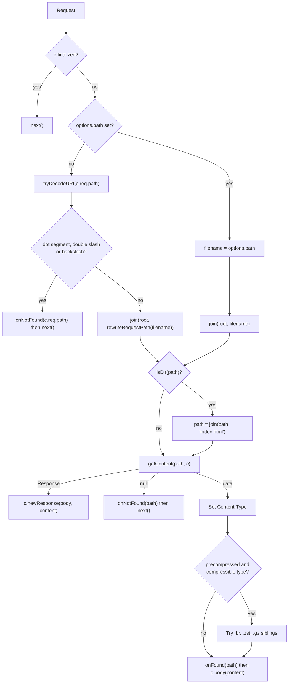

## Overview

Hono has no file system of its own: it runs on Bun, Deno, Cloudflare Workers and other runtimes, and each reads files in a different way. The static file support is therefore split in two. A generic `serveStatic` middleware in `hono/serve-static` does everything that does not depend on the runtime (validating and resolving the request path, picking a MIME type, choosing a precompressed variant, calling hooks), and takes the runtime-specific parts as functions: `getContent` to read a file, plus optional `join` and `isDir`. Each adapter exports its own `serveStatic` that fills in those functions, so application code imports the one for its runtime.

Sources: [src/middleware/serve-static/index.ts:32-53](repo://src/middleware/serve-static/index.ts#L32-L53), [package.json:339-343](repo://package.json#L339-L343)

The middleware is an ordinary handler (see [[Middleware and Composition]]): when it finds a file it returns a response and stops the chain; when it does not, it calls `next()` so later routes or the app's not-found handler answer. The per-runtime wrappers are listed with the rest of each adapter in [[Runtime Adapters]].

Sources: [src/middleware/serve-static/index.ts:54-125](repo://src/middleware/serve-static/index.ts#L54-L125)

## Using It

### Basic usage on Bun or Deno

Mount the adapter's `serveStatic` on a wildcard route. The request path is joined to `root` as it is, so a request for `/static/logo.png` with `root: './'` reads `./static/logo.png`. `rewriteRequestPath` changes that mapping, and `path` serves one fixed file whatever the request path is.

Sources: [src/middleware/serve-static/index.ts:50-79](repo://src/middleware/serve-static/index.ts#L50-L79), [src/adapter/bun/index.ts:1-10](repo://src/adapter/bun/index.ts#L1-L10)

```ts
import { Hono } from 'hono'
import { serveStatic } from 'hono/bun' // or 'hono/deno'

const app = new Hono()

// GET /static/app.js -> ./static/app.js
app.use('/static/*', serveStatic({ root: './' }))

// GET /assets/app.js -> ./public/app.js
app.use(
  '/assets/*',
  serveStatic({
    root: './public',
    rewriteRequestPath: (path) => path.replace(/^\/assets/, ''),
  })
)

// Always serve one file
app.get('/favicon.ico', serveStatic({ path: './favicon.ico' }))

// Fallback: index.html for any other path
app.get('*', serveStatic({ path: './static/index.html' }))
```

Sources: [src/middleware/serve-static/index.ts:13-21](repo://src/middleware/serve-static/index.ts#L13-L21), [src/adapter/bun/serve-static.ts:8-32](repo://src/adapter/bun/serve-static.ts#L8-L32)

### Hooks

`onFound` runs after the file is read and the content headers are set, just before the body is sent, so it is the place to add `Cache-Control` or similar headers. `onNotFound` runs when no file matched (or the path was refused) before control passes to `next()`; it is useful for logging.

Sources: [src/middleware/serve-static/index.ts:118-124](repo://src/middleware/serve-static/index.ts#L118-L124)

```ts
app.use(
  '/static/*',
  serveStatic({
    root: './',
    onFound: (_path, c) => {
      c.header('Cache-Control', 'public, immutable, max-age=31536000')
    },
    onNotFound: (path, c) => {
      console.log(`${path} is not found, you access ${c.req.path}`)
    },
  })
)
```

Sources: [src/middleware/serve-static/index.ts:19-20](repo://src/middleware/serve-static/index.ts#L19-L20), [src/middleware/serve-static/index.ts:118-124](repo://src/middleware/serve-static/index.ts#L118-L124)

## Options

### Common options

`ServeStaticOptions` is the option type every wrapper accepts. All fields are optional.

Sources: [src/middleware/serve-static/index.ts:13-21](repo://src/middleware/serve-static/index.ts#L13-L21)

| Option | Type | Default | Description |
| --- | --- | --- | --- |
| `root` | `string` | `'./'` | Directory the file path is joined to. May be relative or absolute; `..` inside `root` itself is resolved by `join`. |
| `path` | `string` | none | Fixed file to serve instead of the request path. When set, the request path is neither validated nor passed to `rewriteRequestPath`. |
| `precompressed` | `boolean` | `false` | Look for `.br`, `.zst` and `.gz` siblings of the file and serve one the client accepts. |
| `mimes` | `Record<string, string>` | none | Extra extension-to-MIME map, consulted before the built-in table. Keys are extensions without the dot. |
| `rewriteRequestPath` | `(path: string) => string` | none | Maps the decoded request path to the path joined with `root`. Ignored when `path` is set. |
| `onFound` | `(path, c) => void \| Promise<void>` | none | Called with the resolved file path when content is found, before the response is built. |
| `onNotFound` | `(path, c) => void \| Promise<void>` | none | Called when nothing is served: with the raw request path if it was refused, otherwise with the resolved file path. |

Sources: [src/middleware/serve-static/index.ts:13-21](repo://src/middleware/serve-static/index.ts#L13-L21), [src/middleware/serve-static/index.ts:50-124](repo://src/middleware/serve-static/index.ts#L50-L124)

### Runtime hooks of the generic middleware

The generic `serveStatic` exported from `hono/serve-static` takes these extra fields, which the adapters supply. Use it directly only to support a runtime Hono has no wrapper for.

Sources: [src/middleware/serve-static/index.ts:35-49](repo://src/middleware/serve-static/index.ts#L35-L49)

| Field | Type | Required | Description |
| --- | --- | --- | --- |
| `getContent` | `(path, c) => Promise<Data \| Response \| null>` | yes | Reads the file. `null` (or `undefined`) means not found; a `Response` is returned as is; any other value becomes the body. |
| `join` | `(...paths: string[]) => string` | no | Path joiner. Defaults to `defaultJoin`, which always uses `/`. Bun and Deno pass `join` from `node:path`. |
| `isDir` | `(path) => boolean \| undefined \| Promise<...>` | no | Reports whether the resolved path is a directory, so `index.html` can be appended. |
| `pathResolve` | `(path: string) => string` | no | Deprecated and unused. |

Sources: [src/middleware/serve-static/index.ts:35-52](repo://src/middleware/serve-static/index.ts#L35-L52), [src/middleware/serve-static/path.ts:1-5](repo://src/middleware/serve-static/path.ts#L1-L5)

```ts
import { serveStatic } from 'hono/serve-static'

const myServeStatic = serveStatic({
  root: './public',
  getContent: async (path, c) => {
    const data = await readFromMyStore(path) // returns string | ArrayBuffer | ReadableStream | null
    return data ?? null
  },
  isDir: async (path) => await myStoreHasDirectory(path),
})
```

Sources: [src/middleware/serve-static/index.ts:35-53](repo://src/middleware/serve-static/index.ts#L35-L53)

## Request Flow

### Step by step

The handler returned by `serveStatic` runs these steps on every request it is mounted on:
1. If `c.finalized` is already true (an earlier handler set a response), it calls `next()` and does nothing else.
2. It takes the file name from `options.path`, or else decodes `c.req.path` with `tryDecodeURI` and validates it. A refused path calls `onNotFound` with the raw request path, then `next()`.
3. It joins `root` with the file name, after `rewriteRequestPath` when one is given and `path` is not set.
4. If `isDir` says the result is a directory, it appends `index.html`.
5. It calls `getContent`. A `Response` is copied into a new response with `c.newResponse`. Any non-null value is served; `null` calls `onNotFound` with the resolved path and then `next()`.
6. For served content it sets `Content-Type`, optionally swaps in a precompressed variant, calls `onFound`, and returns `c.body(content)`.

Sources: [src/middleware/serve-static/index.ts:54-125](repo://src/middleware/serve-static/index.ts#L54-L125)



Sources: [src/middleware/serve-static/index.ts:54-125](repo://src/middleware/serve-static/index.ts#L54-L125)

### Path validation

The decoded request path is refused when it contains a `.` or `..` segment, two or more consecutive slashes or backslashes, or any backslash. Because the check runs after `tryDecodeURI`, encoded forms such as `%2e%2e` and `%5C` are caught too. `decodeURI` leaves `%2F` encoded, so `/admin%2Fsecret.txt` is looked up as the literal file name `admin%2Fsecret.txt` and never becomes `admin/secret.txt`. A path that `decodeURI` cannot fully decode is decoded piece by piece, leaving the invalid sequences as written.

Sources: [src/middleware/serve-static/index.ts:60-74](repo://src/middleware/serve-static/index.ts#L60-L74), [src/utils/url.ts:81-104](repo://src/utils/url.ts#L81-L104)

```ts
filename = tryDecodeURI(c.req.path)
if (/(?:^|[\/\\])\.{1,2}(?:$|[\/\\])|[\/\\]{2,}|\\/.test(filename)) {
  throw new Error()
}
```

Sources: [src/middleware/serve-static/index.ts:66-69](repo://src/middleware/serve-static/index.ts#L66-L69)

> [!WARNING]
> The check guards the request path only. A `rewriteRequestPath` function and a fixed `path` option are trusted as written, so a rewrite must not reintroduce `..` segments from user input.

Sources: [src/middleware/serve-static/index.ts:62-79](repo://src/middleware/serve-static/index.ts#L62-L79)

The tests pin the cases that matter for a mount like `app.use('/*', serveStatic(...))` placed after a guard on `/admin/*`: `/admin%2Fsecret.txt` skips the guard but cannot reach `admin/secret.txt`, and `//admin/secret.txt` is refused with a 404.

Sources: [src/middleware/serve-static/index.test.ts:295-319](repo://src/middleware/serve-static/index.test.ts#L295-L319)

### Path joining

When the runtime gives no `join`, `defaultJoin` is used. It drops empty parts, joins with `/`, collapses repeated slashes and resolves `.` and `..` segments. A leading `..` that has nothing to pop is kept, so `root: '../home/hono'` stays relative, while `root: '/home/hono/../parent'` resolves to `/home/parent`. An empty result becomes `'.'`. It does not understand Windows paths.

Sources: [src/middleware/serve-static/path.ts:1-25](repo://src/middleware/serve-static/path.ts#L1-L25), [src/middleware/serve-static/index.test.ts:259-281](repo://src/middleware/serve-static/index.test.ts#L259-L281)

```ts
export const defaultJoin = (...paths: string[]): string => {
  // Join non-empty paths with '/'
  let result = paths.filter((p) => p !== '').join('/')

  // Normalize multiple slashes to single slash
  result = result.replace(/(?<=\/)\/+/g, '')

  // Handle path resolution (. and ..)
  const segments = result.split('/')
  const resolved = []

  for (const segment of segments) {
    if (segment === '..' && resolved.length > 0 && resolved.at(-1) !== '..') {
      resolved.pop()
    } else if (segment !== '.') {
      resolved.push(segment)
    }
  }

  return resolved.join('/') || '.'
}
```

Sources: [src/middleware/serve-static/path.ts:5-25](repo://src/middleware/serve-static/path.ts#L5-L25)

With the default `root` of `'./'`, a request for `/static/hello.html` resolves to `static/hello.html`; a request for a directory such as `/static/sub` resolves to `static/sub/index.html` when `isDir` reports a directory.

Sources: [src/middleware/serve-static/index.test.ts:13-53](repo://src/middleware/serve-static/index.test.ts#L13-L53)

## Content Type and Precompressed Files

### MIME type

The `Content-Type` comes from the file extension of the resolved path: first from `options.mimes` if given, then from the built-in table, and `application/octet-stream` when neither knows the extension. `getMimeType` matches the last `.ext` of the name and lowercases it before the lookup. Text types in the table carry `; charset=utf-8`.

Sources: [src/middleware/serve-static/index.ts:92-94](repo://src/middleware/serve-static/index.ts#L92-L94), [src/utils/mime.ts:6-16](repo://src/utils/mime.ts#L6-L16)

| Extension | Content-Type |
| --- | --- |
| `html`, `htm` | `text/html; charset=utf-8` |
| `css` | `text/css; charset=utf-8` |
| `js`, `mjs` | `text/javascript; charset=utf-8` |
| `json`, `map` | `application/json` |
| `svg` | `image/svg+xml; charset=utf-8` |
| `wasm` | `application/wasm` |
| `txt` | `text/plain; charset=utf-8` |
| `ts` | `video/mp2t` |

Sources: [src/utils/mime.ts:35-94](repo://src/utils/mime.ts#L35-L94)

> [!NOTE]
> `ts` maps to the MPEG transport stream type, not TypeScript. Add `mimes: { ts: 'text/plain; charset=utf-8' }` if you serve TypeScript sources.

Sources: [src/utils/mime.ts:75-75](repo://src/utils/mime.ts#L75-L75), [src/middleware/serve-static/index.ts:93](repo://src/middleware/serve-static/index.ts#L93)

### Precompressed variants

With `precompressed: true`, the middleware tries to serve a file compressed ahead of time (for example `app.js.br` next to `app.js`) instead of compressing at request time like the compress middleware in [[Caching, ETag and Compression]]. It only does so when the MIME type is unknown or matches `COMPRESSIBLE_CONTENT_TYPE_REGEX`, so images such as PNG are never swapped.

Sources: [src/middleware/serve-static/index.ts:96-117](repo://src/middleware/serve-static/index.ts#L96-L117), [src/utils/compress.ts:9-10](repo://src/utils/compress.ts#L9-L10)

The encodings are tried in a fixed server order, `br`, then `zstd`, then `gzip`, skipping any the client did not list in `Accept-Encoding`. The first sibling file that `getContent` returns replaces the content, sets `Content-Encoding` and appends `Accept-Encoding` to `Vary`. The `Content-Type` stays that of the original file. If no variant exists, the uncompressed file is served.

Sources: [src/middleware/serve-static/index.ts:23-28](repo://src/middleware/serve-static/index.ts#L23-L28), [src/middleware/serve-static/index.ts:104-116](repo://src/middleware/serve-static/index.ts#L104-L116)

```ts
const ENCODINGS = {
  br: '.br',
  zstd: '.zst',
  gzip: '.gz',
} as const
```

Sources: [src/middleware/serve-static/index.ts:23-27](repo://src/middleware/serve-static/index.ts#L23-L27)

> [!NOTE]
> `Accept-Encoding` is split on commas and trimmed, then matched by exact name. An entry with a quality value such as `gzip;q=0.8` does not match `gzip`, and client q-values never change the order.

Sources: [src/middleware/serve-static/index.ts:97-107](repo://src/middleware/serve-static/index.ts#L97-L107)

## Runtime Wrappers

### Bun

`hono/bun` reads files with `Bun.file(path)` and returns the `BunFile` when `file.exists()` is true, else `null`. `isDir` uses `stat` from `node:fs/promises` and returns `undefined` when the path does not exist; `join` is `node:path`'s.

Sources: [src/adapter/bun/serve-static.ts:1-32](repo://src/adapter/bun/serve-static.ts#L1-L32)

### Deno

`hono/deno` opens the file with `Deno.open` and returns its `readable` stream. `getContent` returns `null` for directories and for missing files; other errors (for example permission errors) are logged with `console.warn` and also treated as not found. `isDir` uses `Deno.lstatSync`, which does not follow symlinks, so a symlink to a directory is not given an `index.html`.

Sources: [src/adapter/deno/serve-static.ts:1-42](repo://src/adapter/deno/serve-static.ts#L1-L42)

```ts
const getContent = async (path: string) => {
  try {
    if (isDir(path)) {
      return null
    }

    const file = await open(path)
    return file.readable
  } catch (e) {
    if (!(e instanceof errors.NotFound)) {
      console.warn(`${e}`)
    }
    return null
  }
}
```

Sources: [src/adapter/deno/serve-static.ts:12-26](repo://src/adapter/deno/serve-static.ts#L12-L26)

### Cloudflare Workers

The Cloudflare Workers `serveStatic` is deprecated in favour of Cloudflare Static Assets. It reads Workers Sites assets from KV: `getContentFromKVAsset` looks the resolved path up in the asset manifest (the `manifest` option, or the global `__STATIC_CONTENT_MANIFEST`, parsed from JSON when it is a string), then fetches the hashed key from the KV namespace as a stream. The namespace is the `namespace` option, else `c.env.__STATIC_CONTENT`, else the global `__STATIC_CONTENT`.

Sources: [src/adapter/cloudflare-workers/serve-static.ts:1-42](repo://src/adapter/cloudflare-workers/serve-static.ts#L1-L42), [src/adapter/cloudflare-workers/utils.ts:1-50](repo://src/adapter/cloudflare-workers/utils.ts#L1-L50)

| Extra option | Type | Description |
| --- | --- | --- |
| `manifest` | `object \| string` | Asset manifest mapping paths to KV keys; required in ES module mode, usually `import manifest from '__STATIC_CONTENT_MANIFEST'`. |
| `namespace` | `unknown` (a `KVNamespace`) | KV namespace holding the assets. Not accepted by the ES module export. |

Sources: [src/adapter/cloudflare-workers/serve-static.ts:6-10](repo://src/adapter/cloudflare-workers/serve-static.ts#L6-L10), [src/adapter/cloudflare-workers/serve-static-module.ts:1-12](repo://src/adapter/cloudflare-workers/serve-static-module.ts#L1-L12)

`hono/cloudflare-workers` exports the ES module variant from `serve-static-module.ts`, which takes the same options minus `namespace`. Neither variant passes `isDir` or `join`, so paths are joined with `defaultJoin` and a directory request is not mapped to `index.html`; the matching test is skipped for that reason. Keys are looked up as joined, so with the default root `/static/app.js` looks up `static/app.js` in the manifest.

Sources: [src/adapter/cloudflare-workers/index.ts:1-8](repo://src/adapter/cloudflare-workers/index.ts#L1-L8), [src/adapter/cloudflare-workers/serve-static.test.ts:80-90](repo://src/adapter/cloudflare-workers/serve-static.test.ts#L80-L90), [src/adapter/cloudflare-workers/serve-static.ts:21-41](repo://src/adapter/cloudflare-workers/serve-static.ts#L21-L41)

### Cloudflare Pages

`hono/cloudflare-pages` exports a different, option-less `serveStatic` for Pages advanced mode. It forwards the raw request to `env.ASSETS.fetch` and returns that response, or `c.notFound()` when the asset binding answers 404. It does not use the generic middleware at all.

Sources: [src/adapter/cloudflare-pages/handler.ts:108-123](repo://src/adapter/cloudflare-pages/handler.ts#L108-L123)

## File Path Helpers

`src/utils/filepath.ts` holds `getFilePath` and `getFilePathWithoutDefaultDocument`, older helpers that turn a request file name and root into a relative path: they append `index.html` to names ending in `/` or lacking an extension, refuse any `..` segment by returning `undefined`, convert backslashes to `/`, and strip leading `./` or `/`. The current `serveStatic` does not call them; it resolves paths with `join` and `isDir` as described above.

Sources: [src/utils/filepath.ts:1-60](repo://src/utils/filepath.ts#L1-L60), [src/middleware/serve-static/index.ts:6-11](repo://src/middleware/serve-static/index.ts#L6-L11)

For generating static files from routes at build time rather than serving existing ones, see [[Static Site Generation]].

Sources: [src/middleware/serve-static/index.ts:32-34](repo://src/middleware/serve-static/index.ts#L32-L34)
