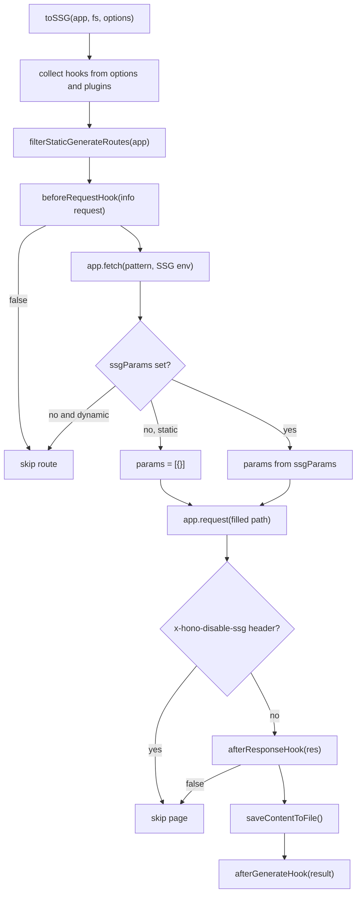

## Overview

The SSG helper (`hono/ssg`) renders a Hono app to files ahead of time. `toSSG` walks the app's registered GET routes, calls the app in-process for each one with `app.fetch` / `app.request`, and writes every successful response to an output directory through a pluggable `FileSystemModule`. Because generation runs the same handlers that serve live traffic, one app can be deployed both as a server and as a static site.

Sources: [src/helper/ssg/index.ts:1-14](repo://src/helper/ssg/index.ts#L1-L14), [src/helper/ssg/ssg.ts:363-470](repo://src/helper/ssg/ssg.ts#L363-L470)

The core is runtime-agnostic: it never imports `fs`. The Bun and Deno adapters export a `toSSG(app, options)` that supplies their own file system module, and on Node.js you pass `node:fs/promises`, which already matches the `writeFile` / `mkdir` interface. Most exports are marked `@experimental` in the source.

Sources: [src/helper/ssg/ssg.ts:29-37](repo://src/helper/ssg/ssg.ts#L29-L37), [src/adapter/bun/ssg.ts:1-27](repo://src/adapter/bun/ssg.ts#L1-L27), [src/adapter/deno/ssg.ts:1-27](repo://src/adapter/deno/ssg.ts#L1-L27), [package.json:269-273](repo://package.json#L269-L273)

## Quick example

```ts
import fs from 'node:fs/promises'
import { Hono } from 'hono'
import { toSSG, ssgParams, disableSSG } from 'hono/ssg'

const app = new Hono()

app.get('/', (c) => c.html('<h1>Home</h1>'))
app.get(
  '/posts/:id',
  ssgParams([{ id: '1' }, { id: '2' }]),
  (c) => c.html(`<h1>Post ${c.req.param('id')}</h1>`)
)
app.get('/api/live', disableSSG(), (c) => c.json({ now: Date.now() }))

const result = await toSSG(app, fs, { dir: './dist' })
// result.files: ['dist/index.html', 'dist/posts/1.html', 'dist/posts/2.html']
```

Sources: [src/helper/ssg/ssg.ts:368-470](repo://src/helper/ssg/ssg.ts#L368-L470), [src/helper/ssg/middleware.ts:40-70](repo://src/helper/ssg/middleware.ts#L40-L70)

## toSSG options and result

### ToSSGOptions

| Option | Type | Default | Description |
| --- | --- | --- | --- |
| `dir` | `string` | `'./static'` (`DEFAULT_OUTPUT_DIR`) | Output directory |
| `concurrency` | `number` | `2` | Maximum in-flight requests to the app |
| `extensionMap` | `Record<string, string>` | `defaultExtensionMap` | MIME type to file extension; replaces the default map entirely when given |
| `plugins` | `SSGPlugin[]` | `[defaultPlugin()]` | Hook bundles, see Plugins and hooks |
| `beforeRequestHook` | hook or array | none | Deprecated: use `plugins[].beforeRequestHook` |
| `afterResponseHook` | hook or array | none | Deprecated: use `plugins[].afterResponseHook` |
| `afterGenerateHook` | hook or array | none | Deprecated: use `plugins[].afterGenerateHook` |

Sources: [src/helper/ssg/ssg.ts:17-27](repo://src/helper/ssg/ssg.ts#L17-L27), [src/helper/ssg/ssg.ts:181-198](repo://src/helper/ssg/ssg.ts#L181-L198), [src/helper/ssg/ssg.ts:368-372](repo://src/helper/ssg/ssg.ts#L368-L372), [src/helper/ssg/ssg.ts:420-423](repo://src/helper/ssg/ssg.ts#L420-L423)

> [!WARNING]
> Passing `plugins` replaces the default list. If you pass your own plugins and still want non-200 responses skipped, include `defaultPlugin()` yourself.

Sources: [src/helper/ssg/ssg.ts:372-372](repo://src/helper/ssg/ssg.ts#L372-L372), [src/helper/ssg/plugins.ts:11-20](repo://src/helper/ssg/plugins.ts#L11-L20)

### ToSSGResult

`toSSG` never rejects for generation errors. It resolves a `ToSSGResult`: `{ success: true, files }` with the written paths, or `{ success: false, files: [], error }` when anything failed. Non-`Error` throwables are wrapped with `new Error(String(error))`.

Sources: [src/helper/ssg/ssg.ts:39-48](repo://src/helper/ssg/ssg.ts#L39-L48), [src/helper/ssg/ssg.ts:450-464](repo://src/helper/ssg/ssg.ts#L450-L464)

## How routes are crawled

### Selecting routes

`filterStaticGenerateRoutes` reads `app.routes` and keeps entries whose method is `GET` or `ALL` and whose handler is not a middleware. A handler counts as middleware when it declares more than one parameter (`handler.length > 1`, that is, it takes `next`), after unwrapping composed handlers via `findTargetHandler`. So for `app.get('/p/:id', ssgParams(...), handler)` only the final handler's entry produces a route, and POST routes are never generated.

Sources: [src/helper/ssg/utils.ts:57-71](repo://src/helper/ssg/utils.ts#L57-L71), [src/utils/handler.ts:8-15](repo://src/utils/handler.ts#L8-L15)

A path is dynamic when any segment starts with `:` or contains `*` (`isDynamicRoute`).

Sources: [src/helper/ssg/utils.ts:73-75](repo://src/helper/ssg/utils.ts#L73-L75)

### Two-phase fetching

`fetchRoutesContent` is a generator that yields one promise per route, each resolving to an inner generator with one promise per page. It works in two phases:

Sources: [src/helper/ssg/ssg.ts:200-302](repo://src/helper/ssg/ssg.ts#L200-L302), [src/helper/ssg/ssg.ts:74-88](repo://src/helper/ssg/ssg.ts#L74-L88)

1. Info request: it builds `new Request('http://localhost' + route.path)` with the raw pattern (for example `/posts/:id`), runs it through `beforeRequestHook` (a falsy result skips the route), and calls `app.fetch(req, { HONO_SSG_CONTEXT: true })`. The response is discarded; the request is used only to collect `ssgParams`.
2. If no middleware attached `ssgParams` to the request, a dynamic route is skipped and a static route gets `[{}]`.
3. Page requests: for each param set it fills the pattern with `replaceUrlParam`, calls `app.request(path, { method, headers }, { HONO_SSG_CONTEXT: true })` reusing the method and headers of the (possibly hooked) info request, and skips responses carrying the `x-hono-disable-ssg` header.
4. The response goes through `afterResponseHook` (falsy skips it). The MIME type is the `Content-Type` before `;`, or `text/plain` when absent; the body is read as text for `text` or `json` types and as an `ArrayBuffer` otherwise.

Sources: [src/helper/ssg/ssg.ts:200-302](repo://src/helper/ssg/ssg.ts#L200-L302), [src/helper/ssg/ssg.ts:74-88](repo://src/helper/ssg/ssg.ts#L74-L88)



Sources: [src/helper/ssg/ssg.ts:205-302](repo://src/helper/ssg/ssg.ts#L205-L302), [src/helper/ssg/ssg.ts:368-470](repo://src/helper/ssg/ssg.ts#L368-L470)

> [!NOTE]
> A static route's handler runs twice: once for the info request, whose response is thrown away, and once for the page request. Keep handlers free of side effects that must not repeat, or guard them with `isSSGContext`.

Sources: [src/helper/ssg/ssg.ts:243-269](repo://src/helper/ssg/ssg.ts#L243-L269)

### Concurrency

Both phases share one pool from `createPool({ concurrency })`. When the pool is full, `run` re-schedules itself with `setTimeout` until a slot frees, so at most `concurrency` app calls are in flight. `toSSG` passes `2` by default; `createPool` itself would fall back to 1024 for a falsy value, and `Infinity` disables the limit.

Sources: [src/helper/ssg/ssg.ts:222-223](repo://src/helper/ssg/ssg.ts#L222-L223), [src/utils/concurrent.ts:6-55](repo://src/utils/concurrent.ts#L6-L55)

## SSG middleware

### ssgParams

`ssgParams` declares which concrete pages a dynamic route produces. It accepts either an array of param objects or a function `(c) => SSGParams | Promise<SSGParams>`, typed with your app's `Env` so the function can read `c.env` and `c.var`. When the request path is dynamic, which only happens for the SSG info request because live requests have concrete paths, it stores the params on `c.req.raw.ssgParams` and returns `c.notFound()` so the real handler does not run with literal `:id` values. Otherwise it calls `next()`.

Sources: [src/helper/ssg/middleware.ts:24-49](repo://src/helper/ssg/middleware.ts#L24-L49)

```ts
app.get(
  '/shops/:id',
  ssgParams(async (c) => {
    const shops = await getShops()
    return shops.map((shop) => ({ id: shop.id }))
  }),
  async (c) => c.html(await renderShop(c.req.param('id')))
)
```

Sources: [src/helper/ssg/middleware.ts:29-49](repo://src/helper/ssg/middleware.ts#L29-L49)

### isSSGContext, disableSSG and onlySSG

`toSSG` marks its requests by passing `{ HONO_SSG_CONTEXT: true }` as the env. `isSSGContext(c)` returns whether `c.env` has that key. The two middlewares build on it:

Sources: [src/helper/ssg/middleware.ts:5-6](repo://src/helper/ssg/middleware.ts#L5-L6), [src/helper/ssg/middleware.ts:51-83](repo://src/helper/ssg/middleware.ts#L51-L83)

| Middleware | During SSG | During live requests |
| --- | --- | --- |
| `disableSSG()` | sets `x-hono-disable-ssg: true` and returns `c.notFound()`; the page is skipped | calls `next()` |
| `onlySSG()` | calls `next()` | returns `c.notFound()` |

Sources: [src/helper/ssg/middleware.ts:5-6](repo://src/helper/ssg/middleware.ts#L5-L6), [src/helper/ssg/middleware.ts:51-83](repo://src/helper/ssg/middleware.ts#L51-L83)

`disableSSG` relies on the header, not the 404 status, so it is skipped even when a plugin set lets non-200 responses through. `SSG_DISABLED_RESPONSE`, a prebuilt 404 response with that header, is deprecated in favor of `X_HONO_DISABLE_SSG_HEADER_KEY`.

Sources: [src/helper/ssg/ssg.ts:270-273](repo://src/helper/ssg/ssg.ts#L270-L273), [src/helper/ssg/middleware.ts:8-22](repo://src/helper/ssg/middleware.ts#L8-L22)

## Plugins and hooks

### Hook types

An `SSGPlugin` bundles up to three hooks, each a function or an array of functions:

Sources: [src/helper/ssg/ssg.ts:110-116](repo://src/helper/ssg/ssg.ts#L110-L116), [src/helper/ssg/ssg.ts:175-179](repo://src/helper/ssg/ssg.ts#L175-L179), [src/helper/ssg/ssg.ts:465-468](repo://src/helper/ssg/ssg.ts#L465-L468)

| Hook | Signature | Effect |
| --- | --- | --- |
| `beforeRequestHook` | `(req: Request) => Request \| false` (sync or async) | Return a new `Request` to replace it, `false` to skip the route |
| `afterResponseHook` | `(res: Response) => Response \| false` (sync or async) | Return a new `Response` to replace it, `false` to skip the page |
| `afterGenerateHook` | `(result, fsModule, options?) => void` (sync or async) | Runs once after all files are written, even when generation failed |

Sources: [src/helper/ssg/ssg.ts:110-116](repo://src/helper/ssg/ssg.ts#L110-L116), [src/helper/ssg/ssg.ts:175-179](repo://src/helper/ssg/ssg.ts#L175-L179), [src/helper/ssg/ssg.ts:465-468](repo://src/helper/ssg/ssg.ts#L465-L468)

### Ordering and combination

`toSSG` collects the deprecated top-level hooks first, then each plugin's hooks in array order. `combineBeforeRequestHooks` and `combineAfterResponseHooks` run the hooks in sequence: the first `false` stops the chain, a returned `Request` / `Response` replaces the current value, and any other return value keeps the previous one. `combineAfterGenerateHooks` awaits each hook in turn. With no hooks at all, identity hooks are used.

Sources: [src/helper/ssg/ssg.ts:118-173](repo://src/helper/ssg/ssg.ts#L118-L173), [src/helper/ssg/ssg.ts:373-429](repo://src/helper/ssg/ssg.ts#L373-L429)

### Built-in plugins

`defaultPlugin()` is an `afterResponseHook` that returns `false` for any status other than 200, so error pages and redirects are not written. `redirectPlugin()` turns 301, 302, 303, 307 and 308 responses into a 200 HTML page with a `meta http-equiv="refresh"`, a canonical link and a `noindex` robots tag pointing at the `Location`; a redirect without `Location` is skipped. The redirect page is built with the `html` tagged template, so the location is escaped.

Sources: [src/helper/ssg/plugins.ts:1-72](repo://src/helper/ssg/plugins.ts#L1-L72)

Order matters because hooks run in sequence: `redirectPlugin` must come before `defaultPlugin`, or the redirect is dropped as a non-200 response first.

Sources: [src/helper/ssg/plugins.ts:38-54](repo://src/helper/ssg/plugins.ts#L38-L54)

```ts
import { toSSG, redirectPlugin, defaultPlugin } from 'hono/ssg'

await toSSG(app, fs, { plugins: [redirectPlugin(), defaultPlugin()] })
```

Sources: [src/helper/ssg/plugins.ts:43-48](repo://src/helper/ssg/plugins.ts#L43-L48)

```ts
const sitemapPlugin: SSGPlugin = {
  afterGenerateHook: async (result, fsModule, options) => {
    if (!result.success) return
    const urls = result.files.map((f) => `<url><loc>${f}</loc></url>`).join('')
    await fsModule.writeFile(`${options?.dir ?? './static'}/sitemap.xml`, `<urlset>${urls}</urlset>`)
  },
}
```

Sources: [src/helper/ssg/ssg.ts:112-116](repo://src/helper/ssg/ssg.ts#L112-L116), [src/helper/ssg/ssg.ts:34-37](repo://src/helper/ssg/ssg.ts#L34-L37)

## Writing files

### File paths and extensions

`generateFilePath` picks the extension from the MIME type with `determineExtension`, which uses `extensionMap` (or `defaultExtensionMap`) first, then `getExtension` from the MIME table, then `'html'`. It then maps the route path:

Sources: [src/helper/ssg/ssg.ts:50-72](repo://src/helper/ssg/ssg.ts#L50-L72), [src/helper/ssg/ssg.ts:90-108](repo://src/helper/ssg/ssg.ts#L90-L108), [src/utils/mime.ts:18-26](repo://src/utils/mime.ts#L18-L26)

| Route path | Rule | Example output (`text/html`) |
| --- | --- | --- |
| already ends with `.<ext>` | kept as is | `/feed.xml` with `application/rss+xml` to `static/feed.xml` |
| `/` | `index.<ext>` | `static/index.html` |
| ends with `/` | `<path>/index.<ext>` | `/blog/` to `static/blog/index.html` |
| anything else | `<path>.<ext>` | `/about` to `static/about.html` |

Sources: [src/helper/ssg/ssg.ts:50-72](repo://src/helper/ssg/ssg.ts#L50-L72), [src/helper/ssg/ssg.ts:90-108](repo://src/helper/ssg/ssg.ts#L90-L108), [src/utils/mime.ts:18-26](repo://src/utils/mime.ts#L18-L26)

`defaultExtensionMap` maps `text/html` to `html`, the XML, Atom and RSS types to `xml`, and `application/yaml` to `yaml`. A `c.text()` page with no explicit type becomes `.txt` and `c.json()` becomes `.json` through the MIME table.

Sources: [src/helper/ssg/ssg.ts:90-97](repo://src/helper/ssg/ssg.ts#L90-L97), [src/utils/mime.ts:55-55](repo://src/utils/mime.ts#L55-L55), [src/utils/mime.ts:77-77](repo://src/utils/mime.ts#L77-L77)

### Path safety

`joinPaths` normalizes backslashes and trailing slashes and resolves `.` and `..` segments. `ensureWithinOutDir` then checks that the normalized file path equals the output directory or starts with it plus `/`, and throws `Path traversal detected` otherwise, so a param such as `../../etc/passwd` cannot write outside `dir`.

Sources: [src/helper/ssg/utils.ts:11-55](repo://src/helper/ssg/utils.ts#L11-L55), [src/helper/ssg/utils.ts:77-87](repo://src/helper/ssg/utils.ts#L77-L87)

### saveContentToFile

`saveContentToFile` awaits the page promise, computes the path, creates the parent directory with `fsModule.mkdir(dir, { recursive: true })` the first time it sees that directory, and writes strings as is and `ArrayBuffer` content as a `Uint8Array`. `toSSG` catches each save's rejection as a value; after all routes are processed it collects file paths in order and rethrows the first error, which turns the result into `success: false`.

Sources: [src/helper/ssg/ssg.ts:304-334](repo://src/helper/ssg/ssg.ts#L304-L334), [src/helper/ssg/ssg.ts:436-464](repo://src/helper/ssg/ssg.ts#L436-L464)

> [!NOTE]
> The set of created directories (`createdDirs`) is module-level, so it persists across `toSSG` calls in the same process. If you delete the output directory between two runs in one process, `mkdir` is not called again for directories seen earlier.

Sources: [src/helper/ssg/ssg.ts:309-327](repo://src/helper/ssg/ssg.ts#L309-L327)

## Runtime adapters

| Runtime | Import | File system module | Notes |
| --- | --- | --- | --- |
| Bun | `hono/bun` | `bunFileSystemModule` | `writeFile` uses `Bun.write`, which creates parent directories; `mkdir` is a no-op |
| Deno | `hono/deno` | `denoFileSystemModule` | `writeFile` encodes strings and calls `Deno.writeFile`; `mkdir` calls `Deno.mkdir` |
| Node.js and others | `hono/ssg` | pass your own, such as `node:fs/promises` | `toSSG(app, fs, options)` |

Sources: [src/adapter/bun/ssg.ts:5-27](repo://src/adapter/bun/ssg.ts#L5-L27), [src/adapter/deno/ssg.ts:4-27](repo://src/adapter/deno/ssg.ts#L4-L27), [src/adapter/bun/index.ts:7-7](repo://src/adapter/bun/index.ts#L7-L7), [src/adapter/deno/index.ts:7-7](repo://src/adapter/deno/index.ts#L7-L7)

The adapter `toSSG` has the `ToSSGAdaptorInterface` shape `(app, options?)` and simply forwards to the core `toSSG` with its module. See [[Runtime Adapters]] for the other per-runtime exports.

Sources: [src/helper/ssg/ssg.ts:350-361](repo://src/helper/ssg/ssg.ts#L350-L361), [src/adapter/bun/ssg.ts:20-27](repo://src/adapter/bun/ssg.ts#L20-L27)

```ts
import { toSSG } from 'hono/bun'
import app from './app'

await toSSG(app, { dir: './public' })
```

Sources: [src/adapter/bun/ssg.ts:25-27](repo://src/adapter/bun/ssg.ts#L25-L27)
