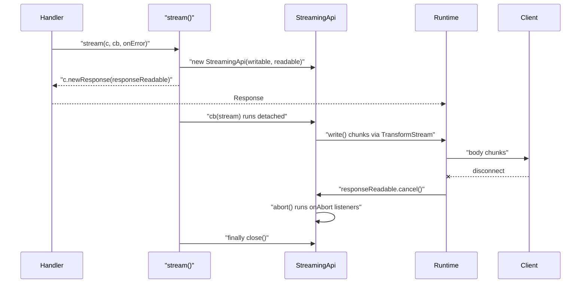

## Overview

The streaming helper (`hono/streaming`) lets a handler return a `Response` immediately and keep writing its body afterwards. It exports three entry points, `stream`, `streamText` and `streamSSE`, plus the `SSEStreamingApi` class and the `SSEMessage` type. All three build on `StreamingApi` in `src/utils/stream.ts`, a small wrapper around a `TransformStream` that turns writes into chunks of the response body and turns a client disconnect into an abort notification.

Sources: [src/helper/streaming/index.ts:1-9](repo://src/helper/streaming/index.ts#L1-L9), [src/utils/stream.ts:1-46](repo://src/utils/stream.ts#L1-L46)

The handler's callback runs in a detached async task: the helper returns `c.newResponse(stream.responseReadable)` right away, so headers and status are sent before the first byte is written. The response therefore goes through the normal [[Context]] machinery, and any headers set with `c.header` before the call are kept.

Sources: [src/helper/streaming/stream.ts:7-45](repo://src/helper/streaming/stream.ts#L7-L45), [src/context.ts:604-641](repo://src/context.ts#L604-L641)

## Helpers at a glance

| Helper | Callback receives | Headers it sets | On error with `onError` |
| --- | --- | --- | --- |
| `stream(c, cb, onError?)` | `StreamingApi` | none | calls `onError(e, stream)` |
| `streamText(c, cb, onError?)` | `StreamingApi` | `Content-Type: text/plain; charset=UTF-8`, `X-Content-Type-Options: nosniff`, `Transfer-Encoding: chunked` | same as `stream` |
| `streamSSE(c, cb, onError?)` | `SSEStreamingApi` | `Transfer-Encoding: chunked`, `Content-Type: text/event-stream`, `Cache-Control: no-cache`, `Connection: keep-alive` | calls `onError`, then writes an `error` event |

Sources: [src/helper/streaming/stream.ts:7-11](repo://src/helper/streaming/stream.ts#L7-L11), [src/helper/streaming/text.ts:6-15](repo://src/helper/streaming/text.ts#L6-L15), [src/helper/streaming/sse.ts:72-100](repo://src/helper/streaming/sse.ts#L72-L100), [src/context.ts:279-279](repo://src/context.ts#L279-L279)

## The StreamingApi class

### Construction and the response body

`StreamingApi` is constructed from the two halves of a `TransformStream`. It takes a writer on the writable side, which every `write` goes through, and a reader on the readable side. Instead of returning that readable directly, it builds a new `ReadableStream` (`responseReadable`) whose `pull` forwards chunks from the reader. Owning this outer stream gives it a `cancel` hook: when the runtime cancels the response body because the client went away, `cancel` calls `abort()` unless the stream already closed normally.

Sources: [src/utils/stream.ts:6-46](repo://src/utils/stream.ts#L6-L46)

The constructor also registers a first abort subscriber that cancels the inner reader. That closes `responseReadable` and unblocks pending writes, which would otherwise wait forever on back-pressure from a body nobody reads.

Sources: [src/utils/stream.ts:26-33](repo://src/utils/stream.ts#L26-L33)

### Methods and properties

| Member | Description |
| --- | --- |
| `write(input)` | Encodes a string with `TextEncoder` (or takes a `Uint8Array`) and writes it. Errors are swallowed. Returns the API for chaining. |
| `writeln(input)` | `write(input + '\n')`. |
| `sleep(ms)` | A `setTimeout` promise, handy for pacing demo streams. |
| `pipe(body)` | Releases the writer lock, pipes a `ReadableStream` into the writable with `preventClose: true`, then reacquires the writer so you can keep writing. |
| `close()` | Sets `closed = true` and closes the writer; errors are swallowed. |
| `onAbort(listener)` | Adds a listener run when the stream is aborted. |
| `abort()` | Sets `aborted = true` and runs every abort subscriber once. |
| `aborted` | `true` after `abort()` ran. |
| `closed` | `true` after `close()` ran. |
| `responseReadable` | The `ReadableStream` used as the response body. |

Sources: [src/utils/stream.ts:48-98](repo://src/utils/stream.ts#L48-L98)

> [!NOTE]
> `write` and `close` catch and ignore errors, because writing to a disconnected client is expected in streaming. The source comment says: if you need to handle those errors, create the stream yourself. Check `stream.aborted` in long loops to stop work after a disconnect.

Sources: [src/utils/stream.ts:48-58](repo://src/utils/stream.ts#L48-L58), [src/utils/stream.ts:69-76](repo://src/utils/stream.ts#L69-L76)

## The stream flow

`stream` wires a `StreamingApi` to the context and runs the callback:

Sources: [src/helper/streaming/stream.ts:1-45](repo://src/helper/streaming/stream.ts#L1-L45), [src/helper/streaming/utils.ts:1-11](repo://src/helper/streaming/utils.ts#L1-L11)

1. Create a `TransformStream` and a `StreamingApi` on top of it.
2. On Bun older than 1.1.27 (detected by `isOldBunVersion`), listen to the request's `abort` signal and call `stream.abort()`, because those versions never cancel the response stream.
3. Store the context in a module-level `WeakMap` keyed by `responseReadable`. On Bun the context would otherwise be destroyed once the handler returns, while the stream still needs it.
4. Start an async IIFE that awaits `cb(stream)`, routes errors, and always calls `stream.close()` in `finally`.
5. Return `c.newResponse(stream.responseReadable)` without waiting.

Sources: [src/helper/streaming/stream.ts:1-45](repo://src/helper/streaming/stream.ts#L1-L45), [src/helper/streaming/utils.ts:1-11](repo://src/helper/streaming/utils.ts#L1-L11)



Sources: [src/helper/streaming/stream.ts:7-45](repo://src/helper/streaming/stream.ts#L7-L45), [src/utils/stream.ts:35-46](repo://src/utils/stream.ts#L35-L46), [src/utils/stream.ts:84-97](repo://src/utils/stream.ts#L84-L97)

`isOldBunVersion` reads `Bun.version` once, matches versions starting with `1.1`, `1.0` or `0.`, and then replaces itself with a function returning the cached result.

Sources: [src/helper/streaming/utils.ts:1-11](repo://src/helper/streaming/utils.ts#L1-L11)

## Error handling

### Errors in stream and streamText

The `catch` in `stream` sorts errors three ways. A rejection with `undefined` is ignored: that is what `pipeTo` rejects with when the reader was cancelled without a reason, meaning the client is already gone. An `Error` is passed to `onError(e, stream)` when one was given, so the callback can still write a fallback chunk before the stream closes. Anything else, or an `Error` without `onError`, goes to `console.error`. In every case `finally` closes the stream.

Sources: [src/helper/streaming/stream.ts:26-42](repo://src/helper/streaming/stream.ts#L26-L42)

```ts
import { stream } from 'hono/streaming'

app.get('/download', (c) =>
  stream(
    c,
    async (stream) => {
      stream.onAbort(() => console.log('client disconnected'))
      await stream.write(new Uint8Array([0x48, 0x69]))
      await stream.pipe(someReadableStream)
    },
    async (err, stream) => {
      await stream.writeln(`Error: ${err.message}`)
    }
  )
)
```

Sources: [src/helper/streaming/stream.ts:7-45](repo://src/helper/streaming/stream.ts#L7-L45), [src/utils/stream.ts:48-86](repo://src/utils/stream.ts#L48-L86)

> [!WARNING]
> The status code and headers are already committed when the callback runs, so an error inside the callback cannot change the response to a 500. The [[Error Handling]] `onError` handler of the app is not involved either; only the helper's own `onError` argument sees the error.

Sources: [src/helper/streaming/stream.ts:26-44](repo://src/helper/streaming/stream.ts#L26-L44)

### Errors in streamSSE

`streamSSE` uses its own `run` function. When the callback throws an `Error` and `onError` is set, it awaits `onError(e, stream)` and then writes an SSE message with `event: 'error'` and `data: e.message`, so the browser's `EventSource` gets a named `error` event. Without `onError` the error is logged with `console.error`. Unlike `stream`, it has no special case for `undefined` rejections. The stream is always closed in `finally`.

Sources: [src/helper/streaming/sse.ts:47-68](repo://src/helper/streaming/sse.ts#L47-L68)

## streamText

`streamText` sets three headers and delegates to `stream`. `X-Content-Type-Options: nosniff` stops browsers from buffering the body to guess its type, which would delay the first visible chunk; `Transfer-Encoding: chunked` signals a body of unknown length.

Sources: [src/helper/streaming/text.ts:1-15](repo://src/helper/streaming/text.ts#L1-L15)

```ts
import { streamText } from 'hono/streaming'

app.get('/tokens', (c) =>
  streamText(c, async (stream) => {
    for (const token of ['Hello', ' ', 'world']) {
      await stream.write(token)
      await stream.sleep(100)
    }
    await stream.writeln('')
  })
)
```

Sources: [src/helper/streaming/text.ts:6-15](repo://src/helper/streaming/text.ts#L6-L15), [src/utils/stream.ts:48-67](repo://src/utils/stream.ts#L48-L67)

## Server-Sent Events

### SSEMessage format

`streamSSE` hands the callback an `SSEStreamingApi`, which adds `writeSSE(message)` to `StreamingApi`. A message has these fields:

Sources: [src/helper/streaming/sse.ts:6-11](repo://src/helper/streaming/sse.ts#L6-L11)

| Field | Type | Required | Wire output |
| --- | --- | --- | --- |
| `data` | `string \| Promise<string>` | yes | one `data: ` line per line of the value |
| `event` | `string` | no | `event: <name>` |
| `id` | `string` | no | `id: <id>` |
| `retry` | `number` | no | `retry: <ms>` |

Sources: [src/helper/streaming/sse.ts:6-11](repo://src/helper/streaming/sse.ts#L6-L11)

### How writeSSE serializes a message

1. `data` is resolved with `resolveCallback(message.data, HtmlEscapedCallbackPhase.Stringify, false, {})`. This awaits a promise and renders JSX elements and `html` template results (including async components and error boundaries) to a plain string.
2. The string is split on `\r\n`, `\r` or `\n`, and each line is prefixed with `data: `, so multi-line payloads stay a single event.
3. `event`, `id` and `retry` are rejected with an error such as `event must not contain "\r" or "\n"` if they contain a line break, which would otherwise let one field inject extra SSE fields.
4. The non-empty parts are joined in the order event, data, id, retry with `\n`, followed by a blank line (`\n\n`), and written with `write`.

Sources: [src/helper/streaming/sse.ts:18-44](repo://src/helper/streaming/sse.ts#L18-L44), [src/utils/html.ts:142-182](repo://src/utils/html.ts#L142-L182)

Empty values are left out by `filter(Boolean)`, so `retry: 0` or `id: ''` produce no line.

Sources: [src/helper/streaming/sse.ts:33-41](repo://src/helper/streaming/sse.ts#L33-L41)

```ts
import { streamSSE } from 'hono/streaming'

let id = 0

app.get('/sse', (c) =>
  streamSSE(c, async (stream) => {
    stream.onAbort(() => console.log('aborted'))
    while (!stream.aborted) {
      await stream.writeSSE({
        event: 'time-update',
        data: new Date().toISOString(),
        id: String(id++),
      })
      await stream.sleep(1000)
    }
  })
)
```

Sources: [src/helper/streaming/sse.ts:13-45](repo://src/helper/streaming/sse.ts#L13-L45), [src/helper/streaming/sse.ts:72-100](repo://src/helper/streaming/sse.ts#L72-L100), [src/utils/stream.ts:84-97](repo://src/utils/stream.ts#L84-L97)

The tests show JSX passed directly as `data`: `writeSSE({ data: <div>Hello</div> })` produces `data: <div>Hello</div>` followed by a blank line.

Sources: [src/helper/streaming/sse.test.tsx:174-190](repo://src/helper/streaming/sse.test.tsx#L174-L190)

### Abort behavior

The tests cover both abort paths: cancelling the body reader on the client side triggers the `onAbort` listener through the `cancel` hook, and on an emulated Bun 1.1.0 aborting the request's `AbortSignal` triggers it through the signal listener.

Sources: [src/helper/streaming/sse.test.tsx:55-108](repo://src/helper/streaming/sse.test.tsx#L55-L108), [src/helper/streaming/sse.ts:80-87](repo://src/helper/streaming/sse.ts#L80-L87)

> [!TIP]
> The compress middleware's `COMPRESSIBLE_CONTENT_TYPE_REGEX` matches `text/*` except `text/event-stream`, so `streamSSE` responses are never compressed while `streamText` responses (`text/plain`) can be. See [[Caching, ETag and Compression]].

Sources: [src/utils/compress.ts:9-10](repo://src/utils/compress.ts#L9-L10), [src/helper/streaming/sse.ts:92-95](repo://src/helper/streaming/sse.ts#L92-L95), [src/helper/streaming/text.ts:11-13](repo://src/helper/streaming/text.ts#L11-L13)
