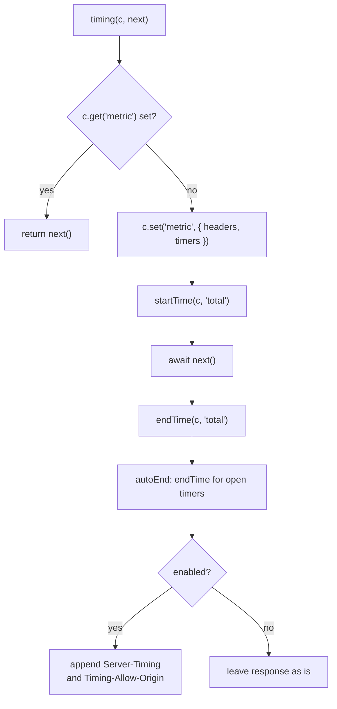
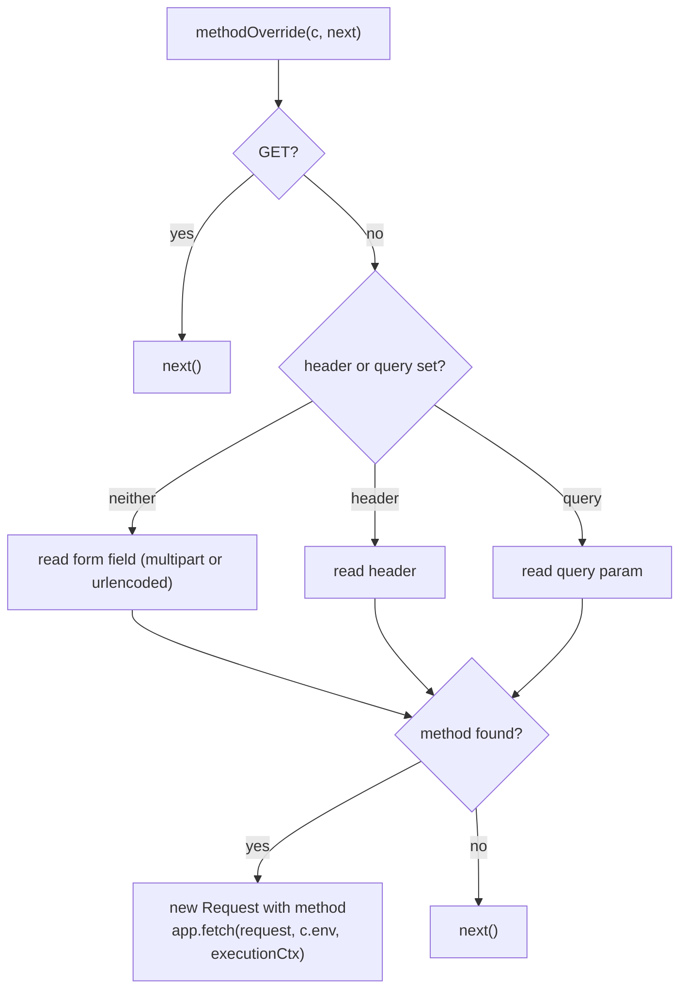
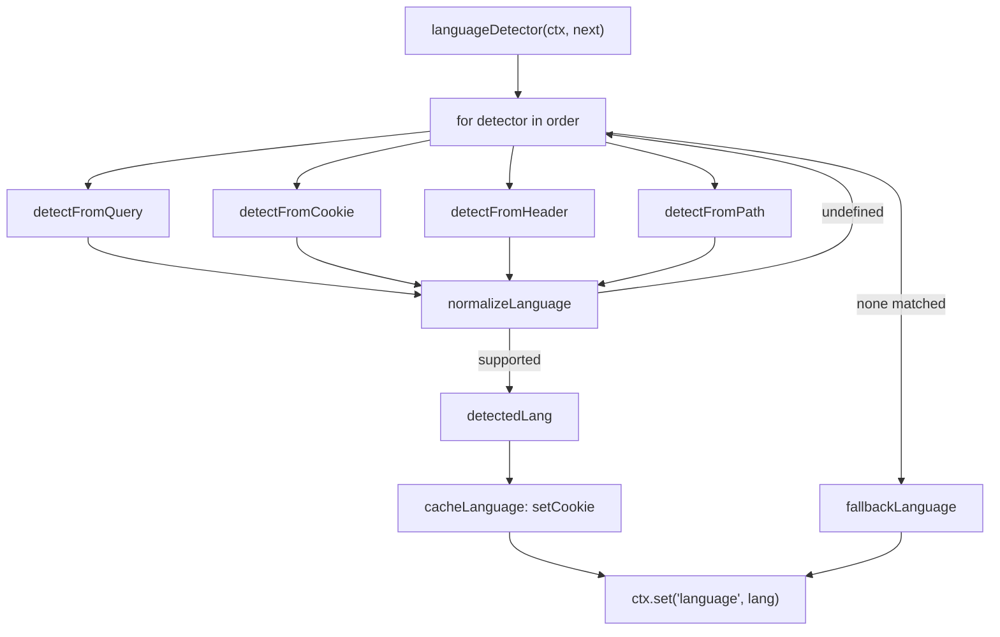

## Overview

Hono ships a set of small middleware that solve common cross-cutting chores: logging, request IDs, `Server-Timing` metrics, timeouts, HTML-form method override, trailing-slash redirects, pretty-printed JSON, the `X-Powered-By` header, language detection, combinators that compose other middleware (`some`, `every`, `except`), and access to the current `Context` from anywhere through `AsyncLocalStorage`. Each one is a factory that returns a `MiddlewareHandler`, so it is registered with `app.use()` like any other middleware described in [[Middleware and Composition]].

Sources: [src/middleware/logger/index.ts:81-95](repo://src/middleware/logger/index.ts#L81-L95), [src/middleware/powered-by/index.ts:30-35](repo://src/middleware/powered-by/index.ts#L30-L35)

Every middleware has its own package subpath (`hono/logger`, `hono/request-id`, `hono/timing`, `hono/timeout`, `hono/method-override`, `hono/trailing-slash`, `hono/pretty-json`, `hono/powered-by`, `hono/language`, `hono/combine`, `hono/context-storage`), so an application only bundles the ones it imports.

Sources: [package.json:119-123](repo://package.json#L119-L123), [package.json:219-268](repo://package.json#L219-L268)

The middleware fall into two groups by where they do their work. Some act before `await next()` (request ID, language detection, timeout set-up, method override, context storage), others act after it on `c.res` (powered-by, pretty JSON, trailing-slash on 404, `Server-Timing` headers), and the logger does both.

Sources: [src/middleware/request-id/request-id.ts:46-58](repo://src/middleware/request-id/request-id.ts#L46-L58), [src/middleware/pretty-json/index.ts:48-55](repo://src/middleware/pretty-json/index.ts#L48-L55), [src/middleware/timing/timing.ts:85-125](repo://src/middleware/timing/timing.ts#L85-L125)

## Logger

### Log lines

`logger(fn = console.log)` prints one line when a request arrives and one when the response leaves. The path is taken from the raw URL by slicing from the first `/` after the scheme (`url.indexOf('/', 8)`), so the query string is included. Incoming lines are `<-- METHOD path`; outgoing lines are `--> METHOD path STATUS elapsed`. The `xxx` prefix exists in the `LogPrefix` enum but the middleware itself never emits it.

Sources: [src/middleware/logger/index.ts:9-13](repo://src/middleware/logger/index.ts#L9-L13), [src/middleware/logger/index.ts:50-63](repo://src/middleware/logger/index.ts#L50-L63), [src/middleware/logger/index.ts:81-95](repo://src/middleware/logger/index.ts#L81-L95)

```ts
export const logger = (fn: PrintFunc = console.log): MiddlewareHandler => {
  return async function logger(c, next) {
    const { method, url } = c.req

    const path = url.slice(url.indexOf('/', 8))

    await log(fn, LogPrefix.Incoming, method, path)

    const start = Date.now()

    await next()

    await log(fn, LogPrefix.Outgoing, method, path, c.res.status, time(start))
  }
}
```

Sources: [src/middleware/logger/index.ts:81-95](repo://src/middleware/logger/index.ts#L81-L95)

### Elapsed time and colours

Elapsed time is measured with `Date.now()`: under one second it is shown as `Nms`, otherwise rounded to whole seconds (`Ns`), with thousands separated by commas by `humanize`. The status code is coloured by class (5xx red, 4xx yellow, 3xx cyan, 2xx green) unless colours are disabled; any other status, such as 101, is printed plain.

Sources: [src/middleware/logger/index.ts:15-46](repo://src/middleware/logger/index.ts#L15-L46)

Colour support is decided by `getColorEnabledAsync`. On Cloudflare Workers (detected by `navigator.userAgent === 'Cloudflare-Workers'`) it dynamically imports `cloudflare:workers` and checks for a `NO_COLOR` binding; elsewhere it honours `Deno.noColor` or a `NO_COLOR` variable in `process.env`.

Sources: [src/utils/color.ts:14-56](repo://src/utils/color.ts#L14-L56)

> [!TIP]
> Pass a custom print function to route log lines into your own logger, for example `app.use(logger((str, ...rest) => myLogger.info(str, ...rest)))`.

Sources: [src/middleware/logger/index.ts:48-48](repo://src/middleware/logger/index.ts#L48-L48)

## Request ID

### requestId options

`requestId()` gives every request an identifier, stores it in the context as `requestId`, and echoes it in a response header. The module augments `ContextVariableMap` with `RequestIdVariables`, so `c.get('requestId')` is typed as `string` once `hono/request-id` is imported.

Sources: [src/middleware/request-id/index.ts:1-7](repo://src/middleware/request-id/index.ts#L1-L7), [src/middleware/request-id/request-id.ts:9-17](repo://src/middleware/request-id/request-id.ts#L9-L17)

| Option | Type | Default | Description |
| --- | --- | --- | --- |
| `limitLength` | `number` | `255` | Longest incoming ID accepted from the request header. |
| `headerName` | `string` | `'X-Request-Id'` | Header read from the request and written on the response. An empty string disables both. |
| `generator` | `(c: Context) => string` | `() => crypto.randomUUID()` | Creates a new ID when none is accepted. |

Sources: [src/middleware/request-id/request-id.ts:41-45](repo://src/middleware/request-id/request-id.ts#L41-L45)

### Accepting or generating an ID

An incoming header value is reused only if it is present, no longer than `limitLength`, and contains nothing but word characters, `-` and `=`. Anything else (for example a value with spaces or `/`) is replaced by `generator(c)`, which keeps untrusted header input out of logs. When `headerName` is empty the middleware does not call `c.req.header('')`, because that would return the whole header object.

Sources: [src/middleware/request-id/request-id.ts:46-58](repo://src/middleware/request-id/request-id.ts#L46-L58)

```ts
import { Hono } from 'hono'
import { requestId } from 'hono/request-id'

const app = new Hono()

app.use(requestId({ generator: (c) => `${Date.now()}-${crypto.randomUUID()}` }))
app.get('/', (c) => c.text(`Your id is ${c.get('requestId')}`))
```

Sources: [src/middleware/request-id/request-id.ts:41-59](repo://src/middleware/request-id/request-id.ts#L41-L59)

## Server-Timing

### timing options

`timing()` collects metrics during a request and writes them to the `Server-Timing` response header so they appear in browser developer tools. It registers a `metric` variable (`headers` array plus a `timers` map) on the context.

Sources: [src/middleware/timing/timing.ts:10-28](repo://src/middleware/timing/timing.ts#L10-L28), [src/middleware/timing/index.ts:1-8](repo://src/middleware/timing/index.ts#L1-L8)

| Option | Type | Default | Description |
| --- | --- | --- | --- |
| `total` | `boolean` | `true` | Record a `total` timer around the rest of the chain. |
| `enabled` | `boolean \| (c: Context) => boolean` | `true` | Whether to write the headers at all; the function form is evaluated after the handler runs. |
| `totalDescription` | `string` | `'Total Response Time'` | `desc` of the total metric. |
| `autoEnd` | `boolean` | `true` | End timers that were started but never ended. |
| `crossOrigin` | `boolean \| string \| (c: Context) => boolean \| string` | `false` | Adds `Timing-Allow-Origin`: `*` for `true`, or the given origin string. |

Sources: [src/middleware/timing/timing.ts:76-84](repo://src/middleware/timing/timing.ts#L76-L84)

### Recording metrics

The middleware is idempotent: if `metric` is already set (for example because `timing()` was registered both globally and on a route) it simply calls `next()`. Otherwise it starts the `total` timer, runs the chain, ends `total`, ends any open timers when `autoEnd` is on, and finally appends `Server-Timing` (joined with commas) and optionally `Timing-Allow-Origin`. Times come from `performance.now()`, falling back to `Date.now()`.

Sources: [src/middleware/timing/timing.ts:30-35](repo://src/middleware/timing/timing.ts#L30-L35), [src/middleware/timing/timing.ts:85-125](repo://src/middleware/timing/timing.ts#L85-L125)



Sources: [src/middleware/timing/timing.ts:85-125](repo://src/middleware/timing/timing.ts#L85-L125)

Handlers record metrics with four helpers exported from `hono/timing`. Each one logs a `console.warn` and does nothing when `timing()` has not run for the route.

Sources: [src/middleware/timing/index.ts:3-3](repo://src/middleware/timing/index.ts#L3-L3), [src/middleware/timing/timing.ts:156-160](repo://src/middleware/timing/timing.ts#L156-L160)

| Function | Behaviour |
| --- | --- |
| `setMetric(c, name, value, description?, precision?)` | Pushes `name;dur=value;desc="description"`; `value` is formatted with `toFixed(precision \|\| 1)`. |
| `setMetric(c, name, description?)` | Pushes a value-less metric `name;desc="description"` or just `name`. |
| `startTime(c, name, description?)` | Stores a timer with the current time; starting the same name again overwrites it. |
| `endTime(c, name, precision?)` | Computes the duration, calls `setMetric`, and deletes the timer; warns if the timer does not exist. |
| `wrapTime(c, name, promise, description?, precision?)` | Starts a timer, awaits the promise, and ends the timer in `finally`, so failures are timed too. |

Sources: [src/middleware/timing/timing.ts:128-225](repo://src/middleware/timing/timing.ts#L128-L225), [src/middleware/timing/timing.ts:244-257](repo://src/middleware/timing/timing.ts#L244-L257)

```ts
import { timing, setMetric, startTime, endTime, wrapTime } from 'hono/timing'

app.use(timing({ crossOrigin: 'https://example.com' }))

app.get('/', async (c) => {
  setMetric(c, 'region', 'europe-west3')
  startTime(c, 'db')
  const rows = await db.findMany()
  endTime(c, 'db')
  const user = await wrapTime(c, 'user', fetchUser())
  return c.json({ rows, user })
})
```

Sources: [src/middleware/timing/timing.ts:76-126](repo://src/middleware/timing/timing.ts#L76-L126), [src/middleware/timing/timing.ts:149-257](repo://src/middleware/timing/timing.ts#L149-L257)

> [!WARNING]
> `Server-Timing` can reveal internal details such as database latency. Use the `enabled` function form to limit it to trusted callers or non-production environments.

Sources: [src/middleware/timing/timing.ts:110-113](repo://src/middleware/timing/timing.ts#L110-L113)

## Timeout

`timeout(duration, exception?)` races the rest of the chain against a timer. When the timer wins, the promise rejects with an `HTTPException`; by default a shared `HTTPException(504, { message: 'Gateway Timeout' })`. The exception may instead be a function of the context, which lets you build a custom response per request. The timer is always cleared in `finally`, whether the handler finished, threw, or timed out.

Sources: [src/middleware/timeout/index.ts:10-58](repo://src/middleware/timeout/index.ts#L10-L58)

```ts
export const timeout = (
  duration: number,
  exception: HTTPExceptionFunction | HTTPException = defaultTimeoutException
): MiddlewareHandler => {
  return async function timeout(context, next) {
    let timer: number | undefined
    const timeoutPromise = new Promise<void>((_, reject) => {
      timer = setTimeout(() => {
        reject(typeof exception === 'function' ? exception(context) : exception)
      }, duration) as unknown as number
    })

    try {
      await Promise.race([next(), timeoutPromise])
    } finally {
      if (timer !== undefined) {
        clearTimeout(timer)
      }
    }
  }
}
```

Sources: [src/middleware/timeout/index.ts:38-58](repo://src/middleware/timeout/index.ts#L38-L58)

The thrown exception travels to the app's error handler, so the client gets the exception's response as explained in [[Error Handling]]. The race does not cancel the handler: `next()` keeps running after the timeout rejects, so a handler that must stop its work needs its own abort logic.

Sources: [src/middleware/timeout/index.ts:50-56](repo://src/middleware/timeout/index.ts#L50-L56)

```ts
import { HTTPException } from 'hono/http-exception'
import { timeout } from 'hono/timeout'

const customTimeout = (c) =>
  new HTTPException(408, { message: `Timed out on ${c.req.path}` })

app.use('/slow/*', timeout(5000, customTimeout))
```

Sources: [src/middleware/timeout/index.ts:10-14](repo://src/middleware/timeout/index.ts#L10-L14), [src/middleware/timeout/index.ts:38-41](repo://src/middleware/timeout/index.ts#L38-L41)

## Method Override

### Choosing the source

HTML forms can only send GET and POST. `methodOverride({ app })` reads the intended method from the request and re-dispatches a new request through `app.fetch`, so a POST form can reach an `app.delete()` route. The `app` option is required because the middleware must re-enter routing. Exactly one source can be configured; the option type is a union that forbids combining them.

Sources: [src/middleware/method-override/index.ts:11-33](repo://src/middleware/method-override/index.ts#L11-L33)

| Option | Type | Default | Description |
| --- | --- | --- | --- |
| `app` | `Hono` | required | The application to re-dispatch the rewritten request to. |
| `form` | `string` | `'_method'` | Form field holding the method; used when neither `header` nor `query` is set. |
| `header` | `string` | none | Request header holding the method, such as `X-HTTP-Method-Override`. |
| `query` | `string` | none | Query parameter holding the method. |

Sources: [src/middleware/method-override/index.ts:11-44](repo://src/middleware/method-override/index.ts#L11-L44)

### Re-dispatch flow

GET requests always pass straight through. In form mode the body is cloned twice so it can be read once to find the method and once to rebuild the new request. A `multipart/form-data` body is rebuilt without the method field and without `content-type`/`content-length` (the runtime sets a new boundary); an `application/x-www-form-urlencoded` body is rebuilt as `URLSearchParams`. In header mode the header is removed; in query mode the parameter is removed from the URL and the body is streamed with `duplex: 'half'`. If no override value is found, the original request continues with `next()`.

Sources: [src/middleware/method-override/index.ts:60-138](repo://src/middleware/method-override/index.ts#L60-L138)



Sources: [src/middleware/method-override/index.ts:60-148](repo://src/middleware/method-override/index.ts#L60-L148)

`getExecutionCtx` reads `c.executionCtx` inside a `try`, because the getter throws on runtimes without an execution context; the new `app.fetch` call then receives `undefined` there.

Sources: [src/middleware/method-override/index.ts:140-148](repo://src/middleware/method-override/index.ts#L140-L148)

```ts
import { methodOverride } from 'hono/method-override'

const app = new Hono()
app.use('/posts', methodOverride({ app }))
app.delete('/posts', (c) => c.text('deleted'))
// <form method="POST" action="/posts"> with <input name="_method" value="DELETE">
```

Sources: [src/middleware/method-override/index.ts:47-60](repo://src/middleware/method-override/index.ts#L47-L60)

## Trailing Slash

### trimTrailingSlash

`trimTrailingSlash()` redirects `/about/` to `/about` with a 301. By default it waits until after the handler runs and only redirects when the response is a 404, so a route that really ends in `/` keeps working. With `alwaysRedirect: true` it redirects before running any handler, which is needed when a wildcard such as `/my-path/*` would otherwise match the slashed path and never 404. Only GET and HEAD are redirected, and the root path `/` is never touched.

Sources: [src/middleware/trailing-slash/index.ts:8-74](repo://src/middleware/trailing-slash/index.ts#L8-L74)

### appendTrailingSlash

`appendTrailingSlash()` does the opposite, redirecting `/about` to `/about/`, with the same 404-or-always logic. It adds a `skip(path)` option to exclude paths, for example files with an extension. The redirect rewrites only `url.pathname`, so the query string is preserved.

Sources: [src/middleware/trailing-slash/index.ts:76-158](repo://src/middleware/trailing-slash/index.ts#L76-L158)

| Option | Applies to | Type | Default | Description |
| --- | --- | --- | --- | --- |
| `alwaysRedirect` | both | `boolean` | `false` | Redirect before handlers run instead of only on 404. |
| `skip` | `appendTrailingSlash` | `(path: string) => boolean` | none | Return `true` to leave a path alone. |

Sources: [src/middleware/trailing-slash/index.ts:8-17](repo://src/middleware/trailing-slash/index.ts#L8-L17), [src/middleware/trailing-slash/index.ts:76-101](repo://src/middleware/trailing-slash/index.ts#L76-L101)

```ts
import { appendTrailingSlash } from 'hono/trailing-slash'

app.use(
  appendTrailingSlash({
    alwaysRedirect: true,
    skip: (path) => /\.\w+$/.test(path),
  })
)
```

Sources: [src/middleware/trailing-slash/index.ts:91-100](repo://src/middleware/trailing-slash/index.ts#L91-L100)

## Pretty JSON and Powered By

### prettyJSON

`prettyJSON()` re-serialises JSON responses with indentation when the request has the trigger query parameter (`?pretty` or `?pretty=anything`; an empty value counts) or when `force` is set. After the handler runs it checks that `Content-Type` starts with `application/json`, parses the body, and replaces `c.res` with a new `Response` that keeps the original status and headers.

Sources: [src/middleware/pretty-json/index.ts:46-56](repo://src/middleware/pretty-json/index.ts#L46-L56)

| Option | Type | Default | Description |
| --- | --- | --- | --- |
| `space` | `number` | `2` | Indentation passed to `JSON.stringify`. |
| `query` | `string` | `'pretty'` | Query parameter that turns prettifying on. |
| `force` | `boolean` | `false` | Prettify every JSON response regardless of the query. |

Sources: [src/middleware/pretty-json/index.ts:8-26](repo://src/middleware/pretty-json/index.ts#L8-L26)

### poweredBy

`poweredBy()` sets `X-Powered-By` on the response after the handler runs, with the value `Hono` or the `serverName` option. Because it uses `headers.set`, it overwrites a value set by the handler.

Sources: [src/middleware/powered-by/index.ts:7-35](repo://src/middleware/powered-by/index.ts#L7-L35)

## Language Detection

### Detector options

`languageDetector(options)` picks a language for the request, stores it as the `language` context variable, and optionally remembers it in a cookie. Options are merged over `DEFAULT_OPTIONS`, with `cookieOptions` merged separately so you can change one cookie attribute without losing the others.

Sources: [src/middleware/language/language.ts:283-300](repo://src/middleware/language/language.ts#L283-L300), [src/middleware/language/index.ts:1-12](repo://src/middleware/language/index.ts#L1-L12)

| Option | Type | Default | Description |
| --- | --- | --- | --- |
| `order` | `DetectorType[]` | `['querystring', 'cookie', 'header']` | Detectors tried in order; `'path'` is also available. |
| `lookupQueryString` | `string` | `'lang'` | Query parameter for the `querystring` detector. |
| `lookupCookie` | `string` | `'language'` | Cookie read by the `cookie` detector and written by the cache. |
| `lookupFromHeaderKey` | `string` | `'accept-language'` | Header for the `header` detector. |
| `lookupFromPathIndex` | `number` | `0` | Path segment index for the `path` detector. |
| `caches` | `CacheType[] \| false` | `['cookie']` | Where to persist a detected language; `false` disables caching. |
| `cookieOptions` | object | `sameSite: 'Strict'`, `secure: true`, `maxAge` one year, `httpOnly: true` | Attributes of the cache cookie (`domain`, `path` also allowed). |
| `ignoreCase` | `boolean` | `true` | Compare language codes case-insensitively. |
| `fallbackLanguage` | `string` | `'en'` | Used when nothing is detected; must be in `supportedLanguages`. |
| `supportedLanguages` | `string[]` | `['en']` | Languages the app accepts. |
| `convertDetectedLanguage` | `(lang: string) => string` | none | Transforms a detected code before matching, e.g. `en_US` to `en-US`. |
| `debug` | `boolean` | `false` | Log which detector matched and detector errors. |

Sources: [src/middleware/language/language.ts:10-68](repo://src/middleware/language/language.ts#L10-L68)

### Detection flow

`validateOptions` runs once when the middleware is created and throws if the fallback is not in `supportedLanguages`, if `lookupFromPathIndex` is negative, or if `order` names an unknown detector. Per request, `detectLanguage` walks `order`; the first detector that returns a supported language wins, and a detector that throws is skipped. The result falls back to `fallbackLanguage`; only a language that was actually detected is written to the cookie, so the fallback never gets cached.

Sources: [src/middleware/language/language.ts:195-258](repo://src/middleware/language/language.ts#L195-L258)



Sources: [src/middleware/language/language.ts:125-182](repo://src/middleware/language/language.ts#L125-L182), [src/middleware/language/language.ts:226-258](repo://src/middleware/language/language.ts#L226-L258), [src/middleware/language/language.ts:295-299](repo://src/middleware/language/language.ts#L295-L299)

`normalizeLanguage` trims the code, applies `convertDetectedLanguage`, then looks for an exact match in `supportedLanguages`. If none is found it truncates subtags from the right, RFC 4647 Lookup style, so `en-GB-oxendict` matches `en-GB` and then `en`. It always returns the spelling from `supportedLanguages`, not the client's. The header detector parses `Accept-Language` with quality values via `parseAccept` and returns the first entry that normalises to a supported language.

Sources: [src/middleware/language/language.ts:74-123](repo://src/middleware/language/language.ts#L74-L123), [src/middleware/language/language.ts:144-162](repo://src/middleware/language/language.ts#L144-L162)

```ts
import { languageDetector } from 'hono/language'

app.use(
  languageDetector({
    order: ['path', 'cookie', 'header'],
    supportedLanguages: ['en', 'ja', 'pt-BR'],
    fallbackLanguage: 'en',
  })
)
app.get('/:lang/*', (c) => c.text(`Language: ${c.get('language')}`))
```

Sources: [src/middleware/language/language.ts:260-300](repo://src/middleware/language/language.ts#L260-L300)

## Combining Middleware

### some

`some(...middleware)` runs its arguments in order and stops at the first that succeeds, like a logical OR. An argument can be a middleware or a condition `(c) => boolean`. A condition returning `true` counts as success and the middleware calls `next()` itself (unless the context is already finalized); returning `false` moves on. A middleware that throws moves on to the next one, unless it had already called `next()`, in which case the error came from downstream and is rethrown at once. If nothing succeeds, the last error is thrown, or `Error('No successful middleware found')` when the last argument was a false condition.

Sources: [src/middleware/combine/index.ts:12-69](repo://src/middleware/combine/index.ts#L12-L69)

### every

`every(...middleware)` runs all arguments as one chain using `compose`, like a logical AND: each must call `next()` for the chain to continue, an error stops it, and a condition returning `false` throws `Error('Unmet condition')`. It saves `c.req.routeIndex` and restores it before each inner handler, because `compose` rewrites the index and route params would otherwise be looked up against the wrong route.

Sources: [src/middleware/combine/index.ts:99-117](repo://src/middleware/combine/index.ts#L99-L117), [src/compose.ts:40-48](repo://src/compose.ts#L40-L48)

### except

`except(condition, ...middleware)` skips the middleware when the condition matches. Conditions may be path patterns, functions, or an array of both. String patterns are added to a private `TrieRouter`, so they support the same wildcards and params as routes. It is built from the other two combinators: `some(matchesAnyCondition, every(...middleware))`.

Sources: [src/middleware/combine/index.ts:141-165](repo://src/middleware/combine/index.ts#L141-L165)

```ts
import { except, some, every } from 'hono/combine'
import { bearerAuth } from 'hono/bearer-auth'

app.use('/api/*', except('/api/public/*', bearerAuth({ token })))

app.use(
  '/admin/*',
  some(
    (c) => c.req.header('x-internal') === '1',
    every(bearerAuth({ token }), myRateLimit({ limit: 100 }))
  )
)
```

Sources: [src/middleware/combine/index.ts:38-38](repo://src/middleware/combine/index.ts#L38-L38), [src/middleware/combine/index.ts:99-99](repo://src/middleware/combine/index.ts#L99-L99), [src/middleware/combine/index.ts:141-144](repo://src/middleware/combine/index.ts#L141-L144)

See [[Authentication Middleware]] for `bearerAuth` and [[Security Middleware]] for other middleware commonly combined this way.

Sources: [src/middleware/combine/index.ts:24-36](repo://src/middleware/combine/index.ts#L24-L36)

## Context Storage

`contextStorage()` runs the rest of the chain inside `asyncLocalStorage.run(c, next)`, using one module-level `AsyncLocalStorage<Context>` from `node:async_hooks`. Code that has no `c` parameter, such as a data-access helper, can then call `getContext()` to get the current [[Context]], or `tryGetContext()` to get `undefined` instead of an error when called outside a request. Both accept an `Env` type parameter for typed `c.var` access.

Sources: [src/middleware/context-storage/index.ts:6-59](repo://src/middleware/context-storage/index.ts#L6-L59)

```ts
import { contextStorage, getContext } from 'hono/context-storage'

type Env = { Variables: { message: string } }

const app = new Hono<Env>()
app.use(contextStorage())
app.use(async (c, next) => {
  c.set('message', 'Hono is hot!!')
  await next()
})

const getMessage = () => getContext<Env>().var.message
app.get('/', (c) => c.text(getMessage()))
```

Sources: [src/middleware/context-storage/index.ts:20-59](repo://src/middleware/context-storage/index.ts#L20-L59)

> [!NOTE]
> The middleware imports `AsyncLocalStorage` from `node:async_hooks`, so it only works on runtimes that provide that module. `getContext()` throws `Error('Context is not available')` when no request is active.

Sources: [src/middleware/context-storage/index.ts:6-10](repo://src/middleware/context-storage/index.ts#L6-L10), [src/middleware/context-storage/index.ts:53-59](repo://src/middleware/context-storage/index.ts#L53-L59)
