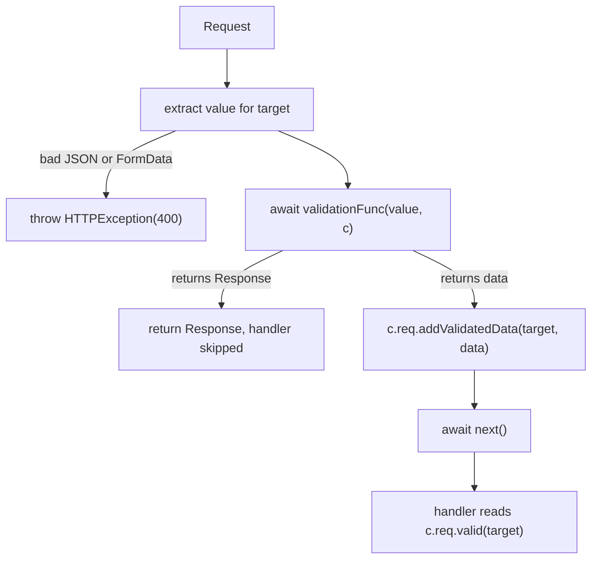

## Overview

`validator()` is a middleware factory that reads one part of the request (a JSON body, a form, the query string, path parameters, headers or cookies), passes it to a function you supply, and stores what that function returns so the handler can read it with `c.req.valid(target)`. Hono itself ships no schema library: the validation function can be hand-written or delegate to Zod, Valibot or any other library, and third-party adapters such as `@hono/zod-validator` are built on this function and on its exported `InferInput` type.

Sources: [src/validator/validator.ts:46-88](repo://src/validator/validator.ts#L46-L88), [src/validator/validator.ts:89-172](repo://src/validator/validator.ts#L89-L172), [src/validator/index.ts:1-8](repo://src/validator/index.ts#L1-L8), [src/validator/utils.ts:47-58](repo://src/validator/utils.ts#L47-L58)

Its second job is typing. The generic parameters of `validator()` become the route's `Input` type, which makes `c.req.valid()` typed inside the handler and lets the [[RPC Client]] know what arguments an endpoint expects.

Sources: [src/validator/validator.ts:64-88](repo://src/validator/validator.ts#L64-L88), [src/request.ts:343-354](repo://src/request.ts#L343-L354)

## Usage

`validator(target, validationFunc)` returns a `MiddlewareHandler` that is placed before the handler in a route definition.

Sources: [src/validator/validator.ts:85-88](repo://src/validator/validator.ts#L85-L88)

```ts
import { Hono } from 'hono'
import { validator } from 'hono/validator'

const app = new Hono()

app.post(
  '/posts',
  validator('json', (value, c) => {
    const title = value['title']
    if (!title || typeof title !== 'string') {
      return c.text('Invalid!', 400)
    }
    return { title }
  }),
  (c) => {
    const { title } = c.req.valid('json')
    return c.json({ title }, 201)
  }
)
```

Sources: [src/validator/validator.ts:46-88](repo://src/validator/validator.ts#L46-L88), [src/validator/validator.ts:89-172](repo://src/validator/validator.ts#L89-L172), [src/request.ts:351-354](repo://src/request.ts#L351-L354)

## Targets

### What each target reads

The middleware fills `value` according to `target`, starting from an empty object.

Sources: [src/validator/validator.ts:89-93](repo://src/validator/validator.ts#L89-L93)

| Target | Source | Value given to the function |
| --- | --- | --- |
| `json` | `c.req.json()` | The parsed body, only when `Content-Type` is JSON; otherwise `{}`. |
| `form` | `c.req.bodyCache.formData`, or `c.req.arrayBuffer()` parsed by `bufferToFormData` | An object built from the `FormData` entries, only when `Content-Type` is multipart or URL-encoded; otherwise `{}`. |
| `query` | `c.req.queries()` | One entry per key: a string when the key appears once, a `string[]` when repeated. |
| `param` | `c.req.param()` | Decoded path parameters of the matched route. |
| `header` | `c.req.header()` | All request headers as a record (keys as the `Headers` object yields them, lower-cased). |
| `cookie` | `getCookie(c)` | All cookies parsed from the `Cookie` header. |

Sources: [src/validator/validator.ts:89-160](repo://src/validator/validator.ts#L89-L160), [src/request.ts:187-199](repo://src/request.ts#L187-L199)

The value types the function receives by default come from `ValidationTargets`, which `validator()` uses whenever you do not give an explicit `InputType`.

Sources: [src/types.ts:2680-2690](repo://src/types.ts#L2680-L2690)

```ts
export type ValidationTargets<T extends FormValue = ParsedFormValue, P extends string = string> = {
  json: any
  form: Record<string, T | T[]>
  query: Record<string, string | string[]>
  param: Record<P, P extends `${infer _}?` ? string | undefined : string>
  header: Record<RequestHeader | CustomHeader, string>
  cookie: Record<string, string>
}
```

Sources: [src/types.ts:2683-2690](repo://src/types.ts#L2683-L2690)

### Content-type checks

Body targets are checked against the `Content-Type` header with three regular expressions, matched case-insensitively. `jsonRegex` accepts `application/json` and structured suffixes such as `application/vnd.api+json`, with optional parameters. `multipartRegex` accepts `multipart/form-data` with an optional `boundary`, and `urlencodedRegex` accepts `application/x-www-form-urlencoded` with optional parameters.

Sources: [src/validator/validator.ts:24-26](repo://src/validator/validator.ts#L24-L26)

A request without a matching content type is not rejected by the middleware: the validation function receives `{}` and decides. A function that requires fields therefore fails naturally, while one that accepts an empty object lets the request through.

Sources: [src/validator/validator.ts:94-111](repo://src/validator/validator.ts#L94-L111)

### Body parsing details

For `json`, a body that fails `JSON.parse` throws `HTTPException(400, { message: 'Malformed JSON in request body' })`. Because `c.req.json()` reads through the request's body cache, the handler can still call `c.req.json()` or `c.req.text()` afterwards.

Sources: [src/validator/validator.ts:94-104](repo://src/validator/validator.ts#L94-L104), [src/request.ts:220-238](repo://src/request.ts#L220-L238), [src/request.ts:253-255](repo://src/request.ts#L253-L255)

For `form`, an already parsed `FormData` in `c.req.bodyCache.formData` is reused. Otherwise the raw bytes are read with `c.req.arrayBuffer()` and parsed by `bufferToFormData`, which wraps them in a `Response` whose media type is lower-cased (keeping the boundary) and calls `formData()`. The parsed `FormData` is stored back in the cache. A parse failure throws `HTTPException(400)` with the message `Malformed FormData request.` followed by the underlying error message.

Sources: [src/validator/validator.ts:105-127](repo://src/validator/validator.ts#L105-L127), [src/utils/buffer.ts:106-117](repo://src/utils/buffer.ts#L106-L117)

The `FormData` entries are then folded into a plain object created with `Object.create(null)`:

Sources: [src/validator/validator.ts:129-130](repo://src/validator/validator.ts#L129-L130)

1. A key ending in `[]` is always an array, even with one value.
2. A key seen again becomes an array of all its values.
3. Any other key keeps a single `string` or `File`.

Sources: [src/validator/validator.ts:129-142](repo://src/validator/validator.ts#L129-L142)

Both 400 errors are ordinary `HTTPException`s, so they reach `app.onError` and can be customised there (see [[Error Handling]]).

Sources: [src/validator/validator.ts:1-3](repo://src/validator/validator.ts#L1-L3), [src/validator/validator.ts:100-103](repo://src/validator/validator.ts#L100-L103), [src/validator/validator.ts:122-125](repo://src/validator/validator.ts#L122-L125)

## The validation function

### Contract

The function has the `ValidationFunction` shape: it receives the extracted value and the `Context`, and may be synchronous or asynchronous.

Sources: [src/validator/validator.ts:14-22](repo://src/validator/validator.ts#L14-L22)

```ts
export type ValidationFunction<
  InputType,
  OutputType,
  E extends Env = {},
  P extends string = string,
> = (
  value: InputType,
  c: Context<E, P>
) => OutputType | TypedResponse | Promise<OutputType> | Promise<TypedResponse>
```

Sources: [src/validator/validator.ts:14-22](repo://src/validator/validator.ts#L14-L22)

What happens next depends on what it returns or throws.

Sources: [src/validator/validator.ts:162-170](repo://src/validator/validator.ts#L162-L170)

| Outcome | Effect |
| --- | --- |
| Returns a `Response` (for example `c.json(..., 400)`) | The middleware returns it immediately; `next()` is not called and the handler never runs. |
| Returns any other value | Stored with `c.req.addValidatedData(target, value)`, then `next()` runs. |
| Throws | The error propagates like any middleware error, to `app.onError`. |

Sources: [src/validator/validator.ts:162-171](repo://src/validator/validator.ts#L162-L171), [src/request.ts:333-341](repo://src/request.ts#L333-L341)

The returned value replaces the raw input, so the function can coerce or transform it: parse numbers from query strings, trim strings, or return the parsed result of a schema library.

Sources: [src/validator/validator.ts:162-168](repo://src/validator/validator.ts#L162-L168)

### Several validators on one route

Each target has one slot in the request's `#validatedData`, so a route may stack validators for different targets (for example `param` and `json`) and read each with its own `c.req.valid()` call. Two validators for the same target overwrite each other, and the last one wins.

Sources: [src/request.ts:53-54](repo://src/request.ts#L53-L54), [src/request.ts:339-354](repo://src/request.ts#L339-L354)



Sources: [src/validator/validator.ts:89-171](repo://src/validator/validator.ts#L89-L171)

## Typing

### Input and output types

`validator()` captures the validation function's type as `VF` and derives a `V` input type with two sides. `out[target]` is `ExtractValidatorOutput<VF>`, the function's return type (unwrapped from a `Promise`) with `Response` and `TypedResponse` results removed. `in[target]` is what a client must send.

Sources: [src/validator/validator.ts:46-88](repo://src/validator/validator.ts#L46-L88), [src/validator/validator.ts:174-185](repo://src/validator/validator.ts#L174-L185)

| Target | `in` type | `out` type |
| --- | --- | --- |
| `json` | The explicit `InputType` type argument if given, otherwise the output type. | Output of the function. |
| `form`, `query`, `param`, `header`, `cookie` | `InferInput<Output, Target, FormValue>`: each output key mapped back to the wire type of that target. | Output of the function. |

Sources: [src/validator/validator.ts:64-82](repo://src/validator/validator.ts#L64-L82)

`c.req.valid(target)` is typed with `InputToDataByTarget<I['out'], T>`, so the handler sees exactly what the function returned, and it only accepts targets that a validator on the route declared.

Sources: [src/request.ts:351-354](repo://src/request.ts#L351-L354), [src/types.ts:2720-2727](repo://src/types.ts#L2720-L2727)

### InferInput

`InferInput<Output, Target>` exists because a validator may turn `page: string` into `page: number`, while the client still has to send a string. For each key it keeps the output type when it is a union of string literals (such as `'asc' | 'desc'`) or an optional union including `undefined`; otherwise it uses the target's wire type: `T | T[]` for `form`, `string | string[]` for `query`, and `string` for `param`, `header` and `cookie`. Non-object outputs become `{}`.

Sources: [src/validator/utils.ts:4-45](repo://src/validator/utils.ts#L4-L45), [src/validator/utils.ts:59-69](repo://src/validator/utils.ts#L59-L69)

### Error responses in the route type

The middleware's response type is `ExtractValidationResponse<VF>`: any `TypedResponse` or `Response` the function can return. Route definitions merge a middleware's response type into the route's schema through `MergeMiddlewareResponse`, so a `c.json({ error }, 400)` returned by a validator appears among the endpoint's possible responses on the client.

Sources: [src/validator/validator.ts:28-44](repo://src/validator/validator.ts#L28-L44), [src/types.ts:2662-2672](repo://src/types.ts#L2662-L2672), [src/types.ts:150-165](repo://src/types.ts#L150-L165)

### GET and HEAD

The helper type `ValidationTargetByMethod<M>` excludes `json` and `form` when the method type parameter is `'get'` or `'head'`, since those requests carry no body.

Sources: [src/validator/validator.ts:9-12](repo://src/validator/validator.ts#L9-L12)

> [!NOTE]
> The middleware itself does not look at the method at runtime. A `json` validator on a `GET` route simply sees no JSON content type and passes `{}` to the function.

Sources: [src/validator/validator.ts:91-97](repo://src/validator/validator.ts#L91-L97)

Reusable validators with typed context are usually declared through [[Factory Helper]]; how the resulting input types reach the client is described in [[RPC Client]].

Sources: [src/helper/factory/index.ts:353-360](repo://src/helper/factory/index.ts#L353-L360)
