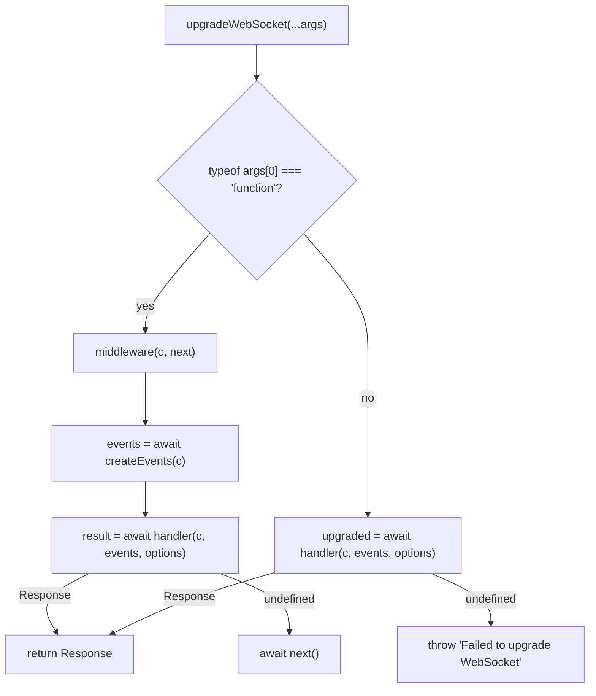

## Overview

WebSocket upgrades are not part of the Fetch standard, so every runtime exposes them differently: Bun upgrades through its server object, Deno through `Deno.upgradeWebSocket`, Cloudflare Workers through `WebSocketPair`. Hono hides those differences behind one function, `upgradeWebSocket`, that each adapter exports with the same shape. You write your handlers once against `WSEvents` and `WSContext`, and only the import path changes per runtime.

Sources: [src/helper/websocket/index.ts:1-40](repo://src/helper/websocket/index.ts#L1-L40), [src/adapter/bun/index.ts:8-9](repo://src/adapter/bun/index.ts#L8-L9), [src/adapter/deno/index.ts:8-8](repo://src/adapter/deno/index.ts#L8-L8), [src/adapter/cloudflare-workers/index.ts:7-7](repo://src/adapter/cloudflare-workers/index.ts#L7-L7)

The runtime-independent part lives in `src/helper/websocket/index.ts`: the event and context types, the `WSContext` class, `createWSMessageEvent`, and `defineWebSocketHelper`, the factory each adapter uses to build its `upgradeWebSocket`. See [[Runtime Adapters]] for the rest of each adapter.

Sources: [src/helper/websocket/index.ts:42-140](repo://src/helper/websocket/index.ts#L42-L140)

## Using upgradeWebSocket

### As middleware

The usual form passes a `createEvents` function that receives the [[Context]] and returns the event handlers, optionally asynchronously. The result is a middleware for a GET route.

Sources: [src/helper/websocket/index.ts:24-34](repo://src/helper/websocket/index.ts#L24-L34)

```ts
import { Hono } from 'hono'
import { upgradeWebSocket } from 'hono/cloudflare-workers' // or 'hono/deno', 'hono/bun'

const app = new Hono()

app.get(
  '/ws',
  upgradeWebSocket((c) => {
    const room = c.req.query('room')
    return {
      onMessage(event, ws) {
        ws.send(`[${room}] echo: ${event.data}`)
      },
      onClose(event) {
        console.log('closed', event.code)
      },
    }
  })
)

export default app
```

Sources: [src/helper/websocket/index.ts:14-34](repo://src/helper/websocket/index.ts#L14-L34), [src/adapter/cloudflare-workers/websocket.ts:5-53](repo://src/adapter/cloudflare-workers/websocket.ts#L5-L53)

### Inside a handler

The second overload takes the context and an events object directly and returns a `Promise` of the upgrade `Response`. Use it when the decision to upgrade happens inside your own handler logic.

Sources: [src/helper/websocket/index.ts:35-39](repo://src/helper/websocket/index.ts#L35-L39)

```ts
app.get('/ws', async (c) => {
  if (!isAuthorized(c)) return c.text('Unauthorized', 401)
  return upgradeWebSocket(c, {
    onMessage(event, ws) {
      ws.send(String(event.data))
    },
  })
})
```

Sources: [src/helper/websocket/index.ts:129-138](repo://src/helper/websocket/index.ts#L129-L138)

## defineWebSocketHelper

`defineWebSocketHelper(handler)` turns a runtime-specific `handler(c, events, options)` into a function implementing both overloads. It tells them apart by checking whether the first argument is a function:

Sources: [src/helper/websocket/index.ts:101-140](repo://src/helper/websocket/index.ts#L101-L140), [src/helper/websocket/index.test.ts:18-56](repo://src/helper/websocket/index.test.ts#L18-L56)

- Middleware form: the returned middleware awaits `createEvents(c)`, calls `handler`, and returns the handler's `Response` if there is one. If the handler returns nothing (for example the request had no `Upgrade: websocket` header), it calls `next()`, so a later handler on the same route can answer plain HTTP requests.
- Direct form: it calls `handler` and throws `Error('Failed to upgrade WebSocket')` when no response comes back.

Sources: [src/helper/websocket/index.ts:101-140](repo://src/helper/websocket/index.ts#L101-L140), [src/helper/websocket/index.test.ts:18-56](repo://src/helper/websocket/index.test.ts#L18-L56)



Sources: [src/helper/websocket/index.ts:111-140](repo://src/helper/websocket/index.ts#L111-L140)

The middleware's type marks the route with `outputFormat: 'ws'`. The [[RPC Client]] reads that marker to add a `$ws()` method to the route, which converts the URL to the `ws` protocol, appends query parameters and opens a `WebSocket` (or calls the `webSocket` factory passed in the client options).

Sources: [src/helper/websocket/index.ts:28-34](repo://src/helper/websocket/index.ts#L28-L34), [src/client/types.ts:112-118](repo://src/client/types.ts#L112-L118), [src/client/client.ts:187-212](repo://src/client/client.ts#L187-L212), [src/client/types.ts:32-34](repo://src/client/types.ts#L32-L34)

## Events and WSContext

### WSEvents

| Handler | Arguments | When it runs |
| --- | --- | --- |
| `onOpen` | `(evt: Event, ws: WSContext)` | The connection opened. Not available on Cloudflare Workers. |
| `onMessage` | `(evt: MessageEvent<WSMessageReceive>, ws: WSContext)` | A message arrived; `evt.data` is `string`, `Blob` or `ArrayBufferLike`. |
| `onClose` | `(evt: CloseEvent, ws: WSContext)` | The connection closed. |
| `onError` | `(evt: Event, ws: WSContext)` | The socket reported an error. Not wired by the Bun adapter. |

Sources: [src/helper/websocket/index.ts:11-19](repo://src/helper/websocket/index.ts#L11-L19), [src/helper/websocket/index.ts:93-93](repo://src/helper/websocket/index.ts#L93-L93), [src/adapter/cloudflare-workers/websocket.ts:5-10](repo://src/adapter/cloudflare-workers/websocket.ts#L5-L10), [src/adapter/bun/websocket.ts:76-104](repo://src/adapter/bun/websocket.ts#L76-L104)

### WSContext

`WSContext` is the object passed as `ws` to every handler. Each adapter constructs it from a `WSContextInit` that supplies `send`, `close`, `readyState`, and optionally `raw`, `url` and `protocol`. The class forwards `send` and `close` to those functions, exposes `readyState` through a getter, normalizes `url` into a `URL` (or `null`) and `protocol` to `null` when missing.

Sources: [src/helper/websocket/index.ts:47-91](repo://src/helper/websocket/index.ts#L47-L91)

| Member | Type | Description |
| --- | --- | --- |
| `send(source, options?)` | `string \| ArrayBuffer \| Uint8Array` | Sends a message. `options.compress` is honored only by Bun. |
| `close(code?, reason?)` | method | Closes the connection. |
| `readyState` | `0 \| 1 \| 2 \| 3` | CONNECTING, OPEN, CLOSING, CLOSED. |
| `url` | `URL \| null` | The connection URL. |
| `protocol` | `string \| null` | The negotiated subprotocol. |
| `raw` | `T` | The runtime's native socket (`WebSocket` on Deno/Workers, Bun's `ServerWebSocket`). |
| `binaryType` | `BinaryType` | Defaults to `'arraybuffer'`. |

Sources: [src/helper/websocket/index.ts:45-45](repo://src/helper/websocket/index.ts#L45-L45), [src/helper/websocket/index.ts:60-91](repo://src/helper/websocket/index.ts#L60-L91), [src/adapter/bun/websocket.ts:33-46](repo://src/adapter/bun/websocket.ts#L33-L46)

`createWSMessageEvent(source)` wraps raw data in a `MessageEvent('message')`. Adapters whose runtime does not deliver a `MessageEvent` (Bun) use it so handlers always receive the same event shape.

Sources: [src/helper/websocket/index.ts:93-99](repo://src/helper/websocket/index.ts#L93-L99), [src/adapter/bun/websocket.ts:95-103](repo://src/adapter/bun/websocket.ts#L95-L103)

## Runtime implementations

### Bun

Bun upgrades through the server object passed as the second `fetch` argument. `getBunServer(c)` reads `c.env.server` or `c.env` itself; if neither exists the helper throws `TypeError('env has to include the 2nd argument of fetch.')`. It calls `server.upgrade(c.req.raw, { data })`, storing the events, the request URL and the first requested subprotocol from `Sec-WebSocket-Protocol` in the socket's `data`. A successful upgrade returns `new Response(null)`; a failed one returns nothing, so the middleware form falls through to `next()`.

Sources: [src/adapter/bun/websocket.ts:48-74](repo://src/adapter/bun/websocket.ts#L48-L74), [src/adapter/bun/server.ts:13-14](repo://src/adapter/bun/server.ts#L13-L14)

Because Bun dispatches socket events to a single server-wide handler rather than per-socket listeners, the adapter also exports a `websocket` object with `open`, `close` and `message` methods. Each reads `ws.data.events` and calls the matching user handler with a fresh `WSContext` from `createWSContext(ws)`. `message` normalizes binary input to its `buffer` before wrapping it with `createWSMessageEvent`, and `close` builds a `CloseEvent` from the code and reason. You must pass this object to `Bun.serve`:

Sources: [src/adapter/bun/websocket.ts:76-104](repo://src/adapter/bun/websocket.ts#L76-L104), [src/adapter/bun/websocket.ts:33-46](repo://src/adapter/bun/websocket.ts#L33-L46)

```ts
import { Hono } from 'hono'
import { upgradeWebSocket, websocket } from 'hono/bun'

const app = new Hono()
app.get('/ws', upgradeWebSocket(() => ({ onMessage: (e, ws) => ws.send(String(e.data)) })))

export default { fetch: app.fetch, websocket }
```

Sources: [src/adapter/bun/index.ts:8-9](repo://src/adapter/bun/index.ts#L8-L9), [src/adapter/bun/websocket.ts:48-104](repo://src/adapter/bun/websocket.ts#L48-L104)

> [!NOTE]
> In the Bun `WSContext`, `readyState` is copied from the socket when the context is created rather than read live, and `createBunWebSocket()` is deprecated: it only returns `{ upgradeWebSocket, websocket }`.

Sources: [src/adapter/bun/websocket.ts:33-46](repo://src/adapter/bun/websocket.ts#L33-L46), [src/adapter/bun/websocket.ts:106-113](repo://src/adapter/bun/websocket.ts#L106-L113)

### Deno

The Deno adapter returns early when the `upgrade` header is not `websocket`. Otherwise it takes the first value of `Sec-WebSocket-Protocol` and calls `Deno.upgradeWebSocket(c.req.raw, { protocol, ...options })`, so the subprotocol is echoed back (browsers reject the connection without it) while an explicit `protocol` in the options passed to `upgradeWebSocket` takes precedence. The second argument of the middleware form is typed as `Deno.UpgradeWebSocketOptions`.

Sources: [src/adapter/deno/websocket.ts:1-18](repo://src/adapter/deno/websocket.ts#L1-L18), [src/adapter/deno/websocket.test.ts:80-146](repo://src/adapter/deno/websocket.test.ts#L80-L146)

It then builds a `WSContext` whose `protocol` and `readyState` are live getters over the socket, assigns `onopen`, `onmessage`, `onclose` and `onerror` to call the user's handlers, and returns Deno's 101 `response`.

Sources: [src/adapter/deno/websocket.ts:20-38](repo://src/adapter/deno/websocket.ts#L20-L38)

### Cloudflare Workers

The Workers adapter also checks the `Upgrade` header, then creates a `WebSocketPair`: the client end goes into the response, the server end is wrapped in a `WSContext`. It attaches `close`, `message` and `error` listeners only for the handlers you defined, calls `server.accept()`, and returns `new Response(null, { status: 101, webSocket: client })`.

Sources: [src/adapter/cloudflare-workers/websocket.ts:10-53](repo://src/adapter/cloudflare-workers/websocket.ts#L10-L53)

> [!WARNING]
> Workers have no `open` event for the server end, so the adapter's type is `Omit<WSEvents<WebSocket>, 'onOpen'>` and an `onOpen` handler is a type error. Send greeting messages from the first `onMessage` instead.

Sources: [src/adapter/cloudflare-workers/websocket.ts:5-10](repo://src/adapter/cloudflare-workers/websocket.ts#L5-L10), [src/adapter/cloudflare-workers/websocket.ts:34-34](repo://src/adapter/cloudflare-workers/websocket.ts#L34-L34)

### Comparison

| Aspect | Bun | Deno | Cloudflare Workers |
| --- | --- | --- | --- |
| Import | `hono/bun` | `hono/deno` | `hono/cloudflare-workers` |
| Upgrade API | `server.upgrade()` | `Deno.upgradeWebSocket()` | `new WebSocketPair()` |
| Checks `Upgrade` header | no (Bun decides) | yes | yes |
| Extra export needed | `websocket` for `Bun.serve` | none | none |
| `onOpen` | yes | yes | no |
| `onError` | no | yes | yes |
| `send` compress option | yes | ignored | ignored |
| Options argument | unused | `Deno.UpgradeWebSocketOptions` | unused |

Sources: [src/adapter/bun/websocket.ts:33-104](repo://src/adapter/bun/websocket.ts#L33-L104), [src/adapter/deno/websocket.ts:4-38](repo://src/adapter/deno/websocket.ts#L4-L38), [src/adapter/cloudflare-workers/websocket.ts:5-53](repo://src/adapter/cloudflare-workers/websocket.ts#L5-L53)

## Writing a custom adapter

`defineWebSocketHelper` is exported, so another runtime integration can provide its own `upgradeWebSocket`: implement a handler that returns the upgrade `Response` (or nothing when the request is not an upgrade), build a `WSContext` around the native socket, and forward native events to the `WSEvents` callbacks.

Sources: [src/helper/websocket/index.ts:101-140](repo://src/helper/websocket/index.ts#L101-L140)

```ts
import { defineWebSocketHelper, WSContext } from 'hono/ws'

export const upgradeWebSocket = defineWebSocketHelper(async (c, events) => {
  if (c.req.header('upgrade') !== 'websocket') return
  const { socket, response } = myRuntimeUpgrade(c.req.raw)
  const ws = new WSContext({
    send: (data) => socket.send(data),
    close: (code, reason) => socket.close(code, reason),
    get readyState() {
      return socket.readyState
    },
    raw: socket,
  })
  socket.onmessage = (evt) => events.onMessage?.(evt, ws)
  return response
})
```

Sources: [src/helper/websocket/index.ts:47-91](repo://src/helper/websocket/index.ts#L47-L91), [src/adapter/deno/websocket.ts:4-38](repo://src/adapter/deno/websocket.ts#L4-L38), [package.json:399-403](repo://package.json#L399-L403)
