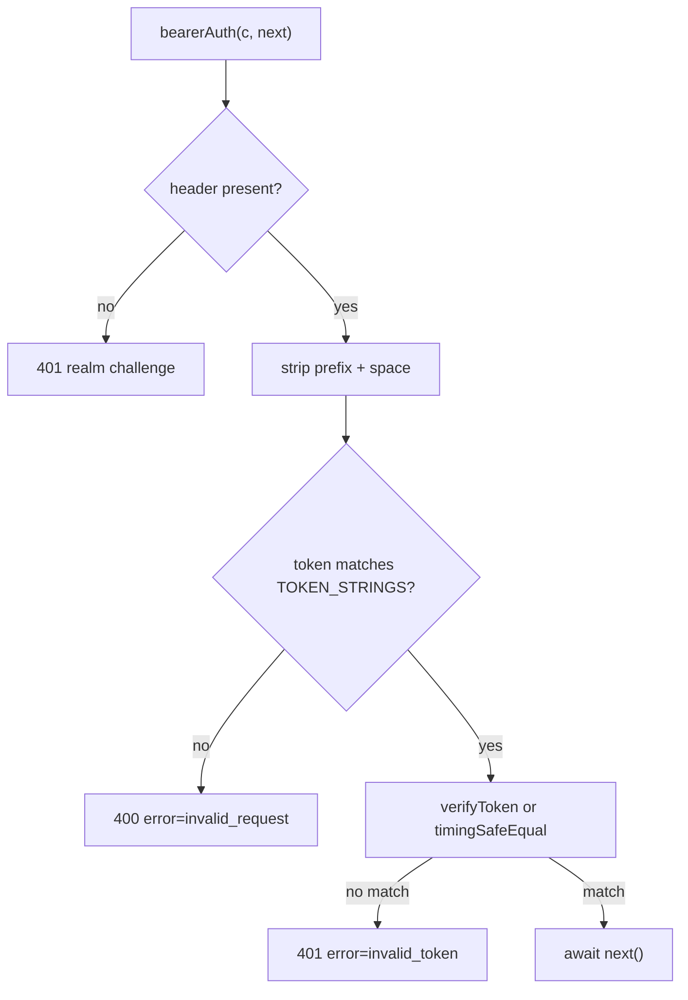
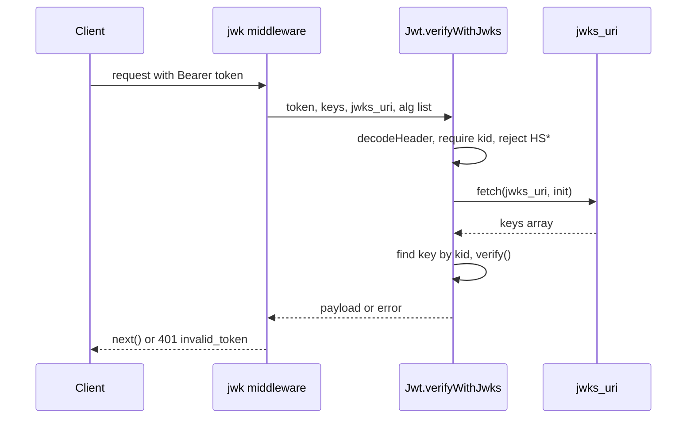

## Overview

Hono ships four authentication middleware that sit in front of route handlers and either call `next()` or throw an `HTTPException` carrying a ready-made `401`/`400` response. `basicAuth` and `bearerAuth` compare credentials from the `Authorization` header against configured secrets; `jwt` and `jwk` verify signed JSON Web Tokens and store the decoded payload on the context as `jwtPayload`. The JWT middleware are thin wrappers around the `Jwt` utility object in `src/utils/jwt`, which can also be used directly to sign, verify and decode tokens.

Sources: [src/middleware/basic-auth/index.ts:80-153](repo://src/middleware/basic-auth/index.ts#L80-L153), [src/middleware/bearer-auth/index.ts:104-221](repo://src/middleware/bearer-auth/index.ts#L104-L221), [src/utils/jwt/index.ts:1-7](repo://src/utils/jwt/index.ts#L1-L7)

All four middleware reject by throwing `HTTPException` with a `res` option, so the prepared response (including its `WWW-Authenticate` header) is what the client receives unless an `app.onError` handler replaces it. See [[Error Handling]] for how `HTTPException.getResponse()` is used, and [[Middleware and Composition]] for mounting middleware on path patterns.

Sources: [src/middleware/basic-auth/index.ts:132-151](repo://src/middleware/basic-auth/index.ts#L132-L151), [src/middleware/jwt/jwt.ts:141-152](repo://src/middleware/jwt/jwt.ts#L141-L152)

| Middleware | Import path | Credential source | On success |
| --- | --- | --- | --- |
| `basicAuth` | `hono/basic-auth` | `Authorization: Basic <base64>` | `onAuthSuccess(c, username)` then `next()` |
| `bearerAuth` | `hono/bearer-auth` | `Authorization: Bearer <token>` (configurable header and prefix) | `next()` |
| `jwt` | `hono/jwt` | `Authorization: Bearer <jwt>` or a cookie | `c.set('jwtPayload', payload)` |
| `jwk` | `hono/jwk` | `Authorization: Bearer <jwt>` or a cookie | `c.set('jwtPayload', payload)` |

Sources: [src/middleware/basic-auth/index.ts:105-131](repo://src/middleware/basic-auth/index.ts#L105-L131), [src/middleware/bearer-auth/index.ts:156-220](repo://src/middleware/bearer-auth/index.ts#L156-L220), [src/middleware/jwt/jwt.ts:76-158](repo://src/middleware/jwt/jwt.ts#L76-L158), [src/middleware/jwk/jwk.ts:75-168](repo://src/middleware/jwk/jwk.ts#L75-L168)

## Basic Auth

### Basic auth options

`basicAuth(options, ...users)` accepts either a fixed `username`/`password` pair or a `verifyUser` callback. Additional `{ username, password }` objects passed as rest arguments are accepted too; when the options carry a pair it is `unshift`ed to the front of that list. Construction throws a plain `Error` if neither form is present.

Sources: [src/middleware/basic-auth/index.ts:14-29](repo://src/middleware/basic-auth/index.ts#L14-L29), [src/middleware/basic-auth/index.ts:80-103](repo://src/middleware/basic-auth/index.ts#L80-L103)

| Option | Type | Default | Description |
| --- | --- | --- | --- |
| `username` / `password` | `string` | none | Credential pair; required unless `verifyUser` is given |
| `verifyUser` | `(username, password, c) => boolean \| Promise<boolean>` | none | Custom check; replaces the built-in comparison |
| `realm` | `string` | `"Secure Area"` | Realm in the `WWW-Authenticate` challenge |
| `hashFunction` | `Function` | SHA-256 | Hash used by `timingSafeEqual` |
| `invalidUserMessage` | `string \| object \| (c) => ...` | `"Unauthorized"` | Body of the 401 response; objects are sent as JSON |
| `onAuthSuccess` | `(c, username) => void \| Promise<void>` | none | Called before `next()` after a successful check |

Sources: [src/middleware/basic-auth/index.ts:31-46](repo://src/middleware/basic-auth/index.ts#L31-L46), [src/middleware/basic-auth/index.ts:93-99](repo://src/middleware/basic-auth/index.ts#L93-L99)

### Credential parsing and comparison

The `auth` helper in `src/utils/basic-auth.ts` matches the header against `CREDENTIALS_REGEXP` (a case-insensitive `Basic` scheme followed by a base64 token), base64-decodes it, UTF-8 decodes the bytes and splits on the first colon with `USER_PASS_REGEXP`. Invalid base64 makes `atob` throw, which is swallowed so the helper returns `undefined` and the request is treated as unauthenticated.

Sources: [src/utils/basic-auth.ts:1-26](repo://src/utils/basic-auth.ts#L1-L26)

With static users, each candidate is checked with two `timingSafeEqual` calls run in parallel. `timingSafeEqual` hashes both strings (SHA-256 unless `hashFunction` is supplied) and compares the digests and the originals with a constant-time comparison, so response timing does not leak how many leading characters matched.

Sources: [src/middleware/basic-auth/index.ts:116-130](repo://src/middleware/basic-auth/index.ts#L116-L130), [src/utils/buffer.ts:44-63](repo://src/utils/buffer.ts#L44-L63)

### Failure response

Any failure builds a `401` with `WWW-Authenticate: Basic realm="<realm>"` (double quotes in the realm are escaped). If `invalidUserMessage` resolves to a string it becomes the plain body; otherwise it is JSON-stringified and `content-type: application/json` is added.

Sources: [src/middleware/basic-auth/index.ts:132-151](repo://src/middleware/basic-auth/index.ts#L132-L151)

```ts
app.use(
  '/auth/*',
  basicAuth({
    username: 'hono',
    password: 'ahotproject',
    onAuthSuccess: (c, username) => {
      c.set('user', { name: username, role: 'admin' })
    },
  })
)
```

Sources: [src/middleware/basic-auth/index.ts:64-78](repo://src/middleware/basic-auth/index.ts#L64-L78)

## Bearer Auth

### Bearer auth options

`bearerAuth` takes either `token` (a string or an array of accepted strings) or `verifyToken(token, c)`. The deprecated `*Message` options still work but the nested `noAuthenticationHeader`, `invalidAuthenticationHeader` and `invalidToken` objects take precedence; each holds an optional `message` and `wwwAuthenticateHeader`.

Sources: [src/middleware/bearer-auth/index.ts:16-66](repo://src/middleware/bearer-auth/index.ts#L16-L66)

| Option | Type | Default | Description |
| --- | --- | --- | --- |
| `token` | `string \| string[]` | none | Accepted tokens; required unless `verifyToken` is given |
| `verifyToken` | `(token, c) => boolean \| Promise<boolean>` | none | Custom check |
| `realm` | `string` | `""` | Realm used in the default challenge |
| `prefix` | `string` | `"Bearer"` | Scheme expected before the token; `""` means the header value is the token |
| `headerName` | `string` | `"Authorization"` | Header to read |
| `hashFunction` | `Function` | SHA-256 | Hash used by `timingSafeEqual` |
| `noAuthenticationHeader` | `{ message?, wwwAuthenticateHeader? }` | `"Unauthorized"` | Response when the header is missing |
| `invalidAuthenticationHeader` | `{ message?, wwwAuthenticateHeader? }` | `"Bad Request"` | Response when the header is malformed |
| `invalidToken` | `{ message?, wwwAuthenticateHeader? }` | `"Unauthorized"` | Response when the token does not match |

Sources: [src/middleware/bearer-auth/index.ts:73-89](repo://src/middleware/bearer-auth/index.ts#L73-L89), [src/middleware/bearer-auth/index.ts:104-120](repo://src/middleware/bearer-auth/index.ts#L104-L120)

### Verification flow

The handler reads the configured header, strips the prefix case-insensitively (requiring a space right after it), and validates the remainder against the RFC 6750 token alphabet `[A-Za-z0-9._~+/-]+=*`. Only then does it compare tokens: `verifyToken` wins, a single string is compared with `timingSafeEqual`, and an array is scanned until one entry matches.

Sources: [src/middleware/bearer-auth/index.ts:12-14](repo://src/middleware/bearer-auth/index.ts#L12-L14), [src/middleware/bearer-auth/index.ts:156-220](repo://src/middleware/bearer-auth/index.ts#L156-L220)



Sources: [src/middleware/bearer-auth/index.ts:156-220](repo://src/middleware/bearer-auth/index.ts#L156-L220)

### Error responses

`throwHTTPException` resolves both the header and message options (functions are awaited with the context). A string `wwwAuthenticateHeader` is used verbatim; an object is rendered as `<prefix> key="value",key="value"`. Object messages become JSON bodies with `content-type: application/json`.

Sources: [src/middleware/bearer-auth/index.ts:122-154](repo://src/middleware/bearer-auth/index.ts#L122-L154)

| Case | Status | Default `WWW-Authenticate` | Default body |
| --- | --- | --- | --- |
| No header | 401 | `Bearer realm="<realm>"` | `Unauthorized` |
| Malformed header | 400 | `Bearer error="invalid_request"` | `Bad Request` |
| Token mismatch | 401 | `Bearer error="invalid_token"` | `Unauthorized` |

Sources: [src/middleware/bearer-auth/index.ts:158-216](repo://src/middleware/bearer-auth/index.ts#L158-L216)

## JWT Middleware

### JWT options

`jwt` requires `secret` and `alg` and throws at construction if either is missing or if `crypto.subtle.importKey` is unavailable in the runtime. Importing `hono/jwt` also augments `ContextVariableMap` with `jwtPayload`, so `c.get('jwtPayload')` is typed everywhere.

Sources: [src/middleware/jwt/jwt.ts:53-74](repo://src/middleware/jwt/jwt.ts#L53-L74), [src/middleware/jwt/index.ts:1-9](repo://src/middleware/jwt/index.ts#L1-L9)

| Option | Type | Description |
| --- | --- | --- |
| `secret` | `string \| HonoJsonWebKey \| CryptoKey` | Key used to verify the signature |
| `alg` | `SignatureAlgorithm` | Required; must equal the token header `alg` |
| `cookie` | `string \| { key, secret?, prefixOptions? }` | Fallback cookie; `secret` reads it with `getSignedCookie` |
| `headerName` | `string` | Header holding the token, default `Authorization` |
| `verification` | `VerifyOptions` | Claim checks passed to `Jwt.verify` (`iss`, `aud`, `nbf`, `exp`, `iat`) |

Sources: [src/middleware/jwt/jwt.ts:27-32](repo://src/middleware/jwt/jwt.ts#L27-L32), [src/middleware/jwt/jwt.ts:53-61](repo://src/middleware/jwt/jwt.ts#L53-L61)

### Token extraction

The header value is split on whitespace and must be exactly `Bearer <token>` (case-insensitive scheme); anything else is rejected immediately with `invalid credentials structure`. The cookie is consulted only when the header is absent, using `getCookie` or `getSignedCookie` from [[Cookie Helper]], optionally with `prefixOptions` for `__Secure-`/`__Host-` cookies.

Sources: [src/middleware/jwt/jwt.ts:76-129](repo://src/middleware/jwt/jwt.ts#L76-L129)

### Verification and errors

The token is passed to `Jwt.verify` with `alg` merged into the `verification` options. Any thrown `Jwt*` error is caught and attached as the `cause` of the resulting `HTTPException`, so an `onError` handler can inspect why a token failed while the client only sees the generic description.

Sources: [src/middleware/jwt/jwt.ts:131-157](repo://src/middleware/jwt/jwt.ts#L131-L157)

Every rejection is a `401` with body `Unauthorized` and a header built by `unauthorizedResponse`: `Bearer realm="<request URL>",error="<code>",error_description="<text>"`.

Sources: [src/middleware/jwt/jwt.ts:160-173](repo://src/middleware/jwt/jwt.ts#L160-L173)

| Failure | `error` | `error_description` |
| --- | --- | --- |
| Header not `Bearer <token>` | `invalid_request` | `invalid credentials structure` |
| No header and no cookie | `invalid_request` | `no authorization included in request` |
| `Jwt.verify` threw | `invalid_token` | `token verification failure` |

Sources: [src/middleware/jwt/jwt.ts:81-152](repo://src/middleware/jwt/jwt.ts#L81-L152)

```ts
app.use('/auth/*', jwt({ secret: 'it-is-very-secret', alg: 'HS256' }))

app.get('/auth/page', (c) => {
  const payload = c.get('jwtPayload')
  return c.json(payload)
})
```

Sources: [src/middleware/jwt/jwt.ts:35-51](repo://src/middleware/jwt/jwt.ts#L35-L51)

## JWK Middleware

### JWK options

`jwk` verifies tokens signed with asymmetric keys looked up by `kid`. It needs `keys`, `jwks_uri`, or both; each may be a value or a function of the context (useful for reading `c.env`). An optional second argument `init` is passed to `fetch` when the JWKS is downloaded.

Sources: [src/middleware/jwk/jwk.ts:48-73](repo://src/middleware/jwk/jwk.ts#L48-L73)

| Option | Type | Description |
| --- | --- | --- |
| `keys` | `HonoJsonWebKey[] \| (c) => ...` | Static public keys |
| `jwks_uri` | `string \| (c) => ...` | URL whose JSON `keys` array is merged with `keys` |
| `alg` | `AsymmetricAlgorithm[]` | Allow-list of header algorithms |
| `allow_anon` | `boolean` | When `true`, requests without a token call `next()` unauthenticated |
| `cookie` | `string \| { key, secret?, prefixOptions? }` | Fallback cookie, same as `jwt` |
| `headerName` | `string` | Default `Authorization` |
| `verification` | `VerifyOptions` | Claim checks |

Sources: [src/middleware/jwk/jwk.ts:22-30](repo://src/middleware/jwk/jwk.ts#L22-L30), [src/middleware/jwk/jwk.ts:48-64](repo://src/middleware/jwk/jwk.ts#L48-L64)

### Flow

Extraction mirrors `jwt`, except a missing token with `allow_anon` returns `next()` instead of a 401. The key sources are resolved per request and handed to `Jwt.verifyWithJwks`. Failures from `verifyWithJwks` that are plain `Error` instances (a failed JWKS fetch or a malformed JWKS document) are rethrown as-is rather than converted into a 401, so configuration problems surface as server errors; `Jwt*` subclasses become the usual `invalid_token` response.

Sources: [src/middleware/jwk/jwk.ts:118-167](repo://src/middleware/jwk/jwk.ts#L118-L167)



Sources: [src/middleware/jwk/jwk.ts:133-167](repo://src/middleware/jwk/jwk.ts#L133-L167), [src/utils/jwt/jwt.ts:197-262](repo://src/utils/jwt/jwt.ts#L197-L262)

## JWT Utilities

### The Jwt object

`src/utils/jwt/index.ts` bundles `sign`, `verify`, `decode` and `verifyWithJwks` as `Jwt`. `hono/jwt` re-exports each function individually plus the `AlgorithmTypes` enum, so they can be used outside the middleware to issue tokens.

Sources: [src/utils/jwt/index.ts:1-7](repo://src/utils/jwt/index.ts#L1-L7), [src/middleware/jwt/jwt.ts:175-178](repo://src/middleware/jwt/jwt.ts#L175-L178), [src/middleware/jwt/index.ts:1-9](repo://src/middleware/jwt/index.ts#L1-L9)

### Algorithms and keys

`AlgorithmTypes` lists 13 algorithms; `getKeyAlgorithm` maps each to Web Crypto parameters. `HS*` are symmetric and the rest form `AsymmetricAlgorithm`.

Sources: [src/utils/jwt/jwa.ts:7-37](repo://src/utils/jwt/jwa.ts#L7-L37), [src/utils/jwt/jws.ts:122-224](repo://src/utils/jwt/jws.ts#L122-L224)

| `alg` | Web Crypto algorithm | Hash / curve |
| --- | --- | --- |
| `HS256` / `HS384` / `HS512` | `HMAC` | SHA-256 / 384 / 512 |
| `RS256` / `RS384` / `RS512` | `RSASSA-PKCS1-v1_5` | SHA-256 / 384 / 512 |
| `PS256` / `PS384` / `PS512` | `RSA-PSS` | SHA-256 / 384 / 512, salt 32 / 48 / 64 |
| `ES256` / `ES384` / `ES512` | `ECDSA` | P-256 / P-384 / P-521 |
| `EdDSA` | `Ed25519` | Ed25519 |

Sources: [src/utils/jwt/jws.ts:122-224](repo://src/utils/jwt/jws.ts#L122-L224)

A `SignatureKey` is a string, a JWK object or a `CryptoKey`. For signing, `importPrivateKey` uses a `CryptoKey` directly (it must be `private` or `secret`), imports objects as `jwk`, strings containing `PRIVATE` as PKCS#8 PEM, and any other string as raw HMAC bytes. For verifying, `importPublicKey` also accepts a private PEM or private `CryptoKey` and derives the public JWK from it via `exportPublicJwkFrom`; strings containing `PUBLIC` are imported as SPKI.

Sources: [src/utils/jwt/jws.ts:23-120](repo://src/utils/jwt/jws.ts#L23-L120)

### sign

`sign(payload, privateKey, alg = 'HS256')` base64url-encodes the header and payload without padding, signs `header.payload`, and appends the signature. When the key is a JWK with an `alg` field, that `alg` overrides the argument and its `kid` is written into the header.

Sources: [src/utils/jwt/jwt.ts:31-76](repo://src/utils/jwt/jwt.ts#L31-L76)

```ts
import { sign, verify } from 'hono/jwt'

const token = await sign({ sub: 'user123', exp: Math.floor(Date.now() / 1000) + 60 * 5 }, secret)
const payload = await verify(token, secret, 'HS256')
```

Sources: [src/utils/jwt/jwt.ts:56-60](repo://src/utils/jwt/jwt.ts#L56-L60), [src/utils/jwt/jwt.ts:96-100](repo://src/utils/jwt/jwt.ts#L96-L100)

### verify and claim checks

`verify(token, publicKey, algOrOptions)` requires an algorithm (a string or `{ alg, ...VerifyOptions }`); there is no fallback to the token header's `alg`, which prevents `alg: none` and algorithm-confusion attacks. It checks, in order: three dot-separated parts, a header that `isTokenHeader` accepts (known `alg`, `typ` absent or `JWT`), header `alg` equal to the expected one, the time claims, `iss`, `aud`, and finally the signature.

Sources: [src/utils/jwt/jwt.ts:38-54](repo://src/utils/jwt/jwt.ts#L38-L54), [src/utils/jwt/jwt.ts:96-188](repo://src/utils/jwt/jwt.ts#L96-L188)

| `VerifyOptions` field | Default | Check | Error |
| --- | --- | --- | --- |
| `nbf` | `true` | If present, `nbf` must be a finite number not after now | `JwtTokenNotBefore` |
| `exp` | `true` | If present, `exp` must be a finite number after now | `JwtTokenExpired` |
| `iat` | `true` | If present, `iat` must be a finite number not in the future | `JwtTokenIssuedAt` |
| `iss` | none | `payload.iss` must equal the string or match the `RegExp` | `JwtTokenIssuer` |
| `aud` | none | One of `payload.aud` must equal, be included in, or match the option | `JwtPayloadRequiresAud`, `JwtTokenAudience` |

Sources: [src/utils/jwt/jwt.ts:78-89](repo://src/utils/jwt/jwt.ts#L78-L89), [src/utils/jwt/jwt.ts:130-174](repo://src/utils/jwt/jwt.ts#L130-L174)

### verifyWithJwks

`verifyWithJwks` decodes only the header, requires a `kid`, rejects `HS256`/`HS384`/`HS512` outright with `JwtSymmetricAlgorithmNotAllowed`, and checks the header `alg` against `allowedAlgorithms`. It copies `keys`, appends the `keys` array fetched from `jwks_uri`, picks the key whose `kid` matches, and if that JWK declares `alg` requires it to equal the header's before delegating to `verify`.

Sources: [src/utils/jwt/jwt.ts:190-262](repo://src/utils/jwt/jwt.ts#L190-L262)

### decode and error types

`decode` splits and base64url-decodes header and payload without checking the signature, throwing `JwtTokenInvalid` on any parse failure; `decodeHeader` does the same for the header only. All verification errors are `Error` subclasses with a `name` matching the class, defined in `types.ts`.

Sources: [src/utils/jwt/jwt.ts:264-291](repo://src/utils/jwt/jwt.ts#L264-L291), [src/utils/jwt/types.ts:6-115](repo://src/utils/jwt/types.ts#L6-L115)

| Error class | Thrown when |
| --- | --- |
| `JwtAlgorithmRequired` | `verify` called without `alg` |
| `JwtAlgorithmMismatch` | Header `alg` differs from expected, or from the JWK's `alg` |
| `JwtAlgorithmNotImplemented` | `getKeyAlgorithm` gets an unknown name |
| `JwtTokenInvalid` | Not three parts, undecodable, or no JWK with the `kid` |
| `JwtHeaderInvalid` / `JwtHeaderRequiresKid` | Bad header, or missing `kid` for JWKS verification |
| `JwtSymmetricAlgorithmNotAllowed` / `JwtAlgorithmNotAllowed` | JWKS token uses `HS*` or an algorithm outside the allow-list |
| `JwtTokenSignatureMismatched` | `crypto.subtle.verify` returned `false` |

Sources: [src/utils/jwt/types.ts:6-115](repo://src/utils/jwt/types.ts#L6-L115), [src/utils/jwt/jws.ts:221-223](repo://src/utils/jwt/jws.ts#L221-L223)
