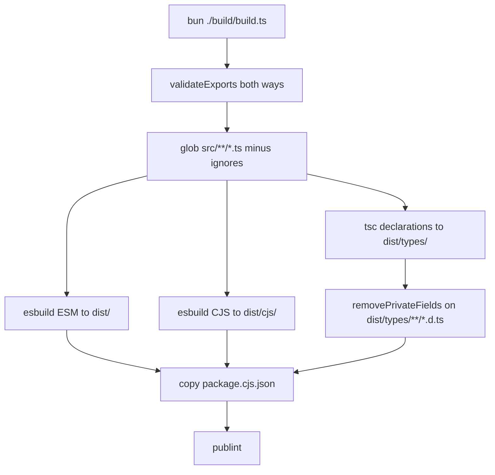

## Overview

This page is for contributors working on the Hono repository itself. Hono is written in TypeScript under `src/` and published twice: to npm as compiled ESM, CommonJS and `.d.ts` files in `dist/`, and to JSR as the TypeScript sources. The build script keeps both export maps in step, and the test setup runs the same code under Vitest in Node plus real or emulated Deno, Bun, Cloudflare `workerd`, Fastly Compute and AWS Lambda environments, because each [[Runtime Adapters]] target behaves differently.

Sources: [package.json:1-37](repo://package.json#L1-L37), [jsr.json:1-31](repo://jsr.json#L1-L31)

## Setting up

The project uses Bun as its package manager and script runner. The tool versions CI pins are in `.tool-versions` (Node.js, Bun and Deno), and `packageManager` in `package.json` names the Bun release.

Sources: [.tool-versions:1-3](repo://.tool-versions#L1-L3), [package.json:694-699](repo://package.json#L694-L699)

```bash
git clone git@github.com:honojs/hono.git && cd hono && bun install --frozen-lockfile
```

Sources: [docs/CONTRIBUTING.md:27-60](repo://docs/CONTRIBUTING.md#L27-L60)

`docs/CONTRIBUTING.md` asks that a pull request pass `bun run test`, and explains that middleware which depends on other libraries or on one platform belongs in the separate `honojs/middleware` monorepo rather than in core. It also states the project's AI usage policy: maintainers may close a PR that wastes their time without notice.

Sources: [docs/CONTRIBUTING.md:21-54](repo://docs/CONTRIBUTING.md#L21-L54)

## package.json scripts

The scripts a contributor uses most:

Sources: [package.json:13-37](repo://package.json#L13-L37)

| Script | What it runs |
| --- | --- |
| `test` | `tsc -p tsconfig.spec.json` (type check of sources and tests), then `vitest --run` (all Vitest projects) |
| `test:watch` | `vitest --watch` |
| `test:deno` | `deno test` on `runtime-tests/deno`, then `runtime-tests/deno-jsx` under the `precompile` and `react-jsx` configs |
| `test:bun` | `bun test --jsx-import-source ../../src/jsx runtime-tests/bun/*` |
| `test:node`, `test:workerd`, `test:fastly`, `test:lambda`, `test:lambda-edge` | one Vitest project each (`vitest --run --project <name>`) |
| `test:all` | `test`, `test:deno` and `test:bun` |
| `build` | remove `dist`, run `build/build.ts`, copy `package.cjs.json` into `dist/cjs` and `dist/types` |
| `postbuild` | `publint`, which checks the built package against its `exports` |
| `watch` | the build in watch mode |
| `lint` / `lint:fix` | ESLint over `src`, `runtime-tests`, `build`, `perf-measures`, `benchmarks` |
| `format` / `format:fix` | Prettier check / write over the same folders |
| `editorconfig-checker` | checks files against `.editorconfig` |
| `coverage` | `vitest --run --coverage` |
| `prerelease` / `release` | `test:deno` plus `build`, then `np --no-publish` |

Sources: [package.json:13-37](repo://package.json#L13-L37)

## The build

### build/build.ts

`build/build.ts` runs under Bun. It first validates the two export maps, then collects every `src/**/*.ts` file as an entry point, skipping tests (`*.test.ts`) and the `src/mod.ts`, `src/middleware.ts` and `src/deno/**` patterns. Every source file becomes its own output file, which is what allows deep imports such as `hono/utils/body`.

Sources: [build/build.ts:18-39](repo://build/build.ts#L18-L39)

Three jobs then run in parallel:

Sources: [build/build.ts:103-107](repo://build/build.ts#L103-L107)

1. ESM: esbuild with `bundle: true`, `format: 'esm'`, output to `dist/`. The `add-extension` plugin marks every import as external and rewrites it to a `.js` path, using `/index.js` when the import names a folder. Each file is therefore "bundled" only with itself, and the output keeps Node-compatible ESM specifiers.
2. CommonJS: esbuild with `format: 'cjs'` to `dist/cjs/`, without bundling.
3. Types: `tsc --emitDeclarationOnly --declaration --project tsconfig.build.json`, which writes `.d.ts` files to `dist/types/`.

Sources: [build/build.ts:41-107](repo://build/build.ts#L41-L107), [tsconfig.build.json:1-19](repo://tsconfig.build.json#L1-L19)



Sources: [build/build.ts:94-114](repo://build/build.ts#L94-L114), [package.json:29-31](repo://package.json#L29-L31)

The `package.json` root sets `"type": "module"`, so `.js` files in `dist/` are ESM. The `copy:package.cjs.json` step drops a `{ "type": "commonjs" }` `package.json` into `dist/cjs` and `dist/types` so Node treats those files as CommonJS. With `--watch`, `runBuild` uses esbuild's `context().watch()` and `tsc -w` instead of one-shot builds.

Sources: [package.cjs.json:1-3](repo://package.cjs.json#L1-L3), [package.json:5-12](repo://package.json#L5-L12), [build/build.ts:94-101](repo://build/build.ts#L94-L101)

### Removing private fields from declarations

`tsc` writes ECMAScript private fields (`#name`) into class declarations. `removePrivateFields` parses every generated `.d.ts` with `oxc-parser`, finds `PropertyDefinition` nodes whose key is a `PrivateIdentifier` inside class declarations, and blanks them out. It replaces each one with spaces of the same length instead of deleting it, so the source offsets of all other nodes stay valid while several removals are applied to the same string.

Sources: [build/remove-private-fields.ts:1-57](repo://build/remove-private-fields.ts#L1-L57)

### Keeping package.json and jsr.json in sync

Each public module is listed twice: in `package.json` `exports` (with `types`, `import` and `require` paths into `dist`) and in `jsr.json` `exports` (a path to the `.ts` source). `validateExports(source, target, fileName)` throws `Missing "<entry>" in '<file>'` for any key of one map that the other lacks, and the build calls it in both directions before compiling. Wildcards are matched both ways: `./utils/*` in `package.json` is satisfied by any `./utils/...` key in `jsr.json`, and a specific entry is satisfied by a `<prefix>/*` key for any of its parent prefixes.

Sources: [build/validate-exports.ts:1-37](repo://build/validate-exports.ts#L1-L37), [build/build.ts:20-26](repo://build/build.ts#L20-L26), [package.json:319-323](repo://package.json#L319-L323), [jsr.json:82-91](repo://jsr.json#L82-L91)

> [!IMPORTANT]
> A new public module needs an entry in `package.json` `exports`, an entry in `jsr.json` `exports`, and a `typesVersions` entry in `package.json` for TypeScript setups that do not read `exports`. The build fails if the first two disagree.

Sources: [package.json:415-420](repo://package.json#L415-L420), [build/validate-exports.ts:32-37](repo://build/validate-exports.ts#L32-L37)

CI also runs `bunx jsr publish --dry-run` to check that the sources are valid for JSR.

Sources: [.github/workflows/ci.yml:59-70](repo://.github/workflows/ci.yml#L59-L70)

## Unit tests with Vitest

### Vitest projects

`vitest.config.ts` enables globals and V8 coverage and defines several projects:

Sources: [vitest.config.ts:1-25](repo://vitest.config.ts#L1-L25)

| Project | Files | JSX import source |
| --- | --- | --- |
| `main` | `src/**`, `scripts/**` and `build/**` tests, excluding `**/sandbox/**` and `*.case.test.*` | `./src/jsx` |
| `jsx-runtime-default` | `src/jsx/dom/**` tests and `src/jsx/hooks/dom.test.tsx` | `./src/jsx` |
| `jsx-runtime-dom` | the same DOM tests | `./src/jsx/dom` |
| one per `runtime-tests/*/vitest.config.ts` | the runtime folder | as configured there |

Sources: [vitest.config.ts:25-73](repo://vitest.config.ts#L25-L73)

The DOM renderer tests run twice, once with each JSX runtime, so components behave the same whether they were compiled against `hono/jsx` or `hono/jsx/dom` (see [[Client-side JSX and Hooks]]). Tests sit next to the code as `*.test.ts` / `*.test.tsx`. Coverage excludes `runtime-tests`, `benchmarks`, `perf-measures`, `build/build.ts` and type-only files such as `src/**/types.ts`.

Sources: [vitest.config.ts:5-24](repo://vitest.config.ts#L5-L24), [vitest.config.ts:45-70](repo://vitest.config.ts#L45-L70)

### Type checking tests

`bun run test` starts with `tsc -p tsconfig.spec.json`, which type-checks `src` including the tests with `jsxImportSource: "hono/jsx"` and Vitest globals. Many tests assert types as well as values, so a type error fails the suite before Vitest starts. The root `tsconfig.json` is a solution file that references the build, spec, perf-measure and runtime-test configs.

Sources: [tsconfig.spec.json:1-11](repo://tsconfig.spec.json#L1-L11), [tsconfig.json:1-14](repo://tsconfig.json#L1-L14), [package.json:14-14](repo://package.json#L14-L14)

## Runtime tests

### Folders

`runtime-tests/` holds one folder per runtime. Each one exercises the adapter and runtime-specific features against the real runtime or a close emulation:

Sources: [tsconfig.json:3-13](repo://tsconfig.json#L3-L13)

| Folder | Runner | Notes |
| --- | --- | --- |
| `node` | Vitest project `node` | sets `NAME=Node` in the environment |
| `workerd` | Vitest project `workerd` | starts `runtime-tests/workerd/index.ts` with Wrangler's `unstable_dev` and calls it over HTTP and WebSocket |
| `fastly` | Vitest project `fastly` | uses `vite-plugin-fastly-js-compute` |
| `lambda` | Vitest project `lambda` | mocks `awslambda.streamifyResponse` with a Node `Writable` to test `streamHandle` |
| `lambda-edge` | Vitest project `lambda-edge` | CloudFront event tests |
| `bun` | `bun test` | static files, colors, JSX via `--jsx-import-source` |
| `deno` | `deno test -c runtime-tests/deno/deno.json` | static files, SSG, streaming, middleware |
| `deno-jsx` | `deno test` with two configs | the same JSX tests under `precompile` and `react-jsx` |

Sources: [runtime-tests/node/vitest.config.ts:1-11](repo://runtime-tests/node/vitest.config.ts#L1-L11), [runtime-tests/workerd/index.test.ts:1-20](repo://runtime-tests/workerd/index.test.ts#L1-L20), [runtime-tests/fastly/vitest.config.ts:1-10](repo://runtime-tests/fastly/vitest.config.ts#L1-L10), [runtime-tests/lambda/stream-mock.ts:1-30](repo://runtime-tests/lambda/stream-mock.ts#L1-L30), [package.json:16-22](repo://package.json#L16-L22)

Deno resolves `hono/jsx/jsx-runtime` through the import map in its `deno.json`, which points at `../../src/jsx/jsx-runtime.ts`, so the runtime tests exercise the sources rather than a build.

Sources: [runtime-tests/deno/deno.json:1-14](repo://runtime-tests/deno/deno.json#L1-L14), [runtime-tests/deno-jsx/deno.precompile.json:1-12](repo://runtime-tests/deno-jsx/deno.precompile.json#L1-L12)

### What CI runs

The `ci` workflow runs on pushes to `main` and `next` and on pull requests. The `Main` job runs `format`, `lint`, `editorconfig-checker`, `build` and `test`. Separate jobs run Deno (with coverage), Bun on Linux and Windows, Fastly, Node.js across a version matrix, workerd, Lambda and Lambda@Edge; most of those run `bun run build` first. Coverage from Main, Bun and Deno is merged and uploaded to Codecov. Pull requests also get type-check and bundle-size measurements (`perf-measures`) and an HTTP benchmark comment.

Sources: [.github/workflows/ci.yml:1-58](repo://.github/workflows/ci.yml#L1-L58), [.github/workflows/ci.yml:72-120](repo://.github/workflows/ci.yml#L72-L120), [.github/workflows/ci.yml:121-200](repo://.github/workflows/ci.yml#L121-L200)

## Lint and format

ESLint uses the shared `@hono/eslint-config`, turns off every rule that needs type information (so linting does not need a TypeScript program), and reports unused `eslint-disable` directives as errors. Prettier uses a print width of 100, no semicolons, single quotes (also in JSX), `es5` trailing commas and LF line endings. `.editorconfig` requires UTF-8, LF, a final newline and two-space indentation.

Sources: [eslint.config.mjs:1-80](repo://eslint.config.mjs#L1-L80), [.prettierrc:1-9](repo://.prettierrc#L1-L9), [.editorconfig:1-21](repo://.editorconfig#L1-L21)

Run `bun run format:fix` and `bun run lint:fix` before pushing; CI runs the check variants and fails on any difference.

Sources: [package.json:24-28](repo://package.json#L24-L28), [.github/workflows/ci.yml:48-53](repo://.github/workflows/ci.yml#L48-L53)

## Migration notes

`docs/MIGRATION.md` records breaking and notable changes between major and minor versions, from v1.6 up to v4.4 (for example the move from `deno.land/x` to JSR as `jsr:@hono/hono`, and the APIs removed in v4.0 such as `hono/nextjs` in favour of `hono/vercel` and `c.jsonT()` in favour of `c.json()`). Add an entry there when a change requires users to update their code.

Sources: [docs/MIGRATION.md:1-38](repo://docs/MIGRATION.md#L1-L38)
