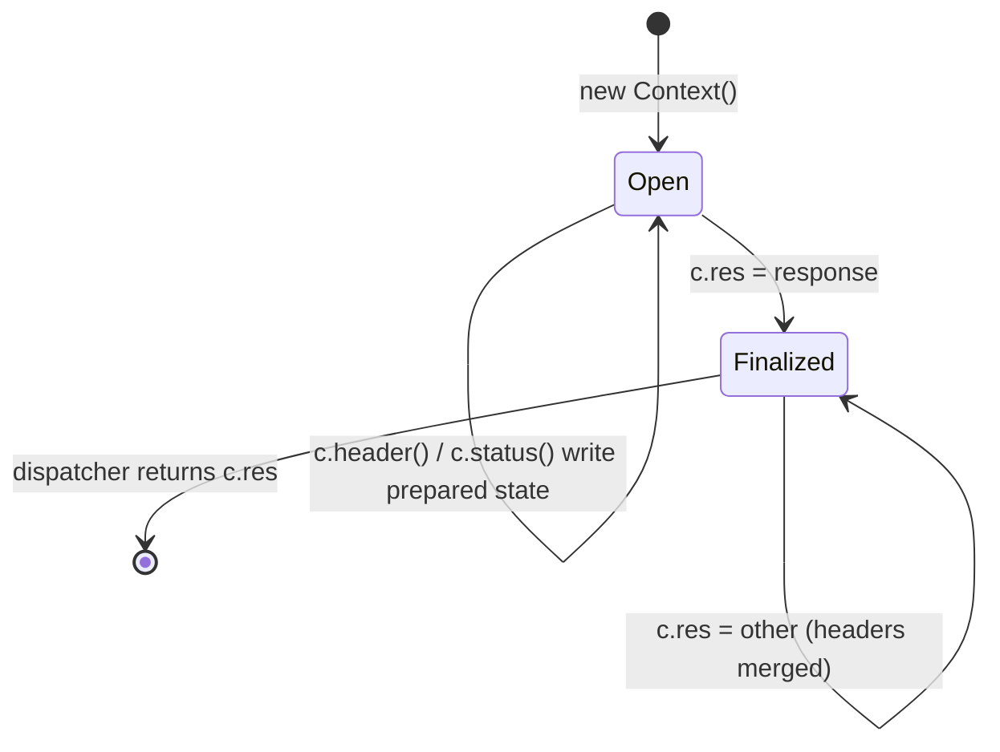

## Overview

Every handler and middleware in Hono receives one `Context` object, conventionally named `c`. It is created once per request by the application's dispatcher and carries everything a handler needs: the wrapped request (`c.req`), the runtime bindings (`c.env`), the platform execution context, per-request variables, and the helpers that build the `Response`. Because the same instance travels through the whole middleware chain, it is also where the response under construction lives (`c.res`) and where an error thrown downstream is recorded (`c.error`).

Sources: [src/context.ts:293-361](repo://src/context.ts#L293-L361)

The class is generic over three parameters: `E extends Env` for bindings and variables, `P extends string` for the matched route path, and `I extends Input` for validated input. These generics drive the typing of `c.env`, `c.get`/`c.set`, `c.var` and `c.req.valid()`; [[Type System]] explains them in depth. The dispatcher that constructs the context is described in [[The Hono Application]].

Sources: [src/context.ts:293-299](repo://src/context.ts#L293-L299), [src/hono-base.ts:418-427](repo://src/hono-base.ts#L418-L427)

## Construction and lifecycle

### How the dispatcher creates a Context

`Hono#dispatch` computes the path with `getPath`, asks the router for a `matchResult`, and then builds the context with the raw `Request` plus `ContextOptions`: `path`, `matchResult`, `env`, `executionCtx` and the app's `notFoundHandler`. The constructor only stores these in private fields; nothing is parsed eagerly.

Sources: [src/hono-base.ts:418-427](repo://src/hono-base.ts#L418-L427), [src/context.ts:237-252](repo://src/context.ts#L237-L252), [src/context.ts:352-361](repo://src/context.ts#L352-L361)

| Option | Type | Stored in | Used by |
| --- | --- | --- | --- |
| `env` | `E['Bindings']` | `env` (public) | `c.env` |
| `executionCtx` | `FetchEventLike \| ExecutionContext` | `#executionCtx` | `c.executionCtx`, `c.event` |
| `notFoundHandler` | `NotFoundHandler<E>` | `#notFoundHandler` | `c.notFound()` |
| `matchResult` | `Result<[H, RouterRoute]>` | `#matchResult` | `c.req` (params, matched routes) |
| `path` | `string` | `#path` | `c.req.path`, `c.req.routePath` |

Sources: [src/context.ts:237-252](repo://src/context.ts#L237-L252), [src/context.ts:300-344](repo://src/context.ts#L300-L344)

### Lazy request wrapper

`c.req` is a getter that creates the [[HonoRequest]] on first access with `??=`, passing the raw request, the path and the match result. A handler that never touches `c.req` never pays for the wrapper.

Sources: [src/context.ts:366-369](repo://src/context.ts#L366-L369)

```ts
get req(): HonoRequest<P, I['out']> {
  this.#req ??= new HonoRequest(this.#rawRequest, this.#path, this.#matchResult)
  return this.#req
}
```

Sources: [src/context.ts:366-369](repo://src/context.ts#L366-L369)

## Runtime bindings and execution context

`c.env` is a public field typed as `E['Bindings']` and defaults to `{}`. On Cloudflare Workers it holds KV namespaces, D1 databases, secrets and other bindings; on other runtimes it holds whatever the adapter passes as the second argument to `app.fetch`.

Sources: [src/context.ts:302-315](repo://src/context.ts#L302-L315), [src/hono-base.ts:479-485](repo://src/hono-base.ts#L479-L485)

`c.executionCtx` returns the third argument of `fetch` cast to `ExecutionContext`, which exposes `waitUntil(promise)`, `passThroughOnException()`, `props` and optional `exports`. `c.event` is only available when the app was started with `app.fire()` (Service Worker style): it checks for a `respondWith` method on the stored object. Both getters throw an `Error` when the value is missing, so code that must run on several runtimes should guard access with `try`/`catch`, as `mount()` does internally.

Sources: [src/context.ts:31-52](repo://src/context.ts#L31-L52), [src/context.ts:377-397](repo://src/context.ts#L377-L397), [src/hono-base.ts:355-361](repo://src/hono-base.ts#L355-L361), [src/hono-base.ts:536-542](repo://src/hono-base.ts#L536-L542)

```ts
app.get('/log', (c) => {
  c.executionCtx.waitUntil(sendAnalytics(c.req.url))
  return c.text('ok')
})
```

Sources: [src/context.ts:31-41](repo://src/context.ts#L31-L41), [src/context.ts:391-397](repo://src/context.ts#L391-L397)

## Response helpers

### Shared response builder

All body-producing helpers funnel into the private `#newResponse(data, arg, headers)`. It decides the headers and status in this order:

Sources: [src/context.ts:604-611](repo://src/context.ts#L604-L611)

1. Start from a copy of the current `c.res` headers if a response already exists, otherwise from the headers prepared by `c.header()` before any response was made.
2. If `arg` is an object with `headers` (a `ResponseInit` or a `Response`), merge them in; `set-cookie` values are appended, every other header overwrites.
3. Apply the `headers` record argument; an array value deletes the header and appends each element.
4. Use `arg` as the status when it is a number, else `arg.status`, else the status set by `c.status()`.

Sources: [src/context.ts:604-641](repo://src/context.ts#L604-L641)

| Helper | Default `Content-Type` | Typed return | Notes |
| --- | --- | --- | --- |
| `c.body(data, status?, headers?)` | none | `TypedResponse<T, U, 'body'>` | `data` may be `string`, `ArrayBuffer`, `ReadableStream`, `Uint8Array` or `null` |
| `c.text(text, ...)` | `text/plain; charset=UTF-8` | `TypedResponse<T, U, 'text'>` | fast path returns `new Response(text)` |
| `c.json(object, ...)` | `application/json` | `TypedResponse<JSONParsed<T>, U, 'json'>` | serialises with `JSON.stringify` |
| `c.html(html, ...)` | `text/html; charset=UTF-8` | `Response` or `Promise<Response>` | resolves a `Promise<string>` from JSX first |
| `c.redirect(location, status?)` | none | `TypedResponse<undefined, T, 'redirect'>` | default status `302` |
| `c.newResponse(data, ...)` | none | `Response` | untyped escape hatch |

Sources: [src/context.ts:26-26](repo://src/context.ts#L26-L26), [src/context.ts:641-733](repo://src/context.ts#L641-L733), [src/context.ts:750-762](repo://src/context.ts#L750-L762)

Each helper accepts either `(data, status, headers)` or `(data, init)`, where `init` is a `ResponseInit`-like object or an existing `Response` whose status and headers are reused. Status generics are restricted to `ContentfulStatusCode` for helpers that carry a body; only `c.body(null, ...)` accepts any `StatusCode` such as `204`.

Sources: [src/context.ts:113-141](repo://src/context.ts#L113-L141), [src/context.ts:156-166](repo://src/context.ts#L156-L166), [src/context.ts:271-277](repo://src/context.ts#L271-L277)

### text fast path

`c.text()` skips the header-merging logic entirely when no headers were prepared, no status was set, no extra arguments were passed and the context is not finalized. This is the hot path for simple handlers and avoids allocating a `Headers` object; the runtime then supplies its own `text/plain;charset=UTF-8` content type.

Sources: [src/context.ts:682-694](repo://src/context.ts#L682-L694)

```ts
return !this.#preparedHeaders && !this.#status && !arg && !headers && !this.finalized
  ? (new Response(text) as ReturnType<TextRespond>)
  : (this.#newResponse(
      text,
      arg,
      setDefaultContentType(TEXT_PLAIN, headers)
    ) as ReturnType<TextRespond>)
```

Sources: [src/context.ts:682-694](repo://src/context.ts#L682-L694)

`setDefaultContentType` places the default `Content-Type` before the caller's headers in an object spread, so a `Content-Type` supplied by the caller always wins.

Sources: [src/context.ts:279-286](repo://src/context.ts#L279-L286)

### html and redirect

`c.html()` accepts a `string` or a `Promise<string>`. When it gets a promise (as produced by async JSX components) it runs `resolveCallback` in the `Stringify` phase and returns a `Promise<Response>`; otherwise it returns a `Response` synchronously. See [[JSX Server Rendering]] for where those promises come from.

Sources: [src/context.ts:723-733](repo://src/context.ts#L723-L733)

`c.redirect()` sets the `Location` header through `c.header()`, percent-encoding the location with `encodeURI` only when it contains characters outside the Latin-1 range, and then returns `newResponse(null, status ?? 302)`. The status generic is limited to `RedirectStatusCode`.

Sources: [src/context.ts:750-762](repo://src/context.ts#L750-L762)

### notFound

`c.notFound()` calls the app's not-found handler that the dispatcher passed in, so a handler can delegate to the same 404 response the app produces for unmatched routes. If the context was created without one (for example in a unit test that calls `new Context(req)` directly), it falls back to an empty `Response`. [[Error Handling]] covers customising this with `app.notFound()`.

Sources: [src/context.ts:776-779](repo://src/context.ts#L776-L779), [src/hono-base.ts:291-294](repo://src/hono-base.ts#L291-L294)

## Headers and status

`c.header(name, value?, options?)` writes to the headers of the current response if one exists, otherwise to a lazily created `#preparedHeaders` that later responses start from. Passing `undefined` as `value` deletes the header, and `{ append: true }` appends instead of replacing, which is how multiple `Set-Cookie` or `Vary` values are produced.

Sources: [src/context.ts:254-262](repo://src/context.ts#L254-L262), [src/context.ts:515-527](repo://src/context.ts#L515-L527)

When the context is already `finalized`, `c.header()` first re-creates `#res` from its own body and init. A `Response` returned by `fetch()` or built elsewhere can have immutable headers, so cloning guarantees a middleware that runs after `await next()` can still add headers.

Sources: [src/context.ts:515-519](repo://src/context.ts#L515-L519)

`c.status(code)` only records the status in `#status`; it takes effect on the next helper call that does not pass its own status.

Sources: [src/context.ts:529-531](repo://src/context.ts#L529-L531)

```ts
app.post('/posts', (c) => {
  c.status(201)
  c.header('X-Request-Id', crypto.randomUUID())
  return c.json({ created: true })
})
```

Sources: [src/context.ts:529-531](repo://src/context.ts#L529-L531), [src/context.ts:637-638](repo://src/context.ts#L637-L638)

## Variables: set, get and var

`c.set(key, value)` stores a value in a per-request `Map` created on first use, and `c.get(key)` reads it back, returning `undefined` when nothing was set. `c.var` exposes the same values as a read-only plain object built with `Object.fromEntries`, which is convenient for destructuring (`const { user } = c.var`).

Sources: [src/context.ts:546-602](repo://src/context.ts#L546-L602)

Their types come from two places. The `Get` and `Set` interfaces have one overload keyed by `E['Variables']` and one keyed by the global `ContextVariableMap` interface, which middleware packages extend with declaration merging. When `E` is `any`, both accept any string key.

Sources: [src/context.ts:54-57](repo://src/context.ts#L54-L57), [src/context.ts:95-108](repo://src/context.ts#L95-L108)

```ts
type Env = { Variables: { user: { id: string } } }

const app = new Hono<Env>()
app.use(async (c, next) => {
  c.set('user', { id: '42' })
  await next()
})
app.get('/me', (c) => c.json(c.var.user))
```

Sources: [src/context.ts:546-602](repo://src/context.ts#L546-L602)

> [!NOTE]
> `c.var` builds a fresh object on every access, so repeated reads in a tight loop are cheaper through `c.get()`.

Sources: [src/context.ts:593-602](repo://src/context.ts#L593-L602)

## Rendering: render, setRenderer and setLayout

`c.render(...args)` calls the current renderer. If none was installed it lazily installs a default that forwards its content to `c.html()`. Middleware such as the JSX renderer calls `c.setRenderer(fn)` so that handlers can write `return c.render(<Page />, props)` without knowing the layout.

Sources: [src/context.ts:448-451](repo://src/context.ts#L448-L451), [src/context.ts:495-497](repo://src/context.ts#L495-L497)

The renderer's signature is customisable through declaration merging on the empty `ContextRenderer` interface: if it is extended with a call signature, `Renderer` becomes that type, otherwise it is the `DefaultRenderer` taking `string | Promise<string>`. `PropsForRenderer` extracts the second parameter of that signature so layouts receive correctly typed props.

Sources: [src/context.ts:59-88](repo://src/context.ts#L59-L88)

`c.setLayout(layout)` and `c.getLayout()` store and return a layout function whose props include the renderer props plus a `Layout` property. The JSX renderer middleware uses them to nest layouts. [[JSX Server Rendering]] shows them in use.

Sources: [src/context.ts:459-472](repo://src/context.ts#L459-L472)

## The res property and finalized state

### Reading c.res

The `res` getter returns the current response, creating an empty `Response` (body `null`) on first access whose headers are `#preparedHeaders`. Middleware that runs after `await next()` reads and mutates `c.res` here.

Sources: [src/context.ts:403-407](repo://src/context.ts#L403-L407)

### Assigning c.res

The setter does two things beyond storing the value. If a response already existed, it copies the old response's headers onto a fresh copy of the new one: every header except `content-type` is carried over, and `set-cookie` values are re-appended individually so none are lost. It then sets `finalized = true`.

Sources: [src/context.ts:414-434](repo://src/context.ts#L414-L434)

```ts
app.use(async (c, next) => {
  await next()
  c.res = new Response('replaced', c.res) // keeps headers set earlier
})
```

Sources: [src/context.ts:414-434](repo://src/context.ts#L414-L434)

### What finalized means

`finalized` is the signal the composer and dispatcher use to know a response exists. `compose` writes a handler's return value into `c.res` only while the context is not finalized (or when the value came from the error handler), and the dispatcher throws `Context is not finalized. Did you forget to return a Response object or `await next()`?` when the chain finishes without one. [[Middleware and Composition]] traces this in detail.

Sources: [src/compose.ts:61-70](repo://src/compose.ts#L61-L70), [src/hono-base.ts:452-465](repo://src/hono-base.ts#L452-L465)



Sources: [src/context.ts:403-434](repo://src/context.ts#L403-L434), [src/context.ts:515-527](repo://src/context.ts#L515-L527)

## Error property

When a handler throws inside a composed chain and the app has an error handler, `compose` stores the thrown `Error` in `c.error` before calling the handler. An outer middleware can inspect it after `await next()` to log or decorate the error response; the response it sees is the one produced by `onError`. [[Error Handling]] describes the full propagation path.

Sources: [src/context.ts:318-333](repo://src/context.ts#L318-L333), [src/compose.ts:50-60](repo://src/compose.ts#L50-L60)
