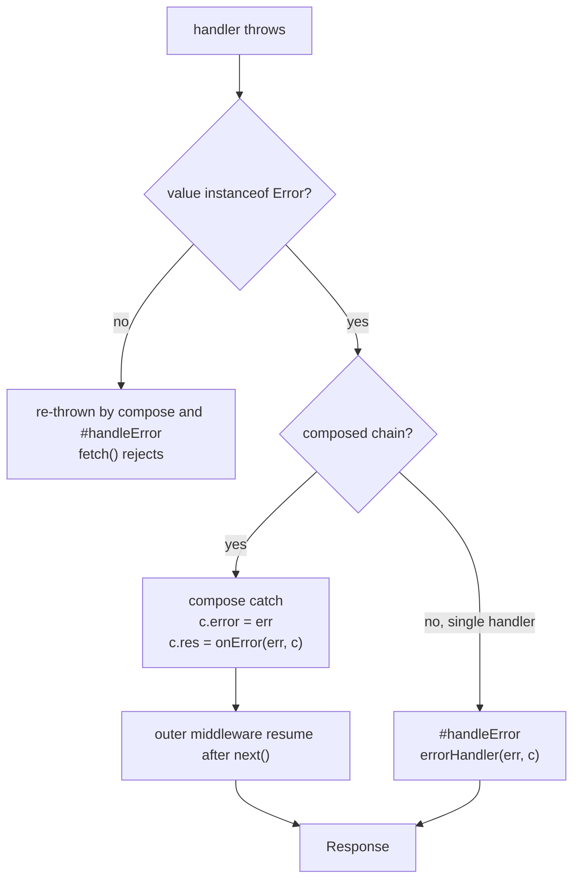

## Overview

Hono turns thrown errors and unmatched requests into responses in two places: the application's error handler (`app.onError`) and its not-found handler (`app.notFound`). `HTTPException` is the error class for failures that already know their HTTP status, such as a failed authentication or a malformed body, so a middleware can `throw` instead of building and returning a response. This page traces where errors are caught, which handler answers, and how the defaults behave.

Sources: [src/http-exception.ts:20-59](repo://src/http-exception.ts#L20-L59), [src/hono-base.ts:31-42](repo://src/hono-base.ts#L31-L42), [src/hono-base.ts:271-294](repo://src/hono-base.ts#L271-L294)

Errors are caught at two levels: inside `compose`, close to the handler that threw, and around the whole dispatch in `Hono#dispatch`. Knowing which level catches an error explains what outer middleware can see and why some values escape to the runtime. [[Middleware and Composition]] describes the chain these levels sit in.

Sources: [src/compose.ts:49-60](repo://src/compose.ts#L49-L60), [src/hono-base.ts:399-466](repo://src/hono-base.ts#L399-L466)

## HTTPException

### Constructor and options

`new HTTPException(status = 500, options?)` extends `Error`. The status is typed as `ContentfulStatusCode`, so codes without a body such as `204` or `304` are rejected at compile time.

Sources: [src/http-exception.ts:46-59](repo://src/http-exception.ts#L46-L59)

| Option | Type | Effect |
| --- | --- | --- |
| `message` | `string` | becomes `err.message`; used as the body when no `res` is given |
| `res` | `Response` | a ready response whose body and headers are used by `getResponse()` |
| `cause` | `unknown` | passed to `Error` as `{ cause }`, available as `err.cause` |

Sources: [src/http-exception.ts:8-18](repo://src/http-exception.ts#L8-L18), [src/http-exception.ts:55-59](repo://src/http-exception.ts#L55-L59)

### getResponse

`getResponse()` builds the response the default error handler sends. With `res`, it creates a new `Response` from `res.body` and `res.headers` but with the exception's own `status`, so the status argument always wins over `res.status`. Without `res`, it returns the `message` as a plain body with that status.

Sources: [src/http-exception.ts:66-77](repo://src/http-exception.ts#L66-L77)

```ts
getResponse(): Response {
  if (this.res) {
    const newResponse = new Response(this.res.body, {
      status: this.status,
      headers: this.res.headers,
    })
    return newResponse
  }
  return new Response(this.message, {
    status: this.status,
  })
}
```

Sources: [src/http-exception.ts:66-77](repo://src/http-exception.ts#L66-L77)

> [!NOTE]
> When `res` is passed, `message` is not part of the response body. It is still available as `err.message` to a custom `onError`.

Sources: [src/http-exception.ts:55-77](repo://src/http-exception.ts#L55-L77)

### Throwing it

```ts
import { HTTPException } from 'hono/http-exception'

app.post('/auth', async (c, next) => {
  if (!(await isAuthorized(c))) {
    throw new HTTPException(401, {
      message: 'Invalid token',
      cause: { userId: c.req.header('X-User') },
    })
  }
  await next()
})
```

Sources: [src/http-exception.ts:31-45](repo://src/http-exception.ts#L31-L45)

Built-in middleware use the same pattern. The bearer and basic auth middleware build a full `Response` with `WWW-Authenticate` headers and throw `new HTTPException(status, { res })`; the JWT middleware passes both a `message` and a `res`; the validator throws a 400 for malformed JSON or form bodies; and the timeout middleware throws a 504 `Gateway Timeout` by default.

Sources: [src/middleware/bearer-auth/index.ts:140-153](repo://src/middleware/bearer-auth/index.ts#L140-L153), [src/middleware/jwt/jwt.ts:119-129](repo://src/middleware/jwt/jwt.ts#L119-L129), [src/validator/validator.ts:94-127](repo://src/validator/validator.ts#L94-L127), [src/middleware/timeout/index.ts:12-14](repo://src/middleware/timeout/index.ts#L12-L14)

## The default handlers

### Default error handler

The default `errorHandler` checks whether the error has a `getResponse` method rather than testing `instanceof HTTPException`. Any error implementing the `HTTPResponseError` interface is therefore turned into its own response, even when it comes from another copy of the library. That response is passed through `c.newResponse(res.body, res)`, so headers set earlier with `c.header()` (for example CORS headers) are merged into the error response. Any other error is logged with `console.error` and answered with `Internal Server Error` and status 500.

Sources: [src/hono-base.ts:35-42](repo://src/hono-base.ts#L35-L42), [src/types.ts:113-115](repo://src/types.ts#L113-L115)

```ts
const errorHandler: ErrorHandler = (err, c) => {
  if ('getResponse' in err) {
    const res = err.getResponse()
    return c.newResponse(res.body, res)
  }
  console.error(err)
  return c.text('Internal Server Error', 500)
}
```

Sources: [src/hono-base.ts:35-42](repo://src/hono-base.ts#L35-L42), [src/types.ts:113-120](repo://src/types.ts#L113-L120)

### Default not-found handler

The default `notFoundHandler` returns `c.text('404 Not Found', 404)`. It is stored per app in a private field and handed to every `Context` the app creates, which is how `c.notFound()` inside a handler produces the same response.

Sources: [src/hono-base.ts:31-33](repo://src/hono-base.ts#L31-L33), [src/hono-base.ts:186-188](repo://src/hono-base.ts#L186-L188), [src/hono-base.ts:421-427](repo://src/hono-base.ts#L421-L427), [src/context.ts:776-779](repo://src/context.ts#L776-L779)

## Customising onError and notFound

### Registering handlers

`app.onError(handler)` replaces `errorHandler` and `app.notFound(handler)` replaces the not-found handler; both return the app for chaining. An `ErrorHandler<E>` receives `(err, c)` where `err` is typed `Error | HTTPResponseError`, and must return a `Response` or a promise of one.

Sources: [src/hono-base.ts:271-294](repo://src/hono-base.ts#L271-L294), [src/types.ts:107-120](repo://src/types.ts#L107-L120)

```ts
app.onError((err, c) => {
  if (err instanceof HTTPException) {
    return err.getResponse()
  }
  console.error(err.cause ?? err)
  return c.json({ message: 'Internal Server Error' }, 500)
})

app.notFound((c) => c.json({ message: `No route for ${c.req.path}` }, 404))
```

Sources: [src/hono-base.ts:271-294](repo://src/hono-base.ts#L271-L294), [src/http-exception.ts:66-77](repo://src/http-exception.ts#L66-L77)

### Typing the not-found response

`NotFoundHandler` returns `Response` by default. Declaring `NotFoundResponse` in a `declare module 'hono'` block switches its return type to that interface, which lets the [[RPC Client]] see a typed 404 body.

Sources: [src/types.ts:98-111](repo://src/types.ts#L98-L111)

## How errors propagate

### Inside compose

When a request matched more than one handler, `compose` wraps every call in `try`/`catch`. If the thrown value is an `Error` and an `onError` handler was supplied (the dispatcher always passes the app's `errorHandler`), `compose`:

Sources: [src/compose.ts:49-60](repo://src/compose.ts#L49-L60), [src/hono-base.ts:450-450](repo://src/hono-base.ts#L450-L450)

1. stores the error in `context.error`;
2. calls `onError(err, context)` and keeps its result;
3. sets `isError`, so the result is assigned to `context.res` even when the context was already finalized;
4. returns normally, so `await next()` in every outer middleware resolves rather than rejects.

Sources: [src/compose.ts:49-70](repo://src/compose.ts#L49-L70)

This is why an outer middleware can inspect the failure after the fact:

Sources: [src/compose.ts:53-56](repo://src/compose.ts#L53-L56)

```ts
app.use(async (c, next) => {
  await next()
  if (c.error) {
    c.header('X-Error', c.error.name) // c.res is already the onError response
  }
})
```

Sources: [src/context.ts:318-333](repo://src/context.ts#L318-L333), [src/compose.ts:53-56](repo://src/compose.ts#L53-L56)

### Around dispatch

`Hono#dispatch` adds a second safety net through `#handleError`. In the single-handler fast path, which skips `compose`, it catches synchronous throws and rejected promises from the handler. In the composed path it catches whatever escapes `compose`, including the `Context is not finalized` error thrown when no function produced a response. `#handleError` forwards `Error` instances to `errorHandler` and re-throws anything else.

Sources: [src/hono-base.ts:399-404](repo://src/hono-base.ts#L399-L404), [src/hono-base.ts:429-466](repo://src/hono-base.ts#L429-L466)



Sources: [src/compose.ts:49-70](repo://src/compose.ts#L49-L70), [src/hono-base.ts:399-466](repo://src/hono-base.ts#L399-L466)

> [!WARNING]
> Throwing a non-`Error` value (`throw 'oops'` or `throw { status: 400 }`) bypasses `onError` entirely and rejects the promise returned by `app.fetch`. Always throw `Error` subclasses such as `HTTPException`.

Sources: [src/compose.ts:53-59](repo://src/compose.ts#L53-L59), [src/hono-base.ts:399-404](repo://src/hono-base.ts#L399-L404)

### When the not-found handler runs

The not-found handler answers in three situations:

Sources: [src/compose.ts:61-65](repo://src/compose.ts#L61-L65)

- the router matched nothing or the whole chain called `next()` without producing a response: `compose` reaches the end of the list and calls `onNotFound` while the context is not finalized;
- a single matched handler returned nothing, or called its `next`, which `#dispatch` defines to assign the not-found response to `c.res`;
- a handler explicitly returns `c.notFound()`.

Sources: [src/compose.ts:61-65](repo://src/compose.ts#L61-L65), [src/hono-base.ts:430-447](repo://src/hono-base.ts#L430-L447), [src/context.ts:776-779](repo://src/context.ts#L776-L779)

Headers set before the fallback are kept: a handler that calls `c.header('explicit', '1')` and returns nothing produces the not-found body with that header, because `c.text()` inside the not-found handler starts from the prepared headers.

Sources: [src/context.ts:604-611](repo://src/context.ts#L604-L611), [src/hono.test.ts:1959-1993](repo://src/hono.test.ts#L1959-L1993)

## Sub-app error handlers

### onError on a routed sub-app

`app.route(path, sub)` copies the sub-app's routes into the parent. If `sub` kept the default error handler, its handlers are copied as is and errors reach the parent's `onError`. If `sub` called `onError`, every one of its handlers is wrapped:

Sources: [src/hono-base.ts:218-228](repo://src/hono-base.ts#L218-L228)

```ts
handler = async (c: Context, next: Next) =>
  (await compose([], app.errorHandler)(c, () => r.handler(c, next))).res
```

Sources: [src/hono-base.ts:218-230](repo://src/hono-base.ts#L218-L230)

`compose([], app.errorHandler)` has no middleware of its own, so its first `dispatch` runs the outer `next` it was given, the original handler. An error from that handler is caught by this inner `compose` and answered by the sub-app's error handler before the parent ever sees it. Middleware registered on the parent still wraps the sub-app's routes, and errors thrown in parent middleware still go to the parent's handler.

Sources: [src/compose.ts:42-60](repo://src/compose.ts#L42-L60), [src/hono.test.ts:1902-1925](repo://src/hono.test.ts#L1902-L1925)

### notFound is app-wide

Only the top-level app's not-found handler is used. `route()` merges handlers into the parent's router, and the `Context` for every request is built by the parent's `#dispatch` with the parent's not-found handler, so `sub.notFound(...)` has no effect once `sub` is mounted with `app.route()`. Branch on `c.req.path` inside the parent's handler for per-prefix 404 pages.

Sources: [src/hono-base.ts:208-232](repo://src/hono-base.ts#L208-L232), [src/hono-base.ts:421-427](repo://src/hono-base.ts#L421-L427), [src/hono.test.ts:1976-2008](repo://src/hono.test.ts#L1976-L2008)

### Mounted applications

`app.mount(path, handler)` is different: the mounted application handles its own errors and 404s and returns a `Response`. If it returns nothing, the mount wrapper calls `next()` and the parent chain continues.

Sources: [src/hono-base.ts:372-382](repo://src/hono-base.ts#L372-L382)
