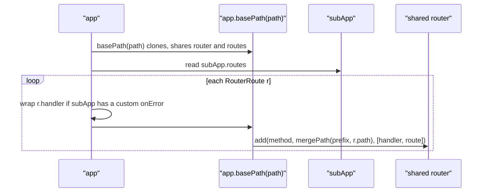

## Overview

The application object is where routes are registered and where every request enters. Its behaviour lives in `HonoBase` (the class named `Hono` inside `src/hono-base.ts`, exported as `HonoBase`). `HonoBase` owns route registration, sub-application grouping, error and not-found handlers and the dispatch loop, but it never creates a router: the comment on its `router` field says to inherit the class and assign one in the constructor.

Sources: [src/hono-base.ts:98-124](repo://src/hono-base.ts#L98-L124), [src/hono-base.ts:545](repo://src/hono-base.ts#L545)

The `Hono` exported from `hono` is that subclass. Its constructor calls `super(options)` and then sets `this.router` to `options.router`, or by default to a `SmartRouter` that tries `RegExpRouter` first and `TrieRouter` second. The `hono/quick` and `hono/tiny` presets are the same subclass with a different router; see [[Overview]].

Sources: [src/hono.ts:16-34](repo://src/hono.ts#L16-L34)

Each instance keeps two views of its routes: the `router`, which answers `match(method, path)` at request time, and the `routes` array of `RouterRoute` records (`basePath`, `path`, `method`, `handler`), which `route()`, the dev helper and static site generation read back.

Sources: [src/hono-base.ts:118-124](repo://src/hono-base.ts#L118-L124), [src/types.ts:57-62](repo://src/types.ts#L57-L62)

## Registering handlers

### Method functions

The constructor builds one function per method in `METHODS` (`get`, `post`, `put`, `delete`, `options`, `patch`) plus `all`. Each function accepts an optional path followed by handlers. A string first argument sets the private `#path`; otherwise the first argument is itself a handler registered under the current `#path`. Every function returns the app, which is what makes chaining work.

Sources: [src/hono-base.ts:126-141](repo://src/hono-base.ts#L126-L141), [src/router.ts:9-17](repo://src/router.ts#L9-L17)

Because `#path` persists between calls, a call without a path reuses the last path registered, and on a fresh app that is `/`. This allows registering several methods on one path in a chain:

Sources: [src/hono-base.ts:121-122](repo://src/hono-base.ts#L121-L122)

```ts
app
  .get('/chained/:abc', (c) => c.text(`GET for ${c.req.param('abc')}`))
  .post((c) => c.text(`POST for ${c.req.param('abc')}`))
```

Sources: [src/hono.test.ts:763-775](repo://src/hono.test.ts#L763-L775)

Passing several handlers registers each as a separate route on the same method and path. The router returns them in order and `compose` runs them as a chain, so `app.get('/x', mw, handler)` attaches route-local middleware.

Sources: [src/hono-base.ts:136-138](repo://src/hono-base.ts#L136-L138)

### app.on

`app.on(method, path, ...handlers)` takes a method name or an array of names, and a path or an array of paths. It registers every handler for every combination, upper-casing the method, so non-standard methods such as `PURGE` work as well.

Sources: [src/hono-base.ts:143-154](repo://src/hono-base.ts#L143-L154), [src/hono.test.ts:2012-2024](repo://src/hono.test.ts#L2012-L2024)

```ts
app.on(['PUT', 'DELETE'], '/posts/:id', (c) =>
  c.json({ postId: c.req.param('id'), method: c.req.method })
)
app.on('GET', ['/hello', '/ja/hello', '/en/hello'], (c) => c.text(c.req.path))
```

Sources: [src/hono.test.ts:2040-2047](repo://src/hono.test.ts#L2040-L2047), [src/hono.test.ts:2082-2091](repo://src/hono.test.ts#L2082-L2091)

### app.use

`app.use` registers middleware under the method `ALL`. With a string first argument it uses that path; with a handler first argument it uses `*` and puts the handler at the front of the list. Unlike the method functions, a path-less `use` always means `*`, never the last path.

Sources: [src/hono-base.ts:156-168](repo://src/hono-base.ts#L156-L168)

### Internal #addRoute

All registration paths end in `#addRoute`. It upper-cases the method, prefixes the path with the instance's `_basePath` through `mergePath`, builds the `RouterRoute` record, adds `[handler, route]` to the router and pushes the record onto `routes`. Storing the record next to the handler is how `c.req.routePath` and `matchedRoutes` later know which pattern matched.

Sources: [src/hono-base.ts:385-397](repo://src/hono-base.ts#L385-L397), [src/helper/route/index.ts:32-59](repo://src/helper/route/index.ts#L32-L59)

## Options

`HonoOptions` has three fields. The constructor strips `strict`, copies the rest onto the instance with `Object.assign` (so `router` and `getPath` become instance properties) and then picks the path extractor.

Sources: [src/hono-base.ts:46-87](repo://src/hono-base.ts#L46-L87), [src/hono-base.ts:170-173](repo://src/hono-base.ts#L170-L173)

| Option | Type | Default | Effect |
| --- | --- | --- | --- |
| `strict` | `boolean` | `true` | When `false`, `getPath` is replaced by `getPathNoStrict`, which drops one trailing slash so `/hello/` matches `/hello` |
| `router` | `Router<[H, RouterRoute]>` | `SmartRouter` of `RegExpRouter` and `TrieRouter` | The router instance used for every `add` and `match` |
| `getPath` | `(request, { env }) => string` | `getPath` from `src/utils/url.ts` | Derives the routing path from the request, for example to route on the `Host` header |

Sources: [src/hono-base.ts:44-87](repo://src/hono-base.ts#L44-L87), [src/utils/url.ts:106-146](repo://src/utils/url.ts#L106-L146)

> [!WARNING]
> `strict: false` wins over a custom `getPath`: the constructor evaluates `(strict ?? true) ? (options.getPath ?? getPath) : getPathNoStrict`, so with `strict: false` your `getPath` is stored by `Object.assign` and then overwritten.

Sources: [src/hono-base.ts:170-172](repo://src/hono-base.ts#L170-L172)

`getPath` receives the bindings as `options.env`, so the path can depend on runtime configuration. The test suite routes requests for a configured host to a `/FOO` prefix this way.

Sources: [src/hono-base.ts:418](repo://src/hono-base.ts#L418), [src/hono.test.ts:736-760](repo://src/hono.test.ts#L736-L760)

## Grouping applications

### basePath

`basePath(path)` returns a clone whose `_basePath` is `mergePath(this._basePath, path)`. `#clone` passes the same `router` and `getPath` to a new `HonoBase`, copies the error and not-found handlers, and assigns the same `routes` array. Routes registered on the clone therefore land in the parent's router and route list with the prefix applied, and calling `fetch` on either object serves both.

Sources: [src/hono-base.ts:175-184](repo://src/hono-base.ts#L175-L184), [src/hono-base.ts:247-253](repo://src/hono-base.ts#L247-L253)

```ts
const app = new Hono()
const book = app.basePath('/book')
book.get('/:id', (c) => c.text('get /book/' + c.req.param('id')))

const user = app.basePath('/user')
const perUser = user.basePath(':id')
perUser.get('/profile', (c) => c.text('get /user/' + c.req.param('id') + '/profile'))
```

Sources: [src/hono.test.ts:425-440](repo://src/hono.test.ts#L425-L440)

The clone takes a snapshot of the handlers: `onError` or `notFound` set on the original after `basePath()` was called does not reach the clone. Set them before deriving, as the chained example in the tests does.

Sources: [src/hono-base.ts:180-181](repo://src/hono-base.ts#L180-L181), [src/hono.test.ts:3721-3745](repo://src/hono.test.ts#L3721-L3745)

### route

`route(path, subApp)` mounts another Hono instance under a prefix. It derives `basePath(path)` and re-registers every record in `subApp.routes` on it, keeping each record's own `basePath`, so nested prefixes accumulate (`/:sub1/:sub2`).

Sources: [src/hono-base.ts:208-232](repo://src/hono-base.ts#L208-L232), [src/hono.test.ts:504-520](repo://src/hono.test.ts#L504-L520)

When the sub-app has its own `onError`, each of its handlers is wrapped: the wrapper runs `compose([], subApp.errorHandler)` around the original handler, so errors thrown inside the sub-app's routes reach the sub-app's handler while errors from the parent's middleware still reach the parent's. The original handler is kept under the `COMPOSED_HANDLER` key so `findTargetHandler` can unwrap it for the dev and SSG helpers.

Sources: [src/hono-base.ts:219-228](repo://src/hono-base.ts#L219-L228), [src/utils/handler.ts:8-15](repo://src/utils/handler.ts#L8-L15), [src/hono.test.ts:1874-1926](repo://src/hono.test.ts#L1874-L1926)



Sources: [src/hono-base.ts:208-232](repo://src/hono-base.ts#L208-L232), [src/hono-base.ts:385-397](repo://src/hono-base.ts#L385-L397)

> [!IMPORTANT]
> `route()` copies routes at call time. Routes added to the sub-app afterwards are not seen, and a sub-app's `notFound` is never copied: unmatched paths under the prefix are answered by the parent's not-found handler.

Sources: [src/hono.test.ts:568-600](repo://src/hono.test.ts#L568-L600), [src/hono.test.ts:1956-2008](repo://src/hono.test.ts#L1956-L2008)

### mount

`mount(path, applicationHandler, options?)` attaches a handler from another framework, anything shaped `(request, ...args) => Response | Promise<Response>`. It registers one `ALL` route at `mergePath(path, '*')`. At request time the route calls the handler with a rewritten request and extra arguments; a truthy response is returned, and otherwise the chain continues with `next()`.

Sources: [src/hono-base.ts:328-383](repo://src/hono-base.ts#L328-L383)

| `options` form | Effect |
| --- | --- |
| omitted | Request path is stripped of the mount prefix; the handler gets `(request, c.env, c.executionCtx)`, with `undefined` when the runtime has no execution context |
| a function `(c) => unknown` | Its return value, wrapped in an array unless it is one, replaces the extra arguments |
| `{ optionHandler }` | Same as the function form |
| `{ replaceRequest: fn }` | `fn(c.req.raw)` builds the request passed on |
| `{ replaceRequest: false }` | The original request is passed unchanged |

Sources: [src/hono-base.ts:89-96](repo://src/hono-base.ts#L89-L96), [src/hono-base.ts:333-370](repo://src/hono-base.ts#L333-L370)

The default request rewriting computes the prefix length once from `mergePath(this._basePath, path)`, slices it off `this.getPath(request)` (falling back to `/`) and builds a new `Request` with that pathname, keeping the query string and everything else.

Sources: [src/hono-base.ts:362-370](repo://src/hono-base.ts#L362-L370)

```ts
import { Router as IttyRouter } from 'itty-router'

const ittyRouter = IttyRouter()
ittyRouter.get('/hello', () => new Response('Hello from itty-router'))

const app = new Hono()
app.mount('/itty-router', ittyRouter.handle) // GET /itty-router/hello
```

Sources: [src/hono-base.ts:306-317](repo://src/hono-base.ts#L306-L317)

## Not-found and error handlers

The defaults are module-level functions. `notFoundHandler` answers `c.text('404 Not Found', 404)`. `errorHandler` returns `err.getResponse()` (re-wrapped through `c.newResponse` so headers set on the context survive) when the error has one, as `HTTPException` does; any other error is logged with `console.error` and answered `500 Internal Server Error`.

Sources: [src/hono-base.ts:31-42](repo://src/hono-base.ts#L31-L42)

`app.notFound(handler)` and `app.onError(handler)` replace them and return the app. `#handleError` sends only `Error` instances to the error handler; anything else thrown, such as a string, is re-thrown to the runtime. [[Error Handling]] covers `HTTPException` and error flow through middleware.

Sources: [src/hono-base.ts:271-294](repo://src/hono-base.ts#L271-L294), [src/hono-base.ts:399-404](repo://src/hono-base.ts#L399-L404)

## Request dispatch

### The dispatch flow

`#dispatch(request, executionCtx, env, method)` is shared by `fetch` and `fire`. A `HEAD` request is dispatched as `GET` and the result is copied into `new Response(null, res)`, which keeps status and headers but drops the body. Otherwise it computes the path with `this.getPath(request, { env })`, calls `router.match`, and creates the `Context` with the path, match result, bindings, execution context and not-found handler.

Sources: [src/hono-base.ts:406-427](repo://src/hono-base.ts#L406-L427)

```mermaid
flowchart TD
  start["#dispatch(request, ctx, env, method)"] --> isHead{"method === HEAD"}
  isHead -->|yes| recurse["#dispatch(..., GET)<br>then new Response(null, res)"]
  isHead -->|no| getPath["path = getPath(request, env)"]
  getPath --> match["matchResult = router.match(method, path)"]
  match --> ctx["c = new Context(request, ...)"]
  ctx --> single{"exactly one handler"}
  single -->|yes| call["handler(c, next sets notFound)"]
  call --> got{"returned a Response"}
  got -->|yes| done["Response"]
  got -->|no| fallback["c.res if finalized,<br>else notFoundHandler(c)"]
  single -->|no| composed["compose(handlers, errorHandler, notFoundHandler)(c)"]
  composed --> fin{"c.finalized"}
  fin -->|yes| done
  fin -->|no| err["throw 'Context is not finalized'"]
  call -.->|throws| onErr["#handleError"]
  composed -.->|throws| onErr
  err -.-> onErr
```

Sources: [src/hono-base.ts:406-466](repo://src/hono-base.ts#L406-L466)

### Single-handler fast path

When the router returns exactly one handler, dispatch skips `compose` entirely. It calls the handler with a `next` that sets `c.res` to the not-found response, catches synchronous throws, and for a returned promise chains `.then` and `.catch`. A handler that resolves to nothing yields `c.res` if the context was finalized, and the not-found response otherwise. This keeps the common case of a route with no middleware free of the closure and the extra `await` that composition costs.

Sources: [src/hono-base.ts:429-448](repo://src/hono-base.ts#L429-L448)

### Composed chain

With two or more handlers, `compose(matchResult[0], this.errorHandler, this.#notFoundHandler)` runs them in order. If the chain finishes without finalizing the context, typically because a middleware forgot `await next()` or a handler returned nothing, dispatch throws `Context is not finalized. Did you forget to return a Response object or \`await next()\`?`, which then goes to the error handler. [[Middleware and Composition]] describes `compose`.

Sources: [src/hono-base.ts:450-465](repo://src/hono-base.ts#L450-L465), [src/hono.test.ts:2256-2288](repo://src/hono.test.ts#L2256-L2288)

## Entry points

### fetch

`fetch(request, env?, executionCtx?)` is the entry point runtimes call. It forwards to `#dispatch` with `request.method`. It is an arrow-function property, so `app.fetch` can be passed around unbound (`Deno.serve(app.fetch)`).

Sources: [src/hono-base.ts:468-485](repo://src/hono-base.ts#L468-L485)

### request

`request(input, requestInit?, env?, executionCtx?)` is a testing convenience. A `Request` input is used as is, or rebuilt with `requestInit` when given. A string or `URL` is used as is when it starts with `http://` or `https://`; otherwise it is joined to `http://localhost` with `mergePath('/', input)`.

Sources: [src/hono-base.ts:487-517](repo://src/hono-base.ts#L487-L517)

```ts
const res = await app.request('/hello')
const res2 = await app.request('/posts', { method: 'POST', body: JSON.stringify({ title: 'x' }) })
```

Sources: [src/hono-base.ts:491-496](repo://src/hono-base.ts#L491-L496)

### fire

`fire()` registers a global `fetch` event listener for Service Worker style runtimes and answers each event with `event.respondWith(#dispatch(...))`, passing the event as the execution context. It is deprecated in favour of `fire` from `hono/service-worker`. [[Runtime Adapters]] covers the adapters.

Sources: [src/hono-base.ts:519-542](repo://src/hono-base.ts#L519-L542), [src/adapter/service-worker/index.ts:28-36](repo://src/adapter/service-worker/index.ts#L28-L36)
