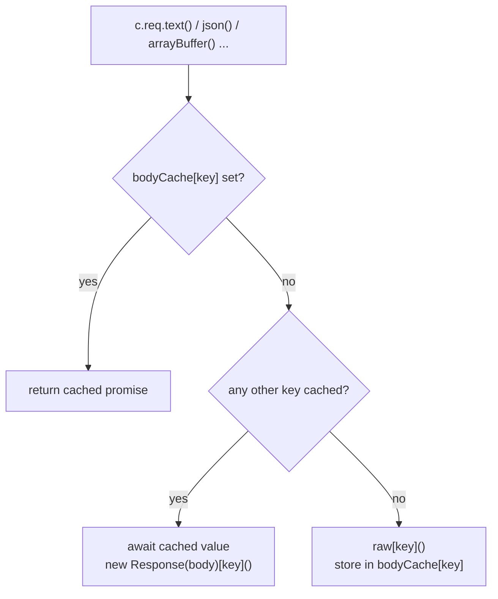

## Overview

`HonoRequest` is the object handlers reach through `c.req`. It wraps the standard Fetch `Request` (kept as `raw`) and adds what routing and validation know about the request: decoded path parameters from the router match, fast query-string parsing, header access, form parsing with `parseBody()`, and validated data written by the validator middleware. It also caches the body so that several middleware can read it even though a Fetch `Request` body can only be consumed once.

Sources: [src/request.ts:36-80](repo://src/request.ts#L36-L80)

The [[Context]] creates the wrapper lazily on first access to `c.req`, handing it the raw request, the path computed by the application and the router's match result. The class has two generics: `P` is the route path string used to type `param()`, and `I` is the validated-input map used to type `valid()`; both are covered in [[Type System]].

Sources: [src/context.ts:366-369](repo://src/context.ts#L366-L369), [src/request.ts:36-36](repo://src/request.ts#L36-L36)

## Request properties

### Fields and getters

| Member | Type | Source of the value |
| --- | --- | --- |
| `raw` | `Request` | the original Fetch request, for runtime-specific fields such as `raw.cf` on Cloudflare |
| `path` | `string` | the path passed by the dispatcher (from `getPath`), default `'/'` |
| `url` | `string` | getter for `raw.url` |
| `method` | `string` | getter for `raw.method` |
| `routeIndex` | `number` | index of the handler currently running, written by `compose` |
| `bodyCache` | `Partial<Body>` | cached body promises keyed by `json`, `text`, `arrayBuffer`, `blob`, `formData` |

Sources: [src/request.ts:20-27](repo://src/request.ts#L20-L27), [src/request.ts:51-80](repo://src/request.ts#L51-L80), [src/request.ts:369-387](repo://src/request.ts#L369-L387)

`path` is not re-derived from `url`: it is the exact string the router matched, so with `strict: false` a trailing slash has already been removed, and a percent-encoded path has already been decoded with `tryDecodeURI`. See [[Routing and Path Patterns]] for the `strict` option.

Sources: [src/utils/url.ts:106-146](repo://src/utils/url.ts#L106-L146), [src/hono-base.ts:418-427](repo://src/hono-base.ts#L418-L427)

## Path parameters

### How param() resolves values

The router returns a `Result` that comes in two shapes. Routers that build one big regular expression return `[[handler, ParamIndexMap][], ParamStash]`, where each handler's map points to an index in a shared array of captured strings. Other routers return `[[handler, Params][]]` with the values inline. `#getParamValue` hides the difference: if a stash exists it looks the key up there, otherwise the map entry is the value.

Sources: [src/router.ts:57-65](repo://src/router.ts#L57-L65), [src/router.ts:98-98](repo://src/router.ts#L98-L98), [src/request.ts:126-128](repo://src/request.ts#L126-L128)

`param(key)` reads the parameter map of the handler at `routeIndex`. Because every middleware and handler in a chain has its own entry in the match result, a middleware registered on `/posts/*` and a handler on `/posts/:id` see their own parameters. Values are decoded with `decodeURIComponent` only when they contain `%`, and `tryDecode` falls back to decoding each valid escape sequence separately so a malformed sequence never throws.

Sources: [src/request.ts:94-124](repo://src/request.ts#L94-L124), [src/utils/url.ts:80-93](repo://src/utils/url.ts#L80-L93)

```ts
app.get('/posts/:id/comments/:commentId?', (c) => {
  const id = c.req.param('id')               // string
  const commentId = c.req.param('commentId') // string | undefined
  const all = c.req.param()                  // { id: string; commentId?: string | undefined }
  return c.json({ id, commentId, all })
})
```

Sources: [src/request.ts:94-104](repo://src/request.ts#L94-L104)

### Typed overloads

The overloads of `param()` use `ParamKeys<P>` to accept only names that appear in the route path. A required name returns `string`; an optional one (`:name?`) is only accepted by the overload that strips the `?` with `RemoveQuestion` and returns `string | undefined`. Calling `param()` with no argument returns an object built from `ParamKeyToRecord`. When `P` is the plain `string` type the typed overloads fall away and any key is allowed.

Sources: [src/request.ts:94-101](repo://src/request.ts#L94-L101), [src/types.ts:2698-2729](repo://src/types.ts#L2698-L2729)

## Query strings

`query(key)` returns the first value for a key and `query()` returns a record of first values; `queries(key)` and `queries()` return every value as arrays. All four delegate to `_getQueryParam` in `utils/url.ts`, which scans `this.url` directly rather than building a `URL` or `URLSearchParams`.

Sources: [src/request.ts:148-171](repo://src/request.ts#L148-L171), [src/utils/url.ts:302-315](repo://src/utils/url.ts#L302-L315)

The scanner has a fast path for a single, unencoded key: it finds `?key` or `&key`, checks that the next character is `=` (value), `&` or the end of the string (empty value), and decodes only the matched value. If the key is not found and the URL contains no `%` or `+`, it returns `undefined` immediately; otherwise it falls back to the full loop that splits on `&` and `=`, decodes names and values, and keeps the first value per name (or pushes every value when `multiple` is set).

Sources: [src/utils/url.ts:219-300](repo://src/utils/url.ts#L219-L300)

`_decodeURI` turns `+` into a space before percent-decoding, matching `application/x-www-form-urlencoded` semantics.

Sources: [src/utils/url.ts:208-217](repo://src/utils/url.ts#L208-L217)

```ts
// GET /search?q=hono&tag=web&tag=edge&empty
c.req.query('q')      // 'hono'
c.req.query('tag')    // 'web'
c.req.queries('tag')  // ['web', 'edge']
c.req.query('empty')  // ''
c.req.query('none')   // undefined
```

Sources: [src/utils/url.ts:226-253](repo://src/utils/url.ts#L226-L253), [src/utils/url.ts:289-299](repo://src/utils/url.ts#L289-L299)

## Headers

`header(name)` returns `raw.headers.get(name)`, converting `null` to `undefined`; lookup is case-insensitive as in the Fetch API. `header()` with no argument copies every header into a plain record with lowercase keys. The `RequestHeader` overload gives editor completion for standard header names.

Sources: [src/request.ts:185-198](repo://src/request.ts#L185-L198)

## Body reading and caching

### The body methods

`text()`, `arrayBuffer()`, `blob()` and `formData()` each call `#cachedBody` with their own key. `json()` reads through the `text` cache and runs `JSON.parse`, and `bytes()` wraps the cached `arrayBuffer` in a `Uint8Array`. All of them return promises.

Sources: [src/request.ts:253-331](repo://src/request.ts#L253-L331)

### How the cache works

`#cachedBody(key)` resolves a read in three steps:

Sources: [src/request.ts:220-222](repo://src/request.ts#L220-L222)

1. If `bodyCache[key]` already holds a promise, return it, so a second `c.req.text()` costs nothing.
2. If some other key is cached, take that cached value, re-serialise it with `JSON.stringify` when the cached key is `json`, wrap it in a new `Response` and call the requested reader on it. This converts, for example, cached text into an `ArrayBuffer` without touching the consumed raw body.
3. Otherwise call the reader on `raw`, store the promise in `bodyCache[key]` and return it.

Sources: [src/request.ts:220-239](repo://src/request.ts#L220-L239)



Sources: [src/request.ts:220-239](repo://src/request.ts#L220-L239)

> [!WARNING]
> Reading `c.req.raw.json()` or `c.req.raw.text()` directly bypasses the cache and consumes the stream. Later calls such as a validator's `c.req.json()` will then fail. Always read through `c.req`.

Sources: [src/request.ts:220-239](repo://src/request.ts#L220-L239)

### Cloning a consumed request

`cloneRawRequest(req)` returns `req.raw.clone()` when the body is still unused. If it was consumed, it rebuilds a `Request` from the first cached body plus the raw request's method, headers, mode, credentials, signal and other init fields. If the body was consumed but nothing is cached, which only happens when code read `raw` directly, it throws an `HTTPException` with status 500. This is how a handler can forward a request to a backend after a validator has already parsed it.

Sources: [src/request.ts:476-505](repo://src/request.ts#L476-L505)

## parseBody

### Content types

`c.req.parseBody(options)` calls `parseBody` from `utils/body.ts`. It reads the `Content-Type` media type and only parses `multipart/form-data` and `application/x-www-form-urlencoded`; for any other type, including JSON, it resolves to `{}`. Use `c.req.json()` for JSON bodies.

Sources: [src/request.ts:212-218](repo://src/request.ts#L212-L218), [src/utils/body.ts:97-113](repo://src/utils/body.ts#L97-L113)

`parseFormData` reads the body through `arrayBuffer()`, so the bytes land in `bodyCache.arrayBuffer`, decodes them with `bufferToFormData`, and stores the resulting promise in `bodyCache.formData`. A later `c.req.formData()` or form validator therefore reuses the parsed form instead of failing on a consumed stream.

Sources: [src/utils/body.ts:123-141](repo://src/utils/body.ts#L123-L141), [src/validator/validator.ts:105-121](repo://src/validator/validator.ts#L105-L121)

### Options all and dot

| Option | Default | Effect |
| --- | --- | --- |
| `all` | `false` | collect repeated fields into arrays; without it the last value wins |
| `dot` | `false` | turn keys like `obj.key1` into nested objects |

Sources: [src/utils/body.ts:43-75](repo://src/utils/body.ts#L43-L75)

`convertFormDataToBodyData` walks the form entries. A key is collected as an array when `all` is set or when the key ends with `[]` regardless of options; `handleParsingAllValues` upgrades a single value to an array when a second one arrives. With `dot`, every key containing `.` is split and written into nested objects by `handleParsingNestedValues`, and the flat key is deleted.

Sources: [src/utils/body.ts:151-206](repo://src/utils/body.ts#L151-L206)

`handleParsingNestedValues` ignores any key with a `__proto__` segment and builds intermediate levels with `Object.create(null)`, which protects against prototype pollution from crafted form field names. An intermediate level that is already a string, array or `File` is replaced by a fresh object.

Sources: [src/utils/body.ts:215-242](repo://src/utils/body.ts#L215-L242)

```ts
// multipart body: tags=a, tags=b, user.name=Ann, user.role=admin, files[]=x
const body = await c.req.parseBody({ all: true, dot: true })
// { tags: ['a', 'b'], user: { name: 'Ann', role: 'admin' }, 'files[]': ['x'] }
```

Sources: [src/utils/body.ts:151-242](repo://src/utils/body.ts#L151-L242)

The return type follows the options: `BodyData<Options>` adds `(string | File)[]` to the value union only when `all` may be true, and nested objects only when `dot` may be true.

Sources: [src/utils/body.ts:23-41](repo://src/utils/body.ts#L23-L41)

## Validated data

`addValidatedData(target, data)` stores the result of a validation in a private record keyed by target (`json`, `form`, `query`, `param`, `header`, `cookie`). The `validator` middleware calls it after the user's validation function returns a non-`Response` value, then calls `next()`.

Sources: [src/request.ts:339-341](repo://src/request.ts#L339-L341), [src/validator/validator.ts:160-170](repo://src/validator/validator.ts#L160-L170), [src/types.ts:2683-2690](repo://src/types.ts#L2683-L2690)

`valid(target)` returns that record entry. Its typed overload accepts only targets present in `I` and returns `InputToDataByTarget<I, T>`, so a handler declared after `validator('json', ...)` receives exactly the validated type. [[Validator]] covers the middleware side.

Sources: [src/request.ts:351-354](repo://src/request.ts#L351-L354), [src/types.ts:2720-2727](repo://src/types.ts#L2720-L2727)

## Matched routes and routePath

`matchedRoutes` maps the match result to its `RouterRoute` entries (each with `basePath`, `path`, `method` and `handler`), listing every middleware and handler that matched. `routePath` returns the registered path of the entry at `routeIndex`, for example `/posts/:id` rather than `/posts/42`. Both getters are deprecated in favour of the `matchedRoutes(c)` and `routePath(c, index?)` functions in `hono/route`, which read the same data through the `GET_MATCH_RESULT` symbol getter.

Sources: [src/request.ts:389-442](repo://src/request.ts#L389-L442), [src/helper/route/index.ts:32-59](repo://src/helper/route/index.ts#L32-L59)

`routeIndex` is updated by `compose` each time it dispatches the next handler, which is why `routePath` inside a `*` middleware returns `*` while the final handler sees its own pattern. The `every` combinator in the combine middleware resets it to the outer index before each nested middleware, so their `routePath` still reports the outer route.

Sources: [src/compose.ts:42-47](repo://src/compose.ts#L42-L47), [src/middleware/combine/index.ts:100-107](repo://src/middleware/combine/index.ts#L100-L107)
