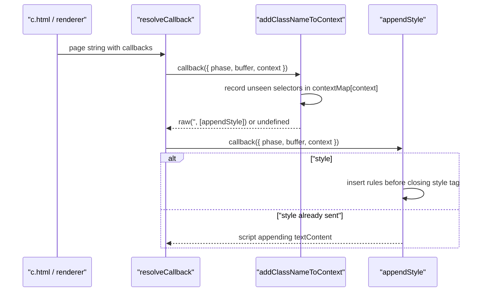

## Overview

`hono/html` and `hono/css` produce markup and styles without a template engine or build step. Both rest on one small model in `src/utils/html.ts`: an `HtmlEscapedString`, a `String` object flagged `isEscaped` that may carry `callbacks`. The flag says "already safe, do not escape again"; the callbacks let a fragment add content later, once the whole page is known. The `html` tagged template, the JSX renderer ([[JSX Server Rendering]]), `c.html()` ([[Context]]) and the CSS helper all speak this model, which is why they compose freely.

Sources: [src/utils/html.ts:1-46](repo://src/utils/html.ts#L1-L46), [package.json:144-153](repo://package.json#L144-L153)

```ts
import { html, raw } from 'hono/html'

app.get('/', (c) => {
  const name = '<script>alert(1)</script>'
  return c.html(html`<!doctype html>
    <h1>Hello ${name}</h1>
    ${raw('<p>trusted markup</p>')}`)
})
```

Sources: [src/helper/html/index.ts:6-57](repo://src/helper/html/index.ts#L6-L57)

## Escaping primitives

### HtmlEscapedString and raw

`raw(value, callbacks?)` wraps any value in `new String(value)`, sets `isEscaped = true` and attaches `callbacks`. Nothing is escaped: `raw` is how trusted markup, and the output of every renderer, is marked safe. A `HtmlEscapedString` is a real `String` object, so it is `typeof 'object'`, which is how consumers tell it apart from a plain string.

Sources: [src/utils/html.ts:17-21](repo://src/utils/html.ts#L17-L21), [src/utils/html.ts:40-46](repo://src/utils/html.ts#L40-L46)

### escapeToBuffer

`escapeToBuffer(str, buffer)` appends an escaped copy of `str` to `buffer[0]`. It first searches for any of `&<>'"`; when there is none the string is appended unchanged. Otherwise it walks from the first match, copying unchanged runs with `substring` and inserting the entity for each special character. The algorithm comes from React DOM's `escapeTextForBrowser`.

Sources: [src/utils/html.ts:48-51](repo://src/utils/html.ts#L48-L51), [src/utils/html.ts:90-127](repo://src/utils/html.ts#L90-L127)

| Character | Entity |
| --- | --- |
| `"` | `&quot;` |
| `'` | `&#39;` |
| `&` | `&amp;` |
| `<` | `&lt;` |
| `>` | `&gt;` |

Sources: [src/utils/html.ts:101-120](repo://src/utils/html.ts#L101-L120)

## The html tagged template

### Interpolation rules

`html` builds its output in a `StringBuffer` and handles each interpolated value by type. Arrays are flattened with `flat(Infinity)` first, so lists of fragments need no `join`.

Sources: [src/helper/html/index.ts:11-49](repo://src/helper/html/index.ts#L11-L49)

| Value | Result |
| --- | --- |
| `string` | Escaped with `escapeToBuffer`. |
| `number` | Appended as is. |
| `boolean`, `null`, `undefined` | Skipped, so a conditional such as `cond && fragment` renders nothing when false. |
| `HtmlEscapedString` without callbacks | Appended unescaped, or deferred if its `toString()` returns a promise. |
| `HtmlEscapedString` with callbacks | Deferred to a buffer slot so the callbacks survive. |
| `Promise` | Deferred to a buffer slot. |
| Any other object | `toString()` then escaped. |

Sources: [src/helper/html/index.ts:20-48](repo://src/helper/html/index.ts#L20-L48)

### The reversed string buffer

A `StringBuffer` alternates strings and pending values, and is stored back to front: `buffer[0]` is always the text currently being appended to. When `html` meets a value it cannot inline, `buffer.unshift('', child)` pushes the finished text down, puts the pending value next to it and starts a new empty head. This keeps every append a cheap `buffer[0] +=` while allowing any number of async holes.

Sources: [src/utils/html.ts:23-38](repo://src/utils/html.ts#L23-L38), [src/helper/html/index.ts:32-45](repo://src/helper/html/index.ts#L32-L45)

When the buffer still has one element at the end, nothing was async and `html` returns a `HtmlEscapedString` synchronously. Otherwise it returns `stringBufferToString(buffer, buffer.callbacks)`, a `Promise<HtmlEscapedString>`. Handlers can pass either to `c.html()`.

Sources: [src/helper/html/index.ts:50-56](repo://src/helper/html/index.ts#L50-L56)

### stringBufferToString

`stringBufferToString` awaits every entry with `Promise.all`, then walks from the tail to the head, alternating between literal text and resolved values. For each resolved value it collects its `callbacks` (before and after calling `toString()`, which may itself be async) and appends it unescaped only if it is flagged `isEscaped`. The result is `raw(str, callbacks)`, so callbacks from nested fragments bubble up to the top-level string.

Sources: [src/utils/html.ts:53-88](repo://src/utils/html.ts#L53-L88)

> [!WARNING]
> A promise that resolves to a plain string is escaped, but a promise that resolves to `raw(...)` is not. Only wrap content in `raw` when it is trusted; user input passed through `raw` reaches the page as markup.

Sources: [src/utils/html.ts:72-84](repo://src/utils/html.ts#L72-L84)

## Callbacks and resolution

### Phases

An `HtmlEscapedCallback` receives `{ phase, buffer?, context }` and returns a `Promise<string>` to append, or `undefined`. `context` is an object unique to one render, used by helpers as a `WeakMap` key so that per-page state (such as which CSS rules were already emitted) does not leak between requests.

Sources: [src/utils/html.ts:6-16](repo://src/utils/html.ts#L6-L16)

| Phase | Value | Used by |
| --- | --- | --- |
| `Stringify` | `1` | `c.html()`, `writeSSE` and `html` when rendering to one string. |
| `BeforeStream` | `2` | `renderToReadableStream` before the first chunk is sent. |
| `Stream` | `3` | Content resolved while streaming, such as `Suspense` boundaries. |

Sources: [src/utils/html.ts:6-10](repo://src/utils/html.ts#L6-L10), [src/context.ts:723-733](repo://src/context.ts#L723-L733), [src/jsx/streaming.ts:127-127](repo://src/jsx/streaming.ts#L127-L127), [src/helper/streaming/sse.ts:19-19](repo://src/helper/streaming/sse.ts#L19-L19)

### resolveCallback

`resolveCallback(str, phase, preserveCallbacks, context, buffer?)` turns a fragment into its final text in the steps below.

Sources: [src/utils/html.ts:142-148](repo://src/utils/html.ts#L142-L148)

1. An object that is not a `String` is converted with `toString()`, and a promise is awaited.
2. Without callbacks the string is returned as is.
3. Otherwise the string goes into `buffer[0]` (appended to an existing buffer, or as a new one), and every callback runs with the same `phase`, `buffer` and `context`. Callbacks may rewrite `buffer[0]` in place.
4. Each non-empty string a callback returns is resolved recursively with the same buffer, so its own callbacks run and its text is appended.
5. The final `buffer[0]` is returned; with `preserveCallbacks` it is wrapped in `raw(..., callbacks)` so a later phase can run the callbacks again.

Sources: [src/utils/html.ts:142-182](repo://src/utils/html.ts#L142-L182)

`resolveCallbackSync` is the synchronous form used by `html`: it runs each callback once in the `Stringify` phase on a fresh buffer and context, ignoring returned promises, and returns `buffer[0]`.

Sources: [src/utils/html.ts:129-140](repo://src/utils/html.ts#L129-L140), [src/helper/html/index.ts:52-56](repo://src/helper/html/index.ts#L52-L56)

`c.html()` calls `resolveCallback(html, Stringify, false, {})` whenever it receives an object, which is what makes CSS rules and other callback output appear in a plain HTML response.

Sources: [src/context.ts:723-733](repo://src/context.ts#L723-L733)

## CSS helper

### Public interface

`hono/css` is a CSS-in-JS helper for server-rendered JSX. Its exports come from a default context with style element id `hono-css`; `createCssContext` makes another set with its own id. All of them are marked experimental.

Sources: [src/helper/css/index.ts:63-80](repo://src/helper/css/index.ts#L63-L80), [src/helper/css/index.ts:217-262](repo://src/helper/css/index.ts#L217-L262), [src/helper/css/common.ts:4-4](repo://src/helper/css/common.ts#L4-L4)

| Export | Returns | Purpose |
| --- | --- | --- |
| `` css`...` `` | `Promise<string>` | A scoped class name for the rules. |
| `cx(...args)` | `Promise<string>` | Combines `css` classes and plain class names. |
| `` keyframes`...` `` | `CssClassName` | An `@keyframes` rule to interpolate into `animation`. |
| `viewTransition(...)` | `Promise<string>` | A class setting `view-transition-name`, with optional `::view-transition-*()` rules. |
| `Style({ children?, nonce? })` | `HtmlEscapedString` | The `<style id="hono-css">` element rules are added to. |
| `rawCssString(value)` | object | Inserts a value into a template without escaping. |
| `createCssContext({ id, classNameSlug?, onInvalidSlug? })` | the five functions above | A separate style element and naming policy. |

Sources: [src/helper/css/index.ts:29-61](repo://src/helper/css/index.ts#L29-L61), [src/helper/css/index.ts:169-215](repo://src/helper/css/index.ts#L169-L215), [src/helper/css/common.ts:27-36](repo://src/helper/css/common.ts#L27-L36)

```tsx
import { css, cx, keyframes, Style } from 'hono/css'

const fadeIn = keyframes`from { opacity: 0 } to { opacity: 1 }`
const title = css`
  /* page title */
  font-size: 2rem;
  animation: ${fadeIn} 1s;
  &:hover { color: tomato; }
`

app.get('/', (c) =>
  c.html(
    <html>
      <head><Style /></head>
      <body><h1 class={cx(title, 'external')}>Hello</h1></body>
    </html>
  )
)
```

Sources: [src/helper/css/index.ts:169-203](repo://src/helper/css/index.ts#L169-L203)

### Building a class

`css` calls `cssCommon`, which starts with `buildStyleString`. It takes a leading `/* comment */` as the label, concatenates the template with each interpolated value by type, and minifies the result with `minify` (dropping comments, extra whitespace and trailing semicolons while leaving quoted strings intact).

Sources: [src/helper/css/common.ts:79-106](repo://src/helper/css/common.ts#L79-L106), [src/helper/css/common.ts:139-199](repo://src/helper/css/common.ts#L139-L199)

| Interpolated value | Handling |
| --- | --- |
| `boolean`, `null`, `undefined` | Skipped. |
| `string` | `\`, `"`, `'` and a `/` after `<` are backslash-escaped, so a value cannot close a string or the `<style>` element. |
| `number` | Appended. |
| `rawCssString(...)` | Appended unescaped. |
| `keyframes` result | Its name is inserted and its rule is recorded as a dependency. |
| `css` class followed by `{` | Used as a nested selector `.css-...`. |
| `css` class elsewhere | Composed: its declarations are inlined (with `;` added) and its dependencies merged. |

Sources: [src/helper/css/common.ts:148-196](repo://src/helper/css/common.ts#L148-L196)

The class name is `css-` plus a 32-bit hash of label and styles, adapted from goober's `toHash`, so identical styles share one class. A `classNameSlug(hash, label, styleString)` can return a custom name; one that fails `isValidClassName` is ignored and reported to `onInvalidSlug`, which defaults to `console.warn`. A template whose whole body is `:-hono-global { ... }` produces global rules instead of a scoped class.

Sources: [src/helper/css/common.ts:38-77](repo://src/helper/css/common.ts#L38-L77), [src/helper/css/common.ts:201-238](repo://src/helper/css/common.ts#L201-L238)

### Emitting rules during rendering

`newCssClassNameObject` turns the result into a `Promise` resolving to a `String` with `isEscaped` set and one callback, `addClassNameToContext`. The class name is HTML-escaped first because names from `cx` are external input. The promise also carries the symbol fields and a `toString` from `createCssJsxDomObjects`, which the client-side renderer uses instead ([[Client-side JSX and Hooks]]).

Sources: [src/helper/css/index.ts:88-88](repo://src/helper/css/index.ts#L88-L88), [src/helper/css/index.ts:149-167](repo://src/helper/css/index.ts#L149-L167)



Sources: [src/helper/css/index.ts:88-147](repo://src/helper/css/index.ts#L88-L147), [src/utils/html.ts:162-175](repo://src/utils/html.ts#L162-L175)

`addClassNameToContext` keeps, per render `context`, a pair of maps: rules still to add and rules already added. It records the class's own selector and every dependency (`SELECTORS`) not yet added, and returns nothing when all are present, so each rule is written once per page. Otherwise it returns `raw('', [appendStyle])`. `appendStyle` builds the rule text (`.name{...}`, `@keyframes name{...}` or global rules verbatim) and either inserts it into the `<style id="...">` element found in `buffer[0]` by regular expression, or, when that element was already flushed in an earlier streamed chunk, emits a `<script>` that appends the rules to its `textContent`, carrying the `nonce` given to `Style`.

Sources: [src/helper/css/index.ts:83-147](repo://src/helper/css/index.ts#L83-L147)

`Style` renders `<style id="..." nonce="...">` with the declarations of an optional `children` class, plus a callback that stores the nonce for the current context. It also sets `DOM_RENDERER` so the same component works in client-side JSX.

Sources: [src/helper/css/index.ts:192-206](repo://src/helper/css/index.ts#L192-L206)

### cx, keyframes and viewTransition

`cx` passes its arguments through `cxCommon`, which turns plain strings into empty `CssClassName` objects carrying the string as an external class name (dropping any containing `<`, `{` or `}` so it cannot break a selector), then calls `css` with empty template parts. The resulting class string is the generated class followed by the external names.

Sources: [src/helper/css/index.ts:173-178](repo://src/helper/css/index.ts#L173-L178), [src/helper/css/common.ts:56-60](repo://src/helper/css/common.ts#L56-L60), [src/helper/css/common.ts:240-258](repo://src/helper/css/common.ts#L240-L258)

`keyframes` returns a `CssClassName` whose class is `@keyframes <name>`. Custom slugs must pass `isValidKeyframeName`, which also rejects CSS-wide keywords such as `none`, `inherit` and `initial`.

Sources: [src/helper/css/common.ts:62-73](repo://src/helper/css/common.ts#L62-L73), [src/helper/css/common.ts:260-288](repo://src/helper/css/common.ts#L260-L288)

`viewTransition` accepts a template, an existing `css` class, or nothing (in which case a numbered `h-v-t` label makes a unique name). It returns a class that sets `view-transition-name` to the content's class name, fills the empty parentheses of `::view-transition-*()` pseudo-elements in the content with that name, and attaches the content as a global dependency.

Sources: [src/helper/css/index.ts:183-190](repo://src/helper/css/index.ts#L183-L190), [src/helper/css/common.ts:290-333](repo://src/helper/css/common.ts#L290-L333)
