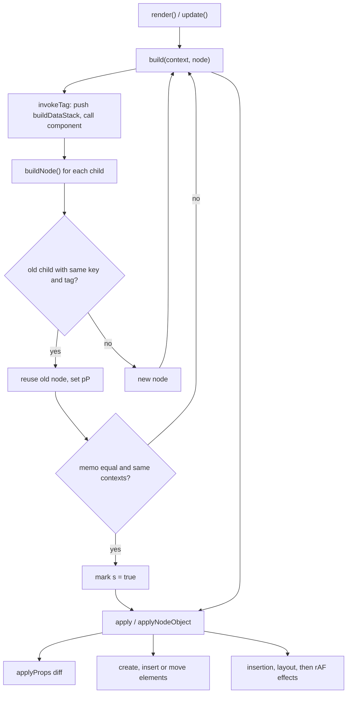

## Overview

`hono/jsx/dom` is a small client-side renderer with a React-compatible API. Components written for [[JSX Server Rendering]] can run in the browser with state, effects, refs, transitions and context, and libraries that expect `react` / `react-dom` can be aliased to `hono/jsx/dom` and `hono/jsx/dom/client`. The renderer keeps a virtual tree of plain objects, rebuilds the subtree of a component whose state changed, and patches the real DOM in place.

Sources: [src/jsx/dom/index.ts:1-40](repo://src/jsx/dom/index.ts#L1-L40), [src/jsx/dom/index.ts:85-125](repo://src/jsx/dom/index.ts#L85-L125)

The hooks live in `src/jsx/hooks/index.ts` and are shared with the server renderer: every hook first looks at `buildDataStack`, which is only populated while the DOM renderer is building a component. When the stack is empty (server rendering) each hook returns a static result, such as the initial state for `useState` or the factory result for `useMemo`, so the same component renders on both sides.

Sources: [src/jsx/hooks/index.ts:182-191](repo://src/jsx/hooks/index.ts#L182-L191), [src/jsx/dom/render.ts:106-106](repo://src/jsx/dom/render.ts#L106-L106)

## Entry points

### Modules

Each entry point is published separately in `package.json`:

Sources: [package.json:179-208](repo://package.json#L179-L208)

| Import | Contents |
| --- | --- |
| `hono/jsx/dom` | `render`, hooks, `createContext`, `memo`, `Suspense`, `ErrorBoundary`, `createPortal`, `flushSync`, `createElement`, `cloneElement`, `Children` |
| `hono/jsx/dom/jsx-runtime` | `jsx`, `jsxs`, `Fragment` for `"jsxImportSource": "hono/jsx/dom"` |
| `hono/jsx/dom/client` | `createRoot`, `hydrateRoot` (the `react-dom/client` shape) |
| `hono/jsx/dom/server` | `renderToString`, `renderToReadableStream` (the `react-dom/server` shape) |
| `hono/jsx/dom/css` | `css`, `cx`, `keyframes`, `viewTransition`, `Style`, `createCssContext` |

Sources: [package.json:179-208](repo://package.json#L179-L208), [src/jsx/dom/index.ts:85-125](repo://src/jsx/dom/index.ts#L85-L125)

### The DOM JSX runtime

Unlike the server runtime, the DOM `jsxDEV` does not create `JSXNode` instances. It returns a plain object `{ tag, type, props, key, ref }`, and replaces the tags `title`, `script`, `style`, `link`, `meta`, `form`, `input` and `button` with the DOM components from `intrinsic-element/components.ts`. `Fragment` is a node whose tag is the empty string.

Sources: [src/jsx/dom/jsx-dev-runtime.ts:1-23](repo://src/jsx/dom/jsx-dev-runtime.ts#L1-L23), [src/jsx/dom/jsx-runtime.ts:1-8](repo://src/jsx/dom/jsx-runtime.ts#L1-L8)

The DOM `memo` returns a wrapper that only carries `DOM_MEMO = propsAreEqual`; the actual skip happens during reconciliation. `createElement` and `cloneElement` translate the classic `(tag, props, ...children)` signature into `jsx(tag, props, key)`.

Sources: [src/jsx/dom/index.ts:41-83](repo://src/jsx/dom/index.ts#L41-L83)

### render, createRoot and hydrateRoot

`render(jsxNode, container)` wraps the node in a fragment and calls `renderNode`, which builds the whole tree, applies it to a fresh `DocumentFragment`, rewrites each node's container from the fragment to the real container, and swaps the content in with `container.replaceChildren(fragment)`.

Sources: [src/jsx/dom/render.ts:783-799](repo://src/jsx/dom/render.ts#L783-L799)

`createRoot(element)` returns `{ render, unmount }`. The first `render` mounts an internal component that keeps the current node in `useState` and captures its setter; later `render` calls just call that setter, so updating a root goes through normal reconciliation. `unmount` renders `null` and marks the root unusable (a later `render` throws `Cannot update an unmounted root`). `hydrateRoot` is `createRoot` plus `render`: hono/jsx/dom does not reuse server-rendered DOM, it replaces the container's children.

Sources: [src/jsx/dom/client.ts:11-89](repo://src/jsx/dom/client.ts#L11-L89)

```tsx
import { createRoot } from 'hono/jsx/dom/client'

const root = createRoot(document.getElementById('root')!)
root.render(<App />)
```

Sources: [src/jsx/dom/client.ts:23-66](repo://src/jsx/dom/client.ts#L23-L66)

## The virtual tree

### Node objects

The renderer stores state on the JSX objects themselves, using short field names to keep the bundle small:

Sources: [src/jsx/dom/render.ts:41-65](repo://src/jsx/dom/render.ts#L41-L65)

| Field | Meaning |
| --- | --- |
| `vC` / `pC` / `vR` | current virtual children, previous children, children to remove |
| `pP` | previous props, used to diff attributes |
| `e` / `c` | the rendered DOM element or text node, and its container |
| `nN` | the next sibling node, used to find the insertion point |
| `n` | namespace URI for SVG and MathML |
| `f` / `s` | force rebuild / skip build and apply (memoised) |
| `p` | preserve the element on unmount (head elements, portals) |
| `[DOM_STASH]` | `[hookIndex, hookStash, contexts, errorHandler]` for function components |

Sources: [src/jsx/dom/render.ts:37-80](repo://src/jsx/dom/render.ts#L37-L80)

Text children become `NodeString` objects `{ t, d }` where `d` marks text that changed. A render-wide `Context` tuple carries the pending type (`0` normal, `1` global transition, `2` hook transition), an error flag, an optional update hook (used by view transitions), a top-level-render flag and the stack of error handlers.

Sources: [src/jsx/dom/render.ts:66-104](repo://src/jsx/dom/render.ts#L66-L104)

### Build and apply

Rendering is split into two passes. `build` calls components and reconciles virtual children; `apply` walks the result and touches the DOM. Effects run at the end of `apply`.

Sources: [src/jsx/dom/render.ts:364-367](repo://src/jsx/dom/render.ts#L364-L367), [src/jsx/dom/render.ts:497-497](repo://src/jsx/dom/render.ts#L497-L497)



Sources: [src/jsx/dom/render.ts:274-291](repo://src/jsx/dom/render.ts#L274-L291), [src/jsx/dom/render.ts:497-609](repo://src/jsx/dom/render.ts#L497-L609)

### Reconciliation in build

For a function component `build` calls `invokeTag`, which resets the hook index, pushes `[context, node]` onto `buildDataStack`, merges `defaultProps`, and calls the component (or its `DOM_RENDERER` override). Nested arrays in the result are flattened. Each child goes through `buildNode`, which turns strings and numbers into text nodes, gives function components a fresh `DOM_STASH`, and wraps `svg` and `math` children in a namespace context provider.

Sources: [src/jsx/dom/render.ts:274-291](repo://src/jsx/dom/render.ts#L274-L291), [src/jsx/dom/render.ts:667-704](repo://src/jsx/dom/render.ts#L667-L704)

Each new child is matched against the old children: by `key` and `tag` when the child has a key, otherwise by the first old child with the same tag (any text node for text). A matched old node is reused and receives the new props, keeping the old ones in `pP`. A reused component is marked `s` (skip) when it was not forced and either the object is the same one the React compiler memoised or `tag[DOM_MEMO](prevProps, nextProps)` returns true, and the context values it saw are unchanged. Unmatched old children end up in `vR` for removal, and `nN` links are set so `apply` can find insertion points.

Sources: [src/jsx/dom/render.ts:520-609](repo://src/jsx/dom/render.ts#L520-L609), [src/jsx/dom/render.ts:483-491](repo://src/jsx/dom/render.ts#L483-L491)

Before building a component child, `build` snapshots the current value of every context into `DOM_STASH[2]` and the nearest error handler into `DOM_STASH[3]`. A later state update of that component can then restore the same provider values without rebuilding its ancestors.

Sources: [src/jsx/dom/render.ts:526-539](repo://src/jsx/dom/render.ts#L526-L539)

### Applying to the DOM

`applyNodeObject` collects the flattened children (function components and fragments contribute their children directly), removes the nodes in `vR` (running effect cleanups and ref cleanups), and computes an offset in the container's `childNodes`. It then creates missing elements (`createElementNS` when a namespace is set), applies props, recurses, and inserts or moves each element so the DOM order matches the virtual order. A `<select>`'s `value` is applied after its options exist.

Sources: [src/jsx/dom/render.ts:293-362](repo://src/jsx/dom/render.ts#L293-L362), [src/jsx/dom/render.ts:387-461](repo://src/jsx/dom/render.ts#L387-L461)

Effects collected from the component stashes run last: `useInsertionEffect` callbacks immediately, `useLayoutEffect` callbacks synchronously after the DOM work, and `useEffect` callbacks in a `requestAnimationFrame`.

Sources: [src/jsx/dom/render.ts:462-481](repo://src/jsx/dom/render.ts#L462-L481)

### Props, events and refs

`applyProps` diffs new props against `pP`:

Sources: [src/jsx/dom/render.ts:164-172](repo://src/jsx/dom/render.ts#L164-L172)

| Prop | Handling |
| --- | --- |
| `on*` | `addEventListener` / `removeEventListener`; `onClickCapture` uses capture; `onChange` maps to `input` and `onDoubleClick` to `dblclick`; a non-function throws |
| `ref` | a callback ref is called with the element (its return value, or a call with `null`, is the cleanup); an object ref gets `current` |
| `style` | a string sets `cssText`; an object goes through `styleObjectForEach` into `style.setProperty` |
| `dangerouslySetInnerHTML` | sets `innerHTML` |
| `value`, `checked`, `selected` | also set as DOM properties on inputs, textareas and options |
| others | `setAttribute` (`true` becomes an empty value, `null` / `undefined` / `false` remove it) |

Sources: [src/jsx/dom/render.ts:115-133](repo://src/jsx/dom/render.ts#L115-L133), [src/jsx/dom/render.ts:164-249](repo://src/jsx/dom/render.ts#L164-L249)

Attribute names are normalised as on the server (`className` to `class`), and camelCase SVG presentation attributes become kebab-case. Invalid attribute names are not pre-validated; `setAttribute`'s `InvalidCharacterError` is caught and ignored instead, which keeps the common path fast.

Sources: [src/jsx/dom/render.ts:135-162](repo://src/jsx/dom/render.ts#L135-L162)

## Update scheduling

### update and batching

A state setter calls `update(context, node)`. `update` keeps one pending entry per node in `updateMap`; a newer call resolves the older one with `undefined`, so only the last update for a node runs. Outside `flushSync` it waits one microtask (`await Promise.resolve()`), which batches every setter called in the same tick into one rebuild per component.

Sources: [src/jsx/dom/render.ts:734-781](repo://src/jsx/dom/render.ts#L734-L781)

`updateSync` pushes the context values saved in the node's stash, rebuilds the component with `build`, pops them, and calls `apply` on the component's container, unless the render is a low-priority transition that hit an error. When the context carries an update hook (`context[2]`), the hook decides when `updateSync` runs.

Sources: [src/jsx/dom/render.ts:713-732](repo://src/jsx/dom/render.ts#L713-L732)

`flushSync(callback)` pushes a set onto `currentUpdateSets`; updates scheduled inside the callback are collected there and run synchronously when it returns. `createPortal(children, container, key)` returns a node with the reserved tag `_hp` whose element is the target container and which is preserved on unmount.

Sources: [src/jsx/dom/render.ts:801-825](repo://src/jsx/dom/render.ts#L801-L825), [src/jsx/dom/render.ts:17-17](repo://src/jsx/dom/render.ts#L17-L17)

### Error boundaries and Suspense on the client

The DOM `ErrorBoundary` and `Suspense` return a fragment carrying a `DOM_ERROR_HANDLER`. `build` registers that handler for its subtree. When a descendant throws, the handler of the nearest boundary decides: `ErrorBoundary` rethrows promises and returns `fallbackRender(err) || fallback` for errors; `Suspense` rethrows errors and, for a thrown promise, returns `fallback` and schedules `retry` with `err.finally(retry)`. `build` then rebuilds the boundary with the fallback and throws an internal `cancelBuild` to abandon the rest of the failed subtree.

Sources: [src/jsx/dom/components.ts:1-39](repo://src/jsx/dom/components.ts#L1-L39), [src/jsx/dom/render.ts:610-665](repo://src/jsx/dom/render.ts#L610-L665)

### Context on the client

The DOM `createContext` returns a provider function that wraps its children between two internal components: the first pushes `value` onto `context.values` while the tree is built, the last pops it. `useContext` reads the top of `values`. If a child throws, the provider's error handler pops the value before rethrowing.

Sources: [src/jsx/dom/context.ts:1-52](repo://src/jsx/dom/context.ts#L1-L52), [src/jsx/dom/utils.ts:1-7](repo://src/jsx/dom/utils.ts#L1-L7)

## Hooks

### State and stash layout

Hooks store their data in `node[DOM_STASH][1]`, an array of per-kind arrays (`STASH_SATE` 0, `STASH_EFFECT` 1, `STASH_CALLBACK` 2, `STASH_MEMO` 3, `STASH_REF` 4), indexed by the call order tracked in `DOM_STASH[0]`. As in React, hooks must be called in the same order on every render.

Sources: [src/jsx/hooks/index.ts:8-34](repo://src/jsx/hooks/index.ts#L8-L34)

`useState` creates `[value, setter]` once per slot. The setter accepts a value or an updater function, ignores updates where `Object.is(newState, current)`, and otherwise stores the new value and calls `update`. Inside a transition it passes the pending type and, for hook transitions, schedules a follow-up normal-priority update after the transition's promise settles. `useReducer` is `useState` plus a `useCallback`-stable dispatcher.

Sources: [src/jsx/hooks/index.ts:178-258](repo://src/jsx/hooks/index.ts#L178-L258)

### Effects, memo and refs

| Hook | Behaviour |
| --- | --- |
| `useEffect` | slot 3 of `EffectData`; run in `requestAnimationFrame` after apply |
| `useLayoutEffect` | slot 1; run synchronously after apply |
| `useInsertionEffect` | slot 4; run before layout effects |
| `useCallback` | returns the stored callback until `deps` change |
| `useMemo` | stores `[factory(), deps]`, recomputes when `deps` change |
| `useRef` | a stable `{ current }` object per slot |
| `useId` | `useMemo` of `:r<n>:` from a module counter |
| `useImperativeHandle` | sets `ref.current = createHandle()` in an effect, clears it on cleanup |
| `forwardRef` / `createRef` | pass `ref` as a second argument / create `{ current: null }` |
| `useDebugValue` | no-op |

Sources: [src/jsx/hooks/index.ts:260-330](repo://src/jsx/hooks/index.ts#L260-L330), [src/jsx/hooks/index.ts:348-395](repo://src/jsx/hooks/index.ts#L348-L395)

`useEffectCommon` compares the new `deps` with the previous ones; when they differ it runs the previous cleanup and stores a runner that saves the effect's return value as the next cleanup. Removing a node runs every stored cleanup.

Sources: [src/jsx/hooks/index.ts:260-297](repo://src/jsx/hooks/index.ts#L260-L297), [src/jsx/dom/render.ts:341-362](repo://src/jsx/dom/render.ts#L341-L362)

### use and useSyncExternalStore

`use(promise)` returns the cached result of a settled promise (or rethrows its error), and otherwise records the result in a `WeakMap` when it settles and throws the promise. The nearest `Suspense` catches it on the client, and the server `Suspense` catches it during string rendering.

Sources: [src/jsx/hooks/index.ts:332-346](repo://src/jsx/hooks/index.ts#L332-L346)

`useSyncExternalStore(subscribe, getSnapshot, getServerSnapshot)` subscribes in an effect and stores snapshots in state. During server rendering it requires `getServerSnapshot` and throws without it; during the first client render it uses the server snapshot when one is given, then switches to `getSnapshot` in the effect.

Sources: [src/jsx/hooks/index.ts:397-425](repo://src/jsx/hooks/index.ts#L397-L425)

### Transitions and deferred values

`startTransition(cb)` and the function returned by `useTransition()` run their callback with an entry on `pendingStack`, so setters called inside schedule low-priority updates. `useTransition` returns `isPending` (true while the component is rendered from a hook transition, `context[0] === 2`) and rethrows errors from an async transition callback on the next render. `useDeferredValue(value, initialValue?)` returns the previous value at first and schedules a deferred update that switches to the new one.

Sources: [src/jsx/hooks/index.ts:101-176](repo://src/jsx/hooks/index.ts#L101-L176)

`startViewTransition(cb)` sets a module-level `updateHook` while `cb` runs. Updates scheduled then run inside `document.startViewTransition` (or immediately when the browser lacks it). `useViewTransition()` returns `[isUpdating, startViewTransition]`; when a component reads it, a second update runs after the transition's `finished` promise with `isUpdating` false.

Sources: [src/jsx/hooks/index.ts:36-99](repo://src/jsx/hooks/index.ts#L36-L99)

### Form hooks

`src/jsx/dom/hooks` adds the React 19 form hooks:

Sources: [src/jsx/dom/hooks/index.ts:1-15](repo://src/jsx/dom/hooks/index.ts#L1-L15)

- `useFormStatus()` reads `FormContext`, which the DOM `form` component provides: `{ pending, data, method, action }` while an action runs.
- `useActionState(fn, initialState, permalink?)` returns `[state, action]`; the action awaits `fn(state, formData)` and stores the result, and carries `permalink` under `PERMALINK` so the server renders it as the form's URL.
- `useOptimistic(state, updateState)` returns an optimistic state that resets to `state` once every registered action promise has settled.

Sources: [src/jsx/dom/hooks/index.ts:1-91](repo://src/jsx/dom/hooks/index.ts#L1-L91)

## DOM intrinsic elements

### Head elements

The DOM versions of `title`, `meta`, `link`, `script` and `style` render through `createPortal` into `document.head`. For tags deduplicated by key (`script` by `src`, `style` by `data-href`, `link` stylesheets with `precedence`) they first look for a matching element already in `<head>`, which includes one emitted by the server, and reuse it; otherwise they create one and cache it by a key built from those attributes. Stylesheets are inserted after the last element with the same `data-precedence`. A `blocking="render"` script, style or link suspends its component with `use()` until the resource fires `load`.

Sources: [src/jsx/dom/intrinsic-element/components.ts:56-125](repo://src/jsx/dom/intrinsic-element/components.ts#L56-L125), [src/jsx/dom/intrinsic-element/components.ts:127-188](repo://src/jsx/dom/intrinsic-element/components.ts#L127-L188), [src/jsx/dom/intrinsic-element/components.ts:223-256](repo://src/jsx/dom/intrinsic-element/components.ts#L223-L256)

The same conditions as on the server decide whether a tag is treated as head metadata (for example, `script` needs both `src` and `async`). A `title` inside `<svg>` renders in place.

Sources: [src/jsx/dom/intrinsic-element/components.ts:257-316](repo://src/jsx/dom/intrinsic-element/components.ts#L257-L316), [src/jsx/intrinsic-element/common.ts:1-23](repo://src/jsx/intrinsic-element/common.ts#L1-L23)

### Forms and actions

When `<form action={fn}>` receives a function, the DOM `form` attaches a `submit` listener. On submit it prevents navigation, builds a `FormData`, marks the form pending, calls the action, registers a returned promise with `registerAction` (for `useOptimistic`) and awaits it. The form is wrapped in a `FormContext` provider whose value feeds `useFormStatus`. `<button formAction={fn}>` and `<input formAction={fn}>` dispatch a synthetic `submit` event that carries their own action. The components are registered into `domRenderers`, which the server runtime attaches to its intrinsic components.

Sources: [src/jsx/dom/intrinsic-element/components.ts:318-386](repo://src/jsx/dom/intrinsic-element/components.ts#L318-L386), [src/jsx/dom/intrinsic-element/components.ts:388-438](repo://src/jsx/dom/intrinsic-element/components.ts#L388-L438), [src/jsx/base.ts:318-327](repo://src/jsx/base.ts#L318-L327)

## Client CSS

`hono/jsx/dom/css` mirrors the server `css` helper from [[HTML and CSS Helpers]] but writes rules into a live stylesheet. `createCssJsxDomObjects({ id })` finds `<style id>` and, when a class name object is stringified (for example in `class={css...}`), inserts its rule and nested selectors with `sheet.insertRule`, tracking added class names to avoid duplicates. If the sheet is not in the DOM yet, insertion is retried in a microtask and throws `style sheet not found` if it is still missing. `:-hono-global` rules are split into top-level rules by `splitRule`.

Sources: [src/jsx/dom/css.ts:27-143](repo://src/jsx/dom/css.ts#L27-L143)

`createCssContext({ id, classNameSlug?, onInvalidSlug? })` returns `css`, `cx`, `keyframes`, `viewTransition` and a `Style` component that renders the `<style id>` element; the default exports use the id `hono-css`. Render `<Style />` once, typically in the document head.

Sources: [src/jsx/dom/css.ts:171-263](repo://src/jsx/dom/css.ts#L171-L263), [src/helper/css/common.ts:4-4](repo://src/helper/css/common.ts#L4-L4)

## Server compatibility module

`hono/jsx/dom/server` provides `react-dom/server`-shaped functions on top of the string renderer. `renderToString(element)` calls `element.toString()` and throws `Async component is not supported in renderToString` if the result is a promise. `renderToReadableStream(element, options)` delegates to the streaming renderer from `hono/jsx/streaming` and supports only `onError`; other options log a warning.

Sources: [src/jsx/dom/server.ts:1-70](repo://src/jsx/dom/server.ts#L1-L70)
