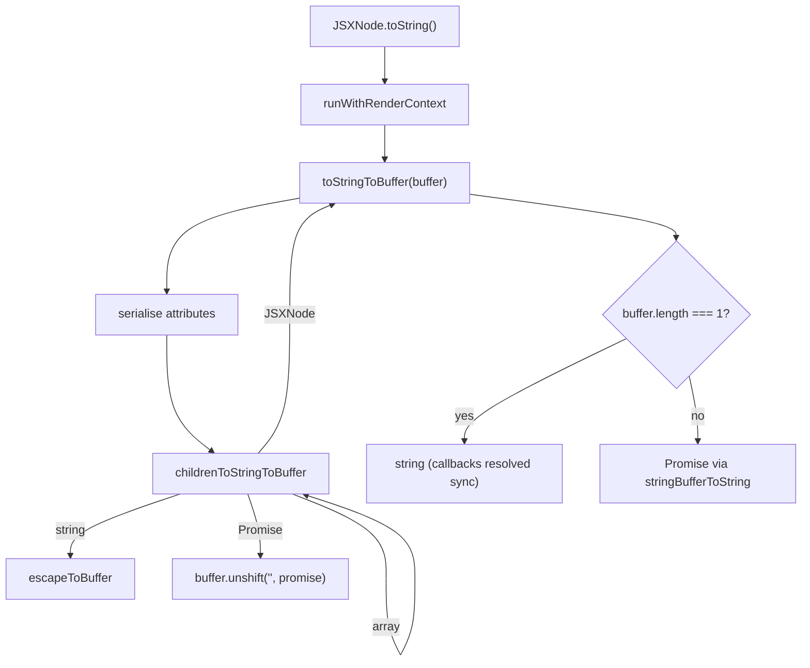
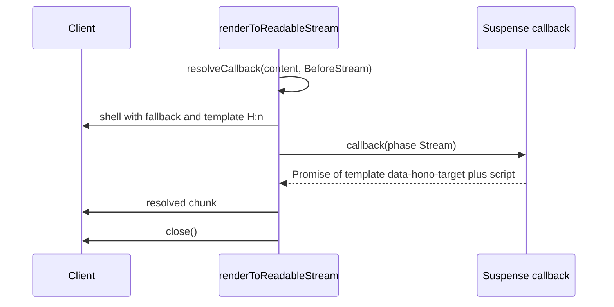

## Overview

`hono/jsx` is a dependency-free JSX implementation that renders components to HTML strings on the server. A JSX expression builds a tree of `JSXNode` objects; calling `toString()` on the root walks the tree into a string buffer, escaping text and attributes as it goes. Async components and `Suspense` leave promises in the buffer, which `c.html()` resolves in one piece or `renderToReadableStream` flushes chunk by chunk. The same module exposes a React-compatible API surface (`memo`, `createContext`, hooks, `Children`, `createElement`) so that React-style libraries can target it, and its DOM renderer is described in [[Client-side JSX and Hooks]].

Sources: [src/jsx/index.ts:1-114](repo://src/jsx/index.ts#L1-L114)

Hono uses JSX for server-side HTML in route handlers, usually through the `jsxRenderer` middleware and `c.render()`. For tagged-template HTML without a compiler step, see [[HTML and CSS Helpers]]; for streaming arbitrary bodies, see [[Streaming and Server-Sent Events]].

Sources: [src/middleware/jsx-renderer/index.ts:116-129](repo://src/middleware/jsx-renderer/index.ts#L116-L129), [src/context.ts:448-451](repo://src/context.ts#L448-L451)

## Compiler configuration

### jsxImportSource

TypeScript (and Deno, Bun, esbuild) compile JSX to calls into `<jsxImportSource>/jsx-runtime`. Hono's own test configuration shows the setting a project needs: `"jsx": "react-jsx"` with `"jsxImportSource": "hono/jsx"`. Use `hono/jsx/dom` instead as the import source for code that runs in the browser.

Sources: [tsconfig.spec.json:3-5](repo://tsconfig.spec.json#L3-L5)

```json
{
  "compilerOptions": {
    "jsx": "react-jsx",
    "jsxImportSource": "hono/jsx"
  }
}
```

Sources: [tsconfig.spec.json:1-11](repo://tsconfig.spec.json#L1-L11)

The package publishes `./jsx`, `./jsx/jsx-runtime`, `./jsx/jsx-dev-runtime`, `./jsx/streaming` and `./jsx-renderer` as separate entry points, both in `package.json` (built `dist` files) and in `jsr.json` (TypeScript sources).

Sources: [package.json:154-178](repo://package.json#L154-L178), [jsr.json:32-42](repo://jsr.json#L32-L42)

### Runtime entry points

`jsx-runtime.ts` re-exports `jsxDEV` from the dev runtime as both `jsx` and `jsxs`, so production and development builds share one code path. `jsxDEV` pulls `children` out of the props the compiler passes, normalises it to an array, calls `jsxFn`, and stores the third argument as the node's `key`.

Sources: [src/jsx/jsx-runtime.ts:6-8](repo://src/jsx/jsx-runtime.ts#L6-L8), [src/jsx/jsx-dev-runtime.ts:12-26](repo://src/jsx/jsx-dev-runtime.ts#L12-L26)

```ts
export function jsxDEV(
  tag: string | Function,
  props: Record<string, unknown>,
  key?: string
): JSXNode {
  let node: JSXNode
  if (!props || !('children' in props)) {
    node = jsxFn(tag, props, [])
  } else {
    const children = props.children as string | HtmlEscapedString
    node = Array.isArray(children) ? jsxFn(tag, props, children) : jsxFn(tag, props, [children])
  }
  node.key = key
  return node
}
```

Sources: [src/jsx/jsx-dev-runtime.ts:6-26](repo://src/jsx/jsx-dev-runtime.ts#L6-L26), [src/jsx/jsx-runtime.ts:6-8](repo://src/jsx/jsx-runtime.ts#L6-L8)

The runtime also exports the helpers that Deno's `"jsx": "precompile"` transform calls: `jsxTemplate` (the `html` tagged template), `jsxAttr` (serialises one attribute, including style objects and promises) and `jsxEscape`. The repository runs the Deno JSX tests under both the `precompile` and `react-jsx` configurations.

Sources: [src/jsx/jsx-runtime.ts:9-51](repo://src/jsx/jsx-runtime.ts#L9-L51), [runtime-tests/deno-jsx/deno.precompile.json:1-12](repo://runtime-tests/deno-jsx/deno.precompile.json#L1-L12), [package.json:16-16](repo://package.json#L16-L16)

## Building the node tree

### jsx and jsxFn

`jsx(tag, props, ...children)` is the classic `createElement` signature (exported as both `jsx` and `createElement`). It folds children into `props.children`, moves `props.key` onto the node, and delegates to `jsxFn`, which picks the node class:

Sources: [src/jsx/base.ts:304-316](repo://src/jsx/base.ts#L304-L316)

| Tag | Node created | Why |
| --- | --- | --- |
| a function component | `JSXFunctionNode(tag)` | the function is called at render time |
| `title`, `script`, `style`, `link`, `meta`, `form`, `input`, `button` | `JSXFunctionNode(intrinsicElementTags[tag])` | these tags have special server behaviour (head hoisting, form actions) |
| `svg` or `head` | `JSXNode(tag)` wrapping a `nameSpaceContext` provider | children know they are inside SVG or `<head>` |
| any other string | `JSXNode(tag)` | plain element |

Sources: [src/jsx/base.ts:304-351](repo://src/jsx/base.ts#L304-L351)

On its first call `jsxFn` also copies the DOM renderers registered in `domRenderers` onto the intrinsic element components under the `DOM_RENDERER` symbol, so the same component objects work in the client renderer. `JSXNode`'s constructor validates string tags with `isValidTagName`, which rejects whitespace, quotes, `<`, `>`, `/`, `=` and a leading `!` or `?`, so a tag name taken from user data cannot inject markup.

Sources: [src/jsx/base.ts:140-154](repo://src/jsx/base.ts#L140-L154), [src/jsx/base.ts:318-327](repo://src/jsx/base.ts#L318-L327), [src/jsx/utils.ts:14-47](repo://src/jsx/utils.ts#L14-L47)

### Node classes

`JSXNode` has `tag`, `props`, `key`, `children` and `isEscaped: true`, which marks it as already-safe HTML when it is interpolated elsewhere. It also exposes `type` and `ref` getters for libraries that read React's element shape. `JSXFunctionNode` overrides rendering to call the component, and `JSXFragmentNode` renders only its children.

Sources: [src/jsx/base.ts:131-165](repo://src/jsx/base.ts#L131-L165), [src/jsx/base.ts:254-302](repo://src/jsx/base.ts#L254-L302)

## Rendering to a string

### toString and the buffer

`JSXNode.toString()` creates a `StringBufferWithCallbacks` (an array whose first slot is the string being built) and calls `toStringToBuffer`. When nothing async was encountered the buffer has length 1 and the string is returned directly, after running any registered callbacks synchronously with `resolveCallbackSync`. When a promise was pushed, `stringBufferToString` awaits the promises and the result is a `Promise<string>`. The whole render runs inside `runWithRenderContext` so that context values are isolated per render (see the Context section).

Sources: [src/jsx/base.ts:166-177](repo://src/jsx/base.ts#L166-L177), [src/utils/html.ts:129-140](repo://src/utils/html.ts#L129-L140)



Sources: [src/jsx/base.ts:108-129](repo://src/jsx/base.ts#L108-L129), [src/jsx/base.ts:166-251](repo://src/jsx/base.ts#L166-L251)

`childrenToStringToBuffer` escapes plain strings, skips booleans, `null` and `undefined` (so `cond && <X />` renders nothing), appends numbers and already-escaped values verbatim, recurses into nested arrays and nodes, and records promises by unshifting them into the buffer.

Sources: [src/jsx/base.ts:108-129](repo://src/jsx/base.ts#L108-L129)

### Function components

`JSXFunctionNode.toStringToBuffer` copies the props, adds `children` (a single child or the array), and calls the component. A `null`, `undefined` or boolean result renders nothing; a `JSXNode` is rendered in place; an escaped string or number is appended along with its `callbacks`; any other string is escaped. A `Promise` result (an `async` component) is unshifted into the buffer. If any context exists, the current context values are captured first with `captureRenderContext`, and attached to the resolved node as `suspendedContext`, so that the awaited subtree still sees the providers that surrounded it.

Sources: [src/jsx/base.ts:254-296](repo://src/jsx/base.ts#L254-L296)

### Attributes and styles

`toStringToBuffer` serialises each prop according to its type:

Sources: [src/jsx/base.ts:179-190](repo://src/jsx/base.ts#L179-L190)

| Prop value | Output |
| --- | --- |
| key fails `isValidAttributeName` | skipped |
| `children` | skipped (rendered as content) |
| `style` object | `style="a:b;c:d"` built by `styleObjectForEach` |
| string | `key="escaped"` |
| `null` / `undefined` | omitted |
| number or escaped string | `key="value"` without escaping |
| boolean, key in `booleanAttributes` | `key=""` when true, omitted when false |
| `dangerouslySetInnerHTML` | replaces children with `raw(v.__html)`; throws if children were also given |
| `Promise` | the attribute value is resolved later from the buffer |
| function | ignored for `on*` and `ref` (client handlers); any other key throws |
| anything else | `v.toString()`, escaped |

Sources: [src/jsx/base.ts:179-251](repo://src/jsx/base.ts#L179-L251), [src/jsx/base.ts:79-106](repo://src/jsx/base.ts#L79-L106)

Keys are normalised first: `className` becomes `class`, `htmlFor` becomes `for`, and `httpEquiv`, `crossOrigin`, `itemProp`, `fetchPriority`, `noModule` and `formAction` get their HTML spellings. Inside an `<svg>` (detected through `nameSpaceContext`), camelCase presentation attributes such as `strokeWidth` and `clipPath` are converted to kebab-case by `toSVGAttributeName`. Void elements listed in `emptyTags` (`br`, `img`, `input`, `meta` and so on) close with `/>` when they have no children.

Sources: [src/jsx/utils.ts:1-12](repo://src/jsx/utils.ts#L1-L12), [src/jsx/base.ts:49-78](repo://src/jsx/base.ts#L49-L78), [src/jsx/base.ts:184-189](repo://src/jsx/base.ts#L184-L189), [src/jsx/base.ts:241-250](repo://src/jsx/base.ts#L241-L250)

`styleObjectForEach` converts camelCase property names to kebab-case (CSS variables starting with `-` pass through), appends `px` to numeric values except for unitless properties such as `opacity`, `z-index`, `flex` and `line-height`, and drops entries whose name or value is unsafe. `hasUnsafeStyleValue` rejects values that contain an unquoted `;`, braces, unbalanced brackets or quotes, or an unterminated comment, so a style value cannot break out into another declaration.

Sources: [src/jsx/utils.ts:121-201](repo://src/jsx/utils.ts#L121-L201)

## Document metadata hoisting

### Which tags are hoisted

`title`, `meta`, `link`, `script` and `style` are implemented as components in `intrinsic-element/components.ts`, following React 19's document metadata semantics: written anywhere in the tree, they are moved into `<head>`. Each falls back to plain rendering (`returnWithoutSpecialBehavior`) in the cases where hoisting does not apply:

Sources: [src/jsx/intrinsic-element/components.ts:93-119](repo://src/jsx/intrinsic-element/components.ts#L93-L119)

| Tag | Rendered in place when |
| --- | --- |
| `title` | inside `<svg>` or `<head>` |
| `meta` | inside `<head>`, or has `itemProp` |
| `script` | missing `src` or `async`, or inside `<head>` |
| `style` | missing `href` or `precedence` (`href` is moved to `data-href`) |
| `link` | has `onLoad` / `onError`, or is a stylesheet without `precedence` or with `disabled` |

Sources: [src/jsx/intrinsic-element/components.ts:93-177](repo://src/jsx/intrinsic-element/components.ts#L93-L177)

### How hoisting works

`documentMetadataTag` renders the tag normally and attaches an `insertIntoHead` callback to the resulting escaped string. The callback runs once the full document is in the buffer: it records the tag in a per-render `metaTagMap` keyed by the render `context` object, removes duplicates using `deDupeKeyMap` (`script` by `src`, `style` by `data-href`, `link` by `href`, `meta` by `name`, `httpEquiv`, `charset` or `itemProp`), and when the buffer contains `</head>` it strips the tags from their original position and inserts them before `</head>`. Stylesheets with `precedence` are written with a `data-precedence` attribute and ordered by first-seen precedence, then by source order.

Sources: [src/jsx/intrinsic-element/components.ts:17-119](repo://src/jsx/intrinsic-element/components.ts#L17-L119), [src/jsx/intrinsic-element/common.ts:1-23](repo://src/jsx/intrinsic-element/common.ts#L1-L23)

> [!NOTE]
> Hoisting needs a `<head>` element in the rendered output. Without one the tags stay where they were written.

Sources: [src/jsx/intrinsic-element/components.ts:64-90](repo://src/jsx/intrinsic-element/components.ts#L64-L90)

### Form actions

`form`, `input` and `button` accept a function for `action` / `formAction`. On the server the function is replaced with its `PERMALINK` string if it has one, and dropped otherwise, so a server action reference renders as a URL.

Sources: [src/jsx/intrinsic-element/components.ts:179-210](repo://src/jsx/intrinsic-element/components.ts#L179-L210)

## Components

### Fragment, memo and helpers

`Fragment` returns a `JSXFragmentNode` that renders only its children; it is also exported as `StrictMode`. `memo(component, propsAreEqual = shallowEqual)` wraps a component and returns the cached result while the props compare equal; it also tags the wrapper with `DOM_MEMO` and `DOM_RENDERER` so the client renderer can skip re-renders. `isValidElement`, `cloneElement` and `Children` (`map`, `forEach`, `count`, `only`, `toArray`) mirror their React counterparts.

Sources: [src/jsx/base.ts:353-442](repo://src/jsx/base.ts#L353-L442), [src/jsx/children.ts:1-20](repo://src/jsx/children.ts#L1-L20)

### ErrorBoundary

`ErrorBoundary` (experimental) accepts `fallback`, `fallbackRender(error)` and `onError`. It renders its children early with `resolveChildEarly`. A synchronous throw renders the fallback immediately; a thrown promise (from `use()`) is awaited and retried through `childrenToString`. When some child result is a promise, it emits a `<template id="E:n">` placeholder plus a closing HTML comment whose text is `E:n`, and a callback. In a buffered render the callback replaces the region between the markers in the buffer; while streaming it emits a `<template data-hono-target="E:n">` with an inline script that moves the content into place. If the async child rejects, `catchCallback` substitutes the fallback the same way.

Sources: [src/jsx/components.ts:14-45](repo://src/jsx/components.ts#L14-L45), [src/jsx/components.ts:55-127](repo://src/jsx/components.ts#L55-L127), [src/jsx/components.ts:128-200](repo://src/jsx/components.ts#L128-L200), [src/jsx/components.ts:201-262](repo://src/jsx/components.ts#L201-L262)

### Suspense

`Suspense` (experimental) renders its children with a `use()` data stack pushed onto `buildDataStack`. If they all resolve synchronously, it returns them joined. If a child throws a promise or returns one, it awaits `fallback.toString()` and returns `<template id="H:n"></template>` followed by the fallback and a closing HTML comment marker whose text is `/$`, plus a callback that waits for the children. The callback does nothing in the `BeforeStream` phase; afterwards it either replaces the placeholder in the buffer (non-streaming) or emits the resolved content in a `<template data-hono-target="H:n">` with a script that swaps it in.

Sources: [src/jsx/streaming.ts:34-138](repo://src/jsx/streaming.ts#L34-L138)

`StreamingContext` lets a page set a CSP nonce for those inline scripts:

Sources: [src/jsx/streaming.ts:18-32](repo://src/jsx/streaming.ts#L18-L32)

```tsx
<StreamingContext.Provider value={{ scriptNonce: 'test-nonce' }}>
  <Suspense fallback={<p>Loading...</p>}>
    <Content />
  </Suspense>
</StreamingContext.Provider>
```

Sources: [src/jsx/streaming.ts:18-32](repo://src/jsx/streaming.ts#L18-L32)

## Context

### createContext and useContext

`createContext(defaultValue)` returns a component that is also its own `Provider`. When it renders, it pushes `props.value` onto the value stack for the current render, renders its children, and pops the value when rendering finishes (synchronously or in `.finally()` for a promise). `useContext(context)` reads the top of that stack, or the default when no provider is active. Every context is registered in `globalContexts` so that suspension points can capture all of them.

Sources: [src/jsx/context.ts:13-14](repo://src/jsx/context.ts#L13-L14), [src/jsx/context.ts:213-261](repo://src/jsx/context.ts#L213-L261)

### Per-request isolation

Context values are not stored on the context object during server rendering. `runWithRenderContext` creates a `WeakMap` store per top-level render and runs the render inside `AsyncLocalStorage.run`, which `loadAsyncLocalStorage` obtains from `node:async_hooks` through `process.getBuiltinModule` or `process.mainModule.require`. Values therefore survive `await` inside an async component and never leak into a concurrent request. Without `AsyncLocalStorage` the store is only set during synchronous work; a `useContext` after an `await` returns the default value, and `warnIfStorelessAccess` prints a one-time warning.

Sources: [src/jsx/context.ts:34-80](repo://src/jsx/context.ts#L34-L80), [src/jsx/context.ts:149-189](repo://src/jsx/context.ts#L149-L189)

`captureRenderContext` snapshots the store and the current value of every context, and returns a resumer that pushes those values back around a deferred callback. `JSXFunctionNode`, `ErrorBoundary`, `Suspense` and `childrenToString` all use it before resuming a suspended subtree.

Sources: [src/jsx/context.ts:109-147](repo://src/jsx/context.ts#L109-L147), [src/jsx/context.ts:190-200](repo://src/jsx/context.ts#L190-L200)

## Streaming with renderToReadableStream

`renderToReadableStream(content, onError = console.trace)` (experimental) turns a node or escaped string into a `ReadableStream<Uint8Array>`. It resolves the content and its callbacks in the `BeforeStream` phase and enqueues the first chunk, which contains the fallbacks. It then calls each callback in the `Stream` phase; every promise it gets back is enqueued when it settles, and its own callbacks are chained recursively. The loop waits until every callback has produced output, then closes the stream. Rejected chunks are logged and passed to `onError`, which also receives errors from a closed connection; cancelling the stream stops further enqueues.

Sources: [src/jsx/streaming.ts:140-220](repo://src/jsx/streaming.ts#L140-L220), [src/utils/html.ts:6-21](repo://src/utils/html.ts#L6-L21)



Sources: [src/jsx/streaming.ts:87-133](repo://src/jsx/streaming.ts#L87-L133), [src/jsx/streaming.ts:146-220](repo://src/jsx/streaming.ts#L146-L220)

## The jsxRenderer middleware

### Setting a layout

`jsxRenderer(component?, options?)` installs a renderer on the context so handlers can call `c.render(<Page />, props)`. It reads any layout set by an outer `jsxRenderer` with `c.getLayout()` (defaulting to `Fragment`), registers its own component as the new layout with `c.setLayout`, and calls `c.setRenderer(createRenderer(...))`. Nested renderers therefore compose: the inner component receives the outer one as its `Layout` prop.

Sources: [src/middleware/jsx-renderer/index.ts:116-129](repo://src/middleware/jsx-renderer/index.ts#L116-L129), [src/context.ts:448-497](repo://src/context.ts#L448-L497)

```tsx
app.get(
  '/page/*',
  jsxRenderer(({ children }) => {
    return (
      <html>
        <body>
          <header>Menu</header>
          <div>{children}</div>
        </body>
      </html>
    )
  })
)

app.get('/page/about', (c) => {
  return c.render(<h1>About me!</h1>)
})
```

Sources: [src/middleware/jsx-renderer/index.ts:93-114](repo://src/middleware/jsx-renderer/index.ts#L93-L114)

### The renderer and its options

The renderer created by `createRenderer` wraps the handler's content in the layout component (passing `Layout` and the props given to `c.render`), wraps that in `RequestContext.Provider` with the Hono `Context` as value, and prefixes a doctype. `options` may be an object or a function of `c`:

Sources: [src/middleware/jsx-renderer/index.ts:33-64](repo://src/middleware/jsx-renderer/index.ts#L33-L64)

| Option | Default | Effect |
| --- | --- | --- |
| `docType` | `true` | `true` writes `<!DOCTYPE html>`, `false` writes nothing, a string is written as-is |
| `stream` | `false` | `true` sets `Transfer-Encoding: chunked`, `Content-Type: text/html; charset=UTF-8` and `Content-Encoding: Identity` and returns `c.body(renderToReadableStream(body))`; an object sets those headers instead |

Sources: [src/middleware/jsx-renderer/index.ts:18-80](repo://src/middleware/jsx-renderer/index.ts#L18-L80)

Without streaming the renderer returns `c.html(body)`. `c.html` resolves a promise or callback-carrying string with `resolveCallback(..., Stringify)` before building the response, which is where head hoisting and buffered `Suspense` replacement take effect.

Sources: [src/context.ts:723-733](repo://src/context.ts#L723-L733), [src/utils/html.ts:142-182](repo://src/utils/html.ts#L142-L182)

### Typing c.render and useRequestContext

`c.render`'s signature comes from the `ContextRenderer` interface, which is empty by default. A project augments it in `declare module 'hono'` to type the props passed as the second argument; `PropsForRenderer` extracts them for the layout.

Sources: [src/context.ts:59-86](repo://src/context.ts#L59-L86)

`useRequestContext()` reads `RequestContext` from inside any component rendered by `jsxRenderer` and returns the Hono [[Context]], so a deeply nested component can read `c.req.url` without prop drilling. It throws `RequestContext is not provided.` outside such a render.

Sources: [src/middleware/jsx-renderer/index.ts:15-16](repo://src/middleware/jsx-renderer/index.ts#L15-L16), [src/middleware/jsx-renderer/index.ts:131-165](repo://src/middleware/jsx-renderer/index.ts#L131-L165)
