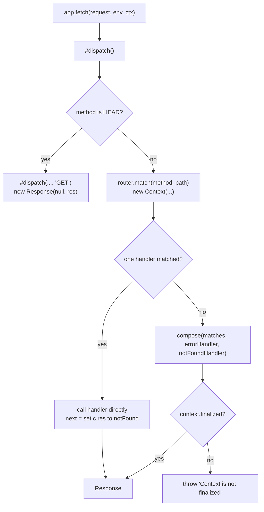
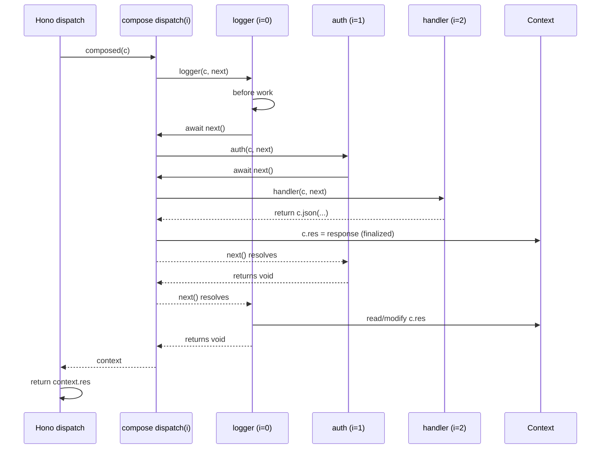

## Overview

In Hono, middleware and handlers are the same kind of thing: functions that take a [[Context]] and a `next` function. Both are registered as routes in the router, both come back from a match as one ordered list, and one small function, `compose`, runs that list in an onion: each function can do work before calling `await next()`, let everything inside it run, then do more work on the way out. This page traces how routes become that list, how `compose` dispatches it, and how to write middleware that fits.

Sources: [src/compose.ts:1-73](repo://src/compose.ts#L1-L73), [src/types.ts:76-96](repo://src/types.ts#L76-L96)

The design is borrowed from `koa-compose`. Its advantage is that cross-cutting concerns (timing, logging, CORS, authentication) wrap the handler without the handler knowing about them, and a middleware can both short-circuit the request and post-process the response.

Sources: [src/compose.ts:4-14](repo://src/compose.ts#L4-L14)

## Handler and middleware types

### Handler, MiddlewareHandler and Next

| Type | Signature | Typical use |
| --- | --- | --- |
| `Next` | `() => Promise<void>` | the `next` argument; resolves when every inner function has finished |
| `Handler<E, P, I, R>` | `(c, next) => R` | route endpoint; returns a `Response` or `TypedResponse` (sync or async) |
| `MiddlewareHandler<E, P, I, R>` | `(c, next) => Promise<R \| void>` | always async; may return nothing after `await next()` |
| `H<E, P, I, R>` | `Handler \| MiddlewareHandler` | what the router stores |

Sources: [src/types.ts:35-35](repo://src/types.ts#L35-L35), [src/types.ts:70-96](repo://src/types.ts#L70-L96)

A `next` returning `Promise<void>` means the inner result is never handed back as a value: an outer middleware reads the result from `c.res` instead. `HandlerResponse<O>` allows `Promise<void>` too, so a handler written as middleware type-checks as a handler.

Sources: [src/types.ts:35-35](repo://src/types.ts#L35-L35), [src/types.ts:70-74](repo://src/types.ts#L70-L74)

### Middleware is a route

`app.use(path?, ...handlers)` does not keep a separate middleware list. It registers each handler with `#addRoute` under the special method `METHOD_NAME_ALL` and the given path, defaulting to `*` when the first argument is a function. `app.get(path, ...handlers)` registers each of its handlers the same way under `GET`. Because order of registration is preserved by the routers, the match result for a request lists middleware and handlers in the order they were added.

Sources: [src/hono-base.ts:127-168](repo://src/hono-base.ts#L127-L168), [src/hono-base.ts:385-397](repo://src/hono-base.ts#L385-L397)

```ts
app.use(logger())                  // ALL  *
app.use('/api/*', cors())          // ALL  /api/*
app.get('/api/posts', auth, list)  // GET  /api/posts  (two entries)
// GET /api/posts matches: [logger, cors, auth, list]
```

Sources: [src/hono-base.ts:127-168](repo://src/hono-base.ts#L127-L168)

Each router entry is a pair `[handler, RouterRoute]`, where `RouterRoute` records `basePath`, `path`, `method` and `handler`. [[Router Implementations]] explains how each router returns matches in registration order.

Sources: [src/types.ts:57-62](repo://src/types.ts#L57-L62), [src/hono-base.ts:385-397](repo://src/hono-base.ts#L385-L397)

## Dispatch in hono-base

### From fetch to compose

`app.fetch(request, env, executionCtx)` calls `#dispatch`, which turns a `HEAD` request into a `GET` dispatch with the body dropped, computes the path, calls `router.match(method, path)` and builds the `Context`. It then chooses between two paths depending on how many handlers matched.

Sources: [src/hono-base.ts:406-428](repo://src/hono-base.ts#L406-L428), [src/hono-base.ts:479-485](repo://src/hono-base.ts#L479-L485)



Sources: [src/hono-base.ts:406-466](repo://src/hono-base.ts#L406-L466)

### The single-handler fast path

When exactly one handler matched, `#dispatch` skips `compose` entirely and calls it with a `next` that assigns the not-found response to `c.res`. A synchronous return is used as is (or the not-found handler runs if it returned nothing); a promise is chained so that an unresolved value falls back to `c.res` when the context is finalized, or to the not-found handler otherwise. Synchronous throws and rejected promises both go to `#handleError`. Most simple routes take this path, which avoids creating closures for every request.

Sources: [src/hono-base.ts:429-448](repo://src/hono-base.ts#L429-L448)

### The composed path

Otherwise `compose(matchResult[0], this.errorHandler, this.#notFoundHandler)` builds a function, which is awaited with the context. If the chain completes without the context being finalized, the dispatcher throws `Context is not finalized. Did you forget to return a Response object or `await next()`?`, and that error goes to `#handleError` like any other.

Sources: [src/hono-base.ts:450-465](repo://src/hono-base.ts#L450-L465)

## How compose works

### The dispatch loop

`compose(middleware, onError?, onNotFound?)` returns `(context, next?) => Promise<Context>`. Each call keeps its own `index` and calls the inner `dispatch(0)`. The steps of `dispatch(i)` are:

Sources: [src/compose.ts:15-23](repo://src/compose.ts#L15-L23)

1. Throw `next() called multiple times` if `i <= index`, then set `index = i`. This blocks a middleware from calling `next()` twice and re-running the inner chain.
2. Pick the handler: `middleware[i][0][0]` (the function from the router pair), recording `i` in `context.req.routeIndex` so `c.req.param()` reads the parameters of the right route. Past the end, use the outer `next` passed to the composed function, if any.
3. Call `handler(context, () => dispatch(i + 1))`. The closure is the `next` the handler sees.
4. If no handler exists (the chain ran out) and the context is not finalized, call `onNotFound`.
5. If the handler returned a value and the context is not finalized (or the value came from `onError`), assign it to `context.res`, which finalizes it.

Sources: [src/compose.ts:32-71](repo://src/compose.ts#L32-L71)

```ts
if (res && (context.finalized === false || isError)) {
  context.res = res
}
return context
```

Sources: [src/compose.ts:67-70](repo://src/compose.ts#L67-L70)

### The onion model

The innermost handler's return value is written into `c.res` first; each outer middleware then resumes after its `await next()` and sees the finished response.

Sources: [src/compose.ts:42-70](repo://src/compose.ts#L42-L70)



Sources: [src/compose.ts:32-71](repo://src/compose.ts#L32-L71), [src/hono-base.ts:450-461](repo://src/hono-base.ts#L450-L461)

### Consequences for middleware authors

- A middleware that returns a `Response` without calling `next()` short-circuits the chain: the context is not yet finalized, so `compose` stores it and the inner handlers never run.
- A middleware that calls `await next()` and then returns a new `Response` has its return value ignored, because the context is already finalized. To replace the response after `next()`, assign `c.res = ...`; the setter carries the earlier headers across.
- A middleware that forgets to `await` (or return) `next()` lets the chain finish before the inner handler resolves, which is what the "Context is not finalized" error usually points to.
- When every function calls `next()` and none returns a response, `onNotFound` runs at the end of the chain, so unmatched requests behind a `*` middleware still get the app's 404.

Sources: [src/compose.ts:42-70](repo://src/compose.ts#L42-L70), [src/context.ts:414-434](repo://src/context.ts#L414-L434), [src/hono-base.ts:452-459](repo://src/hono-base.ts#L452-L459)

### Errors inside compose

A handler's thrown `Error` is caught in the `dispatch` frame that called it. When `onError` was supplied, `compose` records the error in `context.error`, replaces the result with `onError(err, context)` and flags `isError` so the error response overwrites any earlier `c.res`. The outer middleware then resumes normally after `await next()`. Non-`Error` throws, or errors when no `onError` was given, propagate out. [[Error Handling]] follows the whole path.

Sources: [src/compose.ts:49-60](repo://src/compose.ts#L49-L60)

## Writing custom middleware

### A plain function

Any `async (c, next) => { ... }` is middleware. The built-in `poweredBy` shows the minimal shape: wrap the function in a factory so it can take options, call `await next()`, then edit the finished response's headers.

Sources: [src/middleware/powered-by/index.ts:30-35](repo://src/middleware/powered-by/index.ts#L30-L35)

```ts
export const poweredBy = (options?: PoweredByOptions): MiddlewareHandler => {
  return async function poweredBy(c, next) {
    await next()
    c.res.headers.set('X-Powered-By', options?.serverName ?? 'Hono')
  }
}
```

Sources: [src/middleware/powered-by/index.ts:30-35](repo://src/middleware/powered-by/index.ts#L30-L35)

Naming the inner function matters: the dev helper's route inspector prints `handler.name`, and falls back to `[middleware]` or `[handler]` based on whether the function declares more than one parameter.

Sources: [src/utils/handler.ts:8-15](repo://src/utils/handler.ts#L8-L15), [src/helper/dev/index.ts:20-35](repo://src/helper/dev/index.ts#L20-L35)

### Before, after and short-circuit

```ts
app.use('/admin/*', async (c, next) => {
  const start = Date.now()                       // before
  if (!c.req.header('Authorization')) {
    return c.text('Unauthorized', 401)           // short-circuit
  }
  c.set('startedAt', start)
  await next()
  c.header('X-Response-Time', `${Date.now() - start}ms`) // after
})
```

Sources: [src/compose.ts:49-70](repo://src/compose.ts#L49-L70), [src/context.ts:515-556](repo://src/context.ts#L515-L556)

`c.header()` after `next()` is safe even when the response came from `fetch()` with immutable headers, because it clones a finalized response before mutating it.

Sources: [src/context.ts:515-527](repo://src/context.ts#L515-L527)

### createMiddleware

`createMiddleware` from `hono/factory` returns its argument unchanged; its only job is typing. It fixes `E`, `P` and `I` on the `MiddlewareHandler`, so a middleware that declares `Variables` gives typed `c.set`/`c.get` inside it, and `app.use()` merges that `Env` into the app's type with `IntersectNonAnyTypes` so later handlers see the variable too.

Sources: [src/helper/factory/index.ts:368-375](repo://src/helper/factory/index.ts#L368-L375), [src/types.ts:1080-1108](repo://src/types.ts#L1080-L1108)

```ts
import { createMiddleware } from 'hono/factory'

const withUser = createMiddleware<{ Variables: { user: string } }>(async (c, next) => {
  c.set('user', 'alice')
  await next()
})

app.get('/me', withUser, (c) => c.text(c.var.user)) // typed as string
```

Sources: [src/helper/factory/index.ts:368-375](repo://src/helper/factory/index.ts#L368-L375)

The second type parameter `R` defaults to `void`, which maps to `Response`. Set it when the middleware can return a typed response (for example a `c.json()` error), so the RPC client sees that response in the route's output union.

Sources: [src/helper/factory/index.ts:368-375](repo://src/helper/factory/index.ts#L368-L375), [src/types.ts:83-88](repo://src/types.ts#L83-L88)

### Factory and createHandlers

`createFactory<E>()` returns a `Factory` bound to one `Env`, so `factory.createMiddleware` and `factory.createHandlers` need no generic arguments. `createHandlers(...handlers)` returns a typed tuple of up to ten handlers, inferring each one's `Input` and `Env` from those before it, so handlers can be defined apart from `app.get()` and spread into it without losing types. `createApp()` builds a `Hono` with merged `defaultAppOptions` and runs `initApp` on it. [[Factory, Testing and Utility Helpers]] covers the factory in full.

Sources: [src/helper/factory/index.ts:20-53](repo://src/helper/factory/index.ts#L20-L53), [src/helper/factory/index.ts:332-366](repo://src/helper/factory/index.ts#L332-L366)

## Sub-apps and nested composition

`app.route(path, subApp)` copies each of the sub-app's routes into the parent router with the merged base path. When the sub-app has its own `onError`, each handler is wrapped in `compose([], subApp.errorHandler)` with the original handler as the outer `next`, so errors are handled by the sub-app's handler first. The wrapper stores the original handler under `COMPOSED_HANDLER`, which `findTargetHandler` follows so the dev and SSG helpers still see the real function.

Sources: [src/hono-base.ts:208-232](repo://src/hono-base.ts#L208-L232), [src/utils/handler.ts:9-15](repo://src/utils/handler.ts#L9-L15)

`compose` is also reused by the `every` combinator in the combine middleware, which runs a nested list of middleware inside one route entry and restores `routeIndex` for each of them.

Sources: [src/middleware/combine/index.ts:99-107](repo://src/middleware/combine/index.ts#L99-L107)
