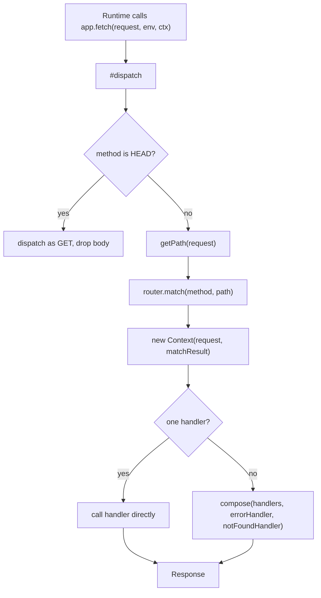

## Overview

Hono is a small web framework built on Web Standards: an application receives a standard `Request` and returns a standard `Response`, so the same code runs on Cloudflare Workers, Fastly Compute, Deno, Bun, Vercel, AWS Lambda, Lambda@Edge and Node.js. The package has zero runtime dependencies and ships its routers, middleware, helpers, JSX renderer and RPC client as separate entry points of one npm package named `hono`.

Sources: [README.md:22-47](repo://README.md#L22-L47), [package.json:1-12](repo://package.json#L1-L12)

The smallest application creates a `Hono` instance, registers a handler and exports the instance. Runtimes that call a default export's `fetch(request, env, ctx)` method (Cloudflare Workers, Bun, Deno) can run it unchanged, because `fetch` is a property of every application.

Sources: [src/index.ts:1-15](repo://src/index.ts#L1-L15), [src/hono-base.ts:468-485](repo://src/hono-base.ts#L468-L485)

```ts
import { Hono } from 'hono'
const app = new Hono()

app.get('/', (c) => c.text('Hono!'))

export default app
```

Sources: [README.md:26-33](repo://README.md#L26-L33)

## Package layout

The source tree under `src/` maps almost one-to-one onto the subpath exports declared in `package.json`. Each subpath resolves to an ES module under `dist/`, a CommonJS build under `dist/cjs/` and type declarations under `dist/types/`.

Sources: [package.json:38-73](repo://package.json#L38-L73)

| Area | Source folder | Import paths | What it holds |
| --- | --- | --- | --- |
| Core | `src/hono-base.ts`, `src/hono.ts`, `src/context.ts`, `src/request.ts`, `src/compose.ts` | `hono`, `hono/hono-base`, `hono/request`, `hono/types` | The application class, the per-request `Context`, `HonoRequest` and the middleware composer |
| Presets | `src/preset/` | `hono/tiny`, `hono/quick` | `Hono` classes wired to a different default router |
| Routers | `src/router/` | `hono/router/reg-exp-router`, `hono/router/trie-router`, `hono/router/smart-router`, `hono/router/pattern-router`, `hono/router/linear-router` | Interchangeable implementations of the `Router` interface |
| Middleware | `src/middleware/` | `hono/basic-auth`, `hono/cors`, `hono/logger`, `hono/jwt`, … | Ready-made `MiddlewareHandler` factories |
| Helpers | `src/helper/` | `hono/cookie`, `hono/html`, `hono/css`, `hono/streaming`, `hono/ws`, `hono/ssg`, `hono/factory`, `hono/testing`, … | Functions that take a `Context` or an app and do one job |
| Adapters | `src/adapter/` | `hono/cloudflare-workers`, `hono/bun`, `hono/deno`, `hono/aws-lambda`, `hono/vercel`, … | Runtime glue: `handle`, `serveStatic`, `upgradeWebSocket`, `getConnInfo` |
| JSX | `src/jsx/` | `hono/jsx`, `hono/jsx/jsx-runtime`, `hono/jsx/streaming`, `hono/jsx/dom`, `hono/jsx-renderer` | Server-side JSX to string and a client-side DOM renderer with hooks |
| Validation | `src/validator/` | `hono/validator` | The `validator` middleware that types request input |
| Client | `src/client/` | `hono/client` | The `hc` RPC client typed from an app's schema |

Sources: [package.json:38-128](repo://package.json#L38-L128), [package.json:144-213](repo://package.json#L144-L213), [package.json:269-343](repo://package.json#L269-L343), [package.json:344-412](repo://package.json#L344-L412)

The root entry point `src/index.ts` exports only the `Hono` class, the `Context` class and the core types (`Env`, `Handler`, `MiddlewareHandler`, `Next`, `ErrorHandler`, `NotFoundHandler`, `Schema`, `TypedResponse`, `HonoRequest`, `InferRequestType`, `InferResponseType` and a few others). Everything else is imported from its own subpath, which keeps the bundle of an application that uses only the core small.

Sources: [src/index.ts:17-53](repo://src/index.ts#L17-L53)

## Entry points and presets

Three classes named `Hono` exist. All three extend `HonoBase` from `src/hono-base.ts`, which holds every application method but deliberately has no router: its constructor leaves `router` unset and each subclass assigns one.

Sources: [src/hono-base.ts:98-124](repo://src/hono-base.ts#L98-L124)

| Import | Class file | Router | When to use it |
| --- | --- | --- | --- |
| `hono` | `src/hono.ts` | `options.router`, or `SmartRouter` over `RegExpRouter` and `TrieRouter` | The default: fastest matching on long-lived processes |
| `hono/quick` | `src/preset/quick.ts` | `SmartRouter` over `LinearRouter` and `TrieRouter` | Environments that build the app on every request, where registration cost dominates |
| `hono/tiny` | `src/preset/tiny.ts` | `PatternRouter` | The smallest bundle (the README quotes under 12kB) |

Sources: [src/hono.ts:16-34](repo://src/hono.ts#L16-L34), [src/preset/quick.ts:13-24](repo://src/preset/quick.ts#L13-L24), [src/preset/tiny.ts:11-20](repo://src/preset/tiny.ts#L11-L20), [README.md:43-44](repo://README.md#L43-L44)

Only the default `hono` class honours the `router` option: `src/hono.ts` assigns `options.router ?? new SmartRouter(...)`, while both presets assign their router unconditionally after `super(options)` has copied the options onto the instance, so a `router` passed to them is overwritten.

Sources: [src/hono.ts:26-33](repo://src/hono.ts#L26-L33), [src/preset/quick.ts:17-23](repo://src/preset/quick.ts#L17-L23), [src/preset/tiny.ts:15-19](repo://src/preset/tiny.ts#L15-L19), [src/hono-base.ts:170-172](repo://src/hono-base.ts#L170-L172)

`SmartRouter` is what makes the default fast without losing features. It only records routes until the first request; then it tries its routers in order, adding all routes to each, and keeps the first one that does not throw `UnsupportedPathError`. From then on `match` is bound directly to the winning router. [[Router Implementations]] compares the five routers.

Sources: [src/router/smart-router/router.ts:13-61](repo://src/router/smart-router/router.ts#L13-L61), [src/router.ts:100-103](repo://src/router.ts#L100-L103)

## Request lifecycle

Every request enters through `app.fetch` (or `app.request` in tests), which calls the private `#dispatch`. `#dispatch` turns `HEAD` into a body-less `GET`, extracts the path with `getPath`, asks the router for every handler that matches the method and path, builds a `Context`, and runs the handlers.

Sources: [src/hono-base.ts:406-427](repo://src/hono-base.ts#L406-L427), [src/hono-base.ts:479-485](repo://src/hono-base.ts#L479-L485)



Sources: [src/hono-base.ts:406-466](repo://src/hono-base.ts#L406-L466)

Middleware and handlers share one signature, `(c, next)`. `compose` calls them in the order the router returned them; a middleware that calls `await next()` runs the rest of the chain and can then read or replace `c.res`. If no handler produces a response the not-found handler answers, and any thrown `Error` goes to the error handler. [[The Hono Application]] traces dispatch in detail and [[Middleware and Composition]] covers `compose`.

Sources: [src/compose.ts:15-73](repo://src/compose.ts#L15-L73)

The `Context` object `c` carries the request (`c.req`, a `HonoRequest`), the runtime bindings (`c.env`), per-request variables (`c.set`, `c.get`, `c.var`) and the response builders (`c.text`, `c.json`, `c.html`, `c.body`, `c.redirect`, `c.notFound`).

Sources: [src/context.ts:515-600](repo://src/context.ts#L515-L600), [src/context.ts:664-780](repo://src/context.ts#L664-L780)

## Map of the docs

### Core and getting started

- [[Quickstart]]: create an app, add routes and middleware, and deploy it.
- [[The Hono Application]]: route registration, `basePath`, `route`, `mount`, options and dispatch.
- [[Routing and Path Patterns]]: parameters, wildcards, regular expressions, ordering and strict mode.
- [[Router Implementations]]: `RegExpRouter`, `TrieRouter`, `SmartRouter`, `LinearRouter` and `PatternRouter`.
- [[Context]] and [[HonoRequest]]: building responses and reading requests.
- [[Middleware and Composition]] and [[Error Handling]]: `compose`, `next()`, `onError` and `HTTPException`.
- [[Type System]], [[Validator]] and [[RPC Client]]: typed routes end to end.

Sources: [src/hono-base.ts:98-124](repo://src/hono-base.ts#L98-L124), [src/index.ts:17-53](repo://src/index.ts#L17-L53)

### Middleware, helpers and runtimes

- [[Authentication Middleware]], [[Security Middleware]], [[Caching, Compression and Timing Middleware]] and [[Utility Middleware]].
- [[Serving Static Files]], [[Cookie Helper]], [[Streaming and Server-Sent Events]], [[WebSockets]] and [[Static Site Generation]].
- [[Factory, Testing and Utility Helpers]] and [[HTML and CSS Helpers]].
- [[JSX Server Rendering]] and [[Client-side JSX and Hooks]].
- [[Runtime Adapters]] for each platform, and [[Building and Testing Hono]] for contributors.

Sources: [package.json:74-188](repo://package.json#L74-L188), [package.json:189-300](repo://package.json#L189-L300), [package.json:301-412](repo://package.json#L301-L412)
