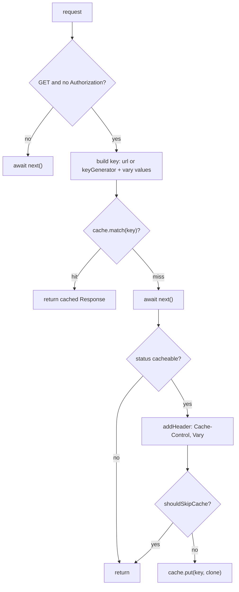

## Overview

Five built-in middleware deal with how fast and how cheaply responses are delivered. `cache` stores responses in the Web Cache API (`globalThis.caches`) where the runtime provides it; `etag` adds entity tags and turns matching conditional requests into `304 Not Modified`; `compress` gzip- or deflate-encodes bodies with `CompressionStream`; `timeout` aborts slow handlers with an `HTTPException`; `timing` collects `Server-Timing` metrics. All except `timeout` work after `await next()` by inspecting and replacing `c.res`, so they must be registered before the handlers whose responses they transform. See [[Middleware and Composition]] for the onion model this relies on.

Sources: [src/middleware/cache/index.ts:141-183](repo://src/middleware/cache/index.ts#L141-L183), [src/middleware/etag/index.ts:79-129](repo://src/middleware/etag/index.ts#L79-L129), [src/middleware/compress/index.ts:86-122](repo://src/middleware/compress/index.ts#L86-L122), [src/middleware/timeout/index.ts:38-58](repo://src/middleware/timeout/index.ts#L38-L58), [src/middleware/timing/timing.ts:76-126](repo://src/middleware/timing/timing.ts#L76-L126)

| Middleware | Import | Acts | Key effect |
| --- | --- | --- | --- |
| `cache` | `hono/cache` | before and after `next()` | serves or stores `GET` responses in `caches.open(cacheName)` |
| `etag` | `hono/etag` | after `next()` | sets `ETag`, answers `304` |
| `compress` | `hono/compress` | after `next()` | pipes body through `CompressionStream` |
| `timeout` | `hono/timeout` | around `next()` | races the handler against a timer |
| `timing` | `hono/timing` | around `next()` | appends `Server-Timing` |

Sources: [src/middleware/cache/index.ts:158-182](repo://src/middleware/cache/index.ts#L158-L182), [src/middleware/etag/index.ts:84-128](repo://src/middleware/etag/index.ts#L84-L128), [src/middleware/compress/index.ts:110-114](repo://src/middleware/compress/index.ts#L110-L114), [src/middleware/timeout/index.ts:42-57](repo://src/middleware/timeout/index.ts#L42-L57), [src/middleware/timing/timing.ts:112-113](repo://src/middleware/timing/timing.ts#L112-L113)

## Cache

### Cache options

`cache` targets runtimes with the Cache API, such as Cloudflare Workers and Deno. When `globalThis.caches` is missing, the factory returns a pass-through middleware and logs a message unless `onCacheNotAvailable` is `false` or a custom callback.

Sources: [src/middleware/cache/index.ts:64-82](repo://src/middleware/cache/index.ts#L64-L82)

| Option | Type | Default | Description |
| --- | --- | --- | --- |
| `cacheName` | `string \| (c) => string \| Promise<string>` | required | Name passed to `caches.open` |
| `wait` | `boolean` | `false` | Await `cache.put` instead of `c.executionCtx.waitUntil` (needed on Deno) |
| `cacheControl` | `string` | none | Directives appended to the response `Cache-Control` |
| `vary` | `string \| string[]` | none | Request headers that become part of the key and the `Vary` header; `*` throws |
| `keyGenerator` | `(c) => string \| Promise<string>` | `c.req.url` | Custom cache key |
| `cacheableStatusCodes` | `StatusCode[]` | `[200]` | Statuses eligible for storage |
| `onCacheNotAvailable` | `(() => void) \| false` | logs | Hook when `caches` is undefined |

Sources: [src/middleware/cache/index.ts:42-51](repo://src/middleware/cache/index.ts#L42-L51), [src/middleware/cache/index.ts:84-103](repo://src/middleware/cache/index.ts#L84-L103)

### Lookup and store flow

Only `GET` requests without an `Authorization` header are considered. The key starts as the URL (or the `keyGenerator` result) and gets `::<header>=<encoded value>` appended for each `vary` header, so different `Accept-Language` values, say, get separate entries. A hit is returned as a fresh `Response` built from the cached one, short-circuiting the handlers.

Sources: [src/middleware/cache/index.ts:141-164](repo://src/middleware/cache/index.ts#L141-L164)

On a miss, the handler runs, and then the response is stored only if its status is cacheable and `shouldSkipCache` finds no reason to skip: the response must not carry `Cache-Control: private`, `no-store` or `no-cache`, must not set cookies, and every header in its own `Vary` must also be one of the configured `vary` headers (otherwise the key would not distinguish the variants). The clone is written with `cache.put`, either awaited or handed to `waitUntil`.

Sources: [src/middleware/cache/index.ts:13-35](repo://src/middleware/cache/index.ts#L13-L35), [src/middleware/cache/index.ts:166-183](repo://src/middleware/cache/index.ts#L166-L183)



Sources: [src/middleware/cache/index.ts:141-183](repo://src/middleware/cache/index.ts#L141-L183)

### Header merging

`addHeader` appends each configured `Cache-Control` directive unless the handler already set a directive with the same name (compared case-insensitively), so a route's own `max-age` wins. Configured `vary` headers are merged with any `Vary` from the response; if the merged set contains `*`, the header collapses to `*`.

Sources: [src/middleware/cache/index.ts:105-139](repo://src/middleware/cache/index.ts#L105-L139)

```ts
app.get(
  '*',
  cache({
    cacheName: 'my-app',
    cacheControl: 'max-age=3600',
  })
)
```

Sources: [src/middleware/cache/index.ts:53-62](repo://src/middleware/cache/index.ts#L53-L62)

## ETag

### ETag options

`etag` accepts three options. `retainedHeaders` defaults to `RETAINED_304_HEADERS` (`cache-control`, `content-location`, `date`, `etag`, `expires`, `vary`), the headers the spec says a 304 must carry.

Sources: [src/middleware/etag/index.ts:9-28](repo://src/middleware/etag/index.ts#L9-L28)

| Option | Type | Default | Description |
| --- | --- | --- | --- |
| `weak` | `boolean` | `false` | Prefix generated tags with `W/` |
| `retainedHeaders` | `string[]` | `RETAINED_304_HEADERS` | Headers kept on a 304 response |
| `generateDigest` | `(body: Uint8Array) => ArrayBuffer \| Promise<ArrayBuffer>` | SHA-1 via `crypto.subtle.digest` | Hash function |

Sources: [src/middleware/etag/index.ts:61-67](repo://src/middleware/etag/index.ts#L61-L67), [src/middleware/etag/index.ts:38-54](repo://src/middleware/etag/index.ts#L38-L54)

### Tag generation

After `next()`, an `ETag` the handler already set is kept as is. Otherwise the middleware reads a clone of the body through `generateDigest` and formats the hex digest as `"<hash>"` or `W/"<hash>"`. If no digest function is available (no `crypto.subtle` and none supplied) or the response has no body, it leaves the response untouched.

Sources: [src/middleware/etag/index.ts:84-105](repo://src/middleware/etag/index.ts#L84-L105)

`generateDigest` streams the body chunk by chunk and feeds the generator the previous digest concatenated with the next chunk. This keeps memory bounded to one chunk plus one hash, at the cost of the tag being a chained hash rather than a plain hash of the whole body; it is stable for identical bodies, which is all an ETag needs.

Sources: [src/middleware/etag/digest.ts:1-43](repo://src/middleware/etag/digest.ts#L1-L43)

### Conditional matching

`If-None-Match` is read before `next()`. A value of `*` matches any successful `GET` or `HEAD`; otherwise the comma-separated tags are compared after stripping `W/` from both sides (weak comparison). On a match `c.res` becomes an empty `304 Not Modified` and every header not in `retainedHeaders` is deleted; otherwise `ETag` is set on the original response.

Sources: [src/middleware/etag/index.ts:30-36](repo://src/middleware/etag/index.ts#L30-L36), [src/middleware/etag/index.ts:107-128](repo://src/middleware/etag/index.ts#L107-L128)

The header filtering works because assigning `c.res` goes through the `Context` setter, which copies every header of the previous response (except `content-type`, and with each `set-cookie` preserved) onto the new one. The 304 therefore starts with all of the original headers, and the loop then prunes it down to `retainedHeaders`.

Sources: [src/middleware/etag/index.ts:112-124](repo://src/middleware/etag/index.ts#L112-L124), [src/context.ts:414-434](repo://src/context.ts#L414-L434)

## Compress

### Compress options

`compress` uses the standard `CompressionStream`, so it works on any runtime that implements it.

Sources: [src/middleware/compress/index.ts:12-22](repo://src/middleware/compress/index.ts#L12-L22), [src/middleware/compress/index.ts:70-84](repo://src/middleware/compress/index.ts#L70-L84)

| Option | Type | Default | Description |
| --- | --- | --- | --- |
| `encoding` | `'gzip' \| 'deflate'` | both | Restrict to one encoding |
| `threshold` | `number` | `1024` | Minimum `Content-Length` in bytes |
| `contentTypeFilter` | `RegExp \| (contentType) => boolean` | `COMPRESSIBLE_CONTENT_TYPE_REGEX` | Which `Content-Type`s to compress |

Sources: [src/middleware/compress/index.ts:51-55](repo://src/middleware/compress/index.ts#L51-L55)

`COMPRESSIBLE_CONTENT_TYPE_REGEX` (re-exported from `hono/compress`) accepts `text/*` except `text/event-stream`, JSON, XML, JavaScript, WASM, `+json`/`+xml`/`+yaml` suffix types and a list of other textual or uncompressed formats. Excluding event streams keeps SSE responses from being buffered by the compressor (see [[Streaming and Server-Sent Events]]).

Sources: [src/utils/compress.ts:6-10](repo://src/utils/compress.ts#L6-L10), [src/middleware/compress/index.ts:8-10](repo://src/middleware/compress/index.ts#L8-L10)

### When compression is skipped

The middleware returns the response unchanged when any of these hold: status `206` (ranges refer to uncompressed bytes), an existing `Content-Encoding` or `Transfer-Encoding`, a `HEAD` request, a declared `Content-Length` under `threshold`, a content type the filter rejects, or `Cache-Control: no-transform`. A response without `Content-Length` (for example a stream) is not subject to the threshold.

Sources: [src/middleware/compress/index.ts:86-102](repo://src/middleware/compress/index.ts#L86-L102), [src/middleware/compress/index.ts:124-129](repo://src/middleware/compress/index.ts#L124-L129)

### Encoding negotiation

`selectEncoding` parses `Accept-Encoding` with `parseAccept` and walks the candidates in order (`gzip` before `deflate`). An encoding listed explicitly uses its own `q`; otherwise it inherits the `*` wildcard's `q`, or 0. The first candidate with `q = 1` wins immediately; otherwise the highest positive `q` is chosen. After compressing, `Content-Length` is removed, `Content-Encoding` is set, and a strong `ETag` is downgraded to weak because the bytes changed.

Sources: [src/middleware/compress/index.ts:24-44](repo://src/middleware/compress/index.ts#L24-L44), [src/middleware/compress/index.ts:104-121](repo://src/middleware/compress/index.ts#L104-L121)

```ts
app.use(compress())

// Compress only JSON responses
app.use(compress({ contentTypeFilter: /^application\/json/ }))
```

Sources: [src/middleware/compress/index.ts:57-68](repo://src/middleware/compress/index.ts#L57-L68)

## Timeout

`timeout(duration, exception?)` starts a `setTimeout` for each request and races `next()` against a promise that rejects when it fires. The default rejection is a shared `HTTPException(504, { message: 'Gateway Timeout' })`; pass another `HTTPException`, or a function `(c) => HTTPException` to build one from the context. The timer is cleared in a `finally` block whether the handler finishes, throws, or loses the race.

Sources: [src/middleware/timeout/index.ts:10-58](repo://src/middleware/timeout/index.ts#L10-L58)

> [!WARNING]
> The race only stops Hono from waiting: the handler's promise keeps running in the background after the 504 is sent. Use an `AbortSignal` in the handler if work must actually stop.

Sources: [src/middleware/timeout/index.ts:42-57](repo://src/middleware/timeout/index.ts#L42-L57)

```ts
app.use('/long-request', timeout(5000))

app.get('/long-request', async (c) => {
  await someLongRunningFunction()
  return c.text('Completed within time limit')
})
```

Sources: [src/middleware/timeout/index.ts:23-36](repo://src/middleware/timeout/index.ts#L23-L36)

The thrown exception is handled like any other `HTTPException`, see [[Error Handling]].

Sources: [src/middleware/timeout/index.ts:12-14](repo://src/middleware/timeout/index.ts#L12-L14)

## Server-Timing

### Timing options

`timing(config)` stores a `metric` object (`headers` array and `timers` map) on the context, typed through `ContextVariableMap` when `hono/timing` is imported. If a `metric` already exists, as when the middleware is mounted twice on overlapping paths, the inner instance just calls `next()`.

Sources: [src/middleware/timing/timing.ts:10-28](repo://src/middleware/timing/timing.ts#L10-L28), [src/middleware/timing/timing.ts:85-93](repo://src/middleware/timing/timing.ts#L85-L93), [src/middleware/timing/index.ts:1-8](repo://src/middleware/timing/index.ts#L1-L8)

| Option | Type | Default | Description |
| --- | --- | --- | --- |
| `total` | `boolean` | `true` | Record a `total` timer around the whole request |
| `totalDescription` | `string` | `"Total Response Time"` | Description for `total` |
| `enabled` | `boolean \| (c) => boolean` | `true` | Whether to emit headers for this request |
| `autoEnd` | `boolean` | `true` | End timers still running when the request finishes |
| `crossOrigin` | `boolean \| string \| (c) => boolean \| string` | `false` | Adds `Timing-Allow-Origin` (`*` for `true`) |

Sources: [src/middleware/timing/timing.ts:42-48](repo://src/middleware/timing/timing.ts#L42-L48), [src/middleware/timing/timing.ts:76-84](repo://src/middleware/timing/timing.ts#L76-L84)

### Recording metrics

Handlers record metrics with four helpers. Each warns on the console and does nothing if the middleware is not installed on the route.

Sources: [src/middleware/timing/timing.ts:149-257](repo://src/middleware/timing/timing.ts#L149-L257)

| Function | Effect | Header entry |
| --- | --- | --- |
| `setMetric(c, name, value, description?, precision?)` | Records a numeric duration (default 1 decimal) | `name;dur=23.8;desc="..."` |
| `setMetric(c, name, description?)` | Records a value-less metric | `name;desc="..."` |
| `startTime(c, name, description?)` | Stores `performance.now()` (or `Date.now()`) in `timers` | none yet |
| `endTime(c, name, precision?)` | Computes elapsed time, calls `setMetric`, deletes the timer | `name;dur=...` |
| `wrapTime(c, name, promise, description?, precision?)` | Times a promise with `startTime`/`endTime` in `try`/`finally` | `name;dur=...` |

Sources: [src/middleware/timing/timing.ts:30-35](repo://src/middleware/timing/timing.ts#L30-L35), [src/middleware/timing/timing.ts:149-257](repo://src/middleware/timing/timing.ts#L149-L257)

### Header emission

After `next()` the middleware ends `total`, then, if `autoEnd` is on, every timer the handler left running. With `autoEnd` off, unfinished timers are simply dropped. When `enabled` resolves truthy, the entries are joined with commas and appended as one `Server-Timing` header, followed by `Timing-Allow-Origin` if `crossOrigin` resolves truthy.

Sources: [src/middleware/timing/timing.ts:98-125](repo://src/middleware/timing/timing.ts#L98-L125)

```ts
app.use(timing())

app.get('/', async (c) => {
  setMetric(c, 'region', 'europe-west3')
  setMetric(c, 'custom', 23.8, 'My custom Metric')
  startTime(c, 'db')
  const data = await db.findMany(...)
  endTime(c, 'db')
  return c.json({ response: data })
})
```

Sources: [src/middleware/timing/timing.ts:50-74](repo://src/middleware/timing/timing.ts#L50-L74)
