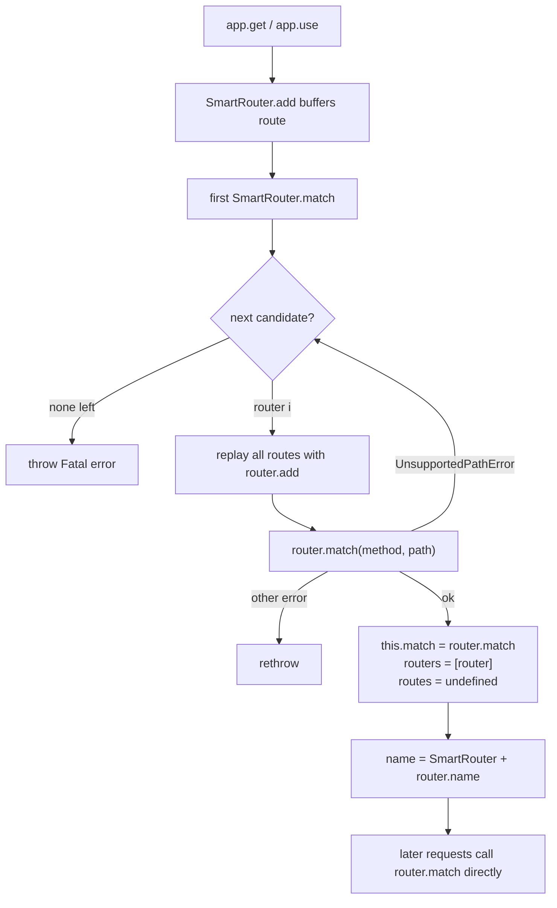

## Overview

Every Hono application delegates route lookup to an object that implements the small `Router<T>` interface. The application calls `add` once per registered handler and `match` once per request; everything else (middleware ordering, parameters, the handler chain) is derived from what `match` returns. Because the contract is so narrow, Hono ships several interchangeable routers that trade startup cost, per-request speed, bundle size and supported path syntax against each other, and the presets in `hono`, `hono/quick` and `hono/tiny` simply pick a different router.

Sources: [src/router.ts:24-52](repo://src/router.ts#L24-L52), [src/hono-base.ts:385-397](repo://src/hono-base.ts#L385-L397)

The path syntax a router has to understand (`:param`, `:param{regex}`, optional `:param?`, `*` wildcards) is described in [[Routing and Path Patterns]]; this page covers how each router stores and matches those patterns.

Sources: [src/utils/url.ts:171-200](repo://src/utils/url.ts#L171-L200)

## The Router contract

### Interface and constants

`src/router.ts` defines the interface and the shared vocabulary. A router has a `name`, an `add(method, path, handler)` and a `match(method, path)` that returns a `Result<T>`. `METHOD_NAME_ALL` (`'ALL'`) is the method string the application uses for `app.use()` and `app.all()`: every router treats a route registered with it as matching any method. `METHODS` lists the lowercase verbs Hono generates shorthand methods for.

Sources: [src/router.ts:6-52](repo://src/router.ts#L6-L52)

`HonoBase#addRoute` upper-cases the method, prefixes the base path, and passes a `[handler, RouterRoute]` tuple as the router's `T`, so the router never needs to know what a handler is. On each request, `#dispatch` calls `this.router.match(method, path)` and hands the result to the `Context`.

Sources: [src/hono-base.ts:385-427](repo://src/hono-base.ts#L385-L427)

### The two Result shapes

`Result<T>` has two forms. Routers that resolve parameter values while matching (`TrieRouter`, `LinearRouter`, `PatternRouter`) return `[[handler, params][]]`, where `params` maps names to strings. `RegExpRouter` instead returns `[[handler, paramIndexMap][], paramStash]`: each handler gets a map from parameter name to an index, and the stash is the regex match array holding the values.

Sources: [src/router.ts:66-98](repo://src/router.ts#L66-L98)

```ts
export type Result<T> = [[T, ParamIndexMap][], ParamStash] | [[T, Params][]]
```

Sources: [src/router.ts:54-98](repo://src/router.ts#L54-L98)

`HonoRequest` hides the difference: `#getParamValue` reads `matchResult[1][paramKey]` when a stash exists and otherwise returns the stored value directly.

Sources: [src/request.ts:126-128](repo://src/request.ts#L126-L128)

### Build-once semantics and errors

Routers that compile their routes freeze after the first `match`. They throw `MESSAGE_MATCHER_IS_ALREADY_BUILT` ("Can not add a route since the matcher is already built.") when `add` is called later. A router that cannot represent a route throws `UnsupportedPathError`, and that error class is the signal `SmartRouter` uses to fall through to the next candidate.

Sources: [src/router.ts:18-22](repo://src/router.ts#L18-L22), [src/router.ts:100-103](repo://src/router.ts#L100-L103)

## RegExpRouter

### Collecting routes

`RegExpRouter` does no matching work in `add`. It keeps two per-method maps, `#middleware` (paths ending in `*`) and `#routes` (everything else), each keyed by path and holding `[handler, paramCount]` lists. The first time a method is seen, both maps are seeded with copies of the `ALL` entries so that method-specific matchers include handlers registered with `app.use`/`app.all`.

Sources: [src/router/reg-exp-router/router.ts:122-147](repo://src/router/reg-exp-router/router.ts#L122-L147)

Wildcard paths are resolved eagerly against everything registered so far. A wildcard route is turned into a regex by `buildWildcardRegExp`, its handler is pushed onto every existing middleware and route entry whose path that regex matches, and a new middleware entry inherits the handlers of the longest already-registered wildcard that covers it (`findMiddleware`). A normal route likewise starts its handler list with the matching middleware, then appends its own handler. Optional parameters are expanded by `checkOptionalParameter` into several concrete paths first.

Sources: [src/router/reg-exp-router/router.ts:16-32](repo://src/router/reg-exp-router/router.ts#L16-L32), [src/router/reg-exp-router/router.ts:105-120](repo://src/router/reg-exp-router/router.ts#L105-L120), [src/router/reg-exp-router/router.ts:149-204](repo://src/router/reg-exp-router/router.ts#L149-L204)

This precomputation is the core idea: each concrete route already carries the full, ordered handler list it needs, so the per-request work reduces to finding which single route matched.

Sources: [src/router/reg-exp-router/router.ts:189-203](repo://src/router/reg-exp-router/router.ts#L189-L203)

### Compiling one regex per method

The first `match` call goes through the shared `match` function in `matcher.ts`, which calls `buildAllMatchers()`. That builds a `Matcher` per method (`[RegExp, HandlerData[], StaticMap]`), releases the route maps and the wildcard cache, and then replaces `this.match` with a closure over the compiled matchers, so later requests skip the build check entirely.

Sources: [src/router/reg-exp-router/matcher.ts:1-33](repo://src/router/reg-exp-router/matcher.ts#L1-L33), [src/router/reg-exp-router/router.ts:206-251](repo://src/router/reg-exp-router/router.ts#L206-L251)

`buildMatcherFromPreprocessedRoutes` flags every route as static or dynamic (`/\*|\/:/`), sorts dynamic routes by path length and puts static routes last. Static routes go straight into `staticMap` with an empty param stash, but they are still inserted into the trie in "path error check only" mode so conflicts with dynamic routes are detected. Dynamic routes get an index `j` and a `paramIndexMap` built from the trie's parameter association list.

Sources: [src/router/reg-exp-router/router.ts:34-80](repo://src/router/reg-exp-router/router.ts#L34-L80)

The `Trie` tokenizes each path into characters, `:label` / `:label{pattern}` tokens and a trailing `/*`, first masking `{...}` groups so their contents are not split. `Node.insert` walks the tokens and records the route index on the final node; named parameters get a global `varIndex`. `buildRegExpStr` then serialises the tree into nested alternations, emitting `#index` for an endpoint and `(pattern)@varIndex` for a capturing parameter. Children are ordered by `compareKey`: literals, then custom-pattern labels, then plain `[^/]+` labels, then wildcards.

Sources: [src/router/reg-exp-router/trie.ts:6-47](repo://src/router/reg-exp-router/trie.ts#L6-L47), [src/router/reg-exp-router/node.ts:1-43](repo://src/router/reg-exp-router/node.ts#L1-L43), [src/router/reg-exp-router/node.ts:135-161](repo://src/router/reg-exp-router/node.ts#L135-L161)

`Trie.buildRegExp` rewrites those markers. Each `#index` becomes an empty capture group `$()` and is recorded in `indexReplacementMap` by capture position; each `@varIndex` is dropped and its capture position recorded in `paramReplacementMap`. The router then rewrites every `paramIndexMap` value to the capture-group number and reorders `handlerData` into `handlerMap` by capture position.

Sources: [src/router/reg-exp-router/trie.ts:49-73](repo://src/router/reg-exp-router/trie.ts#L49-L73), [src/router/reg-exp-router/router.ts:82-103](repo://src/router/reg-exp-router/router.ts#L82-L103)

### Matching a request

Per request, the compiled closure picks the method's matcher (falling back to the `ALL` matcher), returns the `staticMap` entry if the path is a static route, and otherwise runs the single regex. Because exactly one `$()` group participates in a successful match, `match.indexOf('', 1)` finds the matched endpoint's capture position, which indexes `handlerMap`; the match array itself becomes the param stash.

Sources: [src/router/reg-exp-router/matcher.ts:10-24](repo://src/router/reg-exp-router/matcher.ts#L10-L24)

```ts
const staticMatch = matcher[2][path]
if (staticMatch) {
  return staticMatch
}

const match = path.match(matcher[0])
if (!match) {
  return [[], emptyParam]
}

const index = match.indexOf('', 1)
return [matcher[1][index], match]
```

Sources: [src/router/reg-exp-router/matcher.ts:10-33](repo://src/router/reg-exp-router/matcher.ts#L10-L33)

### Unsupported routes

A single alternation can only report one endpoint per request, so `Node.insert` throws `PATH_ERROR` whenever two routes could match the same URL with different handler lists: a literal and a parameter at the same position (`/reg-exp/router` and `/reg-exp/:id`), two different parameter names reaching the same node (`/:type/:id` and `/:class/:id`), a custom pattern that is `.*`, or a capturing group in a custom pattern. `buildMatcherFromPreprocessedRoutes` converts `PATH_ERROR` into `UnsupportedPathError`, which surfaces from the first `match` call.

Sources: [src/router/reg-exp-router/node.ts:50-133](repo://src/router/reg-exp-router/node.ts#L50-L133), [src/router/reg-exp-router/router.ts:60-65](repo://src/router/reg-exp-router/router.ts#L60-L65), [src/router/reg-exp-router/router.test.ts:40-115](repo://src/router/reg-exp-router/router.test.ts#L40-L115)

> [!NOTE]
> Using `RegExpRouter` alone (`new Hono({ router: new RegExpRouter() })`) means such route sets fail at the first request. The default preset avoids this by wrapping it in `SmartRouter` with `TrieRouter` as the fallback.

Sources: [src/hono-base.ts:55-65](repo://src/hono-base.ts#L55-L65), [src/hono.ts:26-33](repo://src/hono.ts#L26-L33)

## PreparedRegExpRouter

`PreparedRegExpRouter` moves the regex compilation to build time. `buildInitParams({ paths })` registers every path on a `RegExpRouter` subclass under `ALL`, using the path string itself as the handler, then exports the compiled matchers. From them it derives a `relocateMap`: for each path, the `handlerMap` indexes (numbers) and static-map keys (strings, `''` meaning the path itself) where that path's handler appeared, plus its param index map. Finally it empties every handler list, leaving only the regex skeleton.

Sources: [src/router/reg-exp-router/prepared-router.ts:95-154](repo://src/router/reg-exp-router/prepared-router.ts#L95-L154)

At runtime the constructor receives `[matchers, relocateMap]`. `add` clones the `ALL` matcher for a new method, appends `*` and `/*` handlers to every list via `#addWildcard`, and pushes any other handler into the slots the relocate map names via `#addPath`. A path missing from the map throws `Path ${path} is not registered`. `buildAllMatchers` just returns the prepared matchers, so the shared `match` function works unchanged.

Sources: [src/router/reg-exp-router/prepared-router.ts:9-93](repo://src/router/reg-exp-router/prepared-router.ts#L9-L93)

`serializeInitParams` turns the init params into JavaScript source, emitting each `RegExp` as a literal rather than a JSON string, so a build step can inline the result. All three exports come from `hono/router/reg-exp-router`.

Sources: [src/router/reg-exp-router/prepared-router.ts:156-165](repo://src/router/reg-exp-router/prepared-router.ts#L156-L165), [src/router/reg-exp-router/index.ts:1-7](repo://src/router/reg-exp-router/index.ts#L1-L7)

## TrieRouter

### Insertion and scoring

`TrieRouter` stores routes in a tree of `Node`s keyed by path segment, expanding optional parameters first. `Node.insert` splits the path with `splitRoutingPath`, uses `getPattern` to classify each part, and keys parameter children by the pattern's key while recording the pattern in the parent's `#patterns`. The endpoint gets a `{ [method]: { handler, possibleKeys, score } }` entry, where `score` is the root's ever-increasing `#order`, so it equals registration order.

Sources: [src/router/trie-router/router.ts:1-28](repo://src/router/trie-router/router.ts#L1-L28), [src/router/trie-router/node.ts:25-85](repo://src/router/trie-router/node.ts#L25-L85)

### Search

`search` walks the request's segments breadth-first, keeping a list of current nodes. At each step a node can advance through an exact child, through a `*` child (which also matches the remaining path), through a plain label, or through a `RegExp` label. Regex labels are tested against the rest of the path from the segment's offset, so `:filename{[a-z]+.js}` can span slashes; matches that consume several segments are queued in `curNodesQueue` and rejoin the walk at the right depth. `/hello/*` also matches `/hello`, and `/:id{[0-9]+}/*` matches `/123`.

Sources: [src/router/trie-router/node.ts:114-148](repo://src/router/trie-router/node.ts#L114-L148), [src/router/trie-router/node.ts:149-235](repo://src/router/trie-router/node.ts#L149-L235)

`#pushHandlerSets` collects matching handler sets for the method or `ALL`, filling `params` from the handler's `possibleKeys`. Because handlers are found in tree order, not registration order, `search` finally sorts them by `score`, which restores the order the application registered them in. The result is the `[[handler, params][]]` shape.

Sources: [src/router/trie-router/node.ts:87-112](repo://src/router/trie-router/node.ts#L87-L112), [src/router/trie-router/node.ts:237-244](repo://src/router/trie-router/node.ts#L237-L244)

`TrieRouter` never throws `UnsupportedPathError`, which is why it is the last candidate in both `SmartRouter` presets.

Sources: [src/hono.ts:28-32](repo://src/hono.ts#L28-L32), [src/preset/quick.ts:18-24](repo://src/preset/quick.ts#L18-L24)

## SmartRouter

`SmartRouter` is a router that chooses a router. Its `add` only buffers `[method, path, handler]` tuples. On the first `match`, it replays every buffered route into each candidate in order and tries to match; a candidate that throws `UnsupportedPathError` (during `add` or during its first `match`) is skipped, and any other error is rethrown.

Sources: [src/router/smart-router/router.ts:4-44](repo://src/router/smart-router/router.ts#L4-L44)

The first candidate that succeeds wins permanently: `SmartRouter` binds `this.match` to the winner's `match`, keeps only that router, drops its route buffer (so a later `add` throws "matcher is already built") and renames itself, for example `SmartRouter + RegExpRouter`. If every candidate failed it throws `Fatal error`. The `activeRouter` getter exposes the winner and throws before one is chosen; the `getRouterName` dev helper triggers a dummy `match` to read the final name.

Sources: [src/router/smart-router/router.ts:46-70](repo://src/router/smart-router/router.ts#L46-L70), [src/helper/dev/index.ts:76-79](repo://src/helper/dev/index.ts#L76-L79)



Sources: [src/router/smart-router/router.ts:13-61](repo://src/router/smart-router/router.ts#L13-L61)

## LinearRouter

`LinearRouter` does no preprocessing: `add` pushes `[method, path, handler]` (expanding optional parameters) onto an array. `match` scans every route in registration order with hand-written string scanning instead of regexes for the common cases: `*` and `/*` match everything, static paths compare directly (tolerating a trailing slash), star-only paths match literal pieces with `indexOf`, and label paths are split by `splitPathRe` and consume one segment per `:label` or a lookahead-guarded regex per `:label{pattern}`.

Sources: [src/router/linear-router/router.ts:1-69](repo://src/router/linear-router/router.ts#L1-L69), [src/router/linear-router/router.ts:70-135](repo://src/router/linear-router/router.ts#L70-L135)

A path mixing a label and a star throws `UnsupportedPathError` at match time, so in `hono/quick` such apps fall back to `TrieRouter`. Because nothing is compiled, `LinearRouter` has the cheapest startup, which suits environments where an isolate serves few requests.

Sources: [src/router/linear-router/router.ts:136-143](repo://src/router/linear-router/router.ts#L136-L143), [src/preset/quick.ts:1-24](repo://src/preset/quick.ts#L1-L24)

## PatternRouter

`PatternRouter` is the smallest implementation. `add` converts each route into one anchored `RegExp` with named groups (`/(?<name>pattern)`), escapes literal characters, makes a trailing `*` an open-ended prefix, appends `/?$` otherwise, and registers an extra route without the last segment for an optional `?` parameter. An invalid generated regex becomes `UnsupportedPathError`. `match` tests every route in order and uses `match.groups` as the params.

Sources: [src/router/pattern-router/router.ts:1-60](repo://src/router/pattern-router/router.ts#L1-L60)

## Choosing a router

### Presets

The three `Hono` classes differ only in the router their constructor assigns. The default `hono` export uses `SmartRouter` over `[RegExpRouter, TrieRouter]` unless `options.router` is passed; `hono/quick` uses `SmartRouter` over `[LinearRouter, TrieRouter]`; `hono/tiny` uses a bare `PatternRouter` and ignores `options.router`.

Sources: [src/hono.ts:16-34](repo://src/hono.ts#L16-L34), [src/preset/quick.ts:1-24](repo://src/preset/quick.ts#L1-L24), [src/preset/tiny.ts:1-20](repo://src/preset/tiny.ts#L1-L20)

### Trade-offs

| Router | Preparation | Per-request cost | Path support | Result shape |
| --- | --- | --- | --- | --- |
| `RegExpRouter` | Builds one regex per method on first match | Static map lookup or one regex exec | Throws on ambiguous routes | Index map + stash |
| `PreparedRegExpRouter` | Done at build time by `buildInitParams` | Same as `RegExpRouter` | Only pre-registered paths | Index map + stash |
| `TrieRouter` | Tree insert per `add` | Breadth-first walk plus sort | Everything | Params object |
| `SmartRouter` | Replays routes into candidates on first match | Delegates to the winner | Union of its candidates | Winner's shape |
| `LinearRouter` | None | Scans all routes | Throws on label + star mix | Params object |
| `PatternRouter` | One regex per route | Tests all routes | Throws on invalid regex | Params object |

Sources: [src/router/reg-exp-router/router.ts:206-251](repo://src/router/reg-exp-router/router.ts#L206-L251), [src/router/reg-exp-router/prepared-router.ts:73-93](repo://src/router/reg-exp-router/prepared-router.ts#L73-L93), [src/router/trie-router/node.ts:114-130](repo://src/router/trie-router/node.ts#L114-L130), [src/router/trie-router/node.ts:233-244](repo://src/router/trie-router/node.ts#L233-L244), [src/router/smart-router/router.ts:21-61](repo://src/router/smart-router/router.ts#L21-L61), [src/router/linear-router/router.ts:25-143](repo://src/router/linear-router/router.ts#L25-L143), [src/router/pattern-router/router.ts:10-60](repo://src/router/pattern-router/router.ts#L10-L60)

### Custom routers

Any object implementing `Router<[H, RouterRoute]>` can be passed as `options.router`. It must return handlers in registration order, including every matching `ALL` route, because the application composes them as returned (see [[Middleware and Composition]]).

Sources: [src/hono-base.ts:55-65](repo://src/hono-base.ts#L55-L65), [src/hono-base.ts:405-427](repo://src/hono-base.ts#L405-L427)
