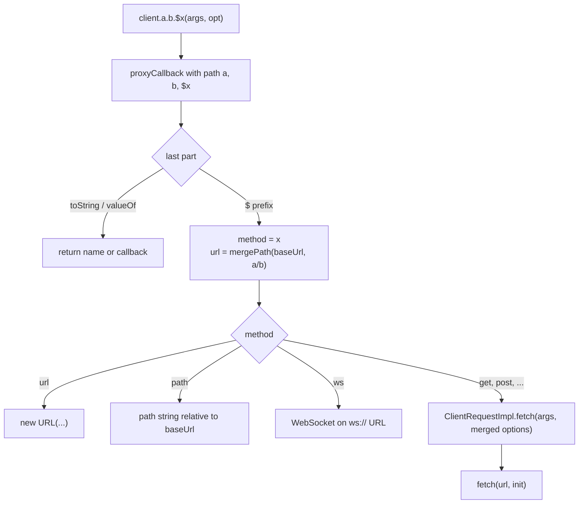

## Overview

`hc` (from `hono/client`) is a typed HTTP client generated from a server application's type. You export `typeof app` from the server, call `hc<AppType>(baseUrl)` on the client, and get an object whose property chain mirrors the routes (`client.posts[':id'].$get(...)`). Nothing is generated at build time: the runtime is a recursive `Proxy` that records property names and turns a final `$method(...)` call into a `fetch`, while all the safety comes from TypeScript types computed from the app's route schema.

Sources: [src/client/client.ts:133-232](repo://src/client/client.ts#L133-L232), [src/client/index.ts:1-17](repo://src/client/index.ts#L1-L17)

The schema the client reads is the one Hono builds as routes are chained: each route contributes `input` (largely from [[Validator]] middleware), `output`, `outputFormat` and `status` under a `$method` key. [[Type System]] explains how that schema is assembled; this page covers how the client consumes it and what it does at runtime.

Sources: [src/types.ts:2500-2530](repo://src/types.ts#L2500-L2530), [src/client/types.ts:294-318](repo://src/client/types.ts#L294-L318)

## Creating a client

### A typical call

The test suite shows the usual shape: chain routes so the variable keeps the schema type, export that type, and pass it to `hc` along with options shared by every request. Request arguments are grouped by validation target (`json`, `form`, `query`, `param`, `header`, `cookie`), and the second argument holds per-call options.

Sources: [src/client/client.ts:53-58](repo://src/client/client.ts#L53-L58), [src/client/types.ts:67-80](repo://src/client/types.ts#L67-L80)

```ts
const client = hc<AppType>('http://localhost', { headers: { 'x-hono': 'hono' } })

it('Should get 200 response', async () => {
  const res = await client.posts.$post(
    {
      json: payload,
      header: {
        'x-message': 'foobar',
      },
      cookie: {
        debug: 'true',
      },
    },
    {}
  )
```

Sources: [src/client/client.test.ts:30-53](repo://src/client/client.test.ts#L30-L53), [src/client/client.test.ts:129-143](repo://src/client/client.test.ts#L129-L143)

### Options

`ClientRequestOptions` is accepted both by `hc` (defaults for every call) and as the second argument of each method call.

Sources: [src/client/client.ts:133-136](repo://src/client/client.ts#L133-L136), [src/client/client.ts:217-219](repo://src/client/client.ts#L217-L219)

| Option | Type | Effect |
| --- | --- | --- |
| `fetch` | `typeof fetch` or `app.request` | Replaces the global `fetch`; passing `app.request` calls the app in-process |
| `headers` | Object, or a sync/async function returning one | Extra request headers, resolved on every call |
| `init` | `RequestInit` | Spread last into the `fetch` init, so it can override `body`, `method` and `headers` |
| `buildSearchParams` | `(query) => URLSearchParams` | Custom query serialization, for example bracket notation |
| `webSocket` | `(...args) => WebSocket` | Factory used by `$ws` instead of `new WebSocket` |

Sources: [src/client/types.ts:30-65](repo://src/client/types.ts#L30-L65)

When the type argument of `ClientRequestOptions<T>` is not empty, `headers` becomes required and typed as `T`, which lets wrappers demand specific headers.

Sources: [src/client/types.ts:57-65](repo://src/client/types.ts#L57-L65)

### Merging global and per-call options

For each method call the proxy copies the per-call options, and if both levels define `headers` it replaces them with an async function that awaits each side (calling it when it is a function) and spreads the per-call headers over the global ones. Everything else is combined with `deepMerge`, which recurses into plain objects and lets the per-call value win otherwise.

Sources: [src/client/client.ts:217-229](repo://src/client/client.ts#L217-L229), [src/client/utils.ts:62-82](repo://src/client/utils.ts#L62-L82)

## Path building with a Proxy

### Recording the property chain

`createProxy` wraps a no-op function in a `Proxy`. Each string property access returns a new proxy with the key appended to `path`; calling the proxy invokes the callback with `{ path, args }`. Accessing `then` returns `undefined`, so `await client.posts` does not treat the proxy as a thenable, and symbol keys are ignored.

Sources: [src/client/client.ts:15-22](repo://src/client/client.ts#L15-L22)

```ts
const createProxy = (callback: Callback, path: string[]) => {
  const proxy: unknown = new Proxy(() => {}, {
    get(_obj, key) {
      if (typeof key !== 'string' || key === 'then') {
        return undefined
      }
      return createProxy(callback, [...path, key])
    },
    apply(_1, _2, args) {
      return callback({
        path,
        args,
      })
    },
  })
  return proxy
}
```

Sources: [src/client/client.ts:15-31](repo://src/client/client.ts#L15-L31)

### Resolving the call

`proxyCallback` inspects the last three path parts. `toString()` and `valueOf()` are special-cased so a proxy can be stringified (and `x.name.toString()` returns the segment name). If the last part starts with `$` it is popped and becomes the method (`$get` becomes `get`). The remaining parts are joined with `/` and appended to the base URL by `mergePath`, which normalises slashes between them.

Sources: [src/client/client.ts:137-170](repo://src/client/client.ts#L137-L170), [src/client/utils.ts:11-16](repo://src/client/utils.ts#L11-L16)



Sources: [src/client/client.ts:137-232](repo://src/client/client.ts#L137-L232)

### Route segments and index

On the type side, `PathToChain` splits each schema path on `/` into nested object keys, so `/posts/:id` becomes `client.posts[':id']`. A route whose last segment is empty (the root `/`, or a trailing slash) is exposed as `index`. At runtime `removeIndexString` strips that `/index` again, leaving a single `/` when the URL is just the origin.

Sources: [src/client/types.ts:294-318](repo://src/client/types.ts#L294-L318), [src/client/utils.ts:55-60](repo://src/client/utils.ts#L55-L60)

`$all` routes are expanded by `ExpandAllMethod` into every standard method (`$get`, `$post`, `$put`, `$delete`, `$options`, `$patch`).

Sources: [src/client/types.ts:8-26](repo://src/client/types.ts#L8-L26)

## Sending requests

### Serializing arguments

`ClientRequestImpl.fetch` converts the first argument target by target.

Sources: [src/client/client.ts:53-59](repo://src/client/client.ts#L53-L59)

- `query` goes through `buildSearchParams` (or the custom option). The default skips `undefined`, appends each element of an array under the same key and sets scalars.
- `form` becomes a `FormData`, skipping `undefined` values and appending array elements individually.
- `json` is `JSON.stringify`-ed and sets `Content-Type: application/json`. It is checked after `form`, so it wins if both are given.
- `param` is stored and later substituted into the URL.

Sources: [src/client/client.ts:53-89](repo://src/client/client.ts#L53-L89), [src/client/utils.ts:26-44](repo://src/client/utils.ts#L26-L44)

### Headers, cookies and the fetch call

Headers start from `args.header`, then the resolved `headers` option overrides them. Each `cookie` entry is serialised with `serialize(key, value, { path: '/' })` and the results are joined into a `Cookie` header. The JSON content type is applied last. The URL then has `/index` removed, `:params` replaced, and the query string appended. GET and HEAD requests never send a body. Finally the request goes to `opt.fetch` or the global `fetch`, with the URL string as the first argument (for MSW and node-fetch compatibility) and `opt.init` spread over the computed init.

Sources: [src/client/client.ts:91-129](repo://src/client/client.ts#L91-L129)

`replaceUrlParam` builds a regex per param that matches `/:name`, an optional `{pattern}` and an optional `?`, and replaces it with `/value`; an empty or missing value removes the segment, which is how optional parameters disappear.

Sources: [src/client/utils.ts:18-24](repo://src/client/utils.ts#L18-L24)

```ts
export const replaceUrlParam = (urlString: string, params: Record<string, string | undefined>) => {
  for (const [k, v] of Object.entries(params)) {
    const reg = new RegExp('/:' + k + '(?:{[^/]+})?\\??(?=/|$)')
    urlString = urlString.replace(reg, v ? `/${v}` : '')
  }
  return urlString
}
```

Sources: [src/client/utils.ts:18-24](repo://src/client/utils.ts#L18-L24)

> [!WARNING]
> `init` has the highest priority. Setting `init.headers` or `init.body` replaces what Hono computed, including the JSON content type; use `headers` to add headers.

Sources: [src/client/types.ts:35-41](repo://src/client/types.ts#L35-L41), [src/client/client.ts:123-128](repo://src/client/client.ts#L123-L128)

## URL helpers and WebSockets

### $url and $path

`$url(arg?)` and `$path(arg?)` build a URL without sending anything. Both substitute `param` and append `query` (through the configured `buildSearchParams`), then remove `/index`. `$url` returns a `URL`; `$path` returns only the part after the base URL, always starting with `/`, so it is the same whether the base is `http://fake`, `http://fake/` or `http://fake/api`.

Sources: [src/client/client.ts:171-186](repo://src/client/client.ts#L171-L186), [src/client/client.test.ts:400-440](repo://src/client/client.test.ts#L400-L440)

Their return types are computed. `$path` returns a template literal such as `'/foo/123/baz'` when the param is a literal, keeping `:id` otherwise, with `` `?${string}` `` appended when a query is passed. `$url` returns a `TypedURL` whose `protocol`, `hostname`, `port`, `pathname` and `search` are literal types when the base URL is a literal; otherwise it falls back to `URL`.

Sources: [src/client/types.ts:156-230](repo://src/client/types.ts#L156-L230), [src/client/types.test.ts:55-76](repo://src/client/types.test.ts#L55-L76)

### $ws

`$ws(args?)` exists on the type only for routes whose `$get` endpoint has `outputFormat: 'ws'` (routes built with the WebSocket helper). At runtime it substitutes params, swaps `http` for `ws` in the protocol with `replaceUrlProtocol` (so `https` becomes `wss`), appends query values to `searchParams`, and constructs the socket with `options.webSocket` if provided, else `new WebSocket`. See [[WebSockets]].

Sources: [src/client/types.ts:112-118](repo://src/client/types.ts#L112-L118), [src/client/client.ts:187-212](repo://src/client/client.ts#L187-L212), [src/client/utils.ts:46-53](repo://src/client/utils.ts#L46-L53)

## Response types

### ClientResponse

Each `$method` resolves to a `ClientResponse<O, S, F>` per possible endpoint, where `O` is the route's output, `S` its status and `F` its format. `ok` is the literal `true` for success statuses and `false` for others, so checking `res.ok` or `res.status` narrows the union. `json()` returns `Promise<O>` for JSON endpoints and `Promise<never>` for text endpoints; `text()` is typed with the literal string for text endpoints.

Sources: [src/client/types.ts:120-154](repo://src/client/types.ts#L120-L154)

Whether the first argument is optional depends on `HasRequiredKeys` of the endpoint's input: a route with no required inputs can be called as `$get()`.

Sources: [src/client/types.ts:67-80](repo://src/client/types.ts#L67-L80)

### InferRequestType and InferResponseType

`InferRequestType<typeof client.posts.$post>` extracts the non-null first parameter. `InferResponseType<T, U>` rebuilds an endpoint from the method's return type with `InferEndpointType` and returns the outputs whose status is in `U` (all statuses by default), so `InferResponseType<typeof route, 200>` gives the success body only.

Sources: [src/client/types.ts:234-279](repo://src/client/types.ts#L234-L279)

### Schema-wide adjustments

`ApplyGlobalResponse<App, Def>` adds endpoints described by a status-to-format map (for example a shared error body from `onError`) to every route, and `PickResponseByStatusCode<App, U>` keeps only the listed statuses on every route, for apps that handle errors centrally. Both return a `Hono` type to pass to `hc`.

Sources: [src/client/types.ts:332-393](repo://src/client/types.ts#L332-L393)

## parseResponse and DetailedError

`parseResponse(client.x.$get())` awaits the response and returns its body already parsed, with a type that keeps only non-error contentful statuses. Its return type is the JSON output for `json` endpoints, the literal or `string` for text, and `undefined` when only error or empty responses remain.

Sources: [src/client/utils.ts:84-114](repo://src/client/utils.ts#L84-L114)

The runtime is `fetchRP`, a trimmed copy of `fetch-result-please`. It reads a body unless the status is 101, 204, 205 or 304, choosing `json()` when the `content-type` media type matches a JSON regex (including `+json` suffixes) and `text()` otherwise. A non-`ok` response throws `DetailedError` with message `` `${status} ${statusText}` ``, `statusCode`, and `detail: { data, statusText }` carrying the parsed error body.

Sources: [src/client/fetch-result-please.ts:7-31](repo://src/client/fetch-result-please.ts#L7-L31), [src/client/fetch-result-please.ts:77-95](repo://src/client/fetch-result-please.ts#L77-L95)

```ts
if (!_fetchRes.ok) {
  throw new DetailedError(`${_fetchRes.status} ${_fetchRes.statusText}`, {
    statusCode: _fetchRes?.status,
    detail: {
      data: _fetchRes?._data,
      statusText: _fetchRes?.statusText,
    },
  })
}
```

Sources: [src/client/fetch-result-please.ts:33-43](repo://src/client/fetch-result-please.ts#L33-L43)

`DetailedError` extends `Error` with optional `detail`, `code`, `log` and `statusCode` fields and sets `name` to `'DetailedError'`; it is exported from `hono/client`.

Sources: [src/client/fetch-result-please.ts:46-75](repo://src/client/fetch-result-please.ts#L46-L75), [src/client/index.ts:6-7](repo://src/client/index.ts#L6-L7)

## Testing without a server

Passing `fetch: app.request` sends client calls straight into the app, which is how the client's own tests run. `testClient(app, env?, executionCtx?, options?)` packages this: it builds `hc` with base `http://localhost` and a `fetch` that calls `app.request(input, init, Env, executionCtx)`. See [[Factory, Testing and Utility Helpers]].

Sources: [src/client/client.test.ts:884-896](repo://src/client/client.test.ts#L884-L896), [src/helper/testing/index.ts:13-27](repo://src/helper/testing/index.ts#L13-L27)
