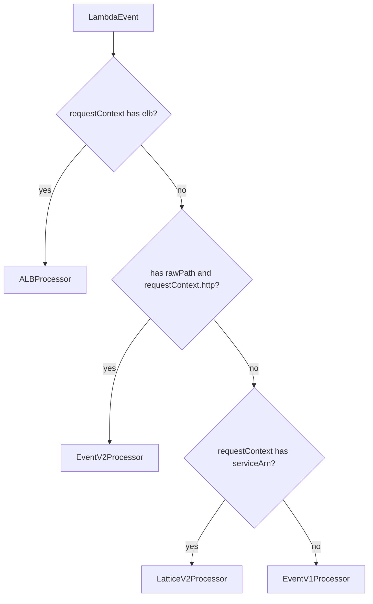

## Overview

A Hono application is a `fetch(request, env, executionCtx)` function over Web standard `Request` and `Response` objects. Runtimes that already call such a function (Cloudflare Workers, Bun, Deno) can export the app directly; the adapters in `src/adapter` cover the rest. Each one converts a platform event into a `Request`, calls `app.fetch` with the platform's bindings as `env`, and converts the `Response` back. Each adapter also ships a `getConnInfo` for reading the client address and, where the platform needs one, a `serveStatic`, `upgradeWebSocket` or `toSSG` implementation.

Sources: [src/adapter/aws-lambda/index.ts:1-14](repo://src/adapter/aws-lambda/index.ts#L1-L14), [src/adapter/cloudflare-workers/index.ts:1-8](repo://src/adapter/cloudflare-workers/index.ts#L1-L8), [src/adapter/bun/index.ts:1-11](repo://src/adapter/bun/index.ts#L1-L11), [src/adapter/deno/index.ts:1-9](repo://src/adapter/deno/index.ts#L1-L9)

The handler itself is described in [[The Hono Application]]; the platform bindings that adapters place in `env` are read through `c.env` on the [[Context]]. Node.js is served by the separate `@hono/node-server` package and has no adapter in this repository.

Sources: [package.json:329-388](repo://package.json#L329-L388)

## Adapter summary

Each adapter is its own package entry point (`hono/aws-lambda`, `hono/cloudflare-pages` and so on):

Sources: [package.json:344-388](repo://package.json#L344-L388)

| Import | Exports | What `env` holds | `getConnInfo` address source |
| --- | --- | --- | --- |
| `hono/aws-lambda` | `handle`, `streamHandle`, `defaultIsContentTypeBinary`, `getConnInfo` | `event`, `requestContext`, `lambdaContext` (`context` for `streamHandle`) | `requestContext.identity.sourceIp` (v1), `requestContext.http.sourceIp` (v2), last `x-forwarded-for` entry (ALB) |
| `hono/lambda-edge` | `handle`, `getConnInfo`, CloudFront types | `event`, `context`, `callback`, `config`, `request`, `response` | `Records[0].cf.request.clientIp` |
| `hono/cloudflare-workers` | `serveStatic` (deprecated), `upgradeWebSocket`, `getConnInfo` | Worker bindings (passed by the runtime) | `cf-connecting-ip` header |
| `hono/cloudflare-pages` | `handle`, `handleMiddleware`, `serveStatic`, `getConnInfo` | Pages bindings plus `eventContext` | `cf-connecting-ip` header |
| `hono/vercel` | `handle`, `getConnInfo` | nothing | `x-real-ip` header |
| `hono/netlify` | `handle`, `getConnInfo` | `context` (Netlify context) | `context.ip` |
| `hono/bun` | `serveStatic`, `toSSG`, `bunFileSystemModule`, `createBunWebSocket`, `upgradeWebSocket`, `websocket`, `getConnInfo`, `getBunServer` | the Bun server (second `fetch` argument) | `server.requestIP(req)` with port and family |
| `hono/deno` | `serveStatic`, `toSSG`, `denoFileSystemModule`, `upgradeWebSocket`, `getConnInfo` | Deno serve handler info | `remoteAddr.hostname`, `port`, `transport` |
| `hono/service-worker` | `handle`, `fire` | empty object; the `FetchEvent` is the execution context | none |

Sources: [src/adapter/aws-lambda/index.ts:6-14](repo://src/adapter/aws-lambda/index.ts#L6-L14), [src/adapter/lambda-edge/index.ts:6-14](repo://src/adapter/lambda-edge/index.ts#L6-L14), [src/adapter/cloudflare-pages/index.ts:6-8](repo://src/adapter/cloudflare-pages/index.ts#L6-L8), [src/adapter/vercel/index.ts:6-7](repo://src/adapter/vercel/index.ts#L6-L7), [src/adapter/netlify/mod.ts:1-2](repo://src/adapter/netlify/mod.ts#L1-L2), [src/adapter/service-worker/index.ts:28-36](repo://src/adapter/service-worker/index.ts#L28-L36)

## AWS Lambda

### handle

`handle(app, { isContentTypeBinary? })` returns an async Lambda handler that accepts API Gateway REST (v1) and HTTP API (v2) events, Lambda Function URL events, Application Load Balancer events and VPC Lattice v2 events. `getProcessor` picks an `EventProcessor` for the event, `createRequest` builds the `Request`, and the app is called with `{ event, requestContext, lambdaContext }` as `env`. If building the request throws, the handler answers 400 `Invalid request` for a `TypeError` and 500 otherwise, without calling the app.

Sources: [src/adapter/aws-lambda/handler.ts:195-276](repo://src/adapter/aws-lambda/handler.ts#L195-L276)

```ts
import { Hono } from 'hono'
import { handle } from 'hono/aws-lambda'

const app = new Hono()

app.get('/', (c) => c.text('Hello from Lambda'))
app.get('/json', (c) => c.json({ message: 'Hello JSON' }))

export const handler = handle(app)
```

Sources: [src/adapter/aws-lambda/handler.ts:211-222](repo://src/adapter/aws-lambda/handler.ts#L211-L222)

### Event detection

`getProcessor` checks the event shape in a fixed order, because several event types share fields:

Sources: [src/adapter/aws-lambda/handler.ts:625-637](repo://src/adapter/aws-lambda/handler.ts#L625-L637)



Sources: [src/adapter/aws-lambda/handler.ts:625-658](repo://src/adapter/aws-lambda/handler.ts#L625-L658)

A v1 REST event behind a custom-domain base path mapping also carries `rawPath`, so v2 detection additionally requires the `http` object that every HTTP API and function URL event has.

Sources: [src/adapter/aws-lambda/handler.ts:646-651](repo://src/adapter/aws-lambda/handler.ts#L646-L651)

### Request conversion

The base `EventProcessor.createRequest` builds `https://<domain><path>?<query>`, taking the domain from `requestContext.domainName` or the `host` header, and decodes a base64 body (setting `content-length`). The subclasses differ in how they read the method, path, query, headers and cookies:

Sources: [src/adapter/aws-lambda/handler.ts:278-342](repo://src/adapter/aws-lambda/handler.ts#L278-L342)

| Processor | Path and method | Query string | Headers and cookies |
| --- | --- | --- | --- |
| `EventV2Processor` | `rawPath`, `requestContext.http.method` | `rawQueryString` as-is | `headers`; the `cookies` array is joined into `Cookie` |
| `EventV1Processor` | `path`, `httpMethod` | rebuilt from `multiValueQueryStringParameters` or `queryStringParameters`, re-encoded with `encodeURIComponent` | `multiValueHeaders` appended, then `headers` not already set |
| `ALBProcessor` | `path`, `httpMethod` | rebuilt from multi-value params first, without re-encoding | `multiValueHeaders` joined with `; `, else `headers` |
| `LatticeV2Processor` | `path`, `method` | empty | each value of the array-valued `headers` appended |

Sources: [src/adapter/aws-lambda/handler.ts:404-501](repo://src/adapter/aws-lambda/handler.ts#L404-L501), [src/adapter/aws-lambda/handler.ts:503-582](repo://src/adapter/aws-lambda/handler.ts#L503-L582), [src/adapter/aws-lambda/handler.ts:584-623](repo://src/adapter/aws-lambda/handler.ts#L584-L623)

Header values that contain non-ASCII characters are passed through `encodeURIComponent` by `sanitizeHeaderValue`, since the `Headers` constructor rejects them.

Sources: [src/adapter/aws-lambda/handler.ts:13-21](repo://src/adapter/aws-lambda/handler.ts#L13-L21)

### Response conversion and binary bodies

`createResult` decides whether to base64-encode the body: it does so when `isContentTypeBinary(contentType)` is true, or when `content-encoding` is anything other than `identity` (for example after the compress middleware). The result uses `multiValueHeaders` when the incoming event used them and `headers` otherwise. `Set-Cookie` values are moved out of the headers: v2 puts them in `cookies`, v1 in `multiValueHeaders['set-cookie']`, ALB in either form, Lattice as an array header.

Sources: [src/adapter/aws-lambda/handler.ts:344-402](repo://src/adapter/aws-lambda/handler.ts#L344-L402), [src/adapter/aws-lambda/handler.ts:672-674](repo://src/adapter/aws-lambda/handler.ts#L672-L674)

`defaultIsContentTypeBinary` treats everything as binary except `text/plain`, `text/html`, `text/css`, `text/javascript`, `text/csv` and `*/json`, `*+json`, `*/xml`, `*+xml` types. Pass your own function to change that, and call the default from it to keep its behaviour for other types:

Sources: [src/adapter/aws-lambda/handler.ts:660-670](repo://src/adapter/aws-lambda/handler.ts#L660-L670)

```ts
import { handle, defaultIsContentTypeBinary } from 'hono/aws-lambda'
export const handler = handle(app, {
  isContentTypeBinary: (contentType) => {
    if (defaultIsContentTypeBinary(contentType)) {
      // default logic same as prior to v4.8.4
      return true
    }
    return contentType.startsWith('image/') || contentType === 'application/pdf'
  }
})
```

Sources: [src/adapter/aws-lambda/handler.ts:224-237](repo://src/adapter/aws-lambda/handler.ts#L224-L237), [src/adapter/aws-lambda/handler.ts:660-670](repo://src/adapter/aws-lambda/handler.ts#L660-L670)

### streamHandle

`streamHandle(app)` wraps the handler in the runtime's `awslambda.streamifyResponse` for Lambda response streaming. It calls the app with `{ event, requestContext, context }`, builds the metadata (`statusCode`, headers, and `Set-Cookie` values as `cookies`) with `awslambda.HttpResponseStream.from`, and pipes the response body chunk by chunk to the Node.js stream. Errors are logged and the stream receives `Internal Server Error`. Use it with [[Streaming and Server-Sent Events]] responses.

Sources: [src/adapter/aws-lambda/handler.ts:126-193](repo://src/adapter/aws-lambda/handler.ts#L126-L193)

> [!NOTE]
> `handle` exposes the Lambda context as `c.env.lambdaContext`, while `streamHandle` exposes it as `c.env.context`.

Sources: [src/adapter/aws-lambda/handler.ts:153-157](repo://src/adapter/aws-lambda/handler.ts#L153-L157), [src/adapter/aws-lambda/handler.ts:268-272](repo://src/adapter/aws-lambda/handler.ts#L268-L272)

## Lambda@Edge

`handle(app)` from `hono/lambda-edge` takes a CloudFront event. `createRequest` builds the URL from the `host` header (or the distribution domain), the `uri` and `querystring`, copies the multi-value CloudFront headers, and decodes a base64 body for methods other than GET and HEAD. The app receives `event`, `context`, `config`, `request`, `response` and a wrapped `callback` in `env`.

Sources: [src/adapter/lambda-edge/handler.ts:116-147](repo://src/adapter/lambda-edge/handler.ts#L116-L147), [src/adapter/lambda-edge/handler.ts:164-212](repo://src/adapter/lambda-edge/handler.ts#L164-L212)

A handler can either return a normal response, which `createResult` converts into a CloudFront result (`status` as a string, lowercased header lists, `bodyEncoding: 'base64'` for binary types or non-identity encodings), or call `c.env.callback(null, c.env.request)` to forward the (possibly modified) request to the origin. The first callback call wins: its result is returned instead of the response, and a callback error is rethrown.

Sources: [src/adapter/lambda-edge/handler.ts:124-162](repo://src/adapter/lambda-edge/handler.ts#L124-L162), [src/adapter/lambda-edge/handler.ts:214-218](repo://src/adapter/lambda-edge/handler.ts#L214-L218)

## Cloudflare

### Workers

Workers call `export default app` directly, so `hono/cloudflare-workers` only provides helpers. `upgradeWebSocket` creates a `WebSocketPair`, wires `onMessage`, `onClose` and `onError` to the server socket (Workers have no `open` event, so `onOpen` is not accepted), and returns the client socket in a 101 response (see [[WebSockets]]). `serveStatic` reads files from the Workers Sites KV namespace `__STATIC_CONTENT` through its manifest and is deprecated in favour of Cloudflare Static Assets; the module export omits the `namespace` option (see [[Serving Static Files]]).

Sources: [src/adapter/cloudflare-workers/websocket.ts:1-53](repo://src/adapter/cloudflare-workers/websocket.ts#L1-L53), [src/adapter/cloudflare-workers/serve-static.ts:1-42](repo://src/adapter/cloudflare-workers/serve-static.ts#L1-L42), [src/adapter/cloudflare-workers/serve-static-module.ts:1-12](repo://src/adapter/cloudflare-workers/serve-static-module.ts#L1-L12), [src/adapter/cloudflare-workers/utils.ts:1-50](repo://src/adapter/cloudflare-workers/utils.ts#L1-L50)

### Pages

`handle(app)` turns the app into a Pages Function: it calls `app.fetch(request, { ...env, eventContext }, { waitUntil, passThroughOnException, props: {} })`, so the Pages `EventContext` (with `params`, `data` and `next`) is available as `c.env.eventContext`.

Sources: [src/adapter/cloudflare-pages/handler.ts:6-46](repo://src/adapter/cloudflare-pages/handler.ts#L6-L46)

`handleMiddleware(middleware)` runs one Hono middleware as a Pages `_middleware` function. It builds a [[Context]] by hand; `next()` calls the Pages `eventContext.next()` and stores its response in `c.res`. A response returned by the middleware wins; otherwise an `HTTPException` becomes its response, any other caught error is rethrown, and `c.res` is returned. `serveStatic()` (advanced mode) fetches the request from `env.ASSETS` and turns a 404 into `c.notFound()`.

Sources: [src/adapter/cloudflare-pages/handler.ts:48-123](repo://src/adapter/cloudflare-pages/handler.ts#L48-L123)

## Vercel and Netlify

The Vercel adapter is a one-line `(req) => app.fetch(req)` for Edge and Next.js route handlers. The Netlify adapter passes Netlify's second argument through as `c.env.context`, from which `getConnInfo` reads `context.ip`.

Sources: [src/adapter/vercel/handler.ts:1-8](repo://src/adapter/vercel/handler.ts#L1-L8), [src/adapter/netlify/handler.ts:1-10](repo://src/adapter/netlify/handler.ts#L1-L10), [src/adapter/netlify/conninfo.ts:53-57](repo://src/adapter/netlify/conninfo.ts#L53-L57)

## Bun and Deno

Bun and Deno serve `app.fetch` directly; their adapters supply the runtime-specific parts of other features: file access for `serveStatic` and `toSSG` ([[Static Site Generation]]), and their native WebSocket APIs for `upgradeWebSocket`.

Sources: [src/adapter/bun/index.ts:6-11](repo://src/adapter/bun/index.ts#L6-L11), [src/adapter/deno/index.ts:6-9](repo://src/adapter/deno/index.ts#L6-L9)

`getBunServer(c)` returns `c.env.server` when present and `c.env` otherwise, which supports both `Bun.serve({ fetch: app.fetch })` and wrappers that nest the server. Bun's `getConnInfo` calls `server.requestIP(c.req.raw)`; it throws a `TypeError` when the server is missing or has no `requestIP`, and returns an empty `remote` when Bun answers `null` (closed requests, Unix sockets). Deno's reads `c.env.remoteAddr`.

Sources: [src/adapter/bun/server.ts:7-14](repo://src/adapter/bun/server.ts#L7-L14), [src/adapter/bun/conninfo.ts:10-43](repo://src/adapter/bun/conninfo.ts#L10-L43), [src/adapter/deno/conninfo.ts:8-17](repo://src/adapter/deno/conninfo.ts#L8-L17)

## Service Worker

`handle(app, opts)` returns a `fetch` event listener that calls `evt.respondWith(...)` with the app's response, passing the `FetchEvent` as the execution context. When `opts.fetch` is set and the app answers 404, the request is re-fetched with it, so unmatched requests fall through to the network. The default options use `globalThis.fetch.bind(globalThis)`, because an unbound `fetch` throws "Illegal invocation" in a worker. Passing options without `fetch` turns the fallback off.

Sources: [src/adapter/service-worker/handler.ts:10-37](repo://src/adapter/service-worker/handler.ts#L10-L37)

`fire(app, options?)` registers that listener with `addEventListener('fetch', ...)`. When `options` is omitted, `handle`'s default options apply, including the network fallback.

Sources: [src/adapter/service-worker/index.ts:10-36](repo://src/adapter/service-worker/index.ts#L10-L36)

## Connection info

### The ConnInfo shape

Every `getConnInfo` has the type `GetConnInfo = (c: Context) => ConnInfo`, exported from `hono/conninfo`. `ConnInfo.remote` is a `NetAddrInfo` with optional `address`, `addressType` (`'IPv4' | 'IPv6'`), `port` and `transport` (`'tcp' | 'udp'`). Adapters that only see a header fill in `address`. Import the function from the adapter that matches the deployment target, since each reads a different source.

Sources: [src/helper/conninfo/types.ts:1-45](repo://src/helper/conninfo/types.ts#L1-L45), [src/helper/conninfo/index.ts:1-6](repo://src/helper/conninfo/index.ts#L1-L6)

```ts
import { Hono } from 'hono'
import { handle, getConnInfo } from 'hono/aws-lambda'

const app = new Hono()

app.get('/', (c) => {
  const info = getConnInfo(c)
  return c.text(`Your IP: ${info.remote.address}`)
})

export const handler = handle(app)
```

Sources: [src/adapter/aws-lambda/conninfo.ts:30-43](repo://src/adapter/aws-lambda/conninfo.ts#L30-L43)

> [!WARNING]
> The header-based sources (`cf-connecting-ip`, `x-real-ip`, `x-forwarded-for`) are only trustworthy when the platform sets them. On ALB, the Lambda adapter takes the last `x-forwarded-for` entry because the load balancer appends the real client address there.

Sources: [src/adapter/aws-lambda/conninfo.ts:45-73](repo://src/adapter/aws-lambda/conninfo.ts#L45-L73), [src/adapter/cloudflare-workers/conninfo.ts:1-7](repo://src/adapter/cloudflare-workers/conninfo.ts#L1-L7), [src/adapter/vercel/conninfo.ts:1-8](repo://src/adapter/vercel/conninfo.ts#L1-L8)

## The adapter helper

### getRuntimeKey

`hono/adapter` lets runtime-neutral code ask where it is running. `getRuntimeKey()` returns one of `'node' | 'deno' | 'bun' | 'workerd' | 'fastly' | 'edge-light' | 'other'`. It first matches `navigator.userAgent` against `Deno`, `Bun`, `Cloudflare-Workers` and `Node.js`, then checks `globalThis.EdgeRuntime` (Vercel Edge), `globalThis.fastly`, and finally `process.release.name === 'node'` for Node versions before 21.1 that lack `navigator.userAgent`.

Sources: [src/helper/adapter/index.ts:8-8](repo://src/helper/adapter/index.ts#L8-L8), [src/helper/adapter/index.ts:43-90](repo://src/helper/adapter/index.ts#L43-L90), [package.json:329-333](repo://package.json#L329-L333)

### env

`env(c, runtime?)` returns environment variables in one shape on every runtime: `process.env` on Node, Bun and Edge Runtime, `Deno.env.toObject()` on Deno, `c.env` (the bindings) on Cloudflare `workerd`, and an empty object on Fastly and unknown runtimes. The type parameter declares the variables you expect.

Sources: [src/helper/adapter/index.ts:10-41](repo://src/helper/adapter/index.ts#L10-L41)

```ts
import { env, getRuntimeKey } from 'hono/adapter'

app.get('/env', (c) => {
  const { NAME } = env<{ NAME: string }>(c)
  return c.text(`${NAME} on ${getRuntimeKey()}`)
})
```

Sources: [src/helper/adapter/index.ts:10-50](repo://src/helper/adapter/index.ts#L10-L50)
