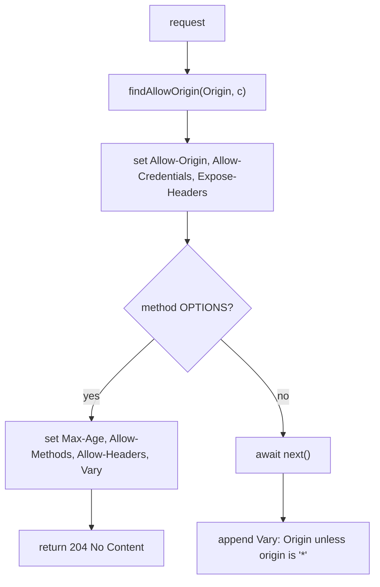
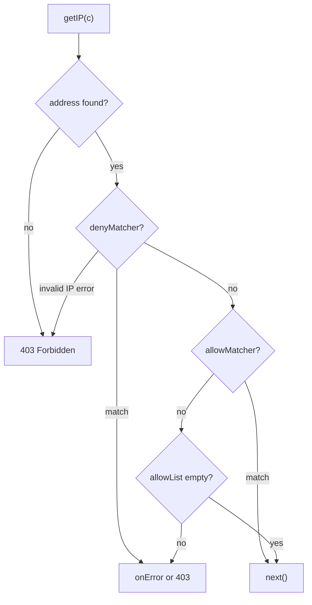

## Overview

These middleware harden an application at the HTTP layer without touching route code. `cors` answers preflight requests and decorates responses with `Access-Control-*` headers; `csrf` rejects cross-site form submissions; `secureHeaders` adds a Helmet-style set of response headers including Content Security Policy with per-request nonces; `ipRestriction` filters clients by IP allow and deny lists; `bodyLimit` caps request body size before a handler reads it. Each is a factory that precomputes as much as possible at construction time and returns a small `MiddlewareHandler`.

Sources: [src/middleware/cors/index.ts:63-96](repo://src/middleware/cors/index.ts#L63-L96), [src/middleware/csrf/index.ts:94-138](repo://src/middleware/csrf/index.ts#L94-L138), [src/middleware/secure-headers/secure-headers.ts:179-215](repo://src/middleware/secure-headers/secure-headers.ts#L179-L215), [src/middleware/ip-restriction/index.ts:218-238](repo://src/middleware/ip-restriction/index.ts#L218-L238), [src/middleware/body-limit/index.ts:50-61](repo://src/middleware/body-limit/index.ts#L50-L61)

Rejections are thrown as `HTTPException` with a prebuilt `res`, so they flow through the app's error handling described in [[Error Handling]]. Registration order matters as for any middleware ([[Middleware and Composition]]): `cors` should run before authentication so preflight `OPTIONS` requests are answered without credentials.

Sources: [src/middleware/csrf/index.ts:144-147](repo://src/middleware/csrf/index.ts#L144-L147), [src/middleware/cors/index.ts:114-148](repo://src/middleware/cors/index.ts#L114-L148)

| Middleware | Import | Rejects with |
| --- | --- | --- |
| `cors` | `hono/cors` | never rejects; answers `OPTIONS` with 204 |
| `csrf` | `hono/csrf` | `403 Forbidden` |
| `secureHeaders` | `hono/secure-headers` | never rejects |
| `ipRestriction` | `hono/ip-restriction` | `403 Forbidden` or custom `onError` |
| `bodyLimit` | `hono/body-limit` | `413 Payload Too Large` or custom `onError` |

Sources: [src/middleware/csrf/index.ts:145-146](repo://src/middleware/csrf/index.ts#L145-L146), [src/middleware/ip-restriction/index.ts:231-236](repo://src/middleware/ip-restriction/index.ts#L231-L236), [src/middleware/body-limit/index.ts:10-58](repo://src/middleware/body-limit/index.ts#L10-L58)

## CORS

### CORS options

`cors(options)` merges the options over defaults: `origin: '*'`, `allowMethods` of `GET`, `HEAD`, `PUT`, `POST`, `DELETE`, `PATCH`, and empty `allowHeaders`/`exposeHeaders`.

Sources: [src/middleware/cors/index.ts:9-22](repo://src/middleware/cors/index.ts#L9-L22), [src/middleware/cors/index.ts:63-70](repo://src/middleware/cors/index.ts#L63-L70)

| Option | Type | Default | Header |
| --- | --- | --- | --- |
| `origin` | `string \| string[] \| (origin, c) => string \| null \| undefined` | `'*'` | `Access-Control-Allow-Origin` |
| `allowMethods` | `string[] \| (origin, c) => string[]` | six methods above | `Access-Control-Allow-Methods` (preflight) |
| `allowHeaders` | `string[]` | `[]` (echo request) | `Access-Control-Allow-Headers` (preflight) |
| `maxAge` | `number` | none | `Access-Control-Max-Age` (preflight) |
| `credentials` | `boolean` | none | `Access-Control-Allow-Credentials: true` |
| `exposeHeaders` | `string[]` | `[]` | `Access-Control-Expose-Headers` |

Sources: [src/middleware/cors/index.ts:29-35](repo://src/middleware/cors/index.ts#L29-L35)

### Origin resolution

`findAllowOrigin` is built once from the `origin` option. The wildcard always returns `'*'`; a single string echoes the request `Origin` only if it is equal; an array echoes it only if included; a function decides per request and may be async. A falsy result means no `Access-Control-Allow-Origin` header is set and the browser blocks the response. `allowMethods` is normalised the same way by `findAllowMethods`.

Sources: [src/middleware/cors/index.ts:72-94](repo://src/middleware/cors/index.ts#L72-L94), [src/middleware/cors/index.ts:101-104](repo://src/middleware/cors/index.ts#L101-L104)

### Preflight and actual requests

For every request the handler sets the allow-origin, credentials and expose headers on `c.res`. An `OPTIONS` request is then answered directly with `204 No Content`, never reaching later middleware or routes. When `allowHeaders` is empty, the preflight echoes the client's `Access-Control-Request-Headers` back. Non-preflight requests call `next()` and afterwards append `Vary: Origin` whenever the origin is not the wildcard, so shared caches do not serve one origin's response to another.

Sources: [src/middleware/cors/index.ts:96-156](repo://src/middleware/cors/index.ts#L96-L156)



Sources: [src/middleware/cors/index.ts:96-156](repo://src/middleware/cors/index.ts#L96-L156)

## CSRF Protection

### CSRF options

`csrf` validates two independent signals: the `Sec-Fetch-Site` fetch-metadata header and the `Origin` header. Each option accepts a single value, an array, or a predicate receiving the context.

Sources: [src/middleware/csrf/index.ts:10-26](repo://src/middleware/csrf/index.ts#L10-L26)

| Option | Type | Default |
| --- | --- | --- |
| `origin` | `string \| string[] \| (origin, c) => boolean` | equal to `new URL(c.req.url).origin` |
| `secFetchSite` | `'same-origin' \| 'same-site' \| 'none' \| 'cross-site'`, an array of them, or `(value, c) => boolean` | `'same-origin'` only |

Sources: [src/middleware/csrf/index.ts:40-53](repo://src/middleware/csrf/index.ts#L40-L53), [src/middleware/csrf/index.ts:95-125](repo://src/middleware/csrf/index.ts#L95-L125)

### When a request is blocked

A request is rejected only when all four conditions hold: the method is not `GET` or `HEAD`; the `Content-Type` is one a plain HTML form can send (`application/x-www-form-urlencoded`, `multipart/form-data`, `text/plain`, with a missing header treated as `text/plain`); the `Sec-Fetch-Site` check fails; and the `Origin` check fails. A missing header, or a `Sec-Fetch-Site` value outside the four standard ones, counts as a failed check. JSON requests are never blocked because browsers cannot send them cross-origin without a CORS preflight.

Sources: [src/middleware/csrf/index.ts:28-30](repo://src/middleware/csrf/index.ts#L28-L30), [src/middleware/csrf/index.ts:106-150](repo://src/middleware/csrf/index.ts#L106-L150)

```ts
app.use('*', csrf({
  secFetchSite: (secFetchSite, c) => {
    if (secFetchSite === 'same-origin') return true
    if (secFetchSite === 'cross-site' && c.req.path.startsWith('/webhook/')) {
      return true
    }
    return false
  }
}))
```

Sources: [src/middleware/csrf/index.ts:70-81](repo://src/middleware/csrf/index.ts#L70-L81)

## Secure Headers

### Default headers

`secureHeaders(customOptions)` spreads the options over `DEFAULT_OPTIONS`. Every key of `HEADERS_MAP` is an `overridableHeader`: `true` emits the default value, a string replaces the value, and `false` omits the header. `getFilteredHeaders` turns this into a static list of `[name, value]` pairs once, at construction.

Sources: [src/middleware/secure-headers/secure-headers.ts:94-124](repo://src/middleware/secure-headers/secure-headers.ts#L94-L124), [src/middleware/secure-headers/secure-headers.ts:231-238](repo://src/middleware/secure-headers/secure-headers.ts#L231-L238)

| Option | Header | Default value | On by default |
| --- | --- | --- | --- |
| `crossOriginEmbedderPolicy` | `Cross-Origin-Embedder-Policy` | `require-corp` | no |
| `crossOriginResourcePolicy` | `Cross-Origin-Resource-Policy` | `same-origin` | yes |
| `crossOriginOpenerPolicy` | `Cross-Origin-Opener-Policy` | `same-origin` | yes |
| `originAgentCluster` | `Origin-Agent-Cluster` | `?1` | yes |
| `referrerPolicy` | `Referrer-Policy` | `no-referrer` | yes |
| `strictTransportSecurity` | `Strict-Transport-Security` | `max-age=15552000; includeSubDomains` | yes |
| `xContentTypeOptions` | `X-Content-Type-Options` | `nosniff` | yes |
| `xDnsPrefetchControl` | `X-DNS-Prefetch-Control` | `off` | yes |
| `xDownloadOptions` | `X-Download-Options` | `noopen` | yes |
| `xFrameOptions` | `X-Frame-Options` | `SAMEORIGIN` | yes |
| `xPermittedCrossDomainPolicies` | `X-Permitted-Cross-Domain-Policies` | `none` | yes |
| `xXssProtection` | `X-XSS-Protection` | `0` | yes |
| `removePoweredBy` | removes `X-Powered-By` | n/a | yes |

Sources: [src/middleware/secure-headers/secure-headers.ts:94-124](repo://src/middleware/secure-headers/secure-headers.ts#L94-L124), [src/middleware/secure-headers/secure-headers.ts:225-227](repo://src/middleware/secure-headers/secure-headers.ts#L225-L227)

The handler calls `next()` first and then writes the headers onto `ctx.res` with `headers.set`, so they override any same-named header a route set, and finally deletes `X-Powered-By` when `removePoweredBy` is on.

Sources: [src/middleware/secure-headers/secure-headers.ts:215-229](repo://src/middleware/secure-headers/secure-headers.ts#L215-L229), [src/middleware/secure-headers/secure-headers.ts:330-334](repo://src/middleware/secure-headers/secure-headers.ts#L330-L334)

### Content Security Policy

`contentSecurityPolicy` and `contentSecurityPolicyReportOnly` take camelCase directive keys (`defaultSrc`, `scriptSrc`, `frameAncestors`, `upgradeInsecureRequests` and so on) whose values are arrays of strings or handler functions. `getCSPDirectives` converts each key to kebab case and builds the header as an array of fragments. If no value is a function, the fragments are joined once into a static string.

Sources: [src/middleware/secure-headers/secure-headers.ts:15-44](repo://src/middleware/secure-headers/secure-headers.ts#L15-L44), [src/middleware/secure-headers/secure-headers.ts:240-269](repo://src/middleware/secure-headers/secure-headers.ts#L240-L269)

When a value is a `ContentSecurityPolicyOptionHandler` `(ctx, directive) => string`, its fragment index is recorded and a callback is returned instead. Per request, the middleware clones the fragment array, lets each callback fill its slot, and joins the result. These callbacks run before `next()` precisely so that a handler can store data on the context for the route to read.

Sources: [src/middleware/secure-headers/secure-headers.ts:246-288](repo://src/middleware/secure-headers/secure-headers.ts#L246-L288), [src/middleware/secure-headers/secure-headers.ts:215-223](repo://src/middleware/secure-headers/secure-headers.ts#L215-L223)

### Nonces

The exported `NONCE` handler is the built-in use of that mechanism. It generates 16 random bytes with `crypto.getRandomValues`, base64-encodes them, stores the value under `secureHeadersNonce` on the context (reusing an existing one so `scriptSrc` and `styleSrc` share a nonce), and returns `'nonce-<value>'`. The `hono/secure-headers` module augments `ContextVariableMap` so `c.get('secureHeadersNonce')` is typed.

Sources: [src/middleware/secure-headers/secure-headers.ts:131-145](repo://src/middleware/secure-headers/secure-headers.ts#L131-L145), [src/middleware/secure-headers/index.ts:1-8](repo://src/middleware/secure-headers/index.ts#L1-L8)

```tsx
import { secureHeaders, NONCE } from 'hono/secure-headers'

app.get(
  '*',
  secureHeaders({
    contentSecurityPolicy: { scriptSrc: [NONCE, 'https://allowed.example.com'] },
  })
)

app.get('/', (c) => {
  return c.html(`<script src="/main.js" nonce="${c.get('secureHeadersNonce')}"></script>`)
})
```

Sources: [src/middleware/secure-headers/secure-headers.ts:137-145](repo://src/middleware/secure-headers/secure-headers.ts#L137-L145), [src/middleware/secure-headers/index.ts:1-8](repo://src/middleware/secure-headers/index.ts#L1-L8)

### Permissions Policy

`permissionsPolicy` maps camelCase feature names (typed by `PermissionsPolicyDirective`, which lists standardized, proposed and experimental features) to a boolean or an allowlist. `getPermissionsPolicyDirectives` kebab-cases each key and serialises: `true` becomes `=*`, `false` becomes `=none`, `[]` becomes `=()`, a lone `'*'` or `'none'` is emitted bare, and other lists become `=(self "https://a.example")` with `self` and `src` left unquoted. The header is sent only when the object has at least one key.

Sources: [src/middleware/secure-headers/permissions-policy.ts:1-20](repo://src/middleware/secure-headers/permissions-policy.ts#L1-L20), [src/middleware/secure-headers/secure-headers.ts:200-205](repo://src/middleware/secure-headers/secure-headers.ts#L200-L205), [src/middleware/secure-headers/secure-headers.ts:290-318](repo://src/middleware/secure-headers/secure-headers.ts#L290-L318)

### Reporting headers

`reportingEndpoints` renders `name="url"` pairs into `Reporting-Endpoints`, and `reportTo` JSON-stringifies each `{ group, max_age, endpoints }` group into the legacy `Report-To` header. Use them with the CSP `reportTo` / `reportUri` directives.

Sources: [src/middleware/secure-headers/secure-headers.ts:46-59](repo://src/middleware/secure-headers/secure-headers.ts#L46-L59), [src/middleware/secure-headers/secure-headers.ts:207-213](repo://src/middleware/secure-headers/secure-headers.ts#L207-L213), [src/middleware/secure-headers/secure-headers.ts:320-328](repo://src/middleware/secure-headers/secure-headers.ts#L320-L328)

## IP Restriction

### Signature and rules

`ipRestriction(getIP, { denyList, allowList }, onError?)` takes a way to find the client address: either a `GetConnInfo` function from a runtime adapter (see [[Runtime Adapters]]) or a plain `(c) => string`. Rules are `'*'`, a static IPv4 or IPv6 address, a CIDR range, or a predicate on `{ addr, type }`.

Sources: [src/middleware/ip-restriction/index.ts:20-38](repo://src/middleware/ip-restriction/index.ts#L20-L38), [src/middleware/ip-restriction/index.ts:169-225](repo://src/middleware/ip-restriction/index.ts#L169-L225)

### Rule compilation

`buildMatcher` compiles each list once. `'*'` short-circuits to a matcher that always returns `true`. Static addresses go into string and `bigint` sets; IPv4 rules are also registered in their IPv4-mapped IPv6 form (`::ffff:a.b.c.d`) and vice versa, so a rule matches regardless of how the runtime reports the address. CIDR rules are stored as `[isIPv4, network, mask]`; a `/32` or `/128` is treated as static, and an IPv4-mapped IPv6 CIDR with prefix of at least 96 is rewritten as an IPv4 range. An invalid rule or prefix throws `TypeError` at construction.

Sources: [src/middleware/ip-restriction/index.ts:40-120](repo://src/middleware/ip-restriction/index.ts#L40-L120)

The returned matcher checks, cheapest first: the string set, the binary static set, the CIDR masks, then function rules. Address parsing uses `src/utils/ipaddr.ts`: `distinctRemoteAddr` classifies by regex (anything with `:` is IPv6), and `convertIPv4ToBinary`/`convertIPv6ToBinary` produce `bigint`s, throwing a `TypeError` with `code: 'ERR_INVALID_IP_ADDRESS'` for malformed input.

Sources: [src/middleware/ip-restriction/index.ts:122-166](repo://src/middleware/ip-restriction/index.ts#L122-L166), [src/utils/ipaddr.ts:39-81](repo://src/utils/ipaddr.ts#L39-L81), [src/utils/ipaddr.ts:141-160](repo://src/utils/ipaddr.ts#L141-L160)

### Decision order

Deny wins over allow. An empty `allowList` means "allow everything not denied"; a non-empty one means "deny everything not allowed". A missing address, or one the parser rejects as invalid, is blocked rather than allowed.

Sources: [src/middleware/ip-restriction/index.ts:238-279](repo://src/middleware/ip-restriction/index.ts#L238-L279)



Sources: [src/middleware/ip-restriction/index.ts:238-279](repo://src/middleware/ip-restriction/index.ts#L238-L279)

## Body Limit

### Body limit options

`bodyLimit({ maxSize, onError })` limits the request body to `maxSize` bytes. Without `onError` the middleware throws `HTTPException(413)` whose response body is `Payload Too Large`; with it, the handler's `Response` is returned instead.

Sources: [src/middleware/body-limit/index.ts:10-59](repo://src/middleware/body-limit/index.ts#L10-L59)

### Size enforcement

Requests without a body pass straight through. If only `Content-Length` is present it is trusted and compared without reading anything. If `Transfer-Encoding` is present (it takes precedence per RFC 7230) or no length is declared, the middleware reads the whole stream up front, failing as soon as the running total exceeds `maxSize`, then replaces `c.req.raw` with a new `Request` whose body replays the buffered chunks. Reading before `next()` makes the check final no matter how the handler later consumes the body.

Sources: [src/middleware/body-limit/index.ts:61-110](repo://src/middleware/body-limit/index.ts#L61-L110)

```ts
app.post(
  '/upload',
  bodyLimit({
    maxSize: 50 * 1024, // 50kb
    onError: (c) => {
      return c.text('overflow :(', 413)
    },
  }),
  async (c) => {
    const body = await c.req.parseBody()
    if (body['file'] instanceof File) {
      console.log(`Got file sized: ${body['file'].size}`)
    }
    return c.text('pass :)')
  }
)
```

Sources: [src/middleware/body-limit/index.ts:28-48](repo://src/middleware/body-limit/index.ts#L28-L48)
