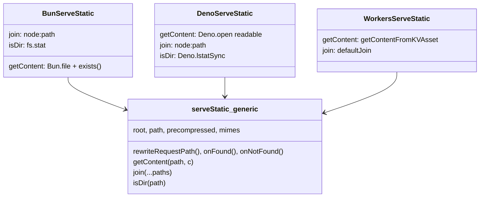
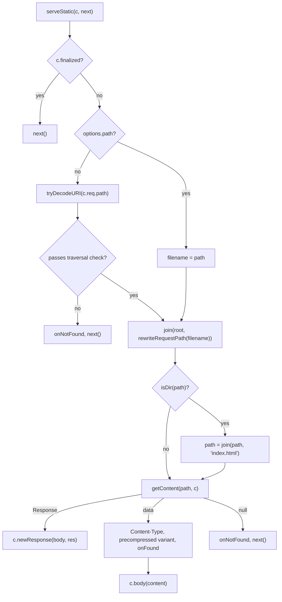

## Overview

Hono serves files from disk or from a key-value store through one runtime-neutral middleware, `serveStatic` in `src/middleware/serve-static`, and thin per-runtime wrappers that tell it how to read a file. The generic middleware owns everything that is the same everywhere: mapping the URL to a file path, rejecting path traversal, choosing the `Content-Type`, picking precompressed variants, and calling hooks. The adapter supplies `getContent` (read a path, return data or `null`), and optionally `join` and `isDir`. Application code imports the wrapper for its runtime, for example `serveStatic` from `hono/bun` or `hono/deno`; see [[Runtime Adapters]].

Sources: [src/middleware/serve-static/index.ts:13-53](repo://src/middleware/serve-static/index.ts#L13-L53), [src/adapter/bun/serve-static.ts:8-32](repo://src/adapter/bun/serve-static.ts#L8-L32), [src/adapter/deno/index.ts:1-9](repo://src/adapter/deno/index.ts#L1-L9)



Sources: [src/middleware/serve-static/index.ts:35-53](repo://src/middleware/serve-static/index.ts#L35-L53), [src/adapter/bun/serve-static.ts:11-31](repo://src/adapter/bun/serve-static.ts#L11-L31), [src/adapter/deno/serve-static.ts:11-41](repo://src/adapter/deno/serve-static.ts#L11-L41), [src/adapter/cloudflare-workers/serve-static.ts:21-42](repo://src/adapter/cloudflare-workers/serve-static.ts#L21-L42)

## Options

`ServeStaticOptions` is the user-facing option set shared by every wrapper. The generic factory additionally takes the adapter-only fields `getContent`, `join`, `isDir` and the deprecated, unused `pathResolve`.

Sources: [src/middleware/serve-static/index.ts:13-21](repo://src/middleware/serve-static/index.ts#L13-L21), [src/middleware/serve-static/index.ts:35-48](repo://src/middleware/serve-static/index.ts#L35-L48)

| Option | Type | Default | Description |
| --- | --- | --- | --- |
| `root` | `string` | `'./'` | Directory (or manifest prefix) the request path is joined onto |
| `path` | `string` | none | Serve this one file for every request, ignoring the URL |
| `rewriteRequestPath` | `(path) => string` | none | Transform the decoded request path before joining, e.g. strip a mount prefix |
| `mimes` | `Record<string, string>` | none | Extra extension-to-MIME entries, consulted before the built-in table |
| `precompressed` | `boolean` | `false` | Look for `.br`, `.zst`, `.gz` siblings the client accepts |
| `onFound` | `(path, c) => void \| Promise<void>` | none | Called before the file body is returned; set headers such as `Cache-Control` here |
| `onNotFound` | `(path, c) => void \| Promise<void>` | none | Called when the file is missing or the path was rejected |

Sources: [src/middleware/serve-static/index.ts:13-21](repo://src/middleware/serve-static/index.ts#L13-L21), [src/middleware/serve-static/index.ts:50-52](repo://src/middleware/serve-static/index.ts#L50-L52)

| Adapter field | Type | Supplied by |
| --- | --- | --- |
| `getContent` | `(path, c) => Promise<Data \| Response \| null>` | every wrapper |
| `join` | `(...paths) => string` | Bun and Deno pass `node:path` `join`; otherwise `defaultJoin` |
| `isDir` | `(path) => boolean \| undefined \| Promise<...>` | Bun (`fs.stat`) and Deno (`Deno.lstatSync`) |

Sources: [src/middleware/serve-static/index.ts:36-48](repo://src/middleware/serve-static/index.ts#L36-L48), [src/adapter/bun/serve-static.ts:1-32](repo://src/adapter/bun/serve-static.ts#L1-L32), [src/adapter/deno/serve-static.ts:1-42](repo://src/adapter/deno/serve-static.ts#L1-L42)

```ts
import { serveStatic } from 'hono/bun'

app.use('/static/*', serveStatic({ root: './' }))
app.use('/favicon.ico', serveStatic({ path: './favicon.ico' }))
app.get(
  '/assets/*',
  serveStatic({
    root: './public',
    rewriteRequestPath: (path) => path.replace(/^\/assets/, ''),
    onFound: (_path, c) => {
      c.header('Cache-Control', 'public, immutable, max-age=31536000')
    },
  })
)
```

Sources: [src/adapter/bun/serve-static.ts:8-32](repo://src/adapter/bun/serve-static.ts#L8-L32), [src/middleware/serve-static/index.ts:62-79](repo://src/middleware/serve-static/index.ts#L62-L79)

## Request Flow

### Resolving the file path

If an earlier middleware already finalized the response (`c.finalized`), the middleware just calls `next()`. With the `path` option the filename is fixed. Otherwise it is `c.req.path` decoded with `tryDecodeURI` and checked against the traversal pattern below; a failure calls `onNotFound(c.req.path, c)` and falls through to `next()`. The final path is `join(root, rewriteRequestPath?.(filename) ?? filename)`; note the full URL path is joined, so a route mounted at `/static/*` with `root: './'` reads `static/...`. When the adapter provides `isDir` and the path is a directory, `index.html` is appended.

Sources: [src/middleware/serve-static/index.ts:30](repo://src/middleware/serve-static/index.ts#L30), [src/middleware/serve-static/index.ts:54-83](repo://src/middleware/serve-static/index.ts#L54-L83)

### Serving the content

`getContent` may return three things. A `Response` is passed through with `c.newResponse(content.body, content)`, which lets an adapter delegate to a platform asset service. Non-null data (a `ReadableStream`, `ArrayBuffer`, Bun `BunFile` and so on) gets a `Content-Type` and is returned with `c.body(content)` after `onFound`. `null` calls `onNotFound(path, c)` and then `next()`, so a later route or the app's not-found handler answers.

Sources: [src/middleware/serve-static/index.ts:85-125](repo://src/middleware/serve-static/index.ts#L85-L125)



Sources: [src/middleware/serve-static/index.ts:54-125](repo://src/middleware/serve-static/index.ts#L54-L125)

### Precompressed variants

With `precompressed: true`, and when the MIME type is unknown or matches `COMPRESSIBLE_CONTENT_TYPE_REGEX`, the middleware splits `Accept-Encoding` on commas and tries `br`, `zstd`, then `gzip` in that fixed server-side order, calling `getContent(path + '.br' | '.zst' | '.gz')`. The first hit replaces the content and sets `Content-Encoding` plus `Vary: Accept-Encoding`; `Content-Type` stays that of the original file. Quality values in the header are not parsed, so an entry such as `gzip;q=0.5` does not match.

Sources: [src/middleware/serve-static/index.ts:23-28](repo://src/middleware/serve-static/index.ts#L23-L28), [src/middleware/serve-static/index.ts:96-117](repo://src/middleware/serve-static/index.ts#L96-L117), [src/utils/compress.ts:6-10](repo://src/utils/compress.ts#L6-L10)

## Path Safety

### Request path check

Before any filesystem access, the decoded request path is rejected if it contains a `.` or `..` segment (bounded by start, end, `/` or `\`), two or more consecutive slashes or backslashes, or any backslash at all. Decoding happens first, so percent-encoded tricks such as `%2e%2e` are caught too. A rejected path is treated exactly like a missing file.

Sources: [src/middleware/serve-static/index.ts:64-73](repo://src/middleware/serve-static/index.ts#L64-L73)

```ts
filename = tryDecodeURI(c.req.path)
if (/(?:^|[\/\\])\.{1,2}(?:$|[\/\\])|[\/\\]{2,}|\\/.test(filename)) {
  throw new Error()
}
```

Sources: [src/middleware/serve-static/index.ts:66-69](repo://src/middleware/serve-static/index.ts#L66-L69)

### defaultJoin

When the adapter does not pass `join`, `defaultJoin` from `path.ts` is used. It drops empty segments, collapses repeated slashes, removes `.` segments and resolves `..` against the preceding segment (but never pops a leading `..`), returning `.` for an empty result. It always uses `/`, so runtimes that need Windows paths should pass `node:path`'s `join`, as the Bun and Deno wrappers do.

Sources: [src/middleware/serve-static/path.ts:1-25](repo://src/middleware/serve-static/path.ts#L1-L25)

> [!WARNING]
> `rewriteRequestPath` runs after the traversal check. A rewrite that introduces `..` segments or depends on untrusted input bypasses that check, so keep rewrites to fixed prefix substitutions.

Sources: [src/middleware/serve-static/index.ts:62-79](repo://src/middleware/serve-static/index.ts#L62-L79)

### filepath utilities

`src/utils/filepath.ts` holds two older helpers that the current middleware no longer calls. `getFilePath` appends a default document to directory-like names (`/top/` and `/top` both become `top/index.html`) and delegates to `getFilePathWithoutDefaultDocument`, which returns `undefined` for any `..` segment, strips a leading `./` or `/`, normalises backslashes, prefixes `root`, and refuses a result that would become absolute when `root` is relative.

Sources: [src/utils/filepath.ts:1-60](repo://src/utils/filepath.ts#L1-L60)

## MIME Types

`getMimeType(filename, mimes = baseMimes)` takes the extension after the last dot, lowercases it, and looks it up. The middleware first checks the user's `mimes` table and then the built-in one, falling back to `application/octet-stream`. Text types in the table already carry `; charset=utf-8`. `getExtension` performs the reverse lookup, and the table itself is exported as `mimes` along with the `BaseMime` union type.

Sources: [src/utils/mime.ts:6-40](repo://src/utils/mime.ts#L6-L40), [src/utils/mime.ts:85-94](repo://src/utils/mime.ts#L85-L94), [src/middleware/serve-static/index.ts:92-94](repo://src/middleware/serve-static/index.ts#L92-L94)

```ts
app.get(
  '/static/*',
  serveStatic({
    mimes: {
      m3u8: 'application/vnd.apple.mpegurl',
      ts: 'video/mp2t',
    },
  })
)
```

Sources: [src/middleware/serve-static/index.ts:17](repo://src/middleware/serve-static/index.ts#L17), [src/utils/mime.ts:6-16](repo://src/utils/mime.ts#L6-L16)

## Runtime Implementations

### Bun

The Bun wrapper builds its helpers inside the per-request handler and then invokes the generic middleware. `getContent` returns `Bun.file(path)` when `file.exists()` resolves true, a lazy file handle that `c.body` can send without reading it into memory first. `isDir` uses `stat` from `node:fs/promises`, returning `undefined` when the path does not exist.

Sources: [src/adapter/bun/serve-static.ts:1-32](repo://src/adapter/bun/serve-static.ts#L1-L32)

### Deno

The Deno wrapper's `getContent` returns `null` for directories, otherwise opens the file with `Deno.open` and returns its `readable` stream. A `Deno.errors.NotFound` is silent; any other error (permission denied, for example) is logged with `console.warn` and treated as not found. `isDir` uses the synchronous `Deno.lstatSync`.

Sources: [src/adapter/deno/serve-static.ts:1-42](repo://src/adapter/deno/serve-static.ts#L1-L42)

### Cloudflare Workers (Workers Sites)

The Workers wrapper is deprecated in favour of Cloudflare Static Assets. It extends the options with `namespace` (a KV namespace) and `manifest`, and its `getContent` calls `getContentFromKVAsset`. That helper parses the manifest (from the option, or the global `__STATIC_CONTENT_MANIFEST`), maps the joined path to a hashed KV key, and fetches the value as a stream from `options.namespace`, `c.env.__STATIC_CONTENT`, or the global `__STATIC_CONTENT`. No `isDir` is passed, so directory index resolution does not apply.

Sources: [src/adapter/cloudflare-workers/serve-static.ts:1-42](repo://src/adapter/cloudflare-workers/serve-static.ts#L1-L42), [src/adapter/cloudflare-workers/utils.ts:1-50](repo://src/adapter/cloudflare-workers/utils.ts#L1-L50)

`hono/cloudflare-workers` actually exports the ES-module variant from `serve-static-module.ts`, whose type omits `namespace`: in module workers the namespace is reached through `c.env.__STATIC_CONTENT`, and the manifest is normally imported from `__STATIC_CONTENT_MANIFEST` and passed in.

Sources: [src/adapter/cloudflare-workers/serve-static-module.ts:1-12](repo://src/adapter/cloudflare-workers/serve-static-module.ts#L1-L12), [src/adapter/cloudflare-workers/index.ts:1-8](repo://src/adapter/cloudflare-workers/index.ts#L1-L8)

```ts
import { serveStatic } from 'hono/cloudflare-workers'
import manifest from '__STATIC_CONTENT_MANIFEST'

app.get('/static/*', serveStatic({ root: './', manifest }))
```

Sources: [src/adapter/cloudflare-workers/serve-static-module.ts:6-12](repo://src/adapter/cloudflare-workers/serve-static-module.ts#L6-L12), [src/adapter/cloudflare-workers/serve-static.ts:6-10](repo://src/adapter/cloudflare-workers/serve-static.ts#L6-L10)

### Cloudflare Pages

The Pages adapter has its own unrelated `serveStatic()` for advanced mode: it takes no options and forwards the raw request to the `ASSETS` binding, turning a `404` into `c.notFound()`.

Sources: [src/adapter/cloudflare-pages/handler.ts:110-123](repo://src/adapter/cloudflare-pages/handler.ts#L110-L123)

For writing static files at build time rather than serving them, see [[Static Site Generation]].

Sources: [src/adapter/deno/index.ts:6-7](repo://src/adapter/deno/index.ts#L6-L7)
