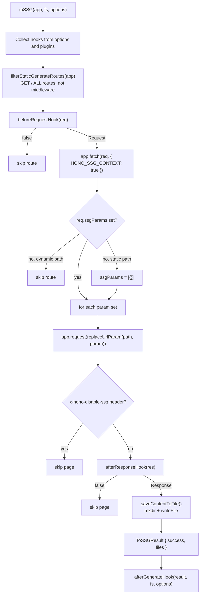

## Overview

The SSG helper (`hono/ssg`) renders a Hono app to files. It does not need a separate build pipeline: `toSSG` lists the app's GET routes, calls the app itself with `app.fetch`/`app.request` for every concrete path, and writes each response body through a small `FileSystemModule` interface. The same routes therefore serve both the live app and the generated site. The whole module is marked experimental.

Sources: [src/helper/ssg/index.ts:1-14](repo://src/helper/ssg/index.ts#L1-L14), [src/helper/ssg/ssg.ts:363-470](repo://src/helper/ssg/ssg.ts#L363-L470), [package.json:269-273](repo://package.json#L269-L273)

```ts
import { Hono } from 'hono'
import { toSSG, ssgParams } from 'hono/ssg'
import fs from 'node:fs/promises'

const app = new Hono()
app.get('/', (c) => c.html('<h1>Home</h1>'))
app.get(
  '/posts/:id',
  ssgParams(() => [{ id: '1' }, { id: '2' }]),
  (c) => c.html(`<h1>Post ${c.req.param('id')}</h1>`)
)

const result = await toSSG(app, fs, { dir: './dist' })
```

Sources: [src/helper/ssg/ssg.ts:34-37](repo://src/helper/ssg/ssg.ts#L34-L37), [src/helper/ssg/middleware.ts:40-49](repo://src/helper/ssg/middleware.ts#L40-L49)

## The toSSG flow

### Steps

`toSSG(app, fs, options)` runs in four stages: collect hooks, generate requests and responses with `fetchRoutesContent`, write files with `saveContentToFile`, and finally run the after-generate hooks with a `ToSSGResult`.

Sources: [src/helper/ssg/ssg.ts:368-470](repo://src/helper/ssg/ssg.ts#L368-L470)



Sources: [src/helper/ssg/ssg.ts:205-302](repo://src/helper/ssg/ssg.ts#L205-L302), [src/helper/ssg/ssg.ts:420-470](repo://src/helper/ssg/ssg.ts#L420-L470)

### Choosing routes

`filterStaticGenerateRoutes` walks `app.routes` and keeps routes whose method is `GET` or `ALL` and whose handler is not a middleware. It unwraps composed handlers with `findTargetHandler` and treats any function with more than one parameter (`(c, next)`) as middleware, so a handler declared with `next` is skipped.

Sources: [src/helper/ssg/utils.ts:57-71](repo://src/helper/ssg/utils.ts#L57-L71), [src/utils/handler.ts:8-15](repo://src/utils/handler.ts#L8-L15)

### Discovering parameters

`fetchRoutesContent` is a generator that yields one promise per route. For each route it builds a request for the raw route path on `http://localhost` (for example `/posts/:id`), passes it through the before-request hook, and calls `app.fetch(request, { HONO_SSG_CONTEXT: true })`. This first call exists to learn the parameters: the `ssgParams` middleware on a dynamic path stores the list on the raw request and answers `c.notFound()` so the real handler does not run. A dynamic route that never set `ssgParams` is skipped; a static route gets `[{}]` and is rendered once.

Sources: [src/helper/ssg/ssg.ts:222-251](repo://src/helper/ssg/ssg.ts#L222-L251), [src/helper/ssg/middleware.ts:43-49](repo://src/helper/ssg/middleware.ts#L43-L49)

### Rendering each page

The resolved value is itself a generator with one promise per parameter set. Each one fills the path with `replaceUrlParam` (shared with the [[RPC Client]]), calls `app.request` with the same method and headers and the SSG env, and drops the page when the response carries `x-hono-disable-ssg` or the after-response hook returns `false`. The MIME type comes from `Content-Type` before any `;`, defaulting to `text/plain`. `parseResponseContent` reads the body as text when the type contains `text` or `json`, and as an `ArrayBuffer` otherwise.

Sources: [src/helper/ssg/ssg.ts:253-296](repo://src/helper/ssg/ssg.ts#L253-L296), [src/helper/ssg/ssg.ts:74-88](repo://src/helper/ssg/ssg.ts#L74-L88), [src/client/utils.ts:18-24](repo://src/client/utils.ts#L18-L24)

> [!NOTE]
> The `DEFAULT_CONTENT_TYPE` of `text/plain` matches what Hono assumes for `c.text()` when Bun omits the `Content-Type` header for speed.

Sources: [src/helper/ssg/ssg.ts:19-25](repo://src/helper/ssg/ssg.ts#L19-L25)

### Concurrency

Both the parameter-discovery calls and the page requests go through one pool from `createPool({ concurrency })`. `options.concurrency` defaults to `2` in `toSSG`. When the pool is full, `run` re-schedules itself with `setTimeout` until a slot frees up.

Sources: [src/helper/ssg/ssg.ts:17-17](repo://src/helper/ssg/ssg.ts#L17-L17), [src/helper/ssg/ssg.ts:420-435](repo://src/helper/ssg/ssg.ts#L420-L435), [src/utils/concurrent.ts:12-55](repo://src/utils/concurrent.ts#L12-L55)

## Writing files

### File paths

`saveContentToFile` awaits one page, picks a path with `generateFilePath`, creates the directory once (a module-level `createdDirs` set remembers it), and writes strings as-is and `ArrayBuffer`s as `Uint8Array`. The extension comes from `options.extensionMap` when given, otherwise from `defaultExtensionMap`, then `getExtension(mimeType)`, then `html`.

Sources: [src/helper/ssg/ssg.ts:304-334](repo://src/helper/ssg/ssg.ts#L304-L334), [src/helper/ssg/ssg.ts:90-108](repo://src/helper/ssg/ssg.ts#L90-L108)

| Route path | Content type | File written (default `dir` `./static`) |
| --- | --- | --- |
| `/` | `text/html` | `static/index.html` |
| `/about` | `text/html` | `static/about.html` |
| `/docs/` | `text/html` | `static/docs/index.html` |
| `/feed.xml` | `application/rss+xml` | `static/feed.xml` (extension already present) |
| `/data` | `application/json` | `static/data.json` |

Sources: [src/helper/ssg/ssg.ts:27-27](repo://src/helper/ssg/ssg.ts#L27-L27), [src/helper/ssg/ssg.ts:50-72](repo://src/helper/ssg/ssg.ts#L50-L72), [src/helper/ssg/ssg.ts:90-97](repo://src/helper/ssg/ssg.ts#L90-L97)

> [!IMPORTANT]
> `generateFilePath` calls `ensureWithinOutDir`, which normalizes both paths with `joinPaths` (resolving `.` and `..`) and throws `Path traversal detected: ...` when the file would land outside the output directory. Parameter values from `ssgParams` therefore cannot write elsewhere on disk.

Sources: [src/helper/ssg/ssg.ts:69-69](repo://src/helper/ssg/ssg.ts#L69-L69), [src/helper/ssg/utils.ts:77-87](repo://src/helper/ssg/utils.ts#L77-L87), [src/helper/ssg/utils.ts:16-55](repo://src/helper/ssg/utils.ts#L16-L55)

### Result and errors

Each save promise has `.catch((e) => e)`, so one failure does not reject the others early. After all routes resolve, `toSSG` walks the saves in order: strings go into `files`, and the first error is rethrown. Any error is caught and reported as `{ success: false, files: [], error }` instead of a rejected promise; non-`Error` values are wrapped with `new Error(String(error))`.

Sources: [src/helper/ssg/ssg.ts:436-464](repo://src/helper/ssg/ssg.ts#L436-L464), [src/helper/ssg/ssg.ts:44-48](repo://src/helper/ssg/ssg.ts#L44-L48)

## Options

| Option | Type | Default | Description |
| --- | --- | --- | --- |
| `dir` | `string` | `./static` | Output directory. |
| `concurrency` | `number` | `2` | Requests in flight at once. |
| `extensionMap` | `Record<string, string>` | `defaultExtensionMap` | MIME type to extension; replaces the default map entirely. |
| `plugins` | `SSGPlugin[]` | `[defaultPlugin()]` | Hook bundles, applied in order. |
| `beforeRequestHook` | hook or array | none | Deprecated; use a plugin. |
| `afterResponseHook` | hook or array | none | Deprecated; use a plugin. |
| `afterGenerateHook` | hook or array | none | Deprecated; use a plugin. |

Sources: [src/helper/ssg/ssg.ts:181-198](repo://src/helper/ssg/ssg.ts#L181-L198), [src/helper/ssg/ssg.ts:368-372](repo://src/helper/ssg/ssg.ts#L368-L372), [src/helper/ssg/ssg.ts:420-422](repo://src/helper/ssg/ssg.ts#L420-L422)

## Plugins and hooks

### Hook types

An `SSGPlugin` may define any of three hooks, each a function or an array of functions. `toSSG` collects the deprecated top-level hooks first and then each plugin's hooks, in plugin order, into three flat lists.

Sources: [src/helper/ssg/ssg.ts:110-116](repo://src/helper/ssg/ssg.ts#L110-L116), [src/helper/ssg/ssg.ts:175-179](repo://src/helper/ssg/ssg.ts#L175-L179), [src/helper/ssg/ssg.ts:373-419](repo://src/helper/ssg/ssg.ts#L373-L419)

| Hook | Signature | Combined by |
| --- | --- | --- |
| `beforeRequestHook` | `(req) => Request \| false` | `combineBeforeRequestHooks`: runs in order, `false` stops and skips the route, a returned `Request` replaces the current one. |
| `afterResponseHook` | `(res) => Response \| false` | `combineAfterResponseHooks`: runs in order, `false` skips the page, a returned `Response` replaces the current one. |
| `afterGenerateHook` | `(result, fsModule, options) => void` | `combineAfterGenerateHooks`: runs every hook in order with the final `ToSSGResult`. |

Sources: [src/helper/ssg/ssg.ts:118-173](repo://src/helper/ssg/ssg.ts#L118-L173)

When a list is empty, `toSSG` substitutes an identity hook for the request and response stages, and skips the after-generate stage entirely. After-generate hooks run even when generation failed, so they can report or clean up.

Sources: [src/helper/ssg/ssg.ts:424-429](repo://src/helper/ssg/ssg.ts#L424-L429), [src/helper/ssg/ssg.ts:465-469](repo://src/helper/ssg/ssg.ts#L465-L469)

### Built-in plugins

`defaultPlugin()` adds one after-response hook that drops every response whose status is not `200`, so 404s and errors are not written to disk. It is only used when `options.plugins` is absent: passing your own `plugins` array removes it unless you include it.

Sources: [src/helper/ssg/plugins.ts:4-20](repo://src/helper/ssg/plugins.ts#L4-L20), [src/helper/ssg/ssg.ts:372-372](repo://src/helper/ssg/ssg.ts#L372-L372)

`redirectPlugin()` turns a `301`, `302`, `303`, `307` or `308` response into a `200` HTML page with a `meta http-equiv="refresh"`, a canonical link and a `noindex` robots tag, built with the `html` helper so the `Location` value is escaped. A redirect without `Location` is dropped. Because `defaultPlugin` discards non-200 responses, `redirectPlugin` must come first.

Sources: [src/helper/ssg/plugins.ts:22-72](repo://src/helper/ssg/plugins.ts#L22-L72)

```ts
import { toSSG, redirectPlugin, defaultPlugin } from 'hono/ssg'

await toSSG(app, fs, { plugins: [redirectPlugin(), defaultPlugin()] })
```

Sources: [src/helper/ssg/plugins.ts:38-55](repo://src/helper/ssg/plugins.ts#L38-L55)

## Middleware for SSG-aware routes

`fetchRoutesContent` passes `{ HONO_SSG_CONTEXT: true }` as the env of every request, which is how the middleware below tells generation from live traffic.

Sources: [src/helper/ssg/middleware.ts:5-6](repo://src/helper/ssg/middleware.ts#L5-L6), [src/helper/ssg/ssg.ts:243-243](repo://src/helper/ssg/ssg.ts#L243-L243), [src/helper/ssg/ssg.ts:266-268](repo://src/helper/ssg/ssg.ts#L266-L268)

| Export | Behaviour |
| --- | --- |
| `ssgParams(params)` | On a dynamic path (a segment starting with `:` or containing `*`), stores `params` (an array, or the result of a possibly async function of `c`) on `c.req.raw.ssgParams` and returns `c.notFound()`; otherwise calls `next()`. |
| `isSSGContext(c)` | `true` when `c.env[HONO_SSG_CONTEXT]` is set. |
| `disableSSG()` | During generation, sets `x-hono-disable-ssg: true` and returns `c.notFound()`, so the route is not written; live requests pass through. |
| `onlySSG()` | Returns `c.notFound()` for live requests; generation passes through. |
| `X_HONO_DISABLE_SSG_HEADER_KEY` | The `x-hono-disable-ssg` header name. |
| `SSG_DISABLED_RESPONSE` | Deprecated 404 response carrying that header. |

Sources: [src/helper/ssg/middleware.ts:5-83](repo://src/helper/ssg/middleware.ts#L5-L83), [src/helper/ssg/utils.ts:73-75](repo://src/helper/ssg/utils.ts#L73-L75)

> [!NOTE]
> `ssgParams` is harmless in live traffic. It tests `c.req.path`, the path actually requested, so only the discovery request for the literal pattern (such as `/posts/:id`) is stopped; a real request to `/posts/1` falls through to `next()` and reaches the handler.

Sources: [src/helper/ssg/middleware.ts:43-49](repo://src/helper/ssg/middleware.ts#L43-L49), [src/helper/ssg/utils.ts:73-75](repo://src/helper/ssg/utils.ts#L73-L75)

## Runtime adapters

`toSSG` only needs `writeFile` and `mkdir`, the `FileSystemModule` interface; Node's `fs/promises` fits directly. Bun and Deno ship their own modules and a `toSSG(app, options)` wrapper that supplies them, exported from `hono/bun` and `hono/deno`.

Sources: [src/helper/ssg/ssg.ts:29-37](repo://src/helper/ssg/ssg.ts#L29-L37), [src/helper/ssg/ssg.ts:350-361](repo://src/helper/ssg/ssg.ts#L350-L361), [src/adapter/bun/index.ts:7-7](repo://src/adapter/bun/index.ts#L7-L7), [src/adapter/deno/index.ts:7-7](repo://src/adapter/deno/index.ts#L7-L7)

| Adapter | `writeFile` | `mkdir` |
| --- | --- | --- |
| `bunFileSystemModule` | `Bun.write(path, data)` | no-op, since `Bun.write` creates parent directories |
| `denoFileSystemModule` | `Deno.writeFile`, encoding strings with `TextEncoder` | `Deno.mkdir(path, { recursive })` |

Sources: [src/adapter/bun/ssg.ts:1-27](repo://src/adapter/bun/ssg.ts#L1-L27), [src/adapter/deno/ssg.ts:1-27](repo://src/adapter/deno/ssg.ts#L1-L27)

```ts
import { toSSG } from 'hono/bun'

await toSSG(app, { dir: './dist' })
```

Sources: [src/adapter/bun/ssg.ts:25-27](repo://src/adapter/bun/ssg.ts#L25-L27)

See [[Runtime Adapters]] for the rest of the Bun and Deno adapters, and [[JSX Server Rendering]] for building the HTML pages themselves.

Sources: [src/adapter/bun/index.ts:7-7](repo://src/adapter/bun/index.ts#L7-L7), [src/adapter/deno/index.ts:7-7](repo://src/adapter/deno/index.ts#L7-L7)
