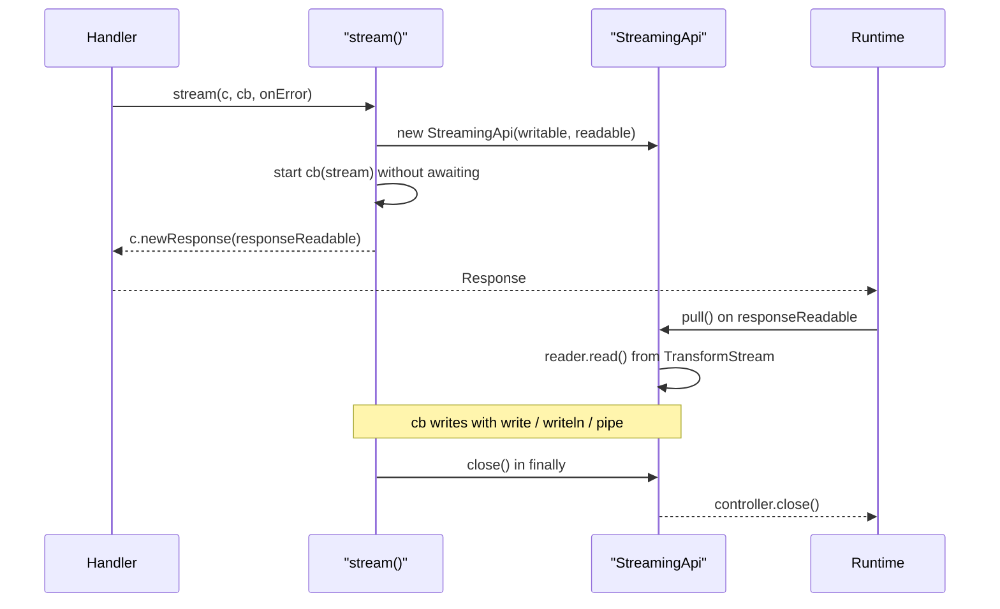

## Overview

The streaming helper (`hono/streaming`) lets a handler return a `Response` immediately and keep writing its body afterwards. It exports three entry points, `stream`, `streamText` and `streamSSE`, plus the `SSEStreamingApi` class and the `SSEMessage` type. All three are built on `StreamingApi` from `src/utils/stream.ts`, a small wrapper around a `TransformStream` that turns the Web Streams API into `write`/`writeln`/`sleep`/`pipe` calls and adds abort notification.

Sources: [src/helper/streaming/index.ts:1-9](repo://src/helper/streaming/index.ts#L1-L9), [package.json:274-278](repo://package.json#L274-L278), [src/utils/stream.ts:6-46](repo://src/utils/stream.ts#L6-L46)

Because the callback runs after the handler has already returned, errors thrown in it can no longer reach `app.onError` (see [[Error Handling]]); each helper therefore takes its own `onError` callback.

Sources: [src/helper/streaming/stream.ts:7-45](repo://src/helper/streaming/stream.ts#L7-L45)

## Choosing a helper

| Helper | Callback receives | Headers set | Error behaviour |
| --- | --- | --- | --- |
| `stream(c, cb, onError?)` | `StreamingApi` | none | `onError(e, stream)` or `console.error` |
| `streamText(c, cb, onError?)` | `StreamingApi` | `Content-Type: text/plain; charset=UTF-8`, `X-Content-Type-Options: nosniff`, `Transfer-Encoding: chunked` | same as `stream` |
| `streamSSE(c, cb, onError?)` | `SSEStreamingApi` | `Transfer-Encoding: chunked`, `Content-Type: text/event-stream`, `Cache-Control: no-cache`, `Connection: keep-alive` | `onError(e, stream)` then an `error` event, or `console.error` |

Sources: [src/helper/streaming/stream.ts:7-45](repo://src/helper/streaming/stream.ts#L7-L45), [src/helper/streaming/text.ts:6-15](repo://src/helper/streaming/text.ts#L6-L15), [src/helper/streaming/sse.ts:47-100](repo://src/helper/streaming/sse.ts#L47-L100), [src/context.ts:279-279](repo://src/context.ts#L279-L279)

```ts
import { streamText, streamSSE } from 'hono/streaming'

app.get('/text', (c) =>
  streamText(c, async (stream) => {
    await stream.writeln('Hello')
    await stream.sleep(1000)
    await stream.write('World')
  })
)

app.get('/sse', (c) =>
  streamSSE(c, async (stream) => {
    let id = 0
    while (!stream.aborted) {
      await stream.writeSSE({ event: 'time', data: new Date().toISOString(), id: String(id++) })
      await stream.sleep(1000)
    }
  })
)
```

Sources: [src/helper/streaming/text.ts:6-15](repo://src/helper/streaming/text.ts#L6-L15), [src/helper/streaming/sse.ts:13-45](repo://src/helper/streaming/sse.ts#L13-L45), [src/utils/stream.ts:48-67](repo://src/utils/stream.ts#L48-L67)

## How a streaming response is built

### The stream flow

`stream` creates a `TransformStream`, wraps its two ends in a `StreamingApi`, starts the callback in a detached async function and returns `c.newResponse(stream.responseReadable)` without awaiting it. The runtime starts sending the response while the callback is still writing. `streamText` only sets its headers and delegates to `stream`; `streamSSE` follows the same shape with an `SSEStreamingApi` and a separate `run` function.

Sources: [src/helper/streaming/stream.ts:7-45](repo://src/helper/streaming/stream.ts#L7-L45), [src/helper/streaming/sse.ts:47-100](repo://src/helper/streaming/sse.ts#L47-L100)



Sources: [src/helper/streaming/stream.ts:12-44](repo://src/helper/streaming/stream.ts#L12-L44), [src/utils/stream.ts:21-46](repo://src/utils/stream.ts#L21-L46)

### Why `responseReadable` is a separate stream

The constructor does not hand the `TransformStream`'s readable side to the `Response` directly. It takes a reader on it and builds a new `ReadableStream` whose `pull` forwards each chunk and whose `cancel` calls `this.abort()` unless the stream was closed normally. This gives Hono a hook into client disconnects: when the runtime cancels the response body, every `onAbort` listener runs. The first listener, registered in the constructor, cancels the internal reader so a pending `writeSSE` stops blocking.

Sources: [src/utils/stream.ts:21-46](repo://src/utils/stream.ts#L21-L46)

### Keeping the context alive

Each helper stores the `Context` in a module-level `WeakMap` keyed by `stream.responseReadable`. On Bun the context is destroyed once the handler returns, and this reference keeps it alive for as long as the response stream exists, without leaking it afterwards.

Sources: [src/helper/streaming/stream.ts:5-25](repo://src/helper/streaming/stream.ts#L5-L25), [src/helper/streaming/sse.ts:70-90](repo://src/helper/streaming/sse.ts#L70-L90)

## StreamingApi

| Member | Description |
| --- | --- |
| `write(input)` | Encodes a string with `TextEncoder` (or passes a `Uint8Array`) and writes it. Write errors are swallowed; returns `this`. |
| `writeln(input)` | `write(input + '\n')`. |
| `sleep(ms)` | A `setTimeout` promise, for pacing output. |
| `pipe(body)` | Releases the writer lock, runs `body.pipeTo(this.writable, { preventClose: true })`, then takes a new writer so writing can continue. |
| `onAbort(listener)` | Adds a listener called once when the stream is aborted. |
| `abort()` | Sets `aborted` and calls every abort listener; repeated calls do nothing. |
| `close()` | Sets `closed` and closes the writer, swallowing errors. |
| `aborted` / `closed` | Booleans for the two ways a stream ends. |
| `responseReadable` | The `ReadableStream` used as the response body. |

Sources: [src/utils/stream.ts:6-98](repo://src/utils/stream.ts#L6-L98)

> [!NOTE]
> `write` and `close` catch and ignore every error, so writing to a stream the client already left does not throw. Check `stream.aborted` in long loops, or register `onAbort`, to stop producing data. The source comment says to build a stream yourself if you need to see write errors.

Sources: [src/utils/stream.ts:48-76](repo://src/utils/stream.ts#L48-L76)

`pipe` keeps the response open because of `preventClose: true`, so a handler can pipe an upstream body and then append more data. `close` is still called by the helper's `finally` block when the callback returns.

Sources: [src/utils/stream.ts:78-82](repo://src/utils/stream.ts#L78-L82), [src/helper/streaming/stream.ts:39-41](repo://src/helper/streaming/stream.ts#L39-L41)

## Server-Sent Events

### writeSSE

`SSEStreamingApi` adds one method, `writeSSE(message)`. The `data` field can be a string or a promise; it is passed through `resolveCallback` with the `Stringify` phase, so an `HtmlEscapedString` or rendered JSX with async callbacks resolves to plain text first (see [[HTML and CSS Helpers]]). The data is split on `\r\n`, `\r` or `\n` and every line is prefixed with `data: `, which is how SSE carries multi-line payloads.

Sources: [src/helper/streaming/sse.ts:6-26](repo://src/helper/streaming/sse.ts#L6-L26)

The message is then assembled in the order `event`, `data`, `id`, `retry`, joined with `\n` and terminated by a blank line. Falsy fields are dropped by `.filter(Boolean)`, so `retry: 0` or an empty `id` is not sent.

Sources: [src/helper/streaming/sse.ts:33-44](repo://src/helper/streaming/sse.ts#L33-L44)

| Field | Type | Line written |
| --- | --- | --- |
| `data` | `string \| Promise<string>` | one `data: ...` line per input line |
| `event` | `string` | `event: ...` |
| `id` | `string` | `id: ...` |
| `retry` | `number` | `retry: ...` |

Sources: [src/helper/streaming/sse.ts:6-11](repo://src/helper/streaming/sse.ts#L6-L11), [src/helper/streaming/sse.ts:33-41](repo://src/helper/streaming/sse.ts#L33-L41)

> [!WARNING]
> `writeSSE` throws `<key> must not contain "\r" or "\n"` when `event`, `id` or `retry` holds a line break. Without this check a value from user input could inject extra SSE fields or a fake event.

Sources: [src/helper/streaming/sse.ts:27-31](repo://src/helper/streaming/sse.ts#L27-L31)

### Headers

`streamSSE` sets `Transfer-Encoding: chunked`, `Content-Type: text/event-stream`, `Cache-Control: no-cache` and `Connection: keep-alive` on the context before building the response, so proxies and browsers neither cache nor buffer the event stream.

Sources: [src/helper/streaming/sse.ts:92-99](repo://src/helper/streaming/sse.ts#L92-L99)

## Errors and aborts

### Error handling

The callback runs inside a `try`/`catch`/`finally` in every helper, but the two families treat a thrown error slightly differently, as the steps below list.

Sources: [src/helper/streaming/stream.ts:26-42](repo://src/helper/streaming/stream.ts#L26-L42), [src/helper/streaming/sse.ts:52-67](repo://src/helper/streaming/sse.ts#L52-L67)

1. `stream` and `streamText`: an `undefined` rejection is ignored, because cancelling a `pipeTo` without a reason rejects with `undefined` after the stream is already closed. An `Error` goes to `onError(e, stream)` when given; anything else, or any error without `onError`, is logged with `console.error`.
2. `streamSSE`: an `Error` with `onError` set calls `onError(e, stream)` and then writes an SSE message with `event: 'error'` and `data: e.message` to the client. Everything else is logged with `console.error`.
3. In both, `finally` calls `stream.close()`, so the response always ends.

Sources: [src/helper/streaming/stream.ts:26-42](repo://src/helper/streaming/stream.ts#L26-L42), [src/helper/streaming/sse.ts:47-68](repo://src/helper/streaming/sse.ts#L47-L68)

> [!CAUTION]
> With `streamSSE`, `e.message` is sent to the browser whenever `onError` is provided. Throw errors whose message is safe to expose, or catch them inside the callback.

Sources: [src/helper/streaming/sse.ts:55-61](repo://src/helper/streaming/sse.ts#L55-L61)

### Client disconnects

A disconnect reaches the stream through `cancel` on `responseReadable`, which calls `abort()`. Bun before 1.1.27 never called `cancel` on bodies returned from `Bun.serve()`, so when `isOldBunVersion()` is true the helpers also listen for `abort` on `c.req.raw.signal` and call `stream.abort()` themselves. `isOldBunVersion` checks `Bun.version` for `1.1`, `1.0` or `0.` and replaces itself with a constant function after the first call.

Sources: [src/helper/streaming/stream.ts:15-22](repo://src/helper/streaming/stream.ts#L15-L22), [src/helper/streaming/sse.ts:80-87](repo://src/helper/streaming/sse.ts#L80-L87), [src/helper/streaming/utils.ts:1-11](repo://src/helper/streaming/utils.ts#L1-L11)

```ts
app.get('/ticks', (c) =>
  stream(
    c,
    async (stream) => {
      stream.onAbort(() => console.log('client left'))
      while (!stream.aborted) {
        await stream.writeln('tick')
        await stream.sleep(500)
      }
    },
    async (err, stream) => {
      await stream.writeln('error: ' + err.message)
    }
  )
)
```

Sources: [src/utils/stream.ts:84-97](repo://src/utils/stream.ts#L84-L97), [src/helper/streaming/stream.ts:7-45](repo://src/helper/streaming/stream.ts#L7-L45)

## Related pages

- [[Context]] for `c.header` and `c.newResponse`, which the helpers use to build the response.
- [[JSX Server Rendering]] for streaming JSX with `Suspense`, a separate mechanism from this helper.
- [[WebSockets]] for two-way communication instead of one-way events.

Sources: [src/helper/streaming/stream.ts:44-44](repo://src/helper/streaming/stream.ts#L44-L44), [src/helper/streaming/sse.ts:92-99](repo://src/helper/streaming/sse.ts#L92-L99)
