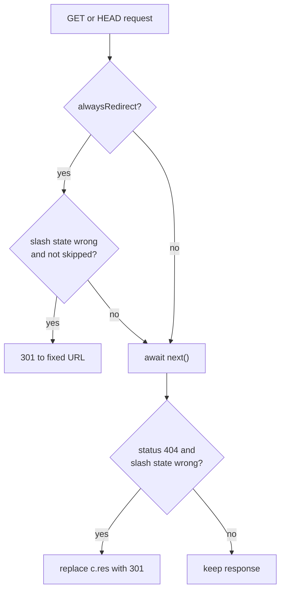
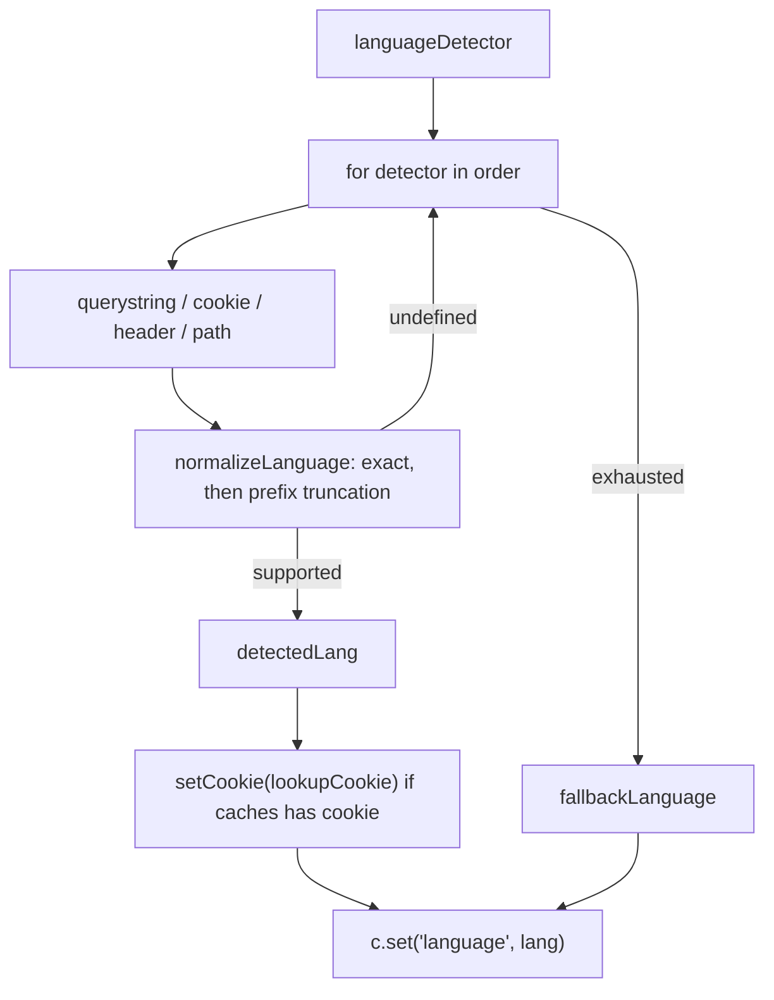

## Overview

This page covers the small, general-purpose middleware that do not belong to authentication, security or performance: request logging, request IDs, pretty-printed JSON, the `X-Powered-By` header, trailing-slash redirects, HTTP method override, combinators that build one middleware out of several, AsyncLocalStorage-backed context access, and language detection. Each lives in its own folder under `src/middleware` and is published as its own subpath export, so an application only bundles what it imports.

Sources: [package.json:119-123](repo://package.json#L119-L123), [package.json:229-268](repo://package.json#L229-L268)

Several of these store values on the context with `c.set` and declare them on `ContextVariableMap`, so `c.get('requestId')` or `c.var.language` is typed as soon as the module is imported. See [[Context]] for variables and [[Middleware and Composition]] for how `next()` and `compose` work.

Sources: [src/middleware/request-id/index.ts:1-7](repo://src/middleware/request-id/index.ts#L1-L7), [src/middleware/language/index.ts:1-12](repo://src/middleware/language/index.ts#L1-L12)

| Middleware | Import | Purpose |
| --- | --- | --- |
| `logger` | `hono/logger` | Log `<--` request and `-->` response lines |
| `requestId` | `hono/request-id` | Assign and echo a request ID |
| `prettyJSON` | `hono/pretty-json` | Re-indent JSON responses on demand |
| `poweredBy` | `hono/powered-by` | Set `X-Powered-By` |
| `trimTrailingSlash`, `appendTrailingSlash` | `hono/trailing-slash` | Canonicalise paths with 301 redirects |
| `methodOverride` | `hono/method-override` | Re-dispatch a POST as another method |
| `some`, `every`, `except` | `hono/combine` | Compose middleware conditionally |
| `contextStorage`, `getContext`, `tryGetContext` | `hono/context-storage` | Reach `Context` outside handlers |
| `languageDetector` | `hono/language` | Resolve the request language |

Sources: [package.json:119-123](repo://package.json#L119-L123), [package.json:139-143](repo://package.json#L139-L143), [package.json:229-268](repo://package.json#L229-L268)

## Logger

`logger(fn = console.log)` prints one line before calling `next()` and one after. The path is everything after the host (`url.slice(url.indexOf('/', 8))`), so the query string is included. The outgoing line adds the status and elapsed time: milliseconds under one second, otherwise whole seconds, with thousands separators inserted by `humanize`.

Sources: [src/middleware/logger/index.ts:9-26](repo://src/middleware/logger/index.ts#L9-L26), [src/middleware/logger/index.ts:50-95](repo://src/middleware/logger/index.ts#L50-L95)

```text
<-- GET /posts?page=2
--> GET /posts?page=2 200 12ms
```

Sources: [src/middleware/logger/index.ts:58-62](repo://src/middleware/logger/index.ts#L58-L62)

Status codes are coloured by class (5xx red, 4xx yellow, 3xx cyan, 2xx green) unless colour is disabled. `getColorEnabledAsync` honours `NO_COLOR` in `process.env`, `Deno.noColor`, and, on Cloudflare Workers, a `NO_COLOR` binding read from `cloudflare:workers`. Pass a custom `fn` to send lines to another logger; it receives the formatted string.

Sources: [src/middleware/logger/index.ts:28-46](repo://src/middleware/logger/index.ts#L28-L46), [src/utils/color.ts:14-56](repo://src/utils/color.ts#L14-L56)

## Request ID

`requestId` reuses an incoming ID when it is present, no longer than `limitLength`, and made only of word characters, `-` and `=`; otherwise it calls `generator`. The ID is stored as `requestId` on the context and echoed in the response header. Setting `headerName` to an empty string disables both reading and writing the header.

Sources: [src/middleware/request-id/request-id.ts:41-59](repo://src/middleware/request-id/request-id.ts#L41-L59)

| Option | Type | Default |
| --- | --- | --- |
| `limitLength` | `number` | `255` |
| `headerName` | `string` | `"X-Request-Id"` |
| `generator` | `(c) => string` | `crypto.randomUUID()` |

Sources: [src/middleware/request-id/request-id.ts:9-17](repo://src/middleware/request-id/request-id.ts#L9-L17), [src/middleware/request-id/request-id.ts:41-45](repo://src/middleware/request-id/request-id.ts#L41-L45)

The character check prevents log or header injection through a client-supplied ID. Register `requestId` before `logger` or any middleware that reads `c.get('requestId')`.

Sources: [src/middleware/request-id/request-id.ts:47-56](repo://src/middleware/request-id/request-id.ts#L47-L56)

## Pretty JSON

`prettyJSON` decides before `next()` whether to pretty-print: when `force` is set, or the query parameter named by `query` (default `pretty`) is present, even with an empty value. After the handler, if the response `Content-Type` starts with `application/json`, it parses the body and replaces `c.res` with `JSON.stringify(obj, null, space)`.

Sources: [src/middleware/pretty-json/index.ts:8-26](repo://src/middleware/pretty-json/index.ts#L8-L26), [src/middleware/pretty-json/index.ts:46-56](repo://src/middleware/pretty-json/index.ts#L46-L56)

| Option | Type | Default |
| --- | --- | --- |
| `space` | `number` | `2` |
| `query` | `string` | `"pretty"` |
| `force` | `boolean` | `false` |

Sources: [src/middleware/pretty-json/index.ts:8-26](repo://src/middleware/pretty-json/index.ts#L8-L26)

## Powered By

`poweredBy({ serverName })` sets `X-Powered-By` to `serverName` or `Hono` after the handler runs. `secureHeaders` removes the same header by default (see [[Security Middleware]]), so registering both has no visible effect unless `removePoweredBy` is turned off.

Sources: [src/middleware/powered-by/index.ts:7-35](repo://src/middleware/powered-by/index.ts#L7-L35)

## Trailing Slash

### trimTrailingSlash

`trimTrailingSlash` redirects `/about/` to `/about` with `301`. By default it waits for the response and redirects only when the route returned `404`, so a route that genuinely ends in a slash keeps working. With `alwaysRedirect: true` it redirects before routing, which is the mode to use when a wildcard route would otherwise swallow the slashed path. Only `GET` and `HEAD` are redirected and the root `/` is never touched.

Sources: [src/middleware/trailing-slash/index.ts:8-17](repo://src/middleware/trailing-slash/index.ts#L8-L17), [src/middleware/trailing-slash/index.ts:44-74](repo://src/middleware/trailing-slash/index.ts#L44-L74)

### appendTrailingSlash

`appendTrailingSlash` is the mirror image: it adds a slash on `404` (or always, with `alwaysRedirect`). Its extra `skip(path)` option exempts paths, for example files with an extension, from the redirect.

Sources: [src/middleware/trailing-slash/index.ts:76-101](repo://src/middleware/trailing-slash/index.ts#L76-L101), [src/middleware/trailing-slash/index.ts:128-158](repo://src/middleware/trailing-slash/index.ts#L128-L158)



Sources: [src/middleware/trailing-slash/index.ts:44-74](repo://src/middleware/trailing-slash/index.ts#L44-L74), [src/middleware/trailing-slash/index.ts:128-158](repo://src/middleware/trailing-slash/index.ts#L128-L158)

## Method Override

`methodOverride({ app, form | header | query })` lets HTML forms or limited clients issue `DELETE`, `PUT` and the like through a `POST`. It needs the `app` instance because it does not mutate the current request: it builds a new `Request` with the overridden method and calls `app.fetch(request, c.env, executionCtx)`, so routing starts over and the original route's later handlers are skipped. `GET` requests always pass through.

Sources: [src/middleware/method-override/index.ts:11-33](repo://src/middleware/method-override/index.ts#L11-L33), [src/middleware/method-override/index.ts:60-66](repo://src/middleware/method-override/index.ts#L60-L66)

| Mode | Option | Source of method | What is stripped |
| --- | --- | --- | --- |
| Form (default) | `form` (default `_method`) | `multipart/form-data` or `application/x-www-form-urlencoded` body field | the field from the re-encoded body |
| Header | `header` | named request header | that header |
| Query | `query` | named query parameter | that parameter from the URL |

Sources: [src/middleware/method-override/index.ts:67-138](repo://src/middleware/method-override/index.ts#L67-L138)

In form mode the raw request is cloned twice: one clone is parsed to find the method field, the other provides the body for the new request. For multipart bodies `content-type` and `content-length` are dropped so `Request` can generate a fresh boundary. `getExecutionCtx` swallows the error `c.executionCtx` throws on runtimes without one.

Sources: [src/middleware/method-override/index.ts:67-105](repo://src/middleware/method-override/index.ts#L67-L105), [src/middleware/method-override/index.ts:140-148](repo://src/middleware/method-override/index.ts#L140-L148)

```ts
const app = new Hono()

// If no options are specified, the value of `_method` in the form,
// e.g. DELETE, is used as the method.
app.use('/posts', methodOverride({ app }))

app.delete('/posts', (c) => {
  // ....
})
```

Sources: [src/middleware/method-override/index.ts:46-58](repo://src/middleware/method-override/index.ts#L46-L58)

## Combine

### some

`some(...middleware)` runs its arguments in order until one succeeds. Arguments may be middleware or `Condition` functions `(c) => boolean`. A condition returning `true` counts as success and calls `next()`; returning `false` moves on to the next argument. A middleware succeeds if it returns without throwing; if it throws before calling `next()`, the error is remembered and the next argument is tried. If it throws after calling `next()`, the error came from downstream and is rethrown at once instead of retrying. When nothing succeeds the last error is thrown.

Sources: [src/middleware/combine/index.ts:38-69](repo://src/middleware/combine/index.ts#L38-L69)

```ts
// If client has a valid token, then skip rate limiting.
// Otherwise, apply rate limiting.
app.use('/api/*', some(
  bearerAuth({ token }),
  myRateLimit({ limit: 100 }),
));
```

Sources: [src/middleware/combine/index.ts:24-36](repo://src/middleware/combine/index.ts#L24-L36)

### every

`every(...middleware)` chains all arguments with the core `compose` function, so each must call `next()` for the following one to run, and the final `next` is the outer one. A condition returning `false` throws `Unmet condition`. Because `compose` normally advances `c.req.routeIndex`, the wrapper restores the outer route index before each call so parameter lookup stays correct.

Sources: [src/middleware/combine/index.ts:99-117](repo://src/middleware/combine/index.ts#L99-L117)

### except

`except(condition, ...middleware)` runs the middleware unless a condition matches. String conditions are path patterns added to a private `TrieRouter` and matched against `c.req.path` (see [[Router Implementations]]); functions are evaluated directly. It is built from the other two: `some(anyConditionMatches, every(...middleware))`.

Sources: [src/middleware/combine/index.ts:141-165](repo://src/middleware/combine/index.ts#L141-L165)

```ts
// If client is accessing public API, then skip authentication.
// Otherwise, require a valid token.
app.use('/api/*', except(
  '/api/public/*',
  bearerAuth({ token }),
));
```

Sources: [src/middleware/combine/index.ts:128-139](repo://src/middleware/combine/index.ts#L128-L139)

## Context Storage

`contextStorage()` wraps the rest of the chain in `asyncLocalStorage.run(c, next)` using a module-level `AsyncLocalStorage<Context>` from `node:async_hooks`. Any code called during the request, such as a data-access helper, can then call `getContext<Env>()` to get the current `Context` with typed `var` and `env`, without the context being passed as an argument. `tryGetContext` returns `undefined` outside a request; `getContext` throws `Context is not available`.

Sources: [src/middleware/context-storage/index.ts:6-59](repo://src/middleware/context-storage/index.ts#L6-L59)

> [!NOTE]
> The module imports `node:async_hooks`, so it requires a runtime with `AsyncLocalStorage`: Node.js, Bun, Deno, or Cloudflare Workers with the Node.js compatibility flag.

Sources: [src/middleware/context-storage/index.ts:6-10](repo://src/middleware/context-storage/index.ts#L6-L10)

```ts
type Env = {
  Variables: {
    message: string
  }
}

const app = new Hono<Env>()

app.use(contextStorage())

app.use(async (c, next) => {
  c.set('message', 'Hono is hot!!')
  await next()
})

app.get('/', async (c) => c.text(getMessage()))

const getMessage = () => {
  return getContext<Env>().var.message
}
```

Sources: [src/middleware/context-storage/index.ts:19-41](repo://src/middleware/context-storage/index.ts#L19-L41)

## Language Detection

### Detector options

`languageDetector(options)` merges partial options over `DEFAULT_OPTIONS` (with `cookieOptions` merged one level deeper), validates them, and on each request stores the result as `language` on the context. `validateOptions` throws at construction if `fallbackLanguage` is not in `supportedLanguages`, if `lookupFromPathIndex` is negative, or if `order` names an unknown detector.

Sources: [src/middleware/language/language.ts:51-68](repo://src/middleware/language/language.ts#L51-L68), [src/middleware/language/language.ts:195-207](repo://src/middleware/language/language.ts#L195-L207), [src/middleware/language/language.ts:283-300](repo://src/middleware/language/language.ts#L283-L300)

| Option | Default | Description |
| --- | --- | --- |
| `order` | `['querystring', 'cookie', 'header']` | Detectors to try; `path` is also available |
| `lookupQueryString` | `"lang"` | Query parameter name |
| `lookupCookie` | `"language"` | Cookie name, read and written |
| `lookupFromHeaderKey` | `"accept-language"` | Header to parse |
| `lookupFromPathIndex` | `0` | Path segment index for `path` |
| `caches` | `['cookie']` | Persist a detected language in a cookie, or `false` |
| `cookieOptions` | `sameSite: 'Strict'`, `secure`, `httpOnly`, one year `maxAge` | Passed to `setCookie` |
| `ignoreCase` | `true` | Case-insensitive matching |
| `fallbackLanguage` | `"en"` | Used when nothing matches |
| `supportedLanguages` | `['en']` | Allowed results |
| `convertDetectedLanguage` | none | Transform raw codes before matching |
| `debug` | `false` | Log detection steps and errors |

Sources: [src/middleware/language/language.ts:13-45](repo://src/middleware/language/language.ts#L13-L45), [src/middleware/language/language.ts:51-68](repo://src/middleware/language/language.ts#L51-L68)

### Detection flow

`detectLanguage` walks `order` and stops at the first detector that returns a supported language; a detector that throws is skipped. Every detector funnels its raw value through `normalizeLanguage`, which trims, applies `convertDetectedLanguage`, tries an exact match, then truncates subtags right to left per RFC 4647 lookup (`en-GB-oxendict` → `en-GB` → `en`). It returns the casing from `supportedLanguages`, never the client's. The header detector parses `Accept-Language` with `parseAccept`, which orders entries by quality, and returns the first one that normalises. A detected language is written back to the cookie when `caches` includes `cookie`; the fallback is never cached.

Sources: [src/middleware/language/language.ts:74-182](repo://src/middleware/language/language.ts#L74-L182), [src/middleware/language/language.ts:212-258](repo://src/middleware/language/language.ts#L212-L258)



Sources: [src/middleware/language/language.ts:229-258](repo://src/middleware/language/language.ts#L229-L258), [src/middleware/language/language.ts:295-299](repo://src/middleware/language/language.ts#L295-L299)

The individual detectors are exported too (`detectFromQuery`, `detectFromCookie`, `detectFromHeader`, `detectFromPath`) for use in custom logic; each takes `(c, options)` with a full `DetectorOptions`. Cookie reads and writes go through the [[Cookie Helper]].

Sources: [src/middleware/language/index.ts:1-12](repo://src/middleware/language/index.ts#L1-L12), [src/middleware/language/language.ts:128-172](repo://src/middleware/language/language.ts#L128-L172)
