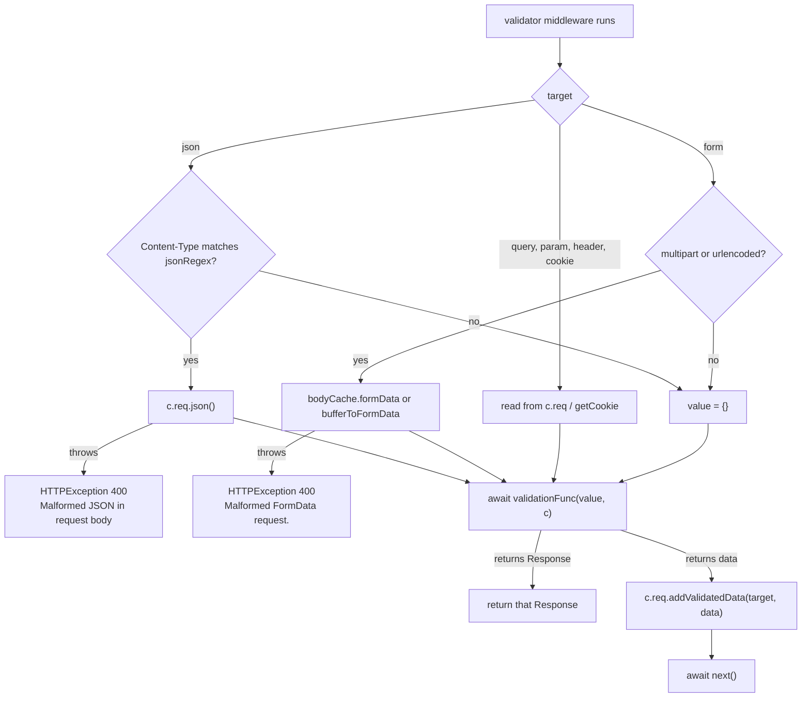

## Overview

`validator()` is the built-in middleware that pulls one part of the request (JSON body, form body, query string, path params, headers or cookies), hands it to a validation function you supply, and stores the function's result so the handler can read it with `c.req.valid(target)`. Hono deliberately ships no schema library: the validation function can be hand-written or wrap Zod, Valibot or anything else, and libraries such as `@hono/zod-validator` are thin wrappers around this function.

Sources: [src/validator/validator.ts:46-88](repo://src/validator/validator.ts#L46-L88), [src/validator/index.ts:1-7](repo://src/validator/index.ts#L1-L7)

The middleware matters as much at the type level as at runtime. Its generic parameters describe an `in` type (what a client must send) and an `out` type (what the handler receives), and the route's schema records both, which is how [[RPC Client]] knows the shape of each request.

Sources: [src/validator/validator.ts:64-82](repo://src/validator/validator.ts#L64-L82), [src/types.ts:2500-2530](repo://src/types.ts#L2500-L2530)

## Using the middleware

### A basic validator

`validator(target, validationFunc)` returns a `MiddlewareHandler`. The function receives the extracted value and the `Context`; it either returns the validated data or returns a `Response` to stop the request. In this example from the test suite, a query without `q` is answered with `400` and never reaches the handler.

Sources: [src/validator/validator.ts:162-170](repo://src/validator/validator.ts#L162-L170)

```ts
validator('query', (value, c) => {
  type verify = Expect<Equal<Record<string, string | string[]>, typeof value>>
  if (!value.q) {
    return c.text('Invalid!', 400)
  }
}),
```

Sources: [src/validator/validator.test.ts:62-80](repo://src/validator/validator.test.ts#L62-L80)

### Wrapping a schema library

The test suite's reference `zodValidator` shows the usual adapter pattern: call `schema.safeParse`, return an error response on failure, return `result.data` on success, and cast the middleware so its `in` type is the schema's input type and its `out` type is the schema's output type.

Sources: [src/validator/validator.test.ts:35-58](repo://src/validator/validator.test.ts#L35-L58)

```ts
const validationFunc = (value: unknown, c: Context<E, P>) => {
  const result = schema.safeParse(value)
  if (!result.success) {
    return c.text('Invalid!', 400)
  }
  return result.data as z.output<T>
}
```

Sources: [src/validator/validator.test.ts:35-58](repo://src/validator/validator.test.ts#L35-L58)

### The ValidationFunction type

`ValidationFunction<InputType, OutputType, E, P>` is the exported signature for such functions: `(value, c) => OutputType | TypedResponse | Promise<OutputType> | Promise<TypedResponse>`. Wrapper libraries use it to type their callbacks.

Sources: [src/validator/validator.ts:14-22](repo://src/validator/validator.ts#L14-L22)

## Targets and value extraction

### What each target reads

The middleware switches on `target` and builds `value` from the request. Every target starts from `{}`, so a body target whose content type does not match passes an empty object to the validation function rather than failing.

Sources: [src/validator/validator.ts:89-97](repo://src/validator/validator.ts#L89-L97), [src/validator/validator.ts:105-111](repo://src/validator/validator.ts#L105-L111)

| Target | Source | Value shape |
| --- | --- | --- |
| `json` | `c.req.json()` when `Content-Type` matches `jsonRegex` | Parsed JSON, else `{}` |
| `form` | Request body as `FormData` when multipart or urlencoded | `Record<string, string \| File \| (string \| File)[]>`, else `{}` |
| `query` | `c.req.queries()` | Single values unwrapped, repeated keys as arrays |
| `param` | `c.req.param()` | `Record<string, string>` |
| `header` | `c.req.header()` | All headers, lowercase keys |
| `cookie` | `getCookie(c)` | `Record<string, string>` |

Sources: [src/validator/validator.ts:89-160](repo://src/validator/validator.ts#L89-L160)

### Content-type checks

Three regexes gate the body targets. `jsonRegex` accepts `application/json` and structured suffixes such as `application/vnd.api+json`, optionally followed by parameters like `charset`. `multipartRegex` accepts `multipart/form-data` with an optional `boundary`, and `urlencodedRegex` accepts `application/x-www-form-urlencoded` with parameters. All are case-insensitive. A header such as `Xapplication/json` does not match, so the body is not read.

Sources: [src/validator/validator.test.ts:182-230](repo://src/validator/validator.test.ts#L182-L230)

```ts
const jsonRegex = /^application\/([a-z-\.]+\+)?json(;\s*[a-zA-Z0-9\-]+\=([^;]+))*$/i
const multipartRegex = /^multipart\/form-data(;\s?boundary=[a-zA-Z0-9'"()+_,\-./:=?]+)?$/i
const urlencodedRegex = /^application\/x-www-form-urlencoded(;\s*[a-zA-Z0-9\-]+\=([^;]+))*$/i
```

Sources: [src/validator/validator.ts:24-26](repo://src/validator/validator.ts#L24-L26)

At the type level, `ValidationTargetByMethod` removes `json` and `form` from the allowed targets when the method type is `get` or `head`, since those requests carry no body.

Sources: [src/validator/validator.ts:9-12](repo://src/validator/validator.ts#L9-L12)

### Form field folding

The form branch converts `FormData` entries into a plain object. A key ending in `[]` always becomes an array (the brackets stay in the key); a key seen more than once is promoted to an array on its second occurrence; any other key holds its single value.

Sources: [src/validator/validator.ts:129-141](repo://src/validator/validator.ts#L129-L141)

```ts
formData.forEach((value, key) => {
  if (key.endsWith('[]')) {
    ;((form[key] ??= []) as unknown[]).push(value)
  } else if (Array.isArray(form[key])) {
    ;(form[key] as unknown[]).push(value)
  } else if (Object.hasOwn(form, key)) {
    form[key] = [form[key] as string | File, value]
  } else {
    form[key] = value
  }
})
```

Sources: [src/validator/validator.ts:129-142](repo://src/validator/validator.ts#L129-L142)

## Body parsing and caching

### Why the body is cached

A `Request` body can be read once, but a validator and a handler (or several validators) may all need it. `HonoRequest` keeps a `bodyCache`, and its `#cachedBody` helper returns the cached promise for the requested format, or converts another cached format through `new Response(body)[key]()`, or finally reads `raw[key]()` and caches it.

Sources: [src/request.ts:220-239](repo://src/request.ts#L220-L239), [src/request.ts:69-69](repo://src/request.ts#L69-L69)

The `json` target calls `c.req.json()`, which reads the body as cached text and runs `JSON.parse`, so a handler calling `c.req.json()` again parses the same cached text instead of failing on a consumed stream.

Sources: [src/request.ts:245-255](repo://src/request.ts#L245-L255), [src/validator/validator.ts:94-104](repo://src/validator/validator.ts#L94-L104)

### Form parsing path

The form target first reuses `c.req.bodyCache.formData` if present. Otherwise it reads `c.req.arrayBuffer()` (itself cached) and converts it with `bufferToFormData`, which wraps the buffer in a `Response` whose `Content-Type` has a lower-cased media type but the original boundary, then calls `response.formData()`. The resulting `FormData` is written back to `bodyCache.formData`, so a later `c.req.formData()` reuses it, and `c.req.parseBody()` can still re-read the cached array buffer.

Sources: [src/validator/validator.ts:105-127](repo://src/validator/validator.ts#L105-L127), [src/utils/buffer.ts:106-117](repo://src/utils/buffer.ts#L106-L117), [src/utils/body.ts:124-134](repo://src/utils/body.ts#L124-L134)

Because the cache holds the body, `cloneRawRequest(c.req)` can rebuild a forwardable `Request` after validation even though the raw stream is consumed; it throws an `HTTPException(500)` only when the body was read from `req.raw` directly and nothing was cached.

Sources: [src/request.ts:445-505](repo://src/request.ts#L445-L505)

## Validation flow and errors

### Middleware flow



Sources: [src/validator/validator.ts:89-171](repo://src/validator/validator.ts#L89-L171)

### Parse errors

Malformed bodies are rejected before your function runs. Invalid JSON throws `new HTTPException(400, { message: 'Malformed JSON in request body' })`. A form body that `FormData` cannot parse throws `HTTPException(400)` with `Malformed FormData request.` followed by the underlying error message.

Sources: [src/validator/validator.ts:98-103](repo://src/validator/validator.ts#L98-L103), [src/validator/validator.ts:118-126](repo://src/validator/validator.ts#L118-L126)

These exceptions travel to the application's error handler. The default handler sees `getResponse` on the `HTTPException` and answers with its status and message, so the client receives a plain-text 400. A custom `app.onError` can reshape it; see [[Error Handling]].

Sources: [src/hono-base.ts:34-41](repo://src/hono-base.ts#L34-L41), [src/http-exception.ts:66-77](repo://src/http-exception.ts#L66-L77), [src/validator/validator.test.ts:232-253](repo://src/validator/validator.test.ts#L232-L253)

### Validation failures

Failures your function detects are expressed by returning a `Response`, typically `c.json(errors, 400)` or `c.text('Invalid!', 400)`. The middleware checks `res instanceof Response` and returns it unchanged, skipping `next()`. Throwing an `HTTPException` from the function also works and goes through the error handler.

Sources: [src/validator/validator.ts:162-170](repo://src/validator/validator.ts#L162-L170)

## Reading validated data

`c.req.addValidatedData(target, data)` stores the result in the private `#validatedData` record keyed by target, and `c.req.valid(target)` returns it. Each target has one slot, so a second validator for the same target replaces the first one's result. Because the data lives on the `HonoRequest`, it is visible to every later middleware and handler on the same request.

Sources: [src/request.ts:333-354](repo://src/request.ts#L333-L354), [src/request.ts:53-53](repo://src/request.ts#L53-L53)

The return type of `valid` is `InputToDataByTarget<I['out'], T>`: it looks up the target in the `out` half of the input type the validator contributed, so `c.req.valid('json')` is typed as whatever the validation function returned.

Sources: [src/types.ts:2717-2725](repo://src/types.ts#L2717-L2725)

## How input types feed RPC types

### The in and out types

`validator` captures the validation function as the type parameter `VF`. `ExtractValidatorOutput<VF>` unwraps its return type (including a `Promise`) and discards `Response`/`TypedResponse` branches; that becomes `out[target]`. For `in[target]`, the `json` target uses the explicit `InputType` if given or the output type, while other targets go through `InferInput`.

Sources: [src/validator/validator.ts:46-88](repo://src/validator/validator.ts#L46-L88), [src/validator/validator.ts:174-185](repo://src/validator/validator.ts#L174-L185)

`InferInput<Output, Target>` maps each field of the output to what can actually arrive over the wire: `string | string[]` for query, `string` for param, header and cookie, `T | T[]` of `FormValue` for form. Two kinds of field keep their declared type: literal unions such as `'asc' | 'desc'` (detected by `IsLiteralUnion`) and optional fields (`IsOptionalUnion`). An optional whole output yields an optional input.

Sources: [src/validator/utils.ts:1-69](repo://src/validator/utils.ts#L1-L69), [src/types.ts:2680-2690](repo://src/types.ts#L2680-L2690)

### Into the route schema

When a route is declared as `app.post(path, validator(...), handler)`, the handler-interface overloads intersect the middleware's input into `I` and call `ToSchema`, which writes `input: AddParam<ExtractInput<I>, P>` under the `$post` key for that path. `ExtractInput` takes the `in` half, and `AddParam` adds a `param` record derived from the path when no `param` validator supplied one.

Sources: [src/types.ts:149-165](repo://src/types.ts#L149-L165), [src/types.ts:36-46](repo://src/types.ts#L36-L46), [src/types.ts:2500-2530](repo://src/types.ts#L2500-L2530), [src/types.ts:2601-2606](repo://src/types.ts#L2601-L2606)

### Validator responses in the schema

`ExtractValidationResponse<VF>` keeps only the `TypedResponse`/`Response` branches of the function's return type and becomes the middleware's response type parameter. `MergeMiddlewareResponse` folds it into the route's outputs, so returning `c.json({ foo: 'bar' }, 401)` from a validator adds a `401` entry with output `{ foo: string }` next to the handler's `201`. The client can then narrow responses by status; see [[Type System]].

Sources: [src/validator/validator.ts:28-44](repo://src/validator/validator.ts#L28-L44), [src/types.ts:2662-2672](repo://src/types.ts#L2662-L2672), [src/validator/validator.test.ts:1240-1300](repo://src/validator/validator.test.ts#L1240-L1300)
