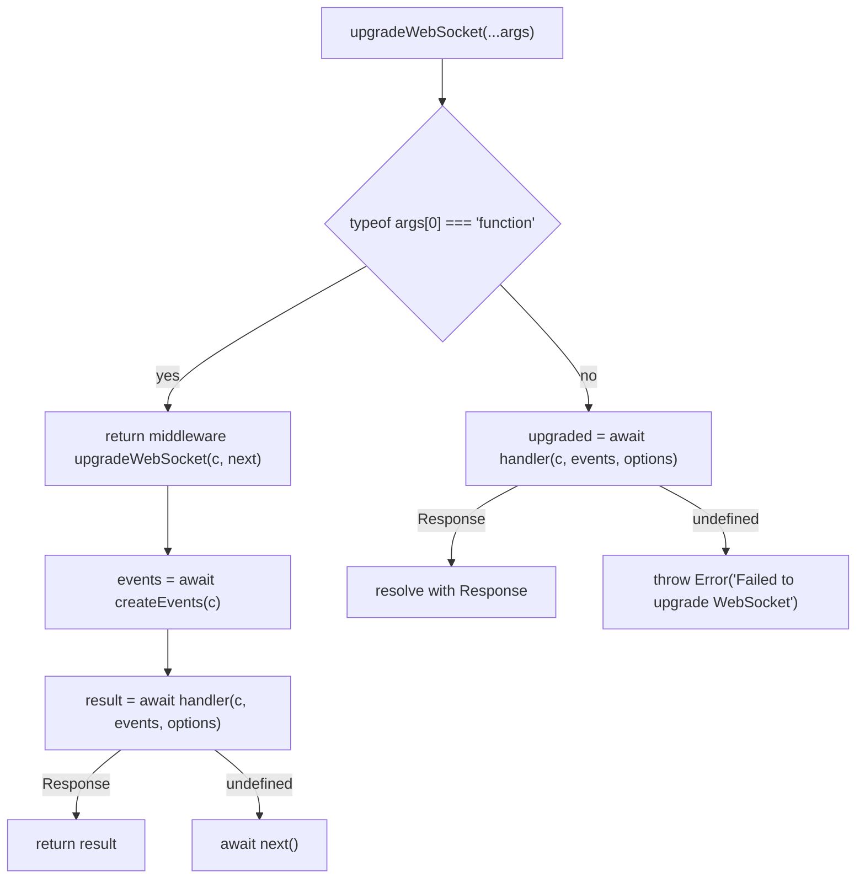

## Overview

Hono has no WebSocket server of its own: each runtime upgrades connections differently, so Hono defines one portable contract in `hono/websocket` and lets each adapter fill it in. The contract has three parts: `WSEvents` (the `onOpen`, `onMessage`, `onClose` and `onError` callbacks an application writes), `WSContext` (the object those callbacks use to send and close) and `defineWebSocketHelper`, which turns a runtime-specific upgrade function into the `upgradeWebSocket` middleware that applications import from `hono/bun`, `hono/deno` or `hono/cloudflare-workers`.

Sources: [src/helper/websocket/index.ts:1-40](repo://src/helper/websocket/index.ts#L1-L40), [src/helper/websocket/index.ts:101-140](repo://src/helper/websocket/index.ts#L101-L140)

```ts
import { Hono } from 'hono'
import { upgradeWebSocket } from 'hono/cloudflare-workers'

const app = new Hono()

app.get(
  '/ws',
  upgradeWebSocket((c) => ({
    onMessage(evt, ws) {
      ws.send(`echo: ${evt.data}`)
    },
    onClose() {
      console.log('closed')
    },
  }))
)
```

Sources: [src/adapter/cloudflare-workers/websocket.ts:5-53](repo://src/adapter/cloudflare-workers/websocket.ts#L5-L53), [src/helper/websocket/index.ts:111-128](repo://src/helper/websocket/index.ts#L111-L128)

## The portable contract

### WSEvents

`WSEvents<T>` is the object an application returns. Every listener is optional and receives the native-style event plus a `WSContext<T>`, where `T` is the runtime's raw socket type.

Sources: [src/helper/websocket/index.ts:11-19](repo://src/helper/websocket/index.ts#L11-L19)

| Listener | Event type | Fired when |
| --- | --- | --- |
| `onOpen` | `Event` | The connection is open (not on Cloudflare Workers). |
| `onMessage` | `MessageEvent<WSMessageReceive>` | A message arrives; `data` is `string \| Blob \| ArrayBufferLike`. |
| `onClose` | `CloseEvent` | The connection closes, with `code` and `reason`. |
| `onError` | `Event` | The runtime reports a socket error (Deno and Cloudflare Workers). |

Sources: [src/helper/websocket/index.ts:14-19](repo://src/helper/websocket/index.ts#L14-L19), [src/helper/websocket/index.ts:93-93](repo://src/helper/websocket/index.ts#L93-L93)

### WSContext

`WSContext` wraps a `WSContextInit` supplied by the adapter and keeps it in a private `#init` field, so the public surface is the same everywhere. `send` and `close` forward to the init functions (`send` defaults its options to `{}`), `readyState` is a getter on `#init.readyState`, and `url` is turned into a `URL` or `null`. `binaryType` is fixed to `'arraybuffer'`.

Sources: [src/helper/websocket/index.ts:42-91](repo://src/helper/websocket/index.ts#L42-L91)

| Member | Type | Notes |
| --- | --- | --- |
| `send(source, options?)` | `void` | `source` is `string \| ArrayBuffer \| Uint8Array`; `options.compress` is used only by Bun. |
| `close(code?, reason?)` | `void` | Closes the underlying socket. |
| `readyState` | `0 \| 1 \| 2 \| 3` | `WSReadyState`, read from the adapter. |
| `raw` | `T \| undefined` | The runtime socket (`ServerWebSocket`, `WebSocket`). |
| `url` | `URL \| null` | The connection URL when the runtime exposes it. |
| `protocol` | `string \| null` | The negotiated subprotocol. |

Sources: [src/helper/websocket/index.ts:45-91](repo://src/helper/websocket/index.ts#L45-L91)

### createWSMessageEvent

Runtimes that deliver messages as plain values (Bun calls a `message(ws, message)` function instead of dispatching an event) use `createWSMessageEvent(source)` to build a standard `MessageEvent('message', { data })`, so `onMessage` always sees `evt.data`.

Sources: [src/helper/websocket/index.ts:93-99](repo://src/helper/websocket/index.ts#L93-L99), [src/adapter/bun/websocket.ts:95-103](repo://src/adapter/bun/websocket.ts#L95-L103)

## defineWebSocketHelper

### Two call forms

`defineWebSocketHelper(handler)` takes a `WebSocketHelperDefineHandler`, a function `(c, events, options?)` that performs the upgrade and returns a `Response` on success or nothing when the request is not an upgrade. The returned `UpgradeWebSocket` function is overloaded, and it picks its behaviour by checking whether its first argument is a function.

Sources: [src/helper/websocket/index.ts:101-140](repo://src/helper/websocket/index.ts#L101-L140), [src/helper/websocket/index.ts:21-40](repo://src/helper/websocket/index.ts#L21-L40)



Sources: [src/helper/websocket/index.ts:111-140](repo://src/helper/websocket/index.ts#L111-L140)

1. Middleware form, `upgradeWebSocket(createEvents, options?)`: returns a middleware. `createEvents(c)` runs per request (it may be async, so it can read the context or await setup) and the adapter handler gets the events. When the request is not an upgrade the middleware calls `next()`, so a later handler on the same route can answer ordinary HTTP requests.
2. Direct form, `upgradeWebSocket(c, events, options?)`: used inside a handler that has already decided to upgrade. It returns a promise of the `Response` and rejects with `Failed to upgrade WebSocket` when the adapter declined.

Sources: [src/helper/websocket/index.ts:119-138](repo://src/helper/websocket/index.ts#L119-L138)

### Typing for the RPC client

The middleware form is typed as `MiddlewareHandler<any, string, { outputFormat: 'ws' }>`, and the direct form as `Response & TypedResponse<{}, StatusCode, 'ws'>`. The [[RPC Client]] looks for `outputFormat: 'ws'` on a route's `$get` and only then adds a `$ws()` method, which rewrites the URL scheme from `http` to `ws` and opens a `WebSocket`.

Sources: [src/helper/websocket/index.ts:24-40](repo://src/helper/websocket/index.ts#L24-L40), [src/client/types.ts:112-118](repo://src/client/types.ts#L112-L118), [src/client/client.ts:187-204](repo://src/client/client.ts#L187-L204)

## Runtime implementations

### Bun

Bun upgrades through the server object, not through a returned response, and dispatches socket events to one `websocket` handler object passed to `Bun.serve`. The adapter therefore has two halves, both exported from `hono/bun`: `upgradeWebSocket` and `websocket`.

Sources: [src/adapter/bun/index.ts:8-9](repo://src/adapter/bun/index.ts#L8-L9), [src/adapter/bun/websocket.ts:15-28](repo://src/adapter/bun/websocket.ts#L15-L28)

`upgradeWebSocket` gets the server with `getBunServer(c)`, which reads `c.env.server` or `c.env` itself (Bun passes the server as the second argument of `fetch`). It throws `TypeError('env has to include the 2nd argument of fetch.')` when there is none. It calls `server.upgrade(c.req.raw, { data })`, storing the events, the request URL and the first subprotocol from `Sec-WebSocket-Protocol` in the socket's `data`, and returns `new Response(null)` on success or nothing on failure.

Sources: [src/adapter/bun/websocket.ts:48-74](repo://src/adapter/bun/websocket.ts#L48-L74), [src/adapter/bun/server.ts:13-14](repo://src/adapter/bun/server.ts#L13-L14)

The `websocket` object's `open`, `close` and `message` methods read `ws.data.events` and call the matching listener with a fresh `WSContext` from `createWSContext`. `close` builds a `CloseEvent` from the code and reason; `message` converts a binary message to its `buffer` and wraps it with `createWSMessageEvent`. There is no `error` hook, so `onError` is never called on Bun.

Sources: [src/adapter/bun/websocket.ts:30-46](repo://src/adapter/bun/websocket.ts#L30-L46), [src/adapter/bun/websocket.ts:76-104](repo://src/adapter/bun/websocket.ts#L76-L104)

```ts
import { Hono } from 'hono'
import { upgradeWebSocket, websocket } from 'hono/bun'

const app = new Hono()
app.get('/ws', upgradeWebSocket(() => ({ onMessage: (evt, ws) => ws.send(evt.data as string) })))

export default { fetch: app.fetch, websocket }
```

Sources: [src/adapter/bun/websocket.ts:48-104](repo://src/adapter/bun/websocket.ts#L48-L104)

> [!NOTE]
> `createWSContext` copies `ws.readyState` when the context is created, unlike Deno and Cloudflare Workers, which expose it through a getter. A `WSContext` kept from an earlier event reports the state at the time it was made. `send` on Bun passes `options.compress` to `ws.send`.

Sources: [src/adapter/bun/websocket.ts:33-46](repo://src/adapter/bun/websocket.ts#L33-L46)

`createBunWebSocket()` is deprecated and only returns the same `{ upgradeWebSocket, websocket }` pair.

Sources: [src/adapter/bun/websocket.ts:106-113](repo://src/adapter/bun/websocket.ts#L106-L113)

### Deno

The Deno adapter returns nothing when the `upgrade` header is not `websocket`. Otherwise it calls `Deno.upgradeWebSocket(c.req.raw, ...)`, passing the first requested subprotocol as `protocol` so that the response carries `Sec-WebSocket-Protocol` (Chrome rejects the connection without it); user `options` of type `Deno.UpgradeWebSocketOptions` are spread last and can override it. It wires `onopen`, `onmessage`, `onclose` and `onerror` on the socket to the four listeners and returns Deno's `response`.

Sources: [src/adapter/deno/websocket.ts:1-38](repo://src/adapter/deno/websocket.ts#L1-L38)

### Cloudflare Workers

The Workers adapter checks the `Upgrade` header, creates a `WebSocketPair`, and keeps the `server` end while returning the `client` end in `new Response(null, { status: 101, webSocket: client })`. Listeners are attached with `addEventListener` only for the events the application defined, then `server.accept()` starts delivery.

Sources: [src/adapter/cloudflare-workers/websocket.ts:4-53](repo://src/adapter/cloudflare-workers/websocket.ts#L4-L53)

> [!WARNING]
> Workers do not fire an `open` event on the server socket. The adapter's type is `UpgradeWebSocket<WebSocket, any, Omit<WSEvents<WebSocket>, 'onOpen'>>`, so passing `onOpen` is a type error; run start-up logic in `createEvents` instead.

Sources: [src/adapter/cloudflare-workers/websocket.ts:5-10](repo://src/adapter/cloudflare-workers/websocket.ts#L5-L10), [src/adapter/cloudflare-workers/websocket.ts:34-34](repo://src/adapter/cloudflare-workers/websocket.ts#L34-L34)

### Comparison

| Behaviour | Bun | Deno | Cloudflare Workers |
| --- | --- | --- | --- |
| Import | `hono/bun` | `hono/deno` | `hono/cloudflare-workers` |
| Upgrade check | `server.upgrade` result | `upgrade` header | `Upgrade` header |
| Response returned | `new Response(null)` | Deno's upgrade `response` | `101` with `webSocket: client` |
| `onOpen` | yes | yes | no |
| `onError` | no | yes | yes |
| `readyState` | snapshot | live getter | live getter |
| `protocol` | first requested subprotocol | `socket.protocol` | `server.protocol` |
| Extra setup | export `websocket` to `Bun.serve` | none | none |

Sources: [src/adapter/bun/websocket.ts:33-104](repo://src/adapter/bun/websocket.ts#L33-L104), [src/adapter/deno/websocket.ts:4-38](repo://src/adapter/deno/websocket.ts#L4-L38), [src/adapter/cloudflare-workers/websocket.ts:10-53](repo://src/adapter/cloudflare-workers/websocket.ts#L10-L53)

## Writing an adapter

A new runtime needs only a function for `defineWebSocketHelper`: return `undefined` for a non-upgrade request, build a `WSContext` around the native socket, forward native events to the `WSEvents` listeners (using `createWSMessageEvent` when the runtime gives raw data), and return the upgrade `Response`. The middleware and direct call forms, `next()` fall-through and the `Failed to upgrade WebSocket` error all come from `defineWebSocketHelper`. [[Runtime Adapters]] covers the rest of each adapter.

Sources: [src/helper/websocket/index.ts:95-140](repo://src/helper/websocket/index.ts#L95-L140)
