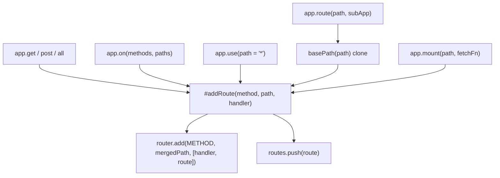

## Overview

Every Hono application is an instance of the class in `hono-base.ts`, exported as `HonoBase`. It holds two things that registration fills: a router, which answers "which handlers match this method and path", and a `routes` array that records every registration for introspection. All the registration methods (`get`, `post`, `use`, `on`, `route`, `mount`) end in the same private `#addRoute`, which writes to both.

Sources: [src/hono-base.ts:98-125](repo://src/hono-base.ts#L98-L125), [src/hono-base.ts:385-397](repo://src/hono-base.ts#L385-L397)

This page follows registration. What happens when a request arrives is in [[Request Lifecycle and Middleware Composition]], and how the router stores and matches paths is in [[Routers and Router Selection]].

Sources: [src/hono-base.ts:406-466](repo://src/hono-base.ts#L406-L466)

## Classes and presets

`HonoBase` declares `router` but never sets it; a comment calls it "like an abstract class" that a subclass completes by assigning a router in its constructor. Three subclasses do so, each exported as `Hono`.

Sources: [src/hono-base.ts:114-118](repo://src/hono-base.ts#L114-L118)

| Import | Router | Honors `options.router` |
| --- | --- | --- |
| `hono` | `options.router`, else `SmartRouter` over `RegExpRouter` and `TrieRouter` | yes |
| `hono/tiny` | `PatternRouter` | no, assigned after `super()` |
| `hono/quick` | `SmartRouter` over `LinearRouter` and `TrieRouter` | no, assigned after `super()` |

Sources: [src/hono.ts:16-34](repo://src/hono.ts#L16-L34), [src/preset/tiny.ts:11-20](repo://src/preset/tiny.ts#L11-L20), [src/preset/quick.ts:13-24](repo://src/preset/quick.ts#L13-L24)

The `HonoBase` constructor copies every option except `strict` onto the instance with `Object.assign`, which is how `options.router` and `options.getPath` arrive; the presets then overwrite `router` with their own.

Sources: [src/hono-base.ts:170-173](repo://src/hono-base.ts#L170-L173)

## Options

| Option | Default | Effect |
| --- | --- | --- |
| `strict` | `true` | When `false`, `getPathNoStrict` drops one trailing slash, so `/hello/` and `/hello` route the same. A custom `getPath` is ignored when `strict` is `false`. |
| `router` | preset's router | The `Router<[H, RouterRoute]>` used for `add` and `match`. |
| `getPath` | `getPath` from `utils/url` | Computes the routing path from the `Request` and the bindings; the doc comment shows prefixing the `Host` header to route by host name. |

Sources: [src/hono-base.ts:46-87](repo://src/hono-base.ts#L46-L87), [src/hono-base.ts:170-173](repo://src/hono-base.ts#L170-L173), [src/utils/url.ts:141-146](repo://src/utils/url.ts#L141-L146)

## Registering handlers

### Method functions

The constructor builds `get`, `post`, `put`, `delete`, `options`, `patch` and `all` from `METHODS` plus `all`. Each accepts either a path followed by handlers, or handlers alone. A path is remembered in the private `#path`, so a call without a path reuses the last one: `app.get('/a', h1).post(h2)` registers `h2` for `POST /a`. Every handler becomes its own registration, in argument order.

Sources: [src/hono-base.ts:126-142](repo://src/hono-base.ts#L126-L142), [src/router.ts:9-17](repo://src/router.ts#L9-L17)

### on() and use()

`app.on(method, path, ...handlers)` accepts a string or an array for both the method and the path, upper-cases each method, and registers every handler for every combination, so it also accepts method names outside `METHODS`. `app.use()` registers middleware under the method `ALL`; with no leading path string it uses `*`, so the middleware applies to every path.

Sources: [src/hono-base.ts:143-168](repo://src/hono-base.ts#L143-L168)

### What #addRoute records

`#addRoute` upper-cases the method, prefixes the app's base path with `mergePath`, and builds a `RouterRoute` of `basePath`, `path`, `method` and `handler`. It passes `[handler, route]` to `router.add`, so a match result carries both the function to call and the route it came from, and appends the route to `routes`.

Sources: [src/hono-base.ts:385-397](repo://src/hono-base.ts#L385-L397), [src/types.ts:57-62](repo://src/types.ts#L57-L62)

`mergePath` joins segments with exactly one slash and treats a sub-path of `/` as empty, so `mergePath('/api', '/')` is `/api` while `mergePath('/api/', '/')` keeps the trailing slash.

Sources: [src/utils/url.ts:148-169](repo://src/utils/url.ts#L148-L169)

Sources: [src/hono-base.ts:126-168](repo://src/hono-base.ts#L126-L168), [src/hono-base.ts:208-253](repo://src/hono-base.ts#L208-L253), [src/hono-base.ts:328-397](repo://src/hono-base.ts#L328-L397)

## Base paths and grouping

### basePath()

`basePath(path)` returns a clone, not the same app. `#clone` constructs a new instance that shares the router, the `getPath` function, the error and not-found handlers and the very same `routes` array, then sets `_basePath` to the merged path. Registrations on the clone therefore land in the parent's router under the longer path.

Sources: [src/hono-base.ts:175-184](repo://src/hono-base.ts#L175-L184), [src/hono-base.ts:247-253](repo://src/hono-base.ts#L247-L253)

The base path lives in a TypeScript-private `_basePath` rather than a `#` field; the comment gives the reason that it "requires visibility at JavaScript runtime", and `basePath()` writes it on the clone it creates.

Sources: [src/hono-base.ts:120-122](repo://src/hono-base.ts#L120-L122)

### route()

`app.route(path, subApp)` copies the sub-app's routes into this app at the time of the call. It takes a `basePath(path)` clone and re-registers each entry of `subApp.routes` with its method and path, passing the sub-route's own `basePath` so introspection can tell which prefix came from where. Routes added to the sub-app after `route()` returns are not copied.

Sources: [src/hono-base.ts:208-232](repo://src/hono-base.ts#L208-L232)

When the sub-app has its own `onError` handler, each copied handler is wrapped: the wrapper runs the original through `compose([], subApp.errorHandler)`, so errors thrown inside the sub-app's routes reach the sub-app's handler first. The wrapper stores the original under the `COMPOSED_HANDLER` key, which [[Route Introspection]] uses to report the real handler name. The sub-app's `notFound` handler is not carried over.

Sources: [src/hono-base.ts:219-229](repo://src/hono-base.ts#L219-L229), [src/utils/constants.ts:1-4](repo://src/utils/constants.ts#L1-L4)

## Error and not-found handlers

`onError(handler)` and `notFound(handler)` replace the app's handlers and return the app for chaining. Until then the defaults apply: the not-found handler answers `404 Not Found` as text, and the error handler returns `err.getResponse()` for errors that have it (such as `HTTPException`), otherwise logs the error and answers `500 Internal Server Error`. How these are invoked is covered in [[Request Lifecycle and Middleware Composition]].

Sources: [src/hono-base.ts:31-42](repo://src/hono-base.ts#L31-L42), [src/hono-base.ts:271-294](repo://src/hono-base.ts#L271-L294)

## Mounting other applications

`app.mount(path, applicationHandler, options)` routes everything under `path` to any function that takes a `Request` and returns a `Response`, such as another framework's fetch handler. It registers one middleware for `ALL` on `mergePath(path, '*')`. The middleware calls the handler with a rewritten request plus extra arguments; if the handler returns a falsy value, it calls `next()` so later Hono routes can answer.

Sources: [src/hono-base.ts:328-383](repo://src/hono-base.ts#L328-L383)

| Option | Default | Effect |
| --- | --- | --- |
| `optionHandler` (or a function as `options`) | `[c.env, c.executionCtx]` | Builds the extra arguments; a non-array result is wrapped in an array. A missing execution context becomes `undefined`. |
| `replaceRequest` | strip the mount prefix | Default builds a new `Request` whose pathname has the merged prefix removed (or `/`). |
| `replaceRequest: false` | | Passes the original request unchanged. |

Sources: [src/hono-base.ts:89-97](repo://src/hono-base.ts#L89-L97), [src/hono-base.ts:333-370](repo://src/hono-base.ts#L333-L370)
