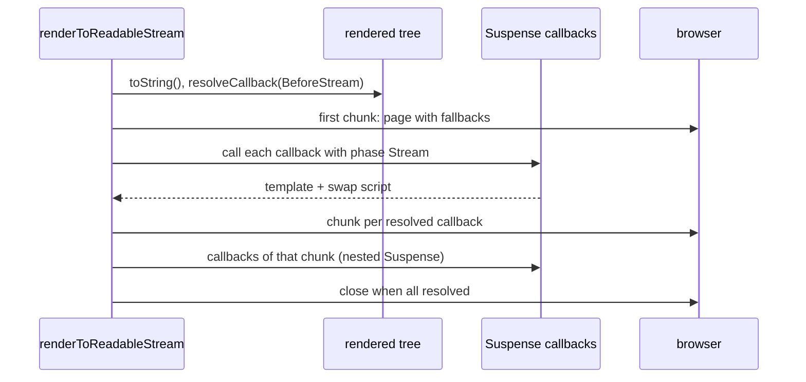

## Overview

Server-side JSX renders async components by deferring their promises and collecting callbacks on the resulting `HtmlEscapedString` ([[Server-Side JSX Rendering]]). The same callbacks let a page be streamed: send the HTML that is ready, with placeholders, then send each async part as it resolves, together with a small script that moves it into place. `Suspense` and `ErrorBoundary` produce those placeholders and callbacks, and `renderToReadableStream` turns them into a stream of chunks.

Sources: [src/jsx/streaming.ts:34-137](repo://src/jsx/streaming.ts#L34-L137), [src/jsx/streaming.ts:146-220](repo://src/jsx/streaming.ts#L146-L220)

The same tree also renders without streaming: `c.html()` resolves every callback before responding, and the placeholders are replaced in the buffer by the final content, so the browser never sees a fallback.

Sources: [src/context.ts:723-733](repo://src/context.ts#L723-L733), [src/jsx/streaming.ts:92-104](repo://src/jsx/streaming.ts#L92-L104)

## Callback phases

An `HtmlEscapedCallback` is called with `{ phase, buffer, context }` and may return a promise of more HTML. The `context` is an object unique to the render, used as a `WeakMap` key by callbacks that keep per-render state, such as the [[CSS Helper]].

Sources: [src/utils/html.ts:6-20](repo://src/utils/html.ts#L6-L20)

| Phase | Used by | What `Suspense` does |
| --- | --- | --- |
| `Stringify` (1) | `c.html()`, `resolveCallback` without streaming | waits for the children and replaces its placeholder in `buffer` with the content |
| `BeforeStream` (2) | the first chunk of `renderToReadableStream` | returns nothing, so the fallback stays in the first chunk |
| `Stream` (3) | each later chunk | returns a `<template>` holding the content plus a script that swaps it in |

Sources: [src/jsx/streaming.ts:87-133](repo://src/jsx/streaming.ts#L87-L133), [src/utils/html.ts:142-182](repo://src/utils/html.ts#L142-L182)

`resolveCallback(str, phase, preserveCallbacks, context, buffer)` runs every callback of a string for a phase, recursively resolves what they return, and, with `preserveCallbacks`, returns the result still carrying the original callbacks so a later phase can run them again.

Sources: [src/utils/html.ts:142-182](repo://src/utils/html.ts#L142-L182)

## Suspense

### Rendering the children

`<Suspense fallback={...}>` renders its children with `toString()` inside a stack frame that the `use()` hook reads. A child that suspends by throwing a promise (as `use()` does) is caught, and the render is retried after the promise settles, resumed in the captured render context so provided context values are still visible. If no child produced a promise, the children's HTML is returned directly and no placeholder is emitted.

Sources: [src/jsx/streaming.ts:42-86](repo://src/jsx/streaming.ts#L42-L86), [src/jsx/streaming.ts:134-137](repo://src/jsx/streaming.ts#L134-L137)

### The placeholder

Otherwise `Suspense` takes the next counter value as its index and returns `<template id="H:index"></template>`, the rendered fallback, and an HTML comment node whose text is `/$`, with the fallback's own callbacks plus its replacement callback. In the `Stream` phase that callback waits for all children and returns `<template data-hono-target="H:index">content</template>` followed by an inline script. The script takes the template's content, removes every node after the placeholder up to the `/$` comment (the fallback), and replaces the placeholder with the content. If the content itself has callbacks (nested `Suspense`), they are kept so the stream renders them next.

Sources: [src/jsx/streaming.ts:87-133](repo://src/jsx/streaming.ts#L87-L133)

### Script nonces

Wrapping the tree in `<StreamingContext.Provider value={{ scriptNonce }}>` adds `nonce="..."` to the generated scripts, for pages served with a Content Security Policy such as the one `secureHeaders` can produce ([[Security Middleware]]).

Sources: [src/jsx/streaming.ts:18-32](repo://src/jsx/streaming.ts#L18-L32), [src/jsx/streaming.ts:105-117](repo://src/jsx/streaming.ts#L105-L117), [src/middleware/secure-headers/secure-headers.ts:137-145](repo://src/middleware/secure-headers/secure-headers.ts#L137-L145)

## ErrorBoundary

`<ErrorBoundary fallback={...} fallbackRender={(error) => ...} onError={...}>` catches errors thrown while rendering its children, synchronously or from async children. It is marked experimental in the code.

Sources: [src/jsx/components.ts:47-61](repo://src/jsx/components.ts#L47-L61)

| Failure | Result |
| --- | --- |
| a child throws synchronously | `onError(error)` runs and the fallback is rendered in place |
| a child throws a promise (suspends) | the children are retried after it settles; a failure then renders the fallback |
| an async child rejects | the boundary emits `<template id="E:index"></template>` followed by an HTML comment node whose text is `E:index`, and, when the error arrives, the fallback replaces that region |

Sources: [src/jsx/components.ts:94-127](repo://src/jsx/components.ts#L94-L127), [src/jsx/components.ts:136-160](repo://src/jsx/components.ts#L136-L160)

The fallback is `fallback` if given, else `fallbackRender(error)`, rendered in the captured render context. When streaming, successful async content is inserted after the placeholder by a script, nested callbacks are chained, and a final script removes the markers once every nested callback has resolved; an error from any of them triggers the fallback swap once. Without streaming, the same regular expression replaces the region in the buffer.

Sources: [src/jsx/components.ts:75-111](repo://src/jsx/components.ts#L75-L111), [src/jsx/components.ts:162-261](repo://src/jsx/components.ts#L162-L261)

## renderToReadableStream

Sources: [src/jsx/streaming.ts:146-220](repo://src/jsx/streaming.ts#L146-L220)

`renderToReadableStream(content, onError = console.trace)` returns a `ReadableStream<Uint8Array>`. In `start` it stringifies a `JSXNode`, resolves the `BeforeStream` phase while preserving callbacks, and enqueues the result. It then calls every callback with the `Stream` phase; each returned promise, once settled, is itself resolved for `BeforeStream`, its own callbacks are scheduled the same way, and its HTML is enqueued. The loop waits until the count of resolved chunks equals the count of scheduled ones, then closes the stream.

Sources: [src/jsx/streaming.ts:146-213](repo://src/jsx/streaming.ts#L146-L213)

A chunk whose promise rejects is logged, passed to `onError`, and replaced by an empty string, so one failed section does not end the stream. An error in the first render, which the code comment attributes to a likely closed connection, is passed to `onError` and the stream is closed. If the consumer cancels, enqueuing stops.

Sources: [src/jsx/streaming.ts:171-219](repo://src/jsx/streaming.ts#L171-L219)

## Streaming from a route

`jsxRenderer(component, { stream: true })` returns `c.body(renderToReadableStream(body))` with `Transfer-Encoding: chunked`, `Content-Type: text/html; charset=UTF-8` and `Content-Encoding: Identity`; passing a record instead of `true` sets the record's headers in their place.

Sources: [src/middleware/jsx-renderer/index.ts:66-79](repo://src/middleware/jsx-renderer/index.ts#L66-L79)
