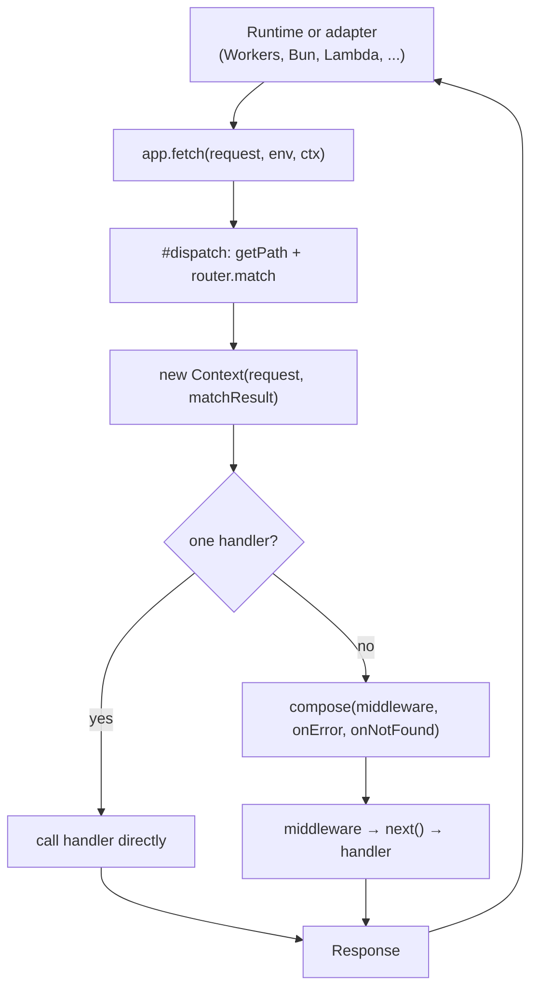

## Overview

Hono is a small web framework built only on the Web Standard `Request` and `Response` APIs, so the same application code runs on Cloudflare Workers, Fastly Compute, Deno, Bun, Vercel, AWS Lambda, Lambda@Edge and Node.js. An application is a `Hono` instance: you register handlers and middleware on it, and its `fetch` method turns a `Request` into a `Response`.

Sources: [README.md:22-33](repo://README.md#L22-L33), [src/index.ts:1-53](repo://src/index.ts#L1-L53)

The package is one core (the app, its routers, the context and the request wrapper) plus many optional modules exported as subpaths: middleware such as `hono/cors`, helpers such as `hono/cookie`, the JSX renderer under `hono/jsx`, the typed client under `hono/client`, and one adapter per runtime. Nothing outside the core is loaded unless an application imports it.

Sources: [package.json:38-157](repo://package.json#L38-L157), [package.json:324-388](repo://package.json#L324-L388)

## Parts of the framework

| Area | What it does | Page |
| --- | --- | --- |
| App | Registers routes and middleware, groups sub-apps, mounts foreign handlers | [[The Hono App and Route Registration]] |
| Dispatch | Matches a request, composes the matched handlers, handles errors and 404s | [[Request Lifecycle and Middleware Composition]] |
| Context | The `c` object: response helpers, headers, variables, bindings | [[Context]] |
| Request | `c.req`: params, query, headers, cached body parsing | [[HonoRequest]] |
| Routers | Interchangeable path matchers and the router chosen at first request | [[Routers and Router Selection]], [[RegExpRouter]] |
| Introspection | Listing routes and finding the route that is handling a request | [[Route Introspection]] |
| Validation | `validator()` middleware and validated data on `c.req.valid()` | [[Validation]] |
| Types | Route schemas accumulated on the app type | [[Typed Routes and Schemas]] |
| Client | `hc`, a fetch client typed from the app | [[RPC Client]] |
| Middleware | Built-in authentication, security, request and response middleware | [[Authentication Middleware]], [[Security Middleware]], [[Request Handling Middleware]], [[Response Middleware]] |
| Helpers | Cookies, streaming, WebSockets, static site generation | [[Cookies]], [[Streaming and Server-Sent Events]], [[WebSockets]], [[Static Site Generation]] |
| JSX | Server rendering, streaming with Suspense, a browser renderer, CSS-in-JS | [[Server-Side JSX Rendering]], [[Suspense and Streaming Rendering]], [[Client-Side JSX Rendering]], [[CSS Helper]] |
| Runtimes | Entry points, connection info, static files per runtime | [[Runtime Adapters]], [[AWS Lambda and Lambda@Edge]], [[Serving Static Files]] |

Sources: [package.json:38-157](repo://package.json#L38-L157), [package.json:158-277](repo://package.json#L158-L277), [package.json:278-397](repo://package.json#L278-L397), [package.json:398-413](repo://package.json#L398-L413)

## How a request flows

Sources: [src/hono-base.ts:406-485](repo://src/hono-base.ts#L406-L485), [src/compose.ts:15-73](repo://src/compose.ts#L15-L73)

1. A runtime calls `app.fetch` directly, or an adapter converts its own event into a `Request` first ([[Runtime Adapters]], [[AWS Lambda and Lambda@Edge]]).
2. `#dispatch` computes the path and asks the router for every handler that matches the method and path ([[Request Lifecycle and Middleware Composition]], [[Routers and Router Selection]]).
3. A `Context` wraps the request, the match result and the environment bindings ([[Context]]); its `c.req` gives handlers params, query and body ([[HonoRequest]]).
4. With several matches, `compose` runs them as an onion: each middleware calls `await next()` to run the rest and can then change the response ([[Request Lifecycle and Middleware Composition]]).
5. The handler returns a `Response` built with helpers such as `c.json()`; thrown errors go to the app's error handler, and unmatched requests to its not-found handler.

Sources: [src/hono-base.ts:406-466](repo://src/hono-base.ts#L406-L466), [src/context.ts:352-369](repo://src/context.ts#L352-L369)

## Design decisions

### Web Standards only

The app's whole contract with a runtime is `fetch(request, env, executionCtx)` returning a `Response`, and handlers build `Response` objects directly. Runtime-specific pieces, such as reading files or upgrading a WebSocket, live in adapters that plug into that contract, which is how the README can claim the same code runs on every platform.

Sources: [src/hono-base.ts:479-485](repo://src/hono-base.ts#L479-L485), [README.md:41-47](repo://README.md#L41-L47)

### The router is chosen at the first request

The default `Hono` class uses a `SmartRouter` holding a `RegExpRouter` and a `TrieRouter`. Routes are only queued until the first `match`; then `SmartRouter` feeds them to each router in turn, keeps the first one that does not throw `UnsupportedPathError`, and replaces its own `match` with that router's. The fast `RegExpRouter` is used whenever it can express every route, and `TrieRouter` takes over when it cannot. Presets swap in other routers: `hono/tiny` uses `PatternRouter`, which the README gives as the under-12kB build, and `hono/quick` uses a `SmartRouter` of `LinearRouter` and `TrieRouter`.

Sources: [src/hono.ts:26-33](repo://src/hono.ts#L26-L33), [src/router/smart-router/router.ts:21-61](repo://src/router/smart-router/router.ts#L21-L61), [src/preset/tiny.ts:1-20](repo://src/preset/tiny.ts#L1-L20), [src/preset/quick.ts:1-24](repo://src/preset/quick.ts#L1-L24), [README.md:43-44](repo://README.md#L43-L44)

### Pay only for what a request uses

The dispatcher skips `compose` when a single handler matches, and `Context` creates its `HonoRequest` only when `c.req` is first read. Response headers are kept in a prepared `Headers` object until a response exists, and `c.text()` returns a bare `new Response(text)` when no header or status was set.

Sources: [src/hono-base.ts:429-448](repo://src/hono-base.ts#L429-L448), [src/context.ts:366-369](repo://src/context.ts#L366-L369), [src/context.ts:682-694](repo://src/context.ts#L682-L694)

### Types are the API contract

Each `app.get(path, handler)` returns the app with a wider type parameter: the schema gains an entry for that path and method, with the validated input and the typed response. The client `hc<typeof app>()` reads that schema to type every call, so server and client share one definition without code generation ([[Typed Routes and Schemas]], [[RPC Client]]).

Sources: [src/types.ts:127-147](repo://src/types.ts#L127-L147), [src/client/client.ts:133-136](repo://src/client/client.ts#L133-L136)
