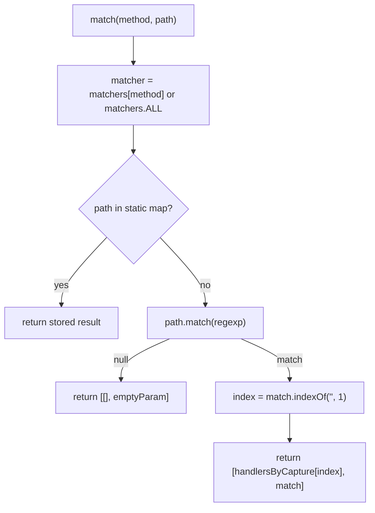

## Overview

`RegExpRouter` is the router the default `hono` export tries first ([[Routers and Router Selection]]). Instead of walking a tree per request, it compiles every route of a method into one regular expression on the first `match`. A request is then answered by one object lookup for static paths, or one `RegExp.exec` for everything else, and the position of an empty capture group in the result tells which route matched.

Sources: [src/hono.ts:26-33](repo://src/hono.ts#L26-L33), [src/router/reg-exp-router/matcher.ts:10-33](repo://src/router/reg-exp-router/matcher.ts#L10-L33)

That compilation cannot express every set of routes. When it cannot, it throws `UnsupportedPathError`, and `SmartRouter` falls back to `TrieRouter`. The work therefore happens in three phases: collecting routes in `add`, building matchers on the first `match`, and matching.

Sources: [src/router/reg-exp-router/router.ts:34-103](repo://src/router/reg-exp-router/router.ts#L34-L103), [src/router/smart-router/router.ts:32-50](repo://src/router/smart-router/router.ts#L32-L50)

## Collecting routes

### Two maps per method

`add` keeps two maps, each keyed by method then by path: `#middleware` for paths ending in `*`, and `#routes` for everything else. Each entry is a list of `[handler, paramCount]`. The first time a method appears, both maps get a copy of everything already registered under `ALL`, so a method-specific matcher also contains the `ALL` handlers.

Sources: [src/router/reg-exp-router/router.ts:122-147](repo://src/router/reg-exp-router/router.ts#L122-L147)

### Wildcard paths

A path ending in `*` (with `/*` normalised to `*`) is turned into a test expression by `buildWildcardRegExp`, where a trailing `/*` becomes `(?:|/.*)` so it also matches the bare prefix. The handler is appended to every existing middleware and route entry whose path the expression matches, for the method or for all methods when registered under `ALL`. A new middleware entry starts with the handlers of the longest wildcard path that already covers it.

Sources: [src/router/reg-exp-router/router.ts:19-32](repo://src/router/reg-exp-router/router.ts#L19-L32), [src/router/reg-exp-router/router.ts:105-120](repo://src/router/reg-exp-router/router.ts#L105-L120), [src/router/reg-exp-router/router.ts:149-187](repo://src/router/reg-exp-router/router.ts#L149-L187)

### Ordinary paths

Other paths are expanded with `checkOptionalParameter`. Each resulting path's entry is created with the wildcard handlers that already cover it, then the handler is appended. Because each entry is seeded with the middleware registered before it and later wildcards append to existing entries, every path's list ends up in registration order. The stored `paramCount` is the number of `/:` segments, reduced for the shorter expansions of an optional parameter.

Sources: [src/router/reg-exp-router/router.ts:189-204](repo://src/router/reg-exp-router/router.ts#L189-L204)

## Building matchers

### When it happens

`match` starts as the shared function in `matcher.ts`. Its first call runs `buildAllMatchers`, which builds one matcher per method plus `ALL`, then releases the route maps and clears the wildcard cache, and finally replaces `this.match` with a closure over the matchers. After that, `add` throws `MESSAGE_MATCHER_IS_ALREADY_BUILT` because the maps are gone.

Sources: [src/router/reg-exp-router/matcher.ts:10-33](repo://src/router/reg-exp-router/matcher.ts#L10-L33), [src/router/reg-exp-router/router.ts:206-222](repo://src/router/reg-exp-router/router.ts#L206-L222)

`#buildMatcher` collects a method's own middleware and route entries; when the method has none in one map, it uses the `ALL` entries of that map instead. A method with no entries of its own gets no matcher, and `match` falls back to the `ALL` matcher for it.

Sources: [src/router/reg-exp-router/router.ts:224-251](repo://src/router/reg-exp-router/router.ts#L224-L251)

### From routes to one expression

`buildMatcherFromPreprocessedRoutes` flags each path as static (no `*` and no `/:`) and sorts dynamic paths first, shortest first, with static paths last. Static paths go into a plain object, the static map, with their handlers and empty parameters. Every path is inserted into a `Trie`, but static ones only to check that they do not collide with a dynamic route.

Sources: [src/router/reg-exp-router/router.ts:34-69](repo://src/router/reg-exp-router/router.ts#L34-L69)

`Trie.insert` protects `{...}` groups, then tokenises the path into single characters, `:label` patterns and a trailing `/*`. `Node.insert` builds a character tree: a pattern child is keyed by its regular-expression source (`[^/]+` for a plain label) and gets a variable index from a shared counter, and the final node records the route's index. The parameter names and their variable indexes are returned to the caller.

Sources: [src/router/reg-exp-router/trie.ts:10-47](repo://src/router/reg-exp-router/trie.ts#L10-L47), [src/router/reg-exp-router/node.ts:45-133](repo://src/router/reg-exp-router/node.ts#L45-L133)

`buildRegExpStr` turns the tree into one alternation. Children are ordered literal characters first, then special patterns, then plain labels, then wildcards; pattern children are wrapped as `(source)@varIndex`, and a node that ends a route emits `#index`. `Trie.buildRegExp` then rewrites the markers: each `#index` becomes `$()`, an empty capture group anchored at the end, recorded in `indexReplacementMap` against its capture number; each `@varIndex` is removed and recorded in `paramReplacementMap` as the capture number of the group before it.

Sources: [src/router/reg-exp-router/node.ts:1-43](repo://src/router/reg-exp-router/node.ts#L1-L43), [src/router/reg-exp-router/node.ts:135-161](repo://src/router/reg-exp-router/node.ts#L135-L161), [src/router/reg-exp-router/trie.ts:49-73](repo://src/router/reg-exp-router/trie.ts#L49-L73)

Finally each handler's parameter map is rewritten from variable indexes to capture numbers, and the handler lists are placed at the capture number of their route's empty group. The matcher is the triple `[regexp, handlersByCapture, staticMap]`.

Sources: [src/router/reg-exp-router/router.ts:71-103](repo://src/router/reg-exp-router/router.ts#L71-L103), [src/router/reg-exp-router/matcher.ts:4-7](repo://src/router/reg-exp-router/matcher.ts#L4-L7)

## Matching

Sources: [src/router/reg-exp-router/matcher.ts:10-33](repo://src/router/reg-exp-router/matcher.ts#L10-L33)

Only the route that matched leaves its `$()` group as an empty string; the groups of other alternatives are `undefined`, so `indexOf('', 1)` finds the route. The whole match array is returned as the shared parameter array, and each handler's map points from parameter name to a capture number in it, which [[HonoRequest]] resolves when a parameter is read.

Sources: [src/router/reg-exp-router/matcher.ts:17-28](repo://src/router/reg-exp-router/matcher.ts#L17-L28), [src/request.ts:126-128](repo://src/request.ts#L126-L128)

## Routes it rejects

`Node.insert` throws an internal `PATH_ERROR`, converted to `UnsupportedPathError`, whenever the single expression would be ambiguous. The cases are listed below.

Sources: [src/router/reg-exp-router/node.ts:4-4](repo://src/router/reg-exp-router/node.ts#L4-L4), [src/router/reg-exp-router/router.ts:60-65](repo://src/router/reg-exp-router/router.ts#L60-L65)

- two routes ending at the same node, such as `/user/:id` and `/user/:name` for one method;
- a static route that a dynamic route also matches at the same position, such as `/about` alongside `/:id`, because the static map could not include the dynamic handler;
- a custom parameter pattern of `.*`, or one containing a capturing group other than a whole-pattern alternation, which is rewritten from `(a|b)` to `(?:a|b)`.

Sources: [src/router/reg-exp-router/node.ts:50-133](repo://src/router/reg-exp-router/node.ts#L50-L133)

Because building happens on the first `match`, these errors appear at the first request, inside `SmartRouter`'s selection loop, and the app transparently uses `TrieRouter` instead.

Sources: [src/router/smart-router/router.ts:32-50](repo://src/router/smart-router/router.ts#L32-L50)

## PreparedRegExpRouter

`PreparedRegExpRouter` skips the build at startup by taking matchers computed ahead of time. `buildInitParams({ paths })` registers each path once under `ALL` with the path itself as the handler, builds the matchers, and records for each path where its handlers belong (capture indexes and static-map keys) in a relocate map; it then empties every handler list. `serializeInitParams` writes the result as JavaScript source, emitting each `RegExp` as a literal so it can be embedded in a bundle.

Sources: [src/router/reg-exp-router/prepared-router.ts:94-165](repo://src/router/reg-exp-router/prepared-router.ts#L94-L165)

At run time, `add` looks the path up in the relocate map and pushes the handler into the recorded slots; a path that was not prepared throws `Path ... is not registered`, and `*` or `/*` is appended to every slot. A method seen for the first time gets a copy of the `ALL` matcher. `buildAllMatchers` simply returns the prepared matchers, so `match` behaves exactly as above.

Sources: [src/router/reg-exp-router/prepared-router.ts:9-92](repo://src/router/reg-exp-router/prepared-router.ts#L9-L92)
