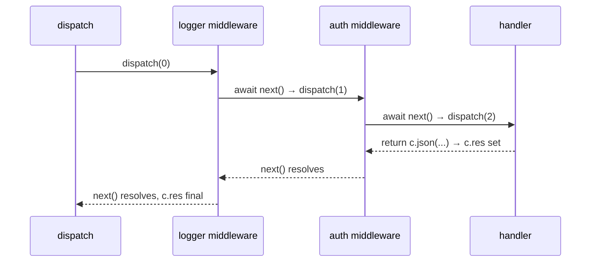

## Overview

Every request enters a Hono app through one private method, `#dispatch`. It asks the router for the handlers that match, wraps the request in a [[Context]], runs the handlers, and turns whatever happens (a returned response, a thrown error, nothing at all) into a single `Response`. Routes reach the router through the registration methods in [[The Hono App and Route Registration]].

Sources: [src/hono-base.ts:406-466](repo://src/hono-base.ts#L406-L466)

Running several handlers is the job of `compose`, a function modeled on `koa-compose`: each middleware receives `next`, and `await next()` runs the rest of the chain before control returns to the caller. This page follows a request from the entry points down through `compose` and back out through the error and not-found paths.

Sources: [src/compose.ts:1-24](repo://src/compose.ts#L1-L24)

## Entry points

| Method | Arguments | What it passes to `#dispatch` |
| --- | --- | --- |
| `app.fetch(request, env, executionCtx)` | runtime's own arguments | request, `executionCtx`, `env`, `request.method` |
| `app.request(input, init, env, executionCtx)` | path, URL or `Request` | builds a `Request` (a bare path gets `http://localhost`), then calls `fetch` |
| `app.fire()` (deprecated) | none | registers a global `fetch` listener and passes the `FetchEvent` as the execution context |

Sources: [src/hono-base.ts:479-517](repo://src/hono-base.ts#L479-L517), [src/hono-base.ts:519-542](repo://src/hono-base.ts#L519-L542)

## Dispatch

### HEAD requests

`#dispatch` first checks for `HEAD`. It runs the same request as `GET` and wraps the result in `new Response(null, getResponse)`, which keeps the status and headers and drops the body. A `HEAD` request therefore never matches `app.on('HEAD', ...)` registrations.

Sources: [src/hono-base.ts:412-416](repo://src/hono-base.ts#L412-L416)

### Matching and the context

The app's `getPath` turns the request into a routing path (the bindings are passed in so a custom `getPath` can read them), and `router.match(method, path)` returns every matching `[handler, route]` pair in registration order along with their parameters. A `Context` is created with the request, path, match result, bindings, execution context and the app's not-found handler; the request wrapper `c.req` is built only when first read.

Sources: [src/hono-base.ts:418-427](repo://src/hono-base.ts#L418-L427), [src/context.ts:352-369](repo://src/context.ts#L352-L369)

### The single-handler fast path

When exactly one handler matched, `#dispatch` calls it directly instead of composing. Its `next` sets `c.res` to the not-found response. The outcome is resolved as follows:

Sources: [src/hono-base.ts:429-448](repo://src/hono-base.ts#L429-L448)

| Handler result | Response |
| --- | --- |
| a `Response` (sync or awaited) | that response |
| a promise resolving to nothing, after `c.res` was set | `c.res` |
| a promise resolving to nothing, `c.res` never set | the not-found handler's response |
| nothing, synchronously | the not-found handler's response |
| a thrown or rejected `Error` | the app's error handler |

Sources: [src/hono-base.ts:429-448](repo://src/hono-base.ts#L429-L448)

Zero matches also take the composed path: `compose` with an empty array calls the not-found handler immediately.

Sources: [src/hono-base.ts:450-465](repo://src/hono-base.ts#L450-L465), [src/compose.ts:61-65](repo://src/compose.ts#L61-L65)

## Composition

### The onion

`compose(middleware, onError, onNotFound)` returns a function that starts `dispatch(0)`. `dispatch(i)` takes the handler at index `i`, records `i` in `c.req.routeIndex` (so `c.req.param()` reads the parameters of the route currently running), and calls it with `() => dispatch(i + 1)` as `next`. Code before `await next()` runs on the way in, code after it on the way out.

Sources: [src/compose.ts:15-56](repo://src/compose.ts#L15-L56)

Sources: [src/compose.ts:32-71](repo://src/compose.ts#L32-L71)

### Rules compose enforces

- Calling `next()` twice in one middleware throws `next() called multiple times`, because `dispatch` refuses an index at or below the last one it ran.
- When the chain runs past its last handler, `compose` calls the `next` it was given, if any. `#dispatch` passes none, so the end of the chain calls the not-found handler, but only while the context is not finalized.
- A handler's return value becomes `c.res` only while the context is not finalized, or when it came from the error handler. A middleware that returns a new `Response` after `await next()` is ignored; to replace the response it must assign `c.res`.

Sources: [src/compose.ts:33-47](repo://src/compose.ts#L33-L47), [src/compose.ts:61-71](repo://src/compose.ts#L61-L71)

Setting `c.res` marks the context finalized, and when a response already exists the setter copies its headers (except `Content-Type`) onto the new one, so headers added by earlier middleware survive the replacement. [[Context]] describes the setter.

Sources: [src/context.ts:414-434](repo://src/context.ts#L414-L434)

### The finalized check

After the composed chain settles, `#dispatch` throws `Context is not finalized. Did you forget to return a Response object or await next()?` if nothing set a response. That error goes to the error handler like any other, so a handler that forgets to return answers with the error handler's response (500 by default).

Sources: [src/hono-base.ts:452-465](repo://src/hono-base.ts#L452-L465)

## Errors

### Where errors are caught

Inside `compose`, an `Error` thrown by the handler at index `i` is caught in `dispatch(i)`: the error is stored in `c.error`, the app's error handler builds a response, and that response becomes `c.res`. The outer middleware's `await next()` then resolves normally, so it can inspect `c.error` and the error response. Thrown values that are not `Error` instances are re-thrown, and `#handleError` re-throws them too, so they escape `app.fetch`.

Sources: [src/compose.ts:49-60](repo://src/compose.ts#L49-L60), [src/hono-base.ts:399-404](repo://src/hono-base.ts#L399-L404), [src/context.ts:318-333](repo://src/context.ts#L318-L333)

In the single-handler fast path there is no `compose`, so `c.error` is not set; `#dispatch` sends the error straight to the error handler.

Sources: [src/hono-base.ts:432-446](repo://src/hono-base.ts#L432-L446)

### The default error handler and HTTPException

The default handler checks for a `getResponse` method. `HTTPException` provides one: with a `res` option it returns that response's body and headers under the exception's status, otherwise a response with the exception's message as body. The default handler passes the result through `c.newResponse`, which merges headers already set on the context. Any other error is logged and answered with `500 Internal Server Error`.

Sources: [src/hono-base.ts:35-42](repo://src/hono-base.ts#L35-L42), [src/http-exception.ts:46-78](repo://src/http-exception.ts#L46-L78)

An `ErrorHandler` receives the error typed as `Error | HTTPResponseError`, and the built-in middleware report failures by throwing `HTTPException` with a prepared response (for example a 401 with `WWW-Authenticate`), which this default handler returns unchanged ([[Authentication Middleware]]).

Sources: [src/types.ts:113-119](repo://src/types.ts#L113-L119), [src/middleware/basic-auth/index.ts:132-151](repo://src/middleware/basic-auth/index.ts#L132-L151)

## Not found

The not-found handler is reached three ways: no route matched, the chain ran past its last handler without a response, or a handler called `c.notFound()`. The app's handler (default: `404 Not Found` as text) is stored on the context at creation, so `c.notFound()` uses the same one.

Sources: [src/hono-base.ts:31-33](repo://src/hono-base.ts#L31-L33), [src/compose.ts:61-65](repo://src/compose.ts#L61-L65), [src/context.ts:776-779](repo://src/context.ts#L776-L779)
