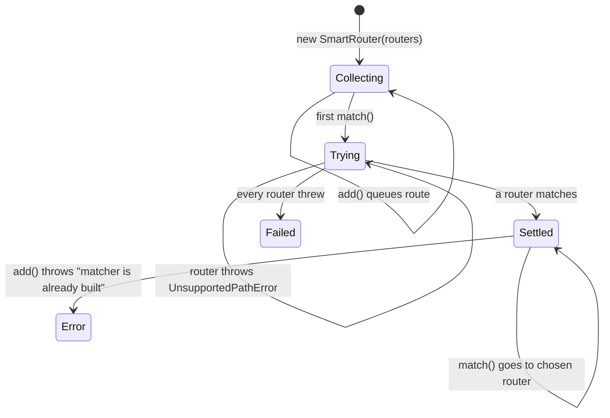

## Overview

A router is the part of Hono that answers one question per request: which registered handlers match this method and path, and with which parameters. The app feeds it every registration through `add` and asks it once per request through `match` ([[The Hono App and Route Registration]], [[Request Lifecycle and Middleware Composition]]). Hono ships five routers behind the same interface, and the presets differ only in which one they use.

Sources: [src/router.ts:24-52](repo://src/router.ts#L24-L52)

| Router | Strategy | Used by |
| --- | --- | --- |
| `SmartRouter` | Tries a list of routers at the first match and keeps the first that accepts all routes | `hono`, `hono/quick` |
| `RegExpRouter` | Compiles all routes of a method into one regular expression ([[RegExpRouter]]) | first choice in `hono` |
| `TrieRouter` | Tree of path segments searched breadth-first | fallback in `hono` and `hono/quick` |
| `PatternRouter` | One regular expression per route, tested in order | `hono/tiny` |
| `LinearRouter` | Stores routes as strings and scans them per request | first choice in `hono/quick` |

Sources: [src/hono.ts:26-33](repo://src/hono.ts#L26-L33), [src/preset/tiny.ts:16-19](repo://src/preset/tiny.ts#L16-L19), [src/preset/quick.ts:18-23](repo://src/preset/quick.ts#L18-L23)

## The Router interface

A router has a `name`, `add(method, path, handler)` and `match(method, path)`. The app stores `[handler, routerRoute]` as the handler value and uses the method `ALL` for middleware and `app.all`. A router that cannot represent a path throws `UnsupportedPathError`, and one that no longer accepts routes after building its matcher throws with `MESSAGE_MATCHER_IS_ALREADY_BUILT`.

Sources: [src/router.ts:1-52](repo://src/router.ts#L1-L52), [src/router.ts:100-103](repo://src/router.ts#L100-L103)

`match` returns every matching handler in registration order, in one of two shapes. The first pairs each handler with a map from parameter name to an index, plus one shared array of captured strings; `RegExpRouter` returns this so captures are not copied per handler. The second pairs each handler with a ready parameter object, which the other routers return. [[HonoRequest]] reads either shape.

Sources: [src/router.ts:54-98](repo://src/router.ts#L54-L98)

## Route path syntax

| Pattern | Meaning |
| --- | --- |
| `/user/:id` | named parameter, one segment |
| `/post/:date{[0-9]+}` | parameter constrained by a regular expression |
| `/api/animals/:type?` | optional trailing parameter |
| `/wild/*/card` | `*` matches any one segment |
| `/assets/*` | the path and everything below it, including `/assets` itself |
| `*` | every path (what `app.use(handler)` registers) |

Sources: [src/utils/url.ts:50-78](repo://src/utils/url.ts#L50-L78), [src/utils/url.ts:171-206](repo://src/utils/url.ts#L171-L206), [src/router/trie-router/node.ts:136-146](repo://src/router/trie-router/node.ts#L136-L146)

Three helpers in `utils/url` turn this syntax into router input. `checkOptionalParameter` expands a path ending in an optional parameter into each prefix, so `/api/animals/:type?` registers both `/api/animals` and `/api/animals/:type`. `splitRoutingPath` replaces `{...}` groups with markers before splitting on `/`, so a regular expression containing `/` stays in one segment. `getPattern` turns a segment into `[key, name, matcher]`: `true` for a plain label, or a `RegExp` that, when followed by a literal segment, includes a lookahead for it. Patterns are cached by segment and next segment.

Sources: [src/utils/url.ts:16-78](repo://src/utils/url.ts#L16-L78), [src/utils/url.ts:171-206](repo://src/utils/url.ts#L171-L206)

## SmartRouter

`SmartRouter` holds a list of routers and defers choosing among them. `add` only queues `[method, path, handler]`. On the first `match`, it registers every queued route in the first router and matches; if that throws `UnsupportedPathError`, it moves to the next router. The first router that succeeds wins: `SmartRouter` replaces its own `match` with that router's bound `match`, drops the others and the queue, and renames itself, for example `SmartRouter + RegExpRouter`.

Sources: [src/router/smart-router/router.ts:4-61](repo://src/router/smart-router/router.ts#L4-L61)

Sources: [src/router/smart-router/router.ts:13-61](repo://src/router/smart-router/router.ts#L13-L61)

Two consequences follow. Every route must be registered before the first request, because `add` throws once the router is settled. And only errors raised during that first `match` trigger a fallback; if every router throws, `match` throws `Fatal error`. `activeRouter` exposes the chosen router after settlement and throws before it; the dev helper's `getRouterName` triggers a match to read the final name ([[Route Introspection]]).

Sources: [src/router/smart-router/router.ts:13-69](repo://src/router/smart-router/router.ts#L13-L69), [src/helper/dev/index.ts:76-79](repo://src/helper/dev/index.ts#L76-L79)

## TrieRouter

### Insertion

`TrieRouter.add` expands optional parameters and inserts each path into a `Node` tree. `insert` splits the path with `splitRoutingPath` and walks one segment at a time: a segment with a pattern is stored under the pattern's key and recorded in the parent's `#patterns`, a literal under its own text. At the final node it pushes a handler set for the method, holding the handler, the parameter names seen on the way (`possibleKeys`) and a `score` equal to the insertion count, which preserves registration order.

Sources: [src/router/trie-router/router.ts:5-28](repo://src/router/trie-router/router.ts#L5-L28), [src/router/trie-router/node.ts:25-85](repo://src/router/trie-router/node.ts#L25-L85)

### Search

`search` splits the request path and advances a set of current nodes one segment at a time. At each node it follows the literal child with the same text, then tries each pattern: `*` keeps the wildcard node as a candidate and collects its handlers, a plain label accepts any non-empty segment, and a regular-expression label is tested against the remaining path from that segment on, so it may consume several segments; nodes reached that way are queued for the matching later step. On the last segment it also collects handlers of a `*` child, which is why `/hello/*` matches `/hello`.

Sources: [src/router/trie-router/node.ts:114-148](repo://src/router/trie-router/node.ts#L114-L148), [src/router/trie-router/node.ts:149-235](repo://src/router/trie-router/node.ts#L149-L235)

Collected handler sets take the method's handler or the `ALL` handler, and fill parameters from the values captured along the path. If more than one handler matched, they are sorted by `score`, so the result is in registration order regardless of where in the tree each was found.

Sources: [src/router/trie-router/node.ts:87-112](repo://src/router/trie-router/node.ts#L87-L112), [src/router/trie-router/node.ts:237-244](repo://src/router/trie-router/node.ts#L237-L244)

## PatternRouter

`PatternRouter` converts each route to its own `RegExp` when it is added: labels become named groups (`[^/]+` or the given pattern), a mid-path `*` becomes `[^/]+`, a trailing `/*` removes the end anchor, and other routes allow an optional trailing slash. An optional parameter registers the path without it as well. A pattern that is not a valid regular expression throws `UnsupportedPathError`. `match` tests every route whose method is the request's or `ALL`, in order, and returns the named groups as parameters.

Sources: [src/router/pattern-router/router.ts:8-60](repo://src/router/pattern-router/router.ts#L8-L60)

## LinearRouter

`LinearRouter.add` only appends `[method, path, handler]`, after expanding optional parameters, so registration does no parsing. `match` walks every route for the method or `ALL` and compares strings: `*` and `/*` match everything; static paths compare directly, allowing one trailing slash; wildcard-only paths are matched piece by piece with `indexOf`; label paths are split and each label consumes up to the next `/`, or the span of its regular expression, built per request with a lookahead for the next literal segment.

Sources: [src/router/linear-router/router.ts:11-69](repo://src/router/linear-router/router.ts#L11-L69), [src/router/linear-router/router.ts:70-135](repo://src/router/linear-router/router.ts#L70-L135)

A route that mixes labels and wildcards throws `UnsupportedPathError` when `match` reaches it. In `hono/quick` this happens during `SmartRouter`'s first match only if the first request's method reaches such a route; otherwise the error surfaces on a later request instead of triggering the fallback to `TrieRouter`.

Sources: [src/router/linear-router/router.ts:136-143](repo://src/router/linear-router/router.ts#L136-L143), [src/router/smart-router/router.ts:32-50](repo://src/router/smart-router/router.ts#L32-L50)
