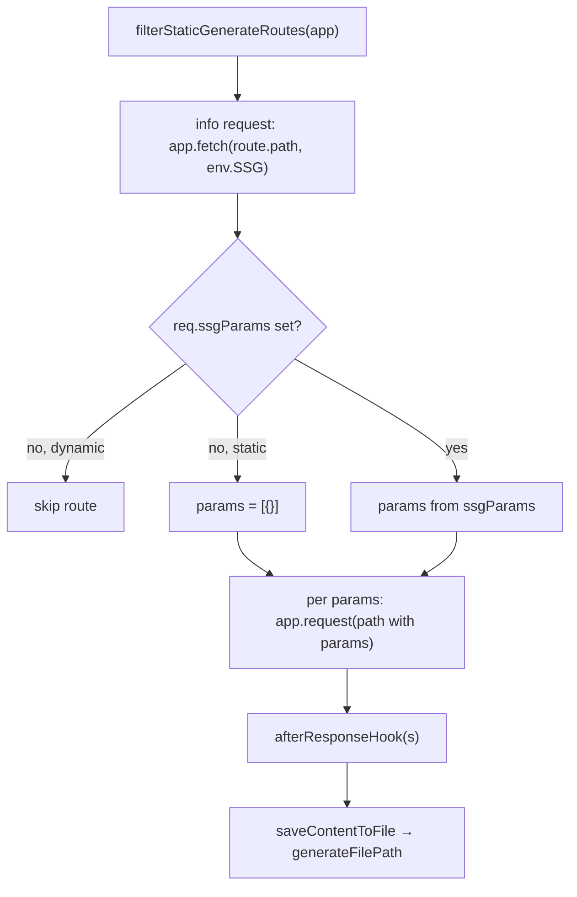

## Overview

`toSSG(app, fsModule, options)` from `hono/ssg` renders an app to files. It does not need a server: it builds a `Request` for each `GET` route, runs it through `app.fetch` and `app.request` in-process, and writes each response body to a file whose name comes from the route path and the response's content type. File access goes through a two-method `FileSystemModule` (`writeFile` and `mkdir`), so the same code runs on any runtime; Bun and Deno adapters supply one.

Sources: [src/helper/ssg/ssg.ts:29-48](repo://src/helper/ssg/ssg.ts#L29-L48), [src/helper/ssg/ssg.ts:368-470](repo://src/helper/ssg/ssg.ts#L368-L470)

Every request made by the generator carries a marker in its bindings, `c.env.HONO_SSG_CONTEXT = true`, which is how middleware tell generation from live traffic.

Sources: [src/helper/ssg/middleware.ts:5-6](repo://src/helper/ssg/middleware.ts#L5-L6), [src/helper/ssg/ssg.ts:243-269](repo://src/helper/ssg/ssg.ts#L243-L269)

## Which routes are generated

`filterStaticGenerateRoutes` walks `app.routes` and keeps the paths of `GET` and `ALL` registrations whose handler, after unwrapping sub-app error wrappers, is not middleware (it declares fewer than two parameters) ([[Route Introspection]]).

Sources: [src/helper/ssg/utils.ts:57-71](repo://src/helper/ssg/utils.ts#L57-L71), [src/utils/handler.ts:8-15](repo://src/utils/handler.ts#L8-L15)

A route with a `:param` or `*` segment is dynamic. It is generated only if middleware on it supplies parameter sets with `ssgParams`; otherwise it is skipped.

Sources: [src/helper/ssg/utils.ts:73-75](repo://src/helper/ssg/utils.ts#L73-L75), [src/helper/ssg/ssg.ts:245-251](repo://src/helper/ssg/ssg.ts#L245-L251)

## The generation flow

### Request sequence

Sources: [src/helper/ssg/ssg.ts:205-302](repo://src/helper/ssg/ssg.ts#L205-L302)

### Info request

For each route, `fetchRoutesContent` first sends an info request to the route path through `beforeRequestHook`; a hook returning `false` skips the route. This request runs the app normally. `ssgParams(params)` middleware, on a dynamic path, stores the parameter list (an array, or the result of a function of the context) on the raw request and answers `c.notFound()`, so the handler does not run. For a static route the handler does run, and its response is discarded.

Sources: [src/helper/ssg/ssg.ts:225-251](repo://src/helper/ssg/ssg.ts#L225-L251), [src/helper/ssg/middleware.ts:24-49](repo://src/helper/ssg/middleware.ts#L24-L49)

### Content requests

Then, for each parameter set, the route path is filled in with `replaceUrlParam` (the client's helper) and requested again with the info request's method and headers. A response carrying the `x-hono-disable-ssg` header is skipped. The `afterResponseHook` may replace the response or return `false` to skip it. The MIME type is the `Content-Type` without parameters, defaulting to `text/plain`, a default whose comment ties it to Bun omitting `Content-Type` for text responses. Text and JSON bodies are read as strings, everything else as an `ArrayBuffer`.

Sources: [src/helper/ssg/ssg.ts:19-25](repo://src/helper/ssg/ssg.ts#L19-L25), [src/helper/ssg/ssg.ts:74-88](repo://src/helper/ssg/ssg.ts#L74-L88), [src/helper/ssg/ssg.ts:253-296](repo://src/helper/ssg/ssg.ts#L253-L296)

### Concurrency

Both kinds of request run through `createPool({ concurrency })`, default 2. When the pool is full, a call re-schedules itself with `setTimeout` until a slot frees; `Infinity` disables the limit.

Sources: [src/helper/ssg/ssg.ts:17](repo://src/helper/ssg/ssg.ts#L17-L17), [src/helper/ssg/ssg.ts:222-223](repo://src/helper/ssg/ssg.ts#L222-L223), [src/utils/concurrent.ts:12-55](repo://src/utils/concurrent.ts#L12-L55)

## File names

`generateFilePath` picks an extension from `extensionMap` (default: HTML, XML variants and YAML), else from the MIME table, else `html`. The route path then decides the name:

Sources: [src/helper/ssg/ssg.ts:90-108](repo://src/helper/ssg/ssg.ts#L90-L108)

| Route path | File |
| --- | --- |
| already ends in `.ext` | `dir/route` as is |
| `/` | `dir/index.ext` |
| ends in `/` | `dir/route/index.ext` |
| anything else | `dir/route.ext` |

Sources: [src/helper/ssg/ssg.ts:50-72](repo://src/helper/ssg/ssg.ts#L50-L72)

Paths are joined with `joinPaths`, which normalises backslashes and resolves `.` and `..`. `ensureWithinOutDir` then throws `Path traversal detected` when the result lies outside the output directory (default `./static`), so a route path or parameter value containing `..` cannot write elsewhere.

Sources: [src/helper/ssg/utils.ts:16-55](repo://src/helper/ssg/utils.ts#L16-L55), [src/helper/ssg/utils.ts:77-87](repo://src/helper/ssg/utils.ts#L77-L87), [src/helper/ssg/ssg.ts:27](repo://src/helper/ssg/ssg.ts#L27-L27)

`saveContentToFile` creates each directory once with `mkdir({ recursive: true })`, remembering created directories in a module-level set, and writes strings directly and buffers as `Uint8Array`.

Sources: [src/helper/ssg/ssg.ts:304-334](repo://src/helper/ssg/ssg.ts#L304-L334)

## Hooks and plugins

`options.beforeRequestHook`, `afterResponseHook` and `afterGenerateHook` accept one function or an array. Arrays run in order; a request or response hook returning `false` stops the chain and skips the route. Plugins are objects with the same three hook fields; their hooks run after the ones in `options`.

Sources: [src/helper/ssg/ssg.ts:110-198](repo://src/helper/ssg/ssg.ts#L110-L198), [src/helper/ssg/ssg.ts:372-419](repo://src/helper/ssg/ssg.ts#L372-L419)

| Plugin | Effect |
| --- | --- |
| `defaultPlugin()` | skips every response whose status is not 200; used when `options.plugins` is not given |
| `redirectPlugin()` | turns 301, 302, 303, 307 and 308 responses into a 200 HTML page with a meta refresh and canonical link to `Location`; skips redirects without `Location` |

Sources: [src/helper/ssg/plugins.ts:4-72](repo://src/helper/ssg/plugins.ts#L4-L72)

Passing `plugins` replaces the default, so `defaultPlugin()` must be listed again to keep its filter, and the doc comment requires `redirectPlugin()` before it, since `defaultPlugin` would otherwise drop the redirect responses first.

Sources: [src/helper/ssg/plugins.ts:37-54](repo://src/helper/ssg/plugins.ts#L37-L54), [src/helper/ssg/ssg.ts:372](repo://src/helper/ssg/ssg.ts#L372-L372)

## Result and errors

`toSSG` resolves to `{ success, files, error }`. It waits for every route, then for every save; the first failed save (or a failed request) makes the result `{ success: false, files: [], error }` instead of rejecting. `afterGenerateHook`s run with the result in both cases, receiving the file system module and options as well.

Sources: [src/helper/ssg/ssg.ts:420-470](repo://src/helper/ssg/ssg.ts#L420-L470)

## Controlling generation from middleware

| Export | Behavior |
| --- | --- |
| `ssgParams(params)` | supplies parameter sets for a dynamic route during the info request |
| `isSSGContext(c)` | `true` when `c.env` carries the SSG marker |
| `disableSSG()` | during generation, sets `x-hono-disable-ssg` and answers not found, so the route is skipped; otherwise passes through |
| `onlySSG()` | outside generation answers not found; during generation passes through |

Sources: [src/helper/ssg/middleware.ts:24-83](repo://src/helper/ssg/middleware.ts#L24-L83)

## Runtime adapters

`hono/bun` exports `toSSG(app, options)` with a file system module that writes through `Bun.write` (whose `mkdir` does nothing), and `hono/deno` one that uses `Deno.writeFile` and `Deno.mkdir`. Both are marked experimental.

Sources: [src/adapter/bun/ssg.ts:1-27](repo://src/adapter/bun/ssg.ts#L1-L27), [src/adapter/deno/ssg.ts:1-27](repo://src/adapter/deno/ssg.ts#L1-L27)
