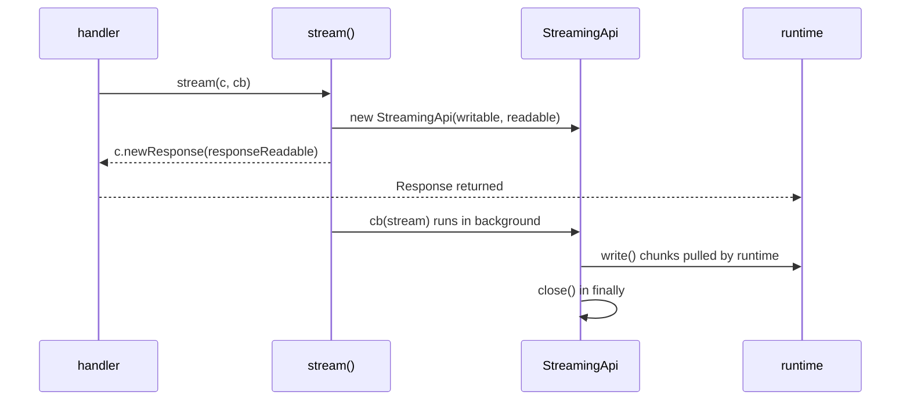

## Overview

The streaming helper (`hono/streaming`) lets a handler return a response immediately and keep writing its body afterwards. `stream(c, cb, onError)` returns a `Response` whose body is a `ReadableStream`, then runs `cb` in the background with a `StreamingApi` to write to. `streamText` and `streamSSE` are the same mechanism with headers and message formatting for plain text and Server-Sent Events.

Sources: [src/helper/streaming/index.ts:1-9](repo://src/helper/streaming/index.ts#L1-L9), [src/helper/streaming/stream.ts:7-45](repo://src/helper/streaming/stream.ts#L7-L45)

Streaming rendered JSX with `Suspense` is a separate path built on `renderToReadableStream` ([[Suspense and Streaming Rendering]]).

Sources: [src/jsx/streaming.ts:146-220](repo://src/jsx/streaming.ts#L146-L220)

## How stream() works

Sources: [src/helper/streaming/stream.ts:7-45](repo://src/helper/streaming/stream.ts#L7-L45)

`stream()` creates a `TransformStream` and wraps both ends in a `StreamingApi`. It starts `cb(stream)` without awaiting it and returns `c.newResponse(stream.responseReadable)`, so headers and status set on the context before the call apply. When `cb` finishes, normally or not, the stream is closed in a `finally` block.

Sources: [src/helper/streaming/stream.ts:11-45](repo://src/helper/streaming/stream.ts#L11-L45)

The context is kept alive in a `WeakMap` keyed by the response stream because, as the code comment says, Bun destroys `c` when the request returns. For Bun before 1.1.27, which did not cancel the stream on disconnect, the request's abort signal is wired to `stream.abort()`; `isOldBunVersion` checks `Bun.version` once and caches the answer.

Sources: [src/helper/streaming/stream.ts:5-25](repo://src/helper/streaming/stream.ts#L5-L25), [src/helper/streaming/utils.ts:1-11](repo://src/helper/streaming/utils.ts#L1-L11)

## The StreamingApi

### Writing

| Member | Behavior |
| --- | --- |
| `write(input)` | encodes strings as UTF-8 and writes; errors are swallowed |
| `writeln(input)` | `write(input + '\n')` |
| `sleep(ms)` | a promise resolving after `ms` |
| `pipe(body)` | releases the writer, pipes a `ReadableStream` in without closing, then takes the writer back |
| `close()` | marks `closed` and closes the writer; errors are swallowed |
| `onAbort(listener)` | registers a callback for client disconnects |
| `abort()` | marks `aborted` once and calls every abort listener |
| `aborted`, `closed` | state flags |

Sources: [src/utils/stream.ts:6-98](repo://src/utils/stream.ts#L6-L98)

Write and close errors are ignored on purpose; the code comments say to build the stream yourself if you need to handle them.

Sources: [src/utils/stream.ts:48-76](repo://src/utils/stream.ts#L48-L76)

### Disconnects

The response body is not the transform's readable side directly. `StreamingApi` builds `responseReadable`, a `ReadableStream` that pulls from the transform's reader. When the runtime cancels it because the client went away, its `cancel` calls `abort()` (unless already closed), and the first abort listener cancels the inner reader, so pending writes stop blocking. A callback can check `stream.aborted` or use `onAbort` to stop producing data.

Sources: [src/utils/stream.ts:21-46](repo://src/utils/stream.ts#L21-L46), [src/utils/stream.ts:84-97](repo://src/utils/stream.ts#L84-L97)

## Errors in the callback

| Thrown | `stream()` | `streamSSE()` |
| --- | --- | --- |
| an `Error` with `onError` given | `onError(err, stream)` | `onError(err, stream)`, then an `event: error` message with `err.message` |
| anything else | logged with `console.error` | logged with `console.error` |
| `undefined` (reader cancelled) | ignored | logged |

Sources: [src/helper/streaming/stream.ts:26-42](repo://src/helper/streaming/stream.ts#L26-L42), [src/helper/streaming/sse.ts:47-68](repo://src/helper/streaming/sse.ts#L47-L68)

Errors are handled inside the background task, and `stream()` returns the response whatever the callback does, so the app's error handler is never involved and the status cannot change.

Sources: [src/helper/streaming/stream.ts:26-44](repo://src/helper/streaming/stream.ts#L26-L44)

## streamText

`streamText(c, cb, onError)` sets `Content-Type: text/plain; charset=UTF-8`, `X-Content-Type-Options: nosniff` and `Transfer-Encoding: chunked`, then calls `stream()`.

Sources: [src/helper/streaming/text.ts:1-15](repo://src/helper/streaming/text.ts#L1-L15)

## streamSSE

### Headers

`streamSSE(c, cb, onError)` follows the same setup with an `SSEStreamingApi` and sets `Transfer-Encoding: chunked`, `Content-Type: text/event-stream`, `Cache-Control: no-cache` and `Connection: keep-alive`. The `compress` middleware skips `text/event-stream` responses through its default content-type filter ([[Response Middleware]]).

Sources: [src/helper/streaming/sse.ts:70-100](repo://src/helper/streaming/sse.ts#L70-L100), [src/utils/compress.ts:6-10](repo://src/utils/compress.ts#L6-L10)

### Messages

`writeSSE({ data, event, id, retry })` resolves `data`, which may be a promise or rendered HTML with callbacks, splits it on any line ending and prefixes each line with `data: `. It refuses an `event`, `id` or `retry` containing a carriage return or line feed by throwing an error. The fields are joined in the order `event`, data lines, `id`, `retry`, and the message ends with a blank line.

Sources: [src/helper/streaming/sse.ts:6-45](repo://src/helper/streaming/sse.ts#L6-L45)
