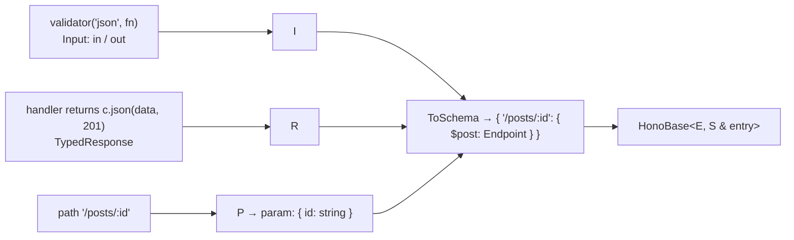

## Overview

Hono's TypeScript types do more than check handlers: every registration method returns the app with a wider type that records the route just added. The app type `Hono<E, S, BasePath>` carries three parameters: `E`, the environment (bindings and variables) handlers see; `S`, the schema, a map from path to method to input and output; and `BasePath`, the prefix set by `basePath()`. Nothing in this page exists at run time; it is the contract the [[RPC Client]] reads.

Sources: [src/hono-base.ts:98-112](repo://src/hono-base.ts#L98-L112), [src/types.ts:2531-2551](repo://src/types.ts#L2531-L2551)

Because each call returns a new type rather than changing the old one, the accumulated schema exists only on the value a call returns. Registering routes as separate statements on one `app` variable leaves that variable's type with an empty schema.

Sources: [src/types.ts:127-147](repo://src/types.ts#L127-L147), [src/types.ts:167-182](repo://src/types.ts#L167-L182)

## Environment

`Env` has optional `Bindings` (what `c.env` holds) and `Variables` (what `c.set`/`c.get` accept). Handlers are typed `Handler<E, P, I, R>` (`(c, next) => R`) and middleware `MiddlewareHandler<E, P, I, R>` (always async, may return nothing), where `P` is the route path and `I` the validated input.

Sources: [src/types.ts:26-46](repo://src/types.ts#L26-L46), [src/types.ts:70-95](repo://src/types.ts#L70-L95)

Middleware may declare an environment of its own, `E2`. The registration overloads combine it with the app's environment through `IntersectNonAnyTypes`, which skips `any` and the empty default, so a middleware typed with `Variables: { user: User }` makes `c.get('user')` typed in the handlers registered with it, and, for `app.use`, in the app returned.

Sources: [src/types.ts:1080-1108](repo://src/types.ts#L1080-L1108), [src/types.ts:2762-2765](repo://src/types.ts#L2762-L2765)

## How the schema grows

### Registration overloads

`HandlerInterface` (behind `get`, `post`, `all` and the others) has an overload for each arity, with and without a path. Each returns `HonoBase<..., S & ToSchema<M, P, I, R>, ...>`: the old schema intersected with one entry for this method and path. `I` is the intersection of the inputs declared by the middleware in the call (validators), and `R` is the last handler's response type merged with any typed responses middleware can return.

Sources: [src/types.ts:127-200](repo://src/types.ts#L127-L200), [src/types.ts:2649-2672](repo://src/types.ts#L2649-L2672)

For the `(path, handler)` form, `AddSchemaIfHasResponse` leaves the schema unchanged when the handler's return type is `Promise<void>`, so a middleware registered with `app.get` does not create an endpoint. `app.on` builds the same entry with its method string, and `app.use` never changes the schema; it only widens `E` and the current path.

Sources: [src/types.ts:2537-2544](repo://src/types.ts#L2537-L2544), [src/types.ts:1457-1479](repo://src/types.ts#L1457-L1479), [src/types.ts:1080-1102](repo://src/types.ts#L1080-L1102)

### One schema entry

`ToSchema<M, P, I, R>` produces `{ [P]: { [$m]: Endpoint } }`, where the method key is the lower-case method with a `$` prefix (`$get`). An `Endpoint` has four fields:

Sources: [src/types.ts:2500-2529](repo://src/types.ts#L2500-L2529), [src/types.ts:2608](repo://src/types.ts#L2608-L2608)

| Field | Source |
| --- | --- |
| `input` | the validated inputs `I['in']`, plus `param` built from the path when no validator declared one |
| `output` | the `TypedResponse` data type, or `{}` when unknown |
| `outputFormat` | `json`, `text`, `redirect`, `ws` or another format named by the response |
| `status` | the status code type from the response, or every `StatusCode` |

Sources: [src/types.ts:2483-2498](repo://src/types.ts#L2483-L2498), [src/types.ts:2546-2551](repo://src/types.ts#L2546-L2551), [src/types.ts:2601-2606](repo://src/types.ts#L2601-L2606)

Sources: [src/types.ts:2500-2529](repo://src/types.ts#L2500-L2529), [src/validator/validator.ts:64-88](repo://src/validator/validator.ts#L64-L88)

## Typed responses

`TypedResponse<T, U, F>` is a phantom type with `_data`, `_status` and `_format` fields; the format defaults to `text` for strings and `json` for JSON values. The [[Context]] helpers return `Response & TypedResponse<...>`: `c.text` keeps the literal string type, `c.body` uses format `body`, `c.redirect` uses `redirect` with an undefined body, and `c.json` returns the `JSONParsed` form of its argument.

Sources: [src/types.ts:2632-2647](repo://src/types.ts#L2632-L2647), [src/context.ts:118-208](repo://src/context.ts#L118-L208), [src/context.ts:750-753](repo://src/context.ts#L750-L753)

`JSONParsed` describes what survives a round trip through `JSON.stringify`: functions, symbols and `undefined` become `null` inside arrays and are dropped as object properties, symbol keys are dropped, values with a `toJSON` method (such as `Date`) take that method's return type, `Set` and `Map` become `{}`, and `bigint` makes the type `never` because `JSON.stringify` throws on it. The client therefore sees the shape the network carries rather than the server-side object type.

Sources: [src/utils/types.ts:22-87](repo://src/utils/types.ts#L22-L87)

The status parameter of `c.json`, `c.text` and `c.body` is limited to codes that may carry a body, and redirects to redirect codes, so `status` in the schema is precise when a literal is passed. `NotFoundResponse` is an empty interface that applications can augment to type `c.notFound()`.

Sources: [src/context.ts:118-197](repo://src/context.ts#L118-L197), [src/types.ts:97-111](repo://src/types.ts#L97-L111)

## Path parameters

`ParamKeys<Path>` splits a path type on `/` and collects every `:name` segment, removing any `{pattern}` suffix and keeping a trailing `?` for optional parameters. `ParamKeyToRecord` turns `id` into `{ id: string }` and `id?` into `{ id: string | undefined }`. These types drive both `c.req.param()` ([[HonoRequest]]) and the `param` input of the schema.

Sources: [src/types.ts:2698-2729](repo://src/types.ts#L2698-L2729), [src/request.ts:94-104](repo://src/request.ts#L94-L104)

## Base paths and sub-apps

`MergePath<A, B>` joins path types with the same slash rules as the run-time `mergePath`. `basePath(path)` returns an app whose `BasePath` is the merged prefix, so later registrations land under it. `route(path, subApp)` returns this app's schema united with `MergeSchemaPath<SubSchema, MergePath<BasePath, path>>`, which renames every sub-app path with the prefix.

Sources: [src/types.ts:2610-2624](repo://src/types.ts#L2610-L2624), [src/hono-base.ts:208-253](repo://src/hono-base.ts#L208-L253)

When the prefix itself has parameters, such as `/users/:userId`, `MergeEndpointParamsWithPath` adds them to each endpoint's `param` input (stripping `{pattern}` from names), so the client must supply `userId` for every route of the sub-app.

Sources: [src/types.ts:2553-2600](repo://src/types.ts#L2553-L2600)

`ExtractSchema<typeof app>` returns the schema of an app type, and `ExtractSchemaForStatusCode` narrows each endpoint to one status code.

Sources: [src/types.ts:2737-2748](repo://src/types.ts#L2737-L2748)

## Reusable typed pieces

### Factory helper

Handlers and middleware defined apart from `app.get(...)` lose the inference that the registration call provides. The factory helper (`hono/factory`) restores it with identity functions that only carry types. `createMiddleware<E>(fn)` returns `fn` typed as `MiddlewareHandler<E, P, I, R>`.

Sources: [src/helper/factory/index.ts:368-375](repo://src/helper/factory/index.ts#L368-L375)

`createFactory<E>({ initApp, defaultAppOptions })` returns a `Factory` bound to one environment type. Its `createApp(options)` builds a `Hono<E>` with the default options merged under the given ones and runs `initApp` on it; `createMiddleware` is the same identity typed with the factory's `E`; and `createHandlers(...handlers)` returns the handlers as a tuple, typed through overloads for up to ten handlers that thread inputs and environments the same way `app.get` does, so they can be spread into a registration call.

Sources: [src/helper/factory/index.ts:18-30](repo://src/helper/factory/index.ts#L18-L30), [src/helper/factory/index.ts:332-366](repo://src/helper/factory/index.ts#L332-L366)

`createHandlers` drops `undefined` entries from its arguments at run time; otherwise the factory does nothing beyond what `new Hono()` and plain functions do.

Sources: [src/helper/factory/index.ts:357-360](repo://src/helper/factory/index.ts#L357-L360)
