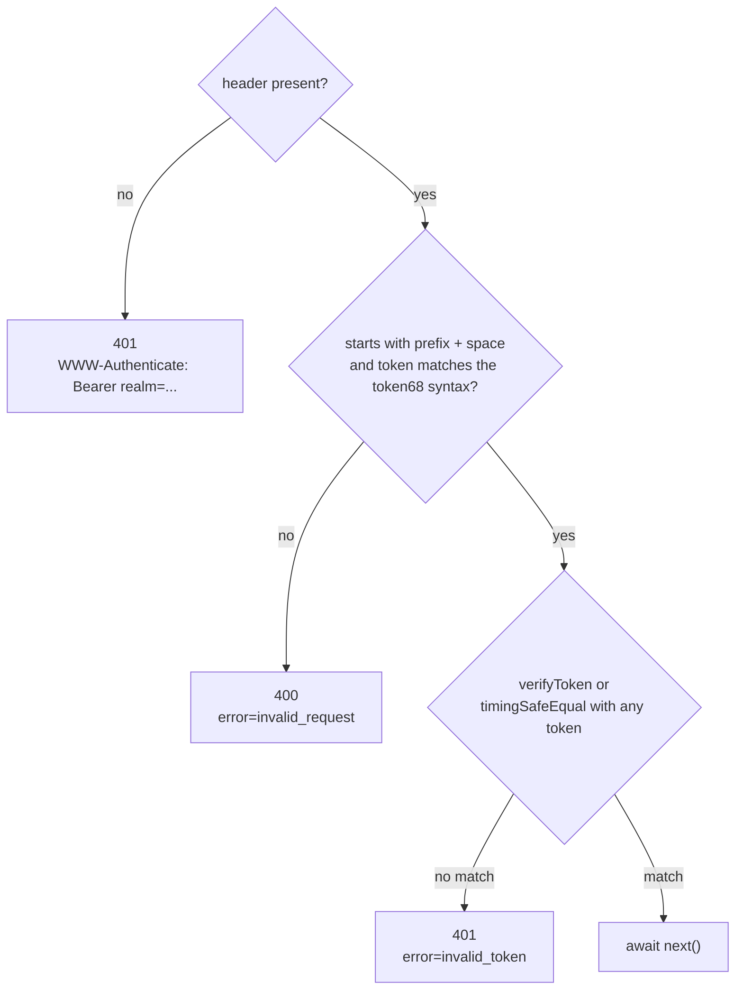

## Overview

`basicAuth` (`hono/basic-auth`) and `bearerAuth` (`hono/bearer-auth`) protect routes with static credentials or a verification callback. Both read the `Authorization` header, compare secrets without leaking timing information, and stop a failed request by throwing an `HTTPException` whose prepared response carries the `WWW-Authenticate` header. A request that passes simply continues with `await next()`.

Sources: [src/middleware/basic-auth/index.ts:80-153](repo://src/middleware/basic-auth/index.ts#L80-L153), [src/middleware/bearer-auth/index.ts:104-221](repo://src/middleware/bearer-auth/index.ts#L104-L221)

Signed tokens such as JWTs are handled by [[JWT and JWK]]; this page covers shared secrets. Because failures are exceptions, a custom `app.onError` must return `err.getResponse()` for an `HTTPException` to keep the challenge header (see [[Middleware Composition and Error Handling]]).

Sources: [src/http-exception.ts:66-77](repo://src/http-exception.ts#L66-L77)

```ts
import { basicAuth } from 'hono/basic-auth'
import { bearerAuth } from 'hono/bearer-auth'

app.use('/admin/*', basicAuth({ username: 'admin', password: 'secret' }))
app.use('/api/*', bearerAuth({ token: ['token-a', 'token-b'] }))
```

Sources: [src/middleware/basic-auth/index.ts:80-83](repo://src/middleware/basic-auth/index.ts#L80-L83), [src/middleware/bearer-auth/index.ts:104-106](repo://src/middleware/bearer-auth/index.ts#L104-L106)

## Timing-safe comparison

Both middleware compare secrets with `timingSafeEqual` from `utils/buffer`. For strings it hashes both sides, SHA-256 by default or the `hashFunction` option, and compares the two digests and the two original strings with `constantTimeEqualString`. That function XORs every character up to the longer length and folds in the length difference, so the loop takes the same time whether the first or the last character differs.

Sources: [src/utils/buffer.ts:28-63](repo://src/utils/buffer.ts#L28-L63)

Hashing first gives both inputs the same length before comparison, so the comparison time does not reveal the secret's length. Requiring the original strings to be equal too guards against a custom hash function that collides. The default `sha256` uses `crypto.subtle.digest`; when Web Crypto is missing it returns `null`, which makes the comparison fail closed.

Sources: [src/utils/buffer.ts:44-63](repo://src/utils/buffer.ts#L44-L63), [src/utils/crypto.ts:15-19](repo://src/utils/crypto.ts#L15-L19), [src/utils/crypto.ts:33-58](repo://src/utils/crypto.ts#L33-L58)

## basicAuth

### Credentials

`basicAuth(options, ...users)` takes either `username` and `password`, optionally with more `{ username, password }` objects as extra arguments, or a `verifyUser(username, password, c)` callback. Passing neither throws at setup.

Sources: [src/middleware/basic-auth/index.ts:14-30](repo://src/middleware/basic-auth/index.ts#L14-L30), [src/middleware/basic-auth/index.ts:80-103](repo://src/middleware/basic-auth/index.ts#L80-L103)

The `auth` helper in `utils/basic-auth` parses the header. It accepts `Basic` in any letter case followed by a base64 token, decodes it as UTF-8, and splits at the first `:` so a password may contain colons. A missing header, a malformed token or invalid base64 all yield `undefined`, which the middleware treats like wrong credentials.

Sources: [src/utils/basic-auth.ts:1-26](repo://src/utils/basic-auth.ts#L1-L26)

### Checking a user

With `verifyUser`, the callback decides and may be async, for example to look the user up in a database. With static users, every configured user is checked with `timingSafeEqual` on both the username and the password, the two comparisons run in parallel, and the first match passes. On success, `onAuthSuccess(c, username)` runs before `next()`, which is the place to store the user with `c.set`.

Sources: [src/middleware/basic-auth/index.ts:105-131](repo://src/middleware/basic-auth/index.ts#L105-L131)

### Failure

Any failure throws `HTTPException(401)` with `WWW-Authenticate: Basic realm="..."`. The realm defaults to `Secure Area` and has its double quotes escaped. The body is `invalidUserMessage`, `Unauthorized` by default: a string is sent as text, an object as JSON, and a function receives the context and returns either.

Sources: [src/middleware/basic-auth/index.ts:93-99](repo://src/middleware/basic-auth/index.ts#L93-L99), [src/middleware/basic-auth/index.ts:132-152](repo://src/middleware/basic-auth/index.ts#L132-L152)

## bearerAuth

### Options

| Option | Default | Effect |
| --- | --- | --- |
| `token` | none | One token or an array of accepted tokens |
| `verifyToken(token, c)` | none | Callback used instead of `token` |
| `prefix` | `Bearer` | Scheme before the token; `''` reads the raw header value |
| `headerName` | `Authorization` | Header to read |
| `realm` | `''` | Realm in the challenge |
| `hashFunction` | SHA-256 | Hash used by the timing-safe comparison |
| `noAuthenticationHeader`, `invalidAuthenticationHeader`, `invalidToken` | built-in | Per-failure `message` and `wwwAuthenticateHeader` overrides |

Sources: [src/middleware/bearer-auth/index.ts:12-66](repo://src/middleware/bearer-auth/index.ts#L12-L66), [src/middleware/bearer-auth/index.ts:107-120](repo://src/middleware/bearer-auth/index.ts#L107-L120)

The older `noAuthenticationHeaderMessage`, `invalidAuthenticationHeaderMessage` and `invalidTokenMessage` options still work as fallbacks for the `message` of each case.

Sources: [src/middleware/bearer-auth/index.ts:156-218](repo://src/middleware/bearer-auth/index.ts#L156-L218)

### Checking a token



Sources: [src/middleware/bearer-auth/index.ts:156-220](repo://src/middleware/bearer-auth/index.ts#L156-L220)

The prefix is matched case-insensitively and must be followed by a space; the rest of the value, with leading spaces trimmed, is the token. The token must match `[A-Za-z0-9._~+/-]+=*`, the `token68` syntax of RFC 6750, before any comparison runs. With an array of tokens, each is compared in turn until one matches.

Sources: [src/middleware/bearer-auth/index.ts:12-14](repo://src/middleware/bearer-auth/index.ts#L12-L14), [src/middleware/bearer-auth/index.ts:170-206](repo://src/middleware/bearer-auth/index.ts#L170-L206)

### Failure responses

The three failures follow RFC 6750: no header gives 401 with only the realm, a malformed header gives 400 with `error="invalid_request"`, and a wrong token gives 401 with `error="invalid_token"`. A custom `wwwAuthenticateHeader` may be a string used as is, or an object whose entries are rendered as `key="value"` pairs after the prefix. Messages follow the same string, object or function rules as `basicAuth`.

Sources: [src/middleware/bearer-auth/index.ts:122-154](repo://src/middleware/bearer-auth/index.ts#L122-L154), [src/middleware/bearer-auth/index.ts:160-216](repo://src/middleware/bearer-auth/index.ts#L160-L216)

## Combining with other checks

Both functions return ordinary middleware, so they combine with `some`, `every` and `except` from `hono/combine`. For example, `some(bearerAuth({ token }), basicAuth({ username, password }))` accepts either scheme, and `except('/health', bearerAuth({ token }))` leaves a health check open. See [[Middleware Composition and Error Handling]].

Sources: [src/middleware/combine/index.ts:38-69](repo://src/middleware/combine/index.ts#L38-L69), [src/middleware/combine/index.ts:141-165](repo://src/middleware/combine/index.ts#L141-L165)
