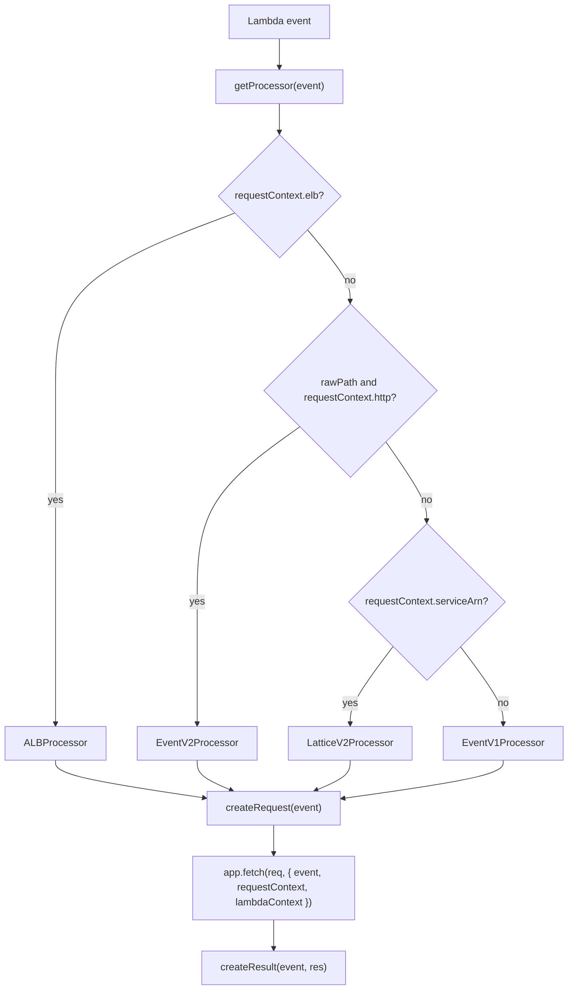

## Overview

AWS does not call functions with a `Request`. Lambda receives a JSON event whose shape depends on what invoked it (API Gateway REST or HTTP APIs, a Function URL, an Application Load Balancer, VPC Lattice) and expects a JSON result back. Lambda@Edge receives CloudFront records. The adapters in `hono/aws-lambda` and `hono/lambda-edge` translate those events into a standard `Request`, call `app.fetch`, and translate the `Response` back, so the app itself stays the same as on any other runtime (see [[Runtime Adapters]]).

Sources: [src/adapter/aws-lambda/handler.ts:23-114](repo://src/adapter/aws-lambda/handler.ts#L23-L114), [src/adapter/lambda-edge/handler.ts:116-147](repo://src/adapter/lambda-edge/handler.ts#L116-L147)

```ts
import { Hono } from 'hono'
import { handle } from 'hono/aws-lambda'

const app = new Hono()
app.get('/', (c) => c.text('Hello from Lambda'))

export const handler = handle(app)
```

Sources: [src/adapter/aws-lambda/handler.ts:239-276](repo://src/adapter/aws-lambda/handler.ts#L239-L276)

## handle

### Request flow



Sources: [src/adapter/aws-lambda/handler.ts:625-658](repo://src/adapter/aws-lambda/handler.ts#L625-L658), [src/adapter/aws-lambda/handler.ts:252-275](repo://src/adapter/aws-lambda/handler.ts#L252-L275)

A REST API (v1) event behind a custom-domain base path mapping also has `rawPath`, so the v2 check requires `requestContext.http` too, which only HTTP API and Function URL events carry.

Sources: [src/adapter/aws-lambda/handler.ts:646-651](repo://src/adapter/aws-lambda/handler.ts#L646-L651)

The event, its `requestContext` and the Lambda context are passed as the app's env, so handlers read `c.env.event`, `c.env.requestContext` and `c.env.lambdaContext`. `getConnInfo` from `hono/aws-lambda` uses `requestContext` (see [[IP Restriction and Connection Info]]). If building the request fails, the handler answers 400 `Invalid request` for a `TypeError` (such as an invalid URL) and 500 otherwise, without calling the app.

Sources: [src/adapter/aws-lambda/handler.ts:255-273](repo://src/adapter/aws-lambda/handler.ts#L255-L273), [src/adapter/aws-lambda/conninfo.ts:45-73](repo://src/adapter/aws-lambda/conninfo.ts#L45-L73)

### Building the Request

`EventProcessor.createRequest` is shared. The URL is `https://` plus the domain (from `requestContext.domainName`, else the `host` header, else a multi-value `host` header), the path and the query string. A body is base64-decoded when `isBase64Encoded` is set, and `content-length` is set from its byte length.

Sources: [src/adapter/aws-lambda/handler.ts:278-342](repo://src/adapter/aws-lambda/handler.ts#L278-L342)

Each subclass reads its own event shape:

Sources: [src/adapter/aws-lambda/handler.ts:278-290](repo://src/adapter/aws-lambda/handler.ts#L278-L290)

| Source | Path, method | Query | Headers and cookies |
| --- | --- | --- | --- |
| HTTP API, Function URL (v2) | `rawPath`, `requestContext.http.method` | `rawQueryString` as sent | `headers`; the `cookies` array joined into `Cookie` |
| REST API (v1) | `path`, `httpMethod` | Rebuilt from the decoded parameters (multi-value first) with `encodeURIComponent` | `multiValueHeaders` appended, then `headers` not already set |
| ALB | `path`, `httpMethod` | Rebuilt from parameters as received (multi-value first) | `multiValueHeaders` joined with `; `, or `headers` |
| VPC Lattice | `path`, `method` | none | Every value appended |

Sources: [src/adapter/aws-lambda/handler.ts:404-499](repo://src/adapter/aws-lambda/handler.ts#L404-L499), [src/adapter/aws-lambda/handler.ts:503-621](repo://src/adapter/aws-lambda/handler.ts#L503-L621)

Header values with non-ASCII characters are percent-encoded with `encodeURIComponent` in the v1, ALB and Lattice processors, because the `Headers` constructor rejects them.

Sources: [src/adapter/aws-lambda/handler.ts:13-21](repo://src/adapter/aws-lambda/handler.ts#L13-L21)

### Building the result

`createResult` reads the whole response. The body is base64-encoded when `isContentTypeBinary(contentType)` says so or when `Content-Encoding` is anything but `identity`; otherwise it is sent as text. The default `defaultIsContentTypeBinary` treats everything as binary except `text/plain`, `text/html`, `text/css`, `text/javascript`, `text/csv` and JSON or XML types. Pass `handle(app, { isContentTypeBinary })` to change that.

Sources: [src/adapter/aws-lambda/handler.ts:344-386](repo://src/adapter/aws-lambda/handler.ts#L344-L386), [src/adapter/aws-lambda/handler.ts:666-674](repo://src/adapter/aws-lambda/handler.ts#L666-L674)

Headers go into `multiValueHeaders` when the event used them and into `headers` otherwise. `Set-Cookie` needs special care because a plain object cannot hold it twice:

Sources: [src/adapter/aws-lambda/handler.ts:361-401](repo://src/adapter/aws-lambda/handler.ts#L361-L401)

| Source | Where cookies go |
| --- | --- |
| v2 | The top-level `cookies` array |
| v1 | `multiValueHeaders['set-cookie']` |
| ALB | `multiValueHeaders['set-cookie']`, or only the first cookie in `headers` when multi-value headers are off |
| Lattice | `headers['set-cookie']` as an array |

Sources: [src/adapter/aws-lambda/handler.ts:423-425](repo://src/adapter/aws-lambda/handler.ts#L423-L425), [src/adapter/aws-lambda/handler.ts:494-498](repo://src/adapter/aws-lambda/handler.ts#L494-L498), [src/adapter/aws-lambda/handler.ts:572-579](repo://src/adapter/aws-lambda/handler.ts#L572-L579), [src/adapter/aws-lambda/handler.ts:615-620](repo://src/adapter/aws-lambda/handler.ts#L615-L620)

> [!WARNING]
> Behind an ALB without multi-value headers enabled, only the first `Set-Cookie` header reaches the client. Enable multi-value headers on the target group if the app sets several cookies.

Sources: [src/adapter/aws-lambda/handler.ts:572-579](repo://src/adapter/aws-lambda/handler.ts#L572-L579)

## streamHandle

`streamHandle(app)` wraps the handler in `awslambda.streamifyResponse`, the Lambda response-streaming API for Function URLs. It builds the request the same way and calls `app.fetch` with `{ event, requestContext, context }`; note the Lambda context is named `context` here, not `lambdaContext`. Headers and cookies are sent first through `awslambda.HttpResponseStream.from`, then the body is copied chunk by chunk from the `ReadableStream` to Lambda's Node stream. This lets [[Streaming and Suspense]] helpers such as `streamSSE` deliver data as it is produced instead of after the handler finishes.

Sources: [src/adapter/aws-lambda/handler.ts:126-193](repo://src/adapter/aws-lambda/handler.ts#L126-L193)

An exception while processing is logged and the stream gets `Internal Server Error`; the stream is always ended.

Sources: [src/adapter/aws-lambda/handler.ts:185-190](repo://src/adapter/aws-lambda/handler.ts#L185-L190)

## Lambda@Edge

### Request

`handle(app)` from `hono/lambda-edge` handles CloudFront viewer and origin events. `createRequest` takes the first record's request and builds the URL from the `host` header (or the distribution domain), the `uri` and the `querystring`. It appends every CloudFront header and decodes a base64 body; bodies of `GET` and `HEAD` are ignored.

Sources: [src/adapter/lambda-edge/handler.ts:164-212](repo://src/adapter/lambda-edge/handler.ts#L164-L212)

The env given to the app holds `event`, `context`, `callback`, and the record's `config`, `request` and `response`. The module also sets `globalThis.crypto` from `node:crypto` where the runtime lacks it, so Web Crypto based middleware such as `jwt` works.

Sources: [src/adapter/lambda-edge/handler.ts:1-8](repo://src/adapter/lambda-edge/handler.ts#L1-L8), [src/adapter/lambda-edge/handler.ts:124-141](repo://src/adapter/lambda-edge/handler.ts#L124-L141)

### Responding or forwarding

An Edge function can either answer the viewer or let CloudFront continue to the origin with a possibly modified request. Hono supports both through `c.env.callback`:

Sources: [src/adapter/lambda-edge/handler.ts:124-147](repo://src/adapter/lambda-edge/handler.ts#L124-L147)

- If a handler calls `c.env.callback(null, c.env.request)`, for example after adding a header to the CloudFront request, that result is returned and the app's `Response` is ignored. Only the first callback call counts, and an error passed to it is thrown.
- Otherwise `createResult` converts the `Response` into a CloudFront result: a string status, headers as lists of `{ key, value }` under lower-case names, and the body, base64-encoded with `bodyEncoding: 'base64'` for binary content types or a non-identity `Content-Encoding`.

Sources: [src/adapter/lambda-edge/handler.ts:105-114](repo://src/adapter/lambda-edge/handler.ts#L105-L114), [src/adapter/lambda-edge/handler.ts:142-162](repo://src/adapter/lambda-edge/handler.ts#L142-L162), [src/adapter/lambda-edge/handler.ts:214-218](repo://src/adapter/lambda-edge/handler.ts#L214-L218)

```ts
import { handle } from 'hono/lambda-edge'

app.get('*', async (c, next) => {
  await next()
  c.env.request.headers['x-from-edge'] = [{ key: 'X-From-Edge', value: 'yes' }]
  c.env.callback(null, c.env.request) // forward to the origin
})

export const handler = handle(app)
```

Sources: [src/adapter/lambda-edge/handler.ts:124-147](repo://src/adapter/lambda-edge/handler.ts#L124-L147)
