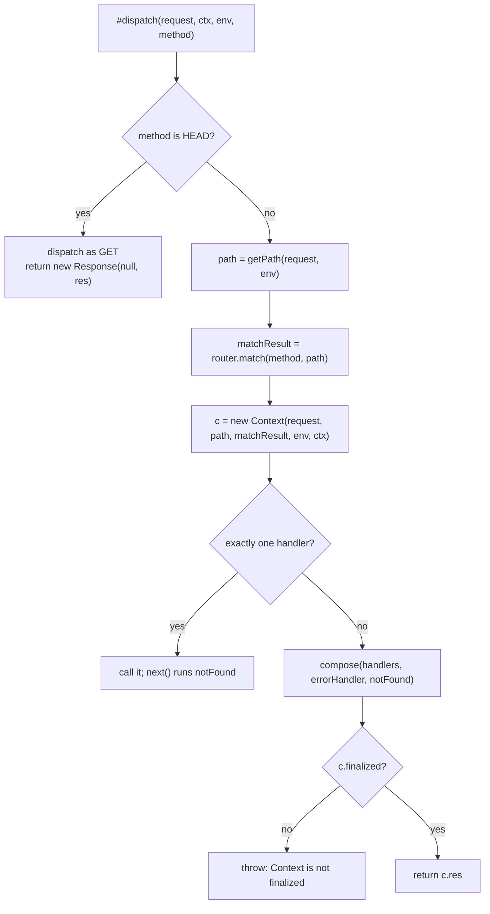

## Overview

The application object is where routes are registered and where every request enters. `HonoBase` in `src/hono-base.ts` holds all of the behaviour: the method functions, grouping, mounting and dispatch. It deliberately has no router of its own; the exported `Hono` class and the two presets subclass it only to choose one. This split lets `hono/tiny` ship without the `RegExpRouter` code while sharing everything else.

Sources: [src/hono-base.ts:98-125](repo://src/hono-base.ts#L98-L125), [src/hono.ts:16-34](repo://src/hono.ts#L16-L34)

| Class | Import | Router |
| --- | --- | --- |
| `Hono` | `hono` | `SmartRouter` over `RegExpRouter` then `TrieRouter`, or `options.router` |
| `Hono` | `hono/quick` | `SmartRouter` over `LinearRouter` then `TrieRouter` |
| `Hono` | `hono/tiny` | `PatternRouter` |
| `HonoBase` | `hono/hono-base` | none: a subclass must set `this.router` |

Sources: [src/hono.ts:26-33](repo://src/hono.ts#L26-L33), [src/preset/quick.ts:13-24](repo://src/preset/quick.ts#L13-L24), [src/preset/tiny.ts:11-19](repo://src/preset/tiny.ts#L11-L19)

The router algorithms are on [[Routing and Router Selection]]; how the matched handlers run is on [[Middleware Composition and Error Handling]].

Sources: [src/hono-base.ts:406-466](repo://src/hono-base.ts#L406-L466)

## Options

The constructor takes `HonoOptions`:

Sources: [src/hono-base.ts:126-126](repo://src/hono-base.ts#L126-L126)

| Option | Default | Effect |
| --- | --- | --- |
| `strict` | `true` | When `false`, a trailing slash is dropped before routing, so `/hello/` matches `/hello` |
| `router` | chosen by the subclass | Any object implementing `Router` |
| `getPath` | `getPath` from `utils/url` | Function that turns the `Request` (and env) into the routing path, for example to route on the `Host` header |

Sources: [src/hono-base.ts:46-87](repo://src/hono-base.ts#L46-L87)

The constructor copies every option except `strict` onto the instance, then sets `getPath`. With `strict: false` it always uses `getPathNoStrict`, which trims one trailing slash from the result of `getPath`.

Sources: [src/hono-base.ts:170-173](repo://src/hono-base.ts#L170-L173), [src/utils/url.ts:141-146](repo://src/utils/url.ts#L141-L146)

> [!WARNING]
> `strict: false` takes precedence over a custom `getPath`: the constructor picks `getPathNoStrict` and ignores `options.getPath`. To combine both, trim the slash inside your own `getPath`.

Sources: [src/hono-base.ts:170-173](repo://src/hono-base.ts#L170-L173)

The default `getPath` scans the URL from the first `/` after the scheme up to `?` or `#`. Only when it meets a `%` does it fall back to `indexOf` and decode the path with `decodeURI`, so unencoded paths, the common case, are sliced without decoding.

Sources: [src/utils/url.ts:106-134](repo://src/utils/url.ts#L106-L134)

## Registering routes

### Method functions

The constructor generates `get`, `post`, `put`, `delete`, `options`, `patch` and `all` from the `METHODS` list. Each accepts either a path followed by handlers, or handlers alone. The path is remembered in the private `#path` field, so a call without a path reuses the last one:

Sources: [src/hono-base.ts:130-135](repo://src/hono-base.ts#L130-L135)

```ts
app
  .get('/posts', listPosts)
  .post(createPost) // also /posts
```

Sources: [src/hono-base.ts:127-141](repo://src/hono-base.ts#L127-L141)

Every handler becomes its own route entry through `#addRoute`: the method is upper-cased, the path is joined to the app's base path with `mergePath`, and the router receives `[handler, routerRoute]`. The same `RouterRoute` record (method, path, basePath, handler) is pushed onto `app.routes`, which [[Routing and Router Selection]] uses for route inspection.

Sources: [src/hono-base.ts:385-397](repo://src/hono-base.ts#L385-L397)

### on and use

`on(method, path, ...handlers)` accepts a method or an array of methods (including custom ones such as `PURGE`) and a path or an array of paths, and registers every combination. `use` registers middleware under the method `ALL`; without a path it uses `*`.

Sources: [src/hono-base.ts:143-168](repo://src/hono-base.ts#L143-L168)

Because middleware and handlers are both just route entries, there is no separate middleware stack: the router returns them interleaved in registration order, and order of registration is the order of execution.

Sources: [src/hono-base.ts:156-168](repo://src/hono-base.ts#L156-L168), [src/router.ts:66-98](repo://src/router.ts#L66-L98)

## Grouping applications

### basePath

`basePath(path)` returns a clone that shares the parent's router, `routes` array, error handler and not-found handler, with `_basePath` extended by `mergePath`. Routes added to the clone go into the same router as the parent, prefixed with the new base.

Sources: [src/hono-base.ts:175-184](repo://src/hono-base.ts#L175-L184), [src/hono-base.ts:247-253](repo://src/hono-base.ts#L247-L253)

`mergePath` joins segments with exactly one slash between them and treats a sub-path of `/` as empty, so `mergePath('/api', '/')` is `/api`.

Sources: [src/utils/url.ts:158-169](repo://src/utils/url.ts#L158-L169)

### route

`route(path, subApp)` copies the sub-app's routes into this app under `path`. It takes a `basePath(path)` clone of this app and re-adds each of `subApp.routes` through it, keeping the sub-app's own base path in the route's `basePath` field.

Sources: [src/hono-base.ts:208-232](repo://src/hono-base.ts#L208-L232)

If the sub-app set its own `onError`, each copied handler is wrapped in `compose([], subApp.errorHandler)` so errors thrown inside the sub-app's routes reach the sub-app's handler, not the parent's. The original handler is kept under the `COMPOSED_HANDLER` symbol so route inspection can still name it.

Sources: [src/hono-base.ts:219-228](repo://src/hono-base.ts#L219-L228)

> [!IMPORTANT]
> `route` copies the routes that exist when it is called. Routes added to the sub-app afterwards are not seen by the parent, and the sub-app's `notFound` handler is not carried over: a miss inside the group answers with the parent's not-found handler.

Sources: [src/hono-base.ts:208-232](repo://src/hono-base.ts#L208-L232)

### mount

`mount(path, handler, options)` embeds an application written for another framework, as long as it is a function from `Request` to `Response`. It registers one `ALL` middleware on `path/*` that rewrites the request URL to strip the mount prefix, calls the foreign handler with `c.env` and the execution context, and returns its response. If the handler returns nothing, `next()` continues to later Hono routes.

Sources: [src/hono-base.ts:328-383](repo://src/hono-base.ts#L328-L383)

| Option | Effect |
| --- | --- |
| a function | `optionHandler`: its return value (or array) replaces `[env, executionCtx]` as the extra arguments |
| `optionHandler` | Same, as an object field |
| `replaceRequest` | Custom request rewriting; `false` passes the request unchanged |

Sources: [src/hono-base.ts:89-96](repo://src/hono-base.ts#L89-L96), [src/hono-base.ts:333-370](repo://src/hono-base.ts#L333-L370)

## Handling a request

### fetch and dispatch

`fetch(request, env, executionCtx)` is the entry point every runtime calls. It forwards to `#dispatch` with the request method.

Sources: [src/hono-base.ts:479-485](repo://src/hono-base.ts#L479-L485)



Sources: [src/hono-base.ts:406-466](repo://src/hono-base.ts#L406-L466)

A `HEAD` request is answered by dispatching the same request as `GET` and returning its status and headers with a null body, so no route needs a `HEAD` handler.

Sources: [src/hono-base.ts:412-416](repo://src/hono-base.ts#L412-L416)

On the single-handler path the result may be a `Response`, a promise, or nothing. An empty result falls back to `c.res` if the context was finalized, otherwise to the not-found handler. Errors, synchronous or rejected, go to `#handleError`, which calls the error handler only for `Error` instances and rethrows anything else.

Sources: [src/hono-base.ts:429-448](repo://src/hono-base.ts#L429-L448), [src/hono-base.ts:399-404](repo://src/hono-base.ts#L399-L404)

When the composed chain finishes without any handler setting a response, dispatch throws `Context is not finalized. Did you forget to return a Response object or await next()?`, which the error handler turns into a 500.

Sources: [src/hono-base.ts:450-465](repo://src/hono-base.ts#L450-L465)

### request and fire

`request(input, init, env, ctx)` is a test helper: it accepts a `Request`, a URL or a path. A string that is not an absolute `http(s)` URL is resolved against `http://localhost`.

Sources: [src/hono-base.ts:499-517](repo://src/hono-base.ts#L499-L517)

`fire()` registers a global `fetch` event listener for Service Worker style runtimes. It is deprecated in favour of `fire` from `hono/service-worker`, described on [[Runtime Adapters]].

Sources: [src/hono-base.ts:519-542](repo://src/hono-base.ts#L519-L542)

## Default handlers

The default not-found handler answers `404 Not Found` as text. The default error handler returns the error's own response if it has a `getResponse` method (as `HTTPException` does), and otherwise logs the error and answers `500 Internal Server Error`. `onError` and `notFound` replace them and return the app for chaining.

Sources: [src/hono-base.ts:31-42](repo://src/hono-base.ts#L31-L42), [src/hono-base.ts:271-294](repo://src/hono-base.ts#L271-L294)
