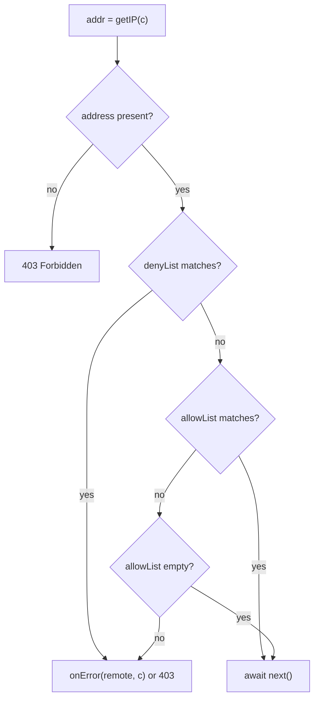

## Overview

A Web Standard `Request` carries no client address, so each runtime exposes it differently: Bun through its server object, Deno through the handler's second argument, Cloudflare through a header, AWS through the event. Hono hides that behind one function type, `GetConnInfo`, with one implementation per adapter. The `ipRestriction` middleware takes any of them, or any function returning an address string, and checks the address against allow and deny lists.

Sources: [src/helper/conninfo/types.ts:1-45](repo://src/helper/conninfo/types.ts#L1-L45), [src/middleware/ip-restriction/index.ts:23-23](repo://src/middleware/ip-restriction/index.ts#L23-L23)

```ts
import { getConnInfo } from 'hono/cloudflare-workers'
import { ipRestriction } from 'hono/ip-restriction'

app.use(
  '/admin/*',
  ipRestriction(getConnInfo, {
    denyList: ['192.168.1.13'],
    allowList: ['10.0.0.0/8', '::1'],
  })
)
```

Sources: [src/middleware/ip-restriction/index.ts:218-225](repo://src/middleware/ip-restriction/index.ts#L218-L225), [src/adapter/cloudflare-workers/conninfo.ts:1-7](repo://src/adapter/cloudflare-workers/conninfo.ts#L1-L7)

## Connection info

### The ConnInfo shape

`getConnInfo(c)` returns `{ remote }`, where `remote` may hold `address`, `addressType` (`IPv4`, `IPv6` or undefined), `port` and `transport` (`tcp` or `udp`). Every field is optional because not every runtime knows every value.

Sources: [src/helper/conninfo/types.ts:1-45](repo://src/helper/conninfo/types.ts#L1-L45)

### Per-runtime sources

| Import | Address comes from | Notes |
| --- | --- | --- |
| `hono/bun` | `server.requestIP(c.req.raw)` | Needs the Bun server as the app's env (`export default { fetch: app.fetch }` passes it); returns an empty `remote` for closed requests or Unix sockets; also sets type and port |
| `hono/deno` | `c.env.remoteAddr` | Pass the `Deno.serve` handler info as env; also sets port and transport |
| `hono/cloudflare-workers`, `hono/cloudflare-pages` | `cf-connecting-ip` header | |
| `hono/vercel` | `x-real-ip` header | |
| `hono/netlify` | `c.env.context.ip` | |
| `hono/lambda-edge` | `c.env.event.Records[0].cf.request.clientIp` | |
| `hono/aws-lambda` | `requestContext.identity.sourceIp` (API Gateway v1), `requestContext.http.sourceIp` (v2), else the last `X-Forwarded-For` entry (ALB) | |

Sources: [src/adapter/bun/conninfo.ts:10-43](repo://src/adapter/bun/conninfo.ts#L10-L43), [src/adapter/deno/conninfo.ts:8-17](repo://src/adapter/deno/conninfo.ts#L8-L17), [src/adapter/cloudflare-pages/conninfo.ts:22-26](repo://src/adapter/cloudflare-pages/conninfo.ts#L22-L26), [src/adapter/vercel/conninfo.ts:3-8](repo://src/adapter/vercel/conninfo.ts#L3-L8), [src/adapter/netlify/conninfo.ts:53-57](repo://src/adapter/netlify/conninfo.ts#L53-L57), [src/adapter/lambda-edge/conninfo.ts:11-15](repo://src/adapter/lambda-edge/conninfo.ts#L11-L15), [src/adapter/aws-lambda/conninfo.ts:45-73](repo://src/adapter/aws-lambda/conninfo.ts#L45-L73)

The Bun version throws a `TypeError` when the env does not contain the server or the server has no `requestIP`, which happens when `app.fetch` is called without its second argument. The header-based versions trust the header, so they are only safe where the platform sets it and clients cannot forge it.

Sources: [src/adapter/bun/conninfo.ts:19-24](repo://src/adapter/bun/conninfo.ts#L19-L24), [src/adapter/cloudflare-workers/conninfo.ts:3-7](repo://src/adapter/cloudflare-workers/conninfo.ts#L3-L7)

On ALB, the last `X-Forwarded-For` entry is used because the load balancer appends the address it saw; earlier entries come from the client and cannot be trusted.

Sources: [src/adapter/aws-lambda/conninfo.ts:58-66](repo://src/adapter/aws-lambda/conninfo.ts#L58-L66)

## ipRestriction

### Rules

`ipRestriction(getIP, { denyList, allowList }, onError?)` accepts these rule forms in either list:

Sources: [src/middleware/ip-restriction/index.ts:37-38](repo://src/middleware/ip-restriction/index.ts#L37-L38), [src/middleware/ip-restriction/index.ts:172-175](repo://src/middleware/ip-restriction/index.ts#L172-L175)

| Rule | Example | Matches |
| --- | --- | --- |
| `*` | `'*'` | Every address |
| IPv4 or IPv6 address | `'192.168.1.13'`, `'::1'` | That address, in either IPv4 or IPv4-mapped IPv6 form |
| CIDR | `'10.0.0.0/8'`, `'2001:db8::/32'` | Every address in the range |
| Function | `({ addr, type }) => boolean` | Whatever it returns true for |

Sources: [src/middleware/ip-restriction/index.ts:82-120](repo://src/middleware/ip-restriction/index.ts#L82-L120)

### Compiling rules

`buildMatcher` compiles a list once, at setup. Static addresses go into a string set (with both `a.b.c.d` and `::ffff:a.b.c.d` spellings) and into IPv4 and IPv6 sets of `bigint` values. A CIDR becomes `[isIPv4, network, mask]` with the network pre-masked. A `/32` or `/128` CIDR is treated as a static address, and an IPv4-mapped IPv6 CIDR with a prefix of 96 or more is converted to the equivalent IPv4 range. A malformed rule or prefix throws `TypeError: Invalid rule` at setup, not per request.

Sources: [src/middleware/ip-restriction/index.ts:40-120](repo://src/middleware/ip-restriction/index.ts#L40-L120)

The matcher checks the cheapest test first: the exact string, then the binary address in the static sets, then each CIDR, then the function rules. The binary form of the remote address is computed once and reused between the deny and allow matchers.

Sources: [src/middleware/ip-restriction/index.ts:122-167](repo://src/middleware/ip-restriction/index.ts#L122-L167)

### Deciding a request



Sources: [src/middleware/ip-restriction/index.ts:238-278](repo://src/middleware/ip-restriction/index.ts#L238-L278)

The deny list always wins. An empty allow list allows everything not denied, while a non-empty one allows only matches. The address type comes from `connInfo.remote.addressType` when the runtime reports it, and is otherwise guessed by `distinctRemoteAddr`: IPv4 if it matches the dotted pattern, IPv6 if it contains a colon.

Sources: [src/middleware/ip-restriction/index.ts:244-247](repo://src/middleware/ip-restriction/index.ts#L244-L247), [src/utils/ipaddr.ts:59-67](repo://src/utils/ipaddr.ts#L59-L67)

### Failures

The default rejection is an `HTTPException(403)` with a plain `Forbidden` body. `onError({ addr, type }, c)` can return a custom response instead. A missing address and an address that fails to parse are both rejected with 403, since an unknown client cannot be shown to be allowed. Other errors propagate to the app's error handler.

Sources: [src/middleware/ip-restriction/index.ts:231-236](repo://src/middleware/ip-restriction/index.ts#L231-L236), [src/middleware/ip-restriction/index.ts:249-268](repo://src/middleware/ip-restriction/index.ts#L249-L268)

## Address parsing

`utils/ipaddr` parses addresses into `bigint` values without regular expressions on the hot path. IPv4 parsing rejects octets above 255, missing octets and leading zeros, which some parsers read as octal. Parse errors are `TypeError`s tagged with `code: 'ERR_INVALID_IP_ADDRESS'`, which is how `ipRestriction` tells a bad client address from a bug. `isIPv4MappedIPv6` and `convertIPv4MappedIPv6ToIPv4` let a dual-stack server's `::ffff:10.0.0.1` match an IPv4 rule.

Sources: [src/utils/ipaddr.ts:41-157](repo://src/utils/ipaddr.ts#L41-L157), [src/utils/ipaddr.ts:313-320](repo://src/utils/ipaddr.ts#L313-L320)
