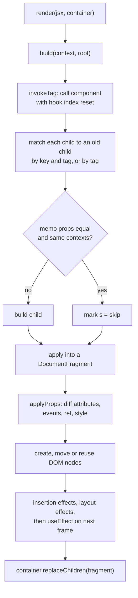

## Overview

`hono/jsx/dom` runs Hono JSX components in the browser. It keeps a tree of virtual nodes, renders it into real DOM nodes, and re-renders a component when its state changes, with a React-like hook API (`useState`, `useEffect`, `useTransition`, `use`, form actions and more). It is small enough to ship to the client next to a Hono server, and the same components can also render to HTML on the server with `hono/jsx` (see [[JSX Server Rendering]]). The `react`-style entry points let libraries written for React run on it.

Sources: [src/jsx/dom/render.ts:796-799](repo://src/jsx/dom/render.ts#L796-L799), [src/jsx/dom/index.ts:85-125](repo://src/jsx/dom/index.ts#L85-L125)

```tsx
/** @jsxImportSource hono/jsx/dom */
import { render, useState } from 'hono/jsx/dom'

const Counter = () => {
  const [count, setCount] = useState(0)
  return <button onClick={() => setCount(count + 1)}>{count}</button>
}

render(<Counter />, document.getElementById('root')!)
```

Sources: [src/jsx/dom/render.ts:783-799](repo://src/jsx/dom/render.ts#L783-L799), [src/jsx/hooks/index.ts:182-244](repo://src/jsx/hooks/index.ts#L182-L244)

## The node tree

### Node objects

`buildNode` turns each JSX child into a virtual node. Strings and numbers become `NodeString` objects (`t` for the text, `d` for dirty). Elements and components become `NodeObject`s: the JSX node plus fields with short names that keep the bundle small.

Sources: [src/jsx/dom/render.ts:667-704](repo://src/jsx/dom/render.ts#L667-L704), [src/jsx/dom/render.ts:41-80](repo://src/jsx/dom/render.ts#L41-L80)

| Field | Holds |
| --- | --- |
| `vC` | Current virtual children |
| `vR` | Children to remove on the next apply |
| `pP` | Props from the previous render, for diffing attributes |
| `nN` | The next sibling node, used to find the insertion point |
| `e` | The real DOM element or text node |
| `c` | The container the node renders into |
| `s` | Skip: reuse the previous result |
| `f` | Force a rebuild |
| `[DOM_STASH]` | Hook index, hook data, captured context values, nearest error boundary |

Sources: [src/jsx/dom/render.ts:41-65](repo://src/jsx/dom/render.ts#L41-L65)

`svg` and `math` elements get their namespace URI recorded, and their children are wrapped in a namespace context so descendants are created with `createElementNS`.

Sources: [src/jsx/dom/render.ts:24-29](repo://src/jsx/dom/render.ts#L24-L29), [src/jsx/dom/render.ts:685-700](repo://src/jsx/dom/render.ts#L685-L700)

### Build and apply

Rendering has two phases. `build` runs components and reconciles the virtual tree; `apply` writes the result to the DOM.

Sources: [src/jsx/dom/render.ts:497-608](repo://src/jsx/dom/render.ts#L497-L608), [src/jsx/dom/render.ts:609-665](repo://src/jsx/dom/render.ts#L609-L665), [src/jsx/dom/render.ts:364-481](repo://src/jsx/dom/render.ts#L364-L481)



Sources: [src/jsx/dom/render.ts:783-799](repo://src/jsx/dom/render.ts#L783-L799), [src/jsx/dom/render.ts:387-481](repo://src/jsx/dom/render.ts#L387-L481)

`invokeTag` resets the node's hook index, pushes `[context, node]` onto `buildDataStack` so hooks know which component is running, merges `defaultProps`, and calls the component (or its `DOM_RENDERER` override). `build` then flattens the returned children, and for each one finds the old child with the same key and tag (or, without a key, the first with the same tag), takes over its DOM element, and records the previous props. A child whose `memo` comparison says the props are equal and whose context values are unchanged is marked to skip. Unmatched old children go to `vR` for removal.

Sources: [src/jsx/dom/render.ts:274-291](repo://src/jsx/dom/render.ts#L274-L291), [src/jsx/dom/render.ts:497-608](repo://src/jsx/dom/render.ts#L497-L608)

`applyNodeObject` removes nodes in `vR`, then walks the flattened list of next children. It reuses or creates each element, applies props, recurses, and moves an element only when it is not already at its position; a swapped neighbour is appended to the end instead of re-inserting both. Function components and fragments add no DOM node of their own, so their children are flattened into the parent's list.

Sources: [src/jsx/dom/render.ts:293-332](repo://src/jsx/dom/render.ts#L293-L332), [src/jsx/dom/render.ts:387-454](repo://src/jsx/dom/render.ts#L387-L454)

### Attributes and events

`applyProps` only touches props that changed since `pP`. `on*` props become `addEventListener` calls, with a `Capture` suffix for the capture phase, and the old listener is removed first. `ref` accepts an object or a callback, and a callback may return a cleanup. `style` accepts a string or an object, and `dangerouslySetInnerHTML` sets `innerHTML`. A `<select>`'s `value` is applied after its options exist.

Sources: [src/jsx/dom/render.ts:115-133](repo://src/jsx/dom/render.ts#L115-L133), [src/jsx/dom/render.ts:144-200](repo://src/jsx/dom/render.ts#L144-L200)

## Updates

### Scheduling

A state change calls `update(context, node)` for the component that owns the state. Updates are batched: the actual work runs after a microtask, and when the same node is updated again before then, only the last call runs and earlier promises resolve to `undefined`. `flushSync(cb)` runs the updates queued inside `cb` immediately.

Sources: [src/jsx/dom/render.ts:734-781](repo://src/jsx/dom/render.ts#L734-L781), [src/jsx/dom/render.ts:801-813](repo://src/jsx/dom/render.ts#L801-L813)

`updateSync` restores the context values captured when the node was last built, rebuilds only that component's subtree, and applies it in place. Low-priority renders from `startTransition` that hit an error are not applied.

Sources: [src/jsx/dom/render.ts:713-732](repo://src/jsx/dom/render.ts#L713-L732)

### Errors

When a component throws, `build` looks up the nearest `ErrorBoundary` recorded in the node's stash and calls its handler with the error and a retry function. If the handler returns a fallback, the boundary is rebuilt with it and applied at once; the internal `cancelBuild` signal stops the rest of the failed build. A thrown promise (from `use()`) is handled the same way by `Suspense`, which shows its fallback and retries when the promise settles.

Sources: [src/jsx/dom/render.ts:609-665](repo://src/jsx/dom/render.ts#L609-L665), [src/jsx/dom/components.ts:1-39](repo://src/jsx/dom/components.ts#L1-L39)

## Hooks

### Hook storage

Each hook reads the current component from the top of `buildDataStack` and stores its data in the node's stash, in a per-kind array indexed by call order. Hooks must therefore be called in the same order on every render. Called outside a browser render, for example during server rendering, most hooks return their initial value and do nothing, which is what lets one component run in both places.

Sources: [src/jsx/hooks/index.ts:8-12](repo://src/jsx/hooks/index.ts#L8-L12), [src/jsx/hooks/index.ts:182-196](repo://src/jsx/hooks/index.ts#L182-L196)

| Hook | Behaviour |
| --- | --- |
| `useState`, `useReducer` | Setter compares with `Object.is` and schedules an update only on change |
| `useEffect` | Runs after the DOM is applied, on the next animation frame |
| `useLayoutEffect` | Runs synchronously after apply |
| `useInsertionEffect` | Runs before layout effects |
| `useMemo`, `useCallback` | Recompute when dependencies change |
| `useRef`, `createRef`, `forwardRef`, `useImperativeHandle` | Refs to DOM nodes or values |
| `useId` | A per-component id such as `:r1:` |
| `useSyncExternalStore` | Subscribes to an external store |
| `use(promise)` | Returns the resolved value, or throws the promise for `Suspense` |

Sources: [src/jsx/hooks/index.ts:182-259](repo://src/jsx/hooks/index.ts#L182-L259), [src/jsx/hooks/index.ts:299-347](repo://src/jsx/hooks/index.ts#L299-L347), [src/jsx/hooks/index.ts:348-425](repo://src/jsx/hooks/index.ts#L348-L425), [src/jsx/dom/render.ts:456-480](repo://src/jsx/dom/render.ts#L456-L480)

Effects run when their dependencies change; the previous cleanup runs first.

Sources: [src/jsx/hooks/index.ts:260-297](repo://src/jsx/hooks/index.ts#L260-L297)

`use` caches the outcome of each promise in a `WeakMap`, so the retry after Suspense gets the value synchronously, and a rejected promise rethrows its error to the nearest `ErrorBoundary`.

Sources: [src/jsx/hooks/index.ts:332-347](repo://src/jsx/hooks/index.ts#L332-L347)

### Transitions

`startTransition(cb)` and the setter from `useTransition()` run `cb` with a pending marker on `pendingStack`. State updates made inside it are scheduled at low priority, and the component that called `useTransition` sees `isPending` as true until the callback, which may be async, settles. Errors from an async transition are rethrown during the next render so an `ErrorBoundary` catches them. `useDeferredValue` and `useViewTransition`/`startViewTransition` build on the same mechanism; the latter wraps the update in `document.startViewTransition` where the browser supports it.

Sources: [src/jsx/hooks/index.ts:102-156](repo://src/jsx/hooks/index.ts#L102-L156), [src/jsx/hooks/index.ts:43-100](repo://src/jsx/hooks/index.ts#L43-L100)

### Form actions

A `<form action={fn}>` in the DOM runtime intercepts `submit`. It prevents the default, builds `FormData`, calls the action, and registers the returned promise. While it runs, descendants read `useFormStatus()` (`pending`, `data`, `method`, `action`) from `FormContext`. `useActionState(fn, initial)` keeps the action's last result as state. `useOptimistic(state, reducer)` shows a provisional value until all registered actions settle.

Sources: [src/jsx/dom/intrinsic-element/components.ts:319-386](repo://src/jsx/dom/intrinsic-element/components.ts#L319-L386), [src/jsx/dom/hooks/index.ts:1-91](repo://src/jsx/dom/hooks/index.ts#L1-L91)

## Entry points and React compatibility

| Import | Provides |
| --- | --- |
| `hono/jsx/dom` | `render`, the hooks, `Suspense`, `ErrorBoundary`, `createContext`, `memo`, `createElement`, `createPortal`, `flushSync`, a default export shaped like `react` |
| `hono/jsx/dom/client` | `createRoot(el).render(...)`, `unmount()` and `hydrateRoot`, shaped like `react-dom/client` |
| `hono/jsx/dom/server` | `renderToString` and `renderToReadableStream` over the server renderer |
| `hono/jsx/dom/jsx-runtime` | The automatic JSX runtime for `jsxImportSource: 'hono/jsx/dom'` |

Sources: [src/jsx/dom/index.ts:85-169](repo://src/jsx/dom/index.ts#L85-L169), [src/jsx/dom/client.ts:11-89](repo://src/jsx/dom/client.ts#L11-L89), [src/jsx/dom/server.ts:11-70](repo://src/jsx/dom/server.ts#L11-L70), [src/jsx/dom/jsx-runtime.ts:1-8](repo://src/jsx/dom/jsx-runtime.ts#L1-L8)

`createRoot` renders a wrapper component that holds the tree in `useState`, so a second `render` call updates it in place. `hydrateRoot` renders into the element rather than reusing server-rendered nodes, and options are not supported yet. `createPortal(children, container)` renders children into another element, which `apply` skips when computing positions in the parent.

Sources: [src/jsx/dom/client.ts:23-84](repo://src/jsx/dom/client.ts#L23-L84), [src/jsx/dom/render.ts:815-825](repo://src/jsx/dom/render.ts#L815-L825), [src/jsx/dom/render.ts:440-442](repo://src/jsx/dom/render.ts#L440-L442)

To use React libraries, alias `react` and `react-dom` to `hono/jsx/dom` in the bundler. In the DOM runtime, `memo` only marks a component with its comparison function; `build` decides whether to skip it.

Sources: [src/jsx/dom/index.ts:40-84](repo://src/jsx/dom/index.ts#L40-L84), [src/jsx/dom/render.ts:572-581](repo://src/jsx/dom/render.ts#L572-L581)
