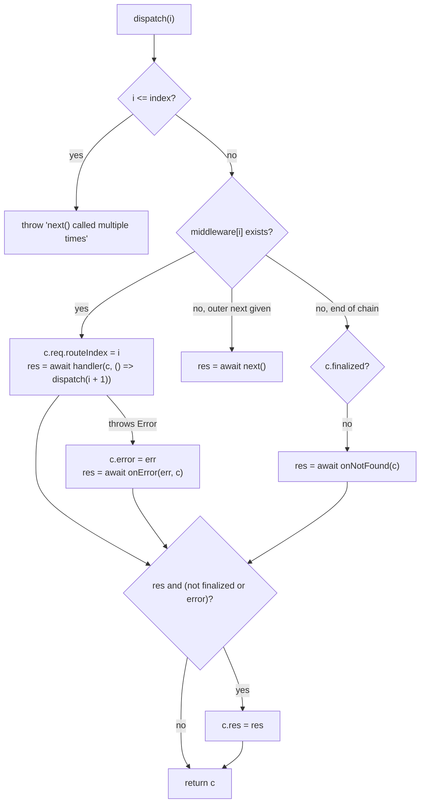

## Overview

When a request matches more than one handler, Hono runs them as an onion: each middleware does its work, calls `await next()` to run everything registered after it, and can then inspect or replace the response on the way out. `compose` in `src/compose.ts`, adapted from `koa-compose`, builds that chain from the router's match result. It also turns thrown errors into responses through the app's error handler and fills in a not-found response when the chain ends without one.

Sources: [src/compose.ts:4-19](repo://src/compose.ts#L4-L19)

[[Hono Application]] shows where dispatch calls `compose`; this page covers what happens inside it, how errors become responses, and the helpers for writing and combining middleware.

Sources: [src/hono-base.ts:450-465](repo://src/hono-base.ts#L450-L465)

## The chain

`compose(middleware, onError, onNotFound)` returns a function of `(context, next)`. Each call keeps its own `index` and starts `dispatch(0)`.

Sources: [src/compose.ts:15-23](repo://src/compose.ts#L15-L23)



Sources: [src/compose.ts:32-71](repo://src/compose.ts#L32-L71)

Each step of that flow keeps one of the chain's guarantees:

Sources: [src/compose.ts:32-36](repo://src/compose.ts#L32-L36)

- **`next()` runs once.** A second call from the same middleware has `i <= index` and throws `next() called multiple times`.
- **`c.req.routeIndex` tracks the running handler.** Helpers such as `routePath(c)` read it to know which route is executing.
- **A returned response wins only if none is set yet.** A handler's return value is assigned to `c.res` only while the context is not finalized. A middleware that wants to change the response after `next()` assigns `c.res` directly instead of returning.
- **Errors replace the response.** After `onError` runs, its response is assigned even if an earlier response had finalized the context.
- **The end of the chain is not-found.** When every handler called `next()` and nobody produced a response, `onNotFound` provides one.

Sources: [src/compose.ts:32-71](repo://src/compose.ts#L32-L71)

When a middleware assigns `c.res` after `next()`, the context's `res` setter copies every header of the previous response onto the new one except `Content-Type`, and appends rather than overwrites `Set-Cookie`. Headers such as CORS or security headers set before `next()` therefore survive a later middleware that rebuilds the response. [[Context and Responses]] covers the setter in full.

Sources: [src/context.ts:414-434](repo://src/context.ts#L414-L434)

## The single-handler path

A route with exactly one matched handler skips `compose`. Dispatch calls the handler with a `next` that sets `c.res` to the not-found response, and accepts a returned `Response`, a promise, or nothing. An empty result uses `c.res` if the handler finalized the context and the not-found handler otherwise. This keeps the per-request cost of a simple app to one function call while giving the same answer as the full chain.

Sources: [src/hono-base.ts:429-448](repo://src/hono-base.ts#L429-L448)

If the composed chain ends with `c.finalized` still false, dispatch throws `Context is not finalized. Did you forget to return a Response object or await next()?`. The usual causes are a handler that builds a response without returning it, or a middleware that calls `next()` without awaiting it.

Sources: [src/hono-base.ts:450-465](repo://src/hono-base.ts#L450-L465)

## Errors

### Where errors go

An `Error` thrown inside the chain is caught in `dispatch`, stored on `c.error`, and passed to `onError(err, c)`. A thrown value that is not an `Error` instance is rethrown, so it escapes `app.fetch` and reaches the runtime. Middleware that runs after `next()` can read `c.error` to log a failure that was already turned into a response.

Sources: [src/compose.ts:49-60](repo://src/compose.ts#L49-L60), [src/hono-base.ts:399-404](repo://src/hono-base.ts#L399-L404)

The default error handler checks for a `getResponse` method: errors that carry their own response return it, everything else is logged with `console.error` and answered with `500 Internal Server Error`. `app.onError(handler)` replaces it, and a sub-app's handler stays in force for its own routes after `app.route` (see [[Hono Application]]).

Sources: [src/hono-base.ts:35-42](repo://src/hono-base.ts#L35-L42), [src/hono-base.ts:219-228](repo://src/hono-base.ts#L219-L228)

### HTTPException

`HTTPException` from `hono/http-exception` is the error middleware throws to stop a request with a specific status, such as a 401 from an authentication check. Its constructor takes a status (500 by default) and options `res`, `message` and `cause`.

Sources: [src/http-exception.ts:14-59](repo://src/http-exception.ts#L14-L59)

`getResponse()` builds the response the default error handler returns. With `res` set, it copies that response's body and headers but uses the exception's status. Without it, the body is the message as plain text.

Sources: [src/http-exception.ts:66-77](repo://src/http-exception.ts#L66-L77)

```ts
import { HTTPException } from 'hono/http-exception'

app.onError((err, c) => {
  if (err instanceof HTTPException) {
    return err.getResponse()
  }
  return c.text('Something went wrong', 500)
})
```

Sources: [src/http-exception.ts:46-78](repo://src/http-exception.ts#L46-L78)

The built-in authentication middleware ([[Basic and Bearer Authentication]], [[JWT and JWK]]) throw `HTTPException` with a prepared `res` that carries the `WWW-Authenticate` header, so a custom `onError` should return `err.getResponse()` to keep it.

Sources: [src/http-exception.ts:66-73](repo://src/http-exception.ts#L66-L73)

## Writing middleware

### createMiddleware and the factory

A middleware is any function `(c, next) => Promise<Response | void>`. `createMiddleware` from `hono/factory` returns its argument unchanged; it exists so TypeScript infers the `Env` (for example the `Variables` the middleware sets) and any response type.

Sources: [src/helper/factory/index.ts:368-375](repo://src/helper/factory/index.ts#L368-L375)

```ts
import { createMiddleware } from 'hono/factory'

const auth = createMiddleware<{ Variables: { user: string } }>(async (c, next) => {
  c.set('user', 'alice')
  await next()
  c.header('X-User', c.get('user'))
})
```

Sources: [src/helper/factory/index.ts:368-375](repo://src/helper/factory/index.ts#L368-L375)

`createFactory({ initApp, defaultAppOptions })` returns a `Factory` bound to one `Env`. Its `createApp` builds a `Hono` with the default options merged under the given ones and runs `initApp` on it, which suits apps that must register the same middleware everywhere. `createMiddleware` and `createHandlers` on the factory carry the factory's `Env` into each handler, and `createHandlers` drops `undefined` entries so handlers can be defined apart from the route call without losing type inference.

Sources: [src/helper/factory/index.ts:332-366](repo://src/helper/factory/index.ts#L332-L366)

### Combining middleware

`hono/combine` builds one middleware out of several. Each accepts middleware or plain conditions `(c) => boolean`.

Sources: [src/middleware/combine/index.ts:12-13](repo://src/middleware/combine/index.ts#L12-L13)

| Function | Runs | Succeeds when |
| --- | --- | --- |
| `some(...m)` | Each in turn until one succeeds | The first that does not throw or return `false`; a condition returning `true` continues to `next()` |
| `every(...m)` | All, composed as a chain | All succeed; a condition returning `false` throws `Unmet condition` |
| `except(cond, ...m)` | `every(...m)` unless a condition matches | A path string or function in `cond` matches, which skips the middleware |

Sources: [src/middleware/combine/index.ts:38-69](repo://src/middleware/combine/index.ts#L38-L69), [src/middleware/combine/index.ts:99-117](repo://src/middleware/combine/index.ts#L99-L117), [src/middleware/combine/index.ts:141-165](repo://src/middleware/combine/index.ts#L141-L165)

`some` remembers the last error and rethrows it when nothing succeeded. If a middleware throws after it already called `next()`, `some` stops there instead of trying the next one, so the downstream handlers never run twice. `every` saves `c.req.routeIndex` and restores it inside each wrapped middleware, since its inner `compose` would otherwise overwrite the index of the outer route.

Sources: [src/middleware/combine/index.ts:38-69](repo://src/middleware/combine/index.ts#L38-L69), [src/middleware/combine/index.ts:99-117](repo://src/middleware/combine/index.ts#L99-L117)

`except` turns string conditions into routes on a private `TrieRouter`, so the paths use the same syntax as app routes, and becomes `some(anyConditionMatches, every(...middleware))`:

Sources: [src/middleware/combine/index.ts:145-161](repo://src/middleware/combine/index.ts#L145-L161)

```ts
import { except } from 'hono/combine'
import { bearerAuth } from 'hono/bearer-auth'

app.use('/api/*', except('/api/public/*', bearerAuth({ token })))
```

Sources: [src/middleware/combine/index.ts:141-165](repo://src/middleware/combine/index.ts#L141-L165)
