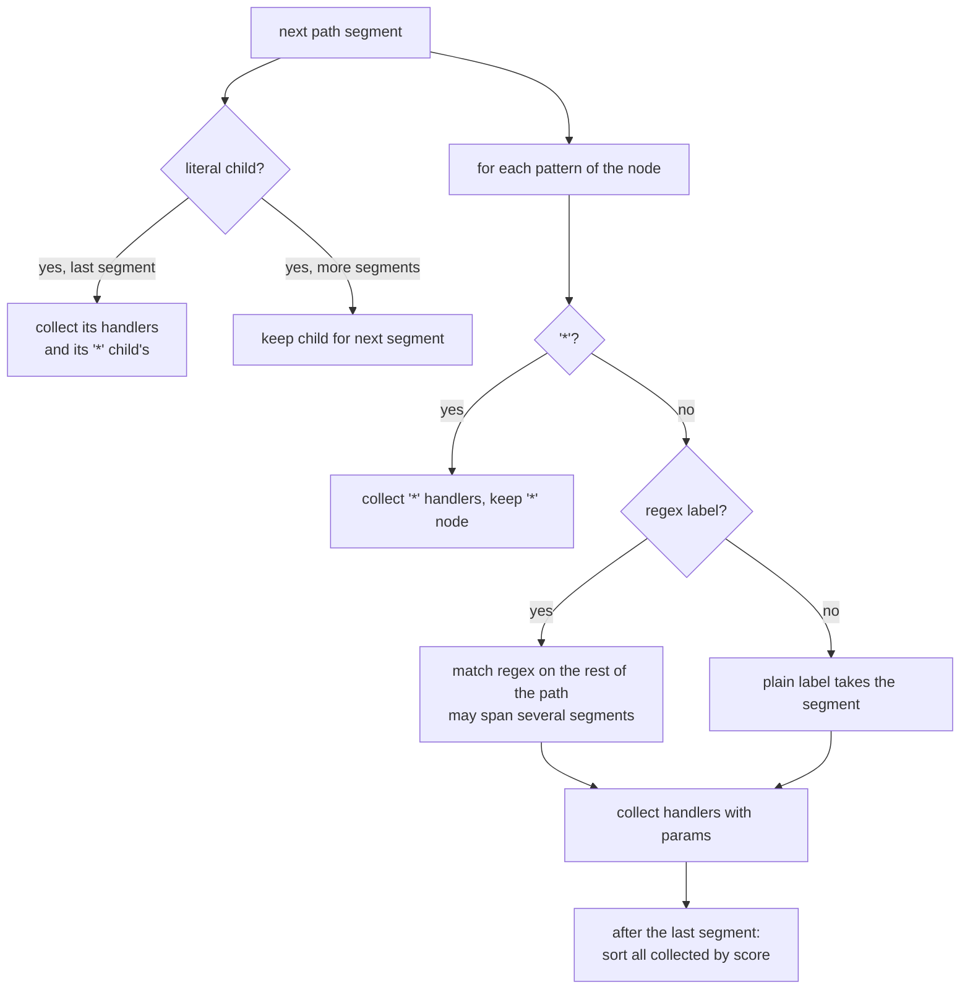

## Overview

Besides [[RegExpRouter]], Hono ships three routers that implement the same `Router` interface with different trade-offs. `TrieRouter` handles every pattern and is the fallback of both `SmartRouter` configurations. `LinearRouter` has no build step and powers `hono/quick`. `PatternRouter` is the smallest and powers `hono/tiny`. All three return parameters as plain objects, the `[[handler, params][]]` form of `Result` described on [[Routing and Router Selection]].

Sources: [src/hono.ts:28-32](repo://src/hono.ts#L28-L32), [src/preset/quick.ts:20-22](repo://src/preset/quick.ts#L20-L22), [src/preset/tiny.ts:18-18](repo://src/preset/tiny.ts#L18-L18)

| Router | Build step | Per-request work | Rejects |
| --- | --- | --- | --- |
| `TrieRouter` | Inserts into a tree on `add` | Walks the tree segment by segment, then sorts matches | nothing |
| `LinearRouter` | None: `add` appends to an array | Scans every route with string operations | a path with both `:label` and `*` |
| `PatternRouter` | One `RegExp` per route on `add` | Runs every route's `RegExp` | patterns that are not valid regular expressions |

Sources: [src/router/trie-router/router.ts:5-28](repo://src/router/trie-router/router.ts#L5-L28), [src/router/linear-router/router.ts:11-23](repo://src/router/linear-router/router.ts#L11-L23), [src/router/linear-router/router.ts:136-138](repo://src/router/linear-router/router.ts#L136-L138), [src/router/pattern-router/router.ts:33-41](repo://src/router/pattern-router/router.ts#L33-L41)

## TrieRouter

### Building the tree

`TrieRouter.add` expands optional parameters with `checkOptionalParameter` and inserts each variant into a root `Node`. `Node.insert` splits the route with `splitRoutingPath` and walks or creates one child per segment. A child's key is the literal segment, or for a pattern the key `getPattern` returns (the label, or the label plus the next segment for a regex with lookahead). Pattern segments are also pushed onto the parent's `#patterns` list, which is what the search iterates for dynamic children.

Sources: [src/router/trie-router/router.ts:13-23](repo://src/router/trie-router/router.ts#L13-L23), [src/router/trie-router/node.ts:44-74](repo://src/router/trie-router/node.ts#L44-L74)

At the end node, the handler is stored per method together with the parameter names seen along the way (`possibleKeys`) and a `score`: the root's insertion counter. The score is the registration order, used later to put the matched handlers back in the order the app registered them.

Sources: [src/router/trie-router/node.ts:44-46](repo://src/router/trie-router/node.ts#L44-L46), [src/router/trie-router/node.ts:76-85](repo://src/router/trie-router/node.ts#L76-L85)

### Searching

`search` walks the request path one segment at a time while keeping a set of current nodes, because several branches can match at once: a literal child, a `:label` child and a `*` child of the same node.

Sources: [src/router/trie-router/node.ts:114-131](repo://src/router/trie-router/node.ts#L114-L131)

Sources: [src/router/trie-router/node.ts:127-244](repo://src/router/trie-router/node.ts#L127-L244)

Three details make the tree match the shared path semantics:

Sources: [src/router/trie-router/node.ts:87-112](repo://src/router/trie-router/node.ts#L87-L112)

- **A trailing `*` matches the parent path.** When the last segment hits a literal node that has a `*` child, the `*` handlers are collected too, so `/hello/*` matches `/hello`.
- **Regex labels may cross slashes.** A `:name{re}` pattern is executed against the rest of the path, not the segment, using precomputed segment offsets. When the match covers several segments, the child is queued in `curNodesQueue` at the number of extra segments it consumed and resumes from there. This is how `/js/:file{[a-z0-9/]+.js}` captures `chunk/123.js`.
- **Parameters are per handler.** `#pushHandlerSets` fills each handler's `params` from its own `possibleKeys`, so a middleware sees only the parameters its pattern declares.

Sources: [src/router/trie-router/node.ts:136-147](repo://src/router/trie-router/node.ts#L136-L147), [src/router/trie-router/node.ts:173-209](repo://src/router/trie-router/node.ts#L173-L209), [src/router/trie-router/node.ts:87-112](repo://src/router/trie-router/node.ts#L87-L112)

Collected handler sets are sorted by `score` when there is more than one, restoring registration order across branches before the result is returned.

Sources: [src/router/trie-router/node.ts:237-243](repo://src/router/trie-router/node.ts#L237-L243)

`TrieRouter` never throws `UnsupportedPathError` and accepts routes after matching has started, which is why it is the last candidate in both `SmartRouter` lists. It is also used outside routing, for example by `except` in `hono/combine` to test paths (see [[Middleware Composition and Error Handling]]).

Sources: [src/router/trie-router/router.ts:5-28](repo://src/router/trie-router/router.ts#L5-L28), [src/middleware/combine/index.ts:145-159](repo://src/middleware/combine/index.ts#L145-L159)

## LinearRouter

`LinearRouter` stores `[method, path, handler]` triples and does all the work in `match`, so adding routes is nearly free. That suits environments where the app is rebuilt for each request or each cold start and serves few requests per instance.

Sources: [src/router/linear-router/router.ts:11-23](repo://src/router/linear-router/router.ts#L11-L23)

For every route of the right method (or `ALL`), `match` picks a strategy by the shape of the route path:

Sources: [src/router/linear-router/router.ts:25-36](repo://src/router/linear-router/router.ts#L25-L36)

| Route shape | Strategy |
| --- | --- |
| `*` or `/*` | Always matches |
| Static | Equal to the path, or to the path minus one trailing slash |
| Wildcards only | Splits on `*` and checks each piece appears at the expected position, each `*` consuming up to the next `/` |
| Labels only | Splits with `splitPathRe`; a plain label takes the segment, a `:label{re}` label runs its regex with the `d` flag on the rest of the path, with a lookahead for the next literal |
| Labels and wildcards | Throws `UnsupportedPathError` |

Sources: [src/router/linear-router/router.ts:30-138](repo://src/router/linear-router/router.ts#L30-L138)

In `hono/quick`, an app with a route mixing a label and a wildcard therefore switches to `TrieRouter` at its first request.

Sources: [src/preset/quick.ts:20-22](repo://src/preset/quick.ts#L20-L22), [src/router/linear-router/router.ts:41-69](repo://src/router/linear-router/router.ts#L41-L69)

## PatternRouter

`PatternRouter` compiles each route into its own regular expression when it is added and stores `[regexp, method, handler]`. Labels become named groups `(?<name>[^/]+)` or `(?<name>custom)`, literal text is escaped, an inner `/*` becomes `/[^/]+`, and a trailing `/*` is cut so the expression is left open-ended. A trailing optional parameter registers the route a second time without its last segment.

Sources: [src/router/pattern-router/router.ts:12-42](repo://src/router/pattern-router/router.ts#L12-L42)

`match` runs every expression of the right method and uses `match.groups` as the parameters. No parameter is decoded here; [[Reading Requests]] decodes them on access. A custom pattern that is not a valid regular expression makes the `RegExp` constructor throw, which is reported as `UnsupportedPathError`.

Sources: [src/router/pattern-router/router.ts:44-59](repo://src/router/pattern-router/router.ts#L44-L59)

## Trailing slashes

> [!WARNING]
> `LinearRouter` and `PatternRouter` accept one trailing slash on any route (`routePath + '/' === path`, and `/?$` at the end of each expression). In `hono/quick` and `hono/tiny`, `GET /hello` therefore answers `/hello/` even with the default `strict: true`, whereas the default `Hono` answers 404. If the distinction matters, use the default `Hono` or the `trailingSlash` middleware described on [[Body Limit, Timeout and Request Rewriting]].

Sources: [src/router/linear-router/router.ts:37-40](repo://src/router/linear-router/router.ts#L37-L40), [src/router/linear-router/router.ts:125-132](repo://src/router/linear-router/router.ts#L125-L132), [src/router/pattern-router/router.ts:33-38](repo://src/router/pattern-router/router.ts#L33-L38)
